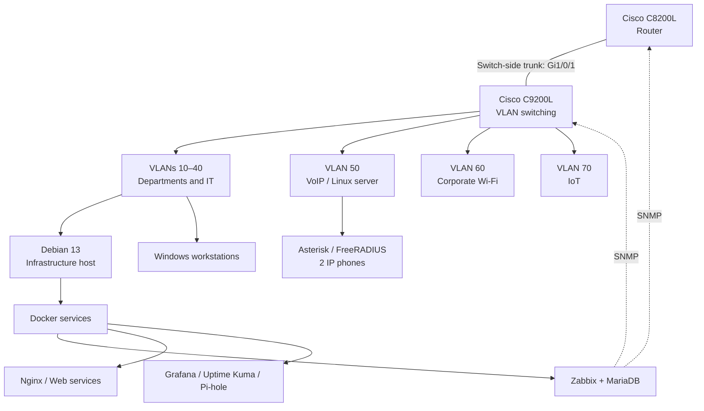

> **A real physical laboratory in a fictional company — from network rack to infrastructure monitoring.**

**Networking**  
  

**Linux & Containers**  
   

**Infrastructure & Monitoring**  
     

---

## Project overview

**Enterprise NOC — From Scratch** is my first project in **Network Administration**. It documents a physical corporate-style laboratory that brings together Cisco networking, Debian Linux infrastructure, containerized services, IP telephony, and monitoring through Zabbix and Grafana.

**Tapajós Inovações** is the fictional company used to organize the business scenario; the network equipment, workstations and historical technical evidence come from a real laboratory. This repository contains the technical record, while the [bilingual public portal](https://kayo-willian.github.io/enterprise-noc-from-scratch/) presents a visual tour of the environment.

### Laboratory at a glance

| Indicator | Recorded scope |
| --- | --- |
| **7 VLANs** | Cisco C9200L switch configuration |
| **12 hosts** | Registered in Zabbix |
| **1,820 monitoring items** | Zabbix system snapshot; 113 unsupported |
| **10 containers** | Running in the dated Docker inventory |
| **2 IP phones** | Grandstream devices |
| **25 images** | Curated evidence in the public portal gallery |
| **52 questions** | Bilingual technical FAQ |

*Network capture: November 4, 2026. Infrastructure and monitoring evidence: November 6, 2026. These are **historical counts**, not live metrics.*

## Network and service architecture

The diagram summarizes **documented logical associations**, not verified end-to-end traffic. The switch-side trunk is recorded on `Gi1/0/1`; a complete C8200L running configuration, inter-VLAN policy tests and every wireless configuration were not captured. See the [consolidated logical topology](docs/networking/consolidated-logical-topology.md) and [VLAN inventory](docs/networking/vlans.md).

## Evidence from the laboratory

<table>
<tr>
<td width="50%" align="center"> <strong>Cisco equipment</strong></td>
<td width="50%" align="center"> <strong>Zabbix</strong></td>
</tr>
<tr>
<td width="50%" align="center"> <strong>Grafana</strong></td>
<td width="50%" align="center"> <strong>Portainer</strong></td>
</tr>
</table>

The equipment photo is a **close-up**, rather than the wider rack overview. The dashboard and Portainer images are dated observations. [Explore the evidence on the corporate portal](https://kayo-willian.github.io/enterprise-noc-from-scratch/#evidence).

## Implementation and verification status

| Area | Recorded state | Evidence boundary |
| --- | --- | --- |
| Cisco networking and seven VLANs | **Configured / documented** | Switch VLAN and trunk records; router policy not fully verified |
| Debian host and Docker services | **Running at capture time** | Ten containers; no continuous-uptime guarantee |
| Zabbix, Grafana and SNMP | **Implemented with partial coverage** | 7 available and 5 unavailable hosts; 113 unsupported items in Zabbix |
| VoIP and FreeRADIUS | **Partially evidenced** | Linux service, two phones; completed calls/RADIUS authentication not independently established |
| Corporate Wi-Fi and IoT | **Partially evidenced** | Two devices and associated switch ports; client behavior not established |
| Cross-VLAN access, production TLS and database restore | **Not fully tested / not evidenced** | Public configurations do not establish these operational results |

**Engineering approach:** recording a configuration is different from proving a service works. The [monitoring findings](docs/monitoring/zabbix-monitoring.md), [networking evidence](docs/networking/README.md) and [NOC runbooks](docs/noc-operations/incident-management.md) maintain that distinction.

## Real troubleshooting case: Cisco SNMP

**November 4, 2026 · Catalyst C9200L · Zabbix / SNMPv2c**

| Stage | Documented outcome |
| --- | --- |
| **Symptom** | The switch's SNMP interface remained unavailable in Zabbix, preventing metric collection. |
| **Investigation** | IP reachability, Linux SNMP queries, switch configuration and inherited Zabbix host settings were compared. |
| **Cause** | The inherited SNMP community did not match the value configured on the switch. |
| **Correction** | The host-level `{$SNMP_COMMUNITY}` macro was aligned and the Zabbix configuration cache reloaded. |
| **Result** | The SNMP interface became available; collection and interface discovery resumed in the recorded case. |

This is a **historical troubleshooting outcome**, not a fresh test or evidence that later monitoring gaps were resolved. [Full SNMP investigation](docs/monitoring/snmp-troubleshooting.md).

## My work and technical experience

I participated in the physical laboratory's infrastructure activities and built a structured technical record around the work: the network topology and inventories, Linux/container dependencies, monitoring evidence, NOC incident procedures, infrastructure costs and the bilingual portal. The repository makes it possible to inspect **what was configured, what was observed and what remains unverified**.

| Practice area | Technologies and methods |
| --- | --- |
| **Networking** | Cisco switching, VLAN segmentation, trunk/access ports, topology and addressing analysis |
| **Systems and services** | Debian, Docker Compose, Nginx, MariaDB, Pi-hole, Asterisk and FreeRADIUS |
| **Monitoring** | Zabbix, SNMP, agents, Grafana, service checks and troubleshooting |
| **Operations** | Evidence collection, runbooks, incident reasoning and bilingual technical documentation |

## Technical documentation

| Area | Start here | Detailed records |
| --- | --- | --- |
| **Network & architecture** | [Networking overview](docs/networking/README.md) | [Topology](docs/networking/consolidated-logical-topology.md) · [VLANs](docs/networking/vlans.md) · [Router](docs/networking/router-c8200l.md) |
| **Physical equipment** | [Rack and cabling](docs/evidence/physical-infrastructure.md) | [Inventory](docs/endpoints/workstation-inventory.md) · [Evidence log](docs/evidence/evidence-collection-2026-11-06.md) |
| **Linux & Docker** | [Container infrastructure](docs/containers/docker-services.md) | [Compose](docker_configs/docker-compose.yml) · [Nginx](docs/services/nginx-reverse-proxy/README.md) · [MariaDB](docs/services/mariadb-zabbix/README.md) |
| **Monitoring** | [Zabbix](docs/monitoring/zabbix-monitoring.md) | [Grafana](docs/monitoring/grafana-monitoring.md) · [SNMP diagnosis](docs/monitoring/snmp-troubleshooting.md) |
| **Infrastructure services** | [DNS & availability](docs/services/dns-and-availability.md) | [Asterisk / FreeRADIUS](docs/services/asterisk-freeradius.md) |
| **NOC operations** | [Incident management](docs/noc-operations/incident-management.md) | [Incident exercises](docs/noc-operations/incident-simulation-and-validation.md) · [Docker runbook](docs/noc-operations/runbooks/docker-service-failure.md) |
| **Project website** | [Public website](https://kayo-willian.github.io/enterprise-noc-from-scratch/) | [Website architecture](docs/site/README.md) · [Technical FAQ (52)](docs/faq/technical-faq.md) |

**Full indexes:** [English](docs/README.md) · [Português (Brasil)](docs/pt-BR/README.md).

## Infrastructure cost analysis

| Scenario | Brazil (BRL) | Converted USD |
| --- | ---: | ---: |
| **A — Full acquisition and deployment** | R$ 86,683.14 | $15,590.49 |
| **B — Deployment with existing assets** | R$ 7,448.85 | $1,339.72 |
| **C — Monthly operations** | R$ 1,084.09 | $194.98 |

The USD values use the documented **USD 1 = BRL 5.5600** reference from November 11, 2026. They are converted **estimates**, not actual purchase receipts or independently surveyed US prices.

[BRL report](docs/pt-BR/custos/enterprise-noc-orcamento-final-brl-2026.md) · [BRL workbook](docs/pt-BR/custos/enterprise-noc-orcamento-final-brl-2026.xlsx) · [USD report](docs/costs/enterprise-noc-final-budget-usd-2026.md) · [USD workbook](docs/costs/enterprise-noc-final-budget-usd-2026.xlsx)

## Scope and attribution

The laboratory is real, but **Tapajós Inovações is a fictional enterprise**. The public portal is static, the evidence is historical, sensitive configuration values are excluded, and undocumented tests are never presented as successful. The environment is **not represented as production-ready**. This is my **first Network Administration project**, developed as part of my technical training.

**Project and documentation:** Kayo Willian. **Editorial/review tools acknowledged:** ChatGPT Plus (High) and Antigravity — Gemini 3.8 Flash (High). These credits recognize assistance with writing and organizing technical materials; they do not imply that tools physically operated the laboratory.

**License:** [MIT](LICENSE).

## Contact

