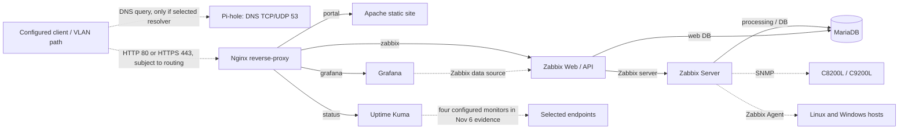
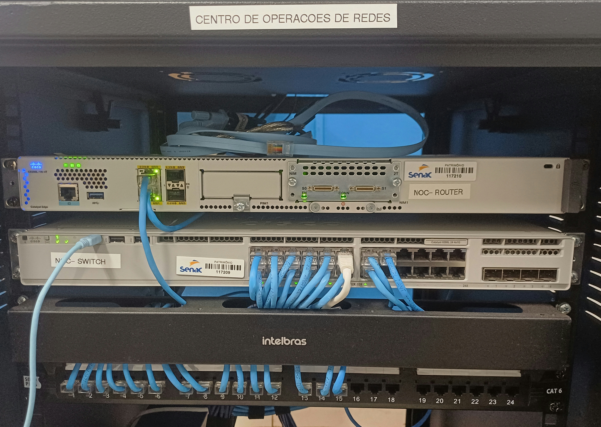
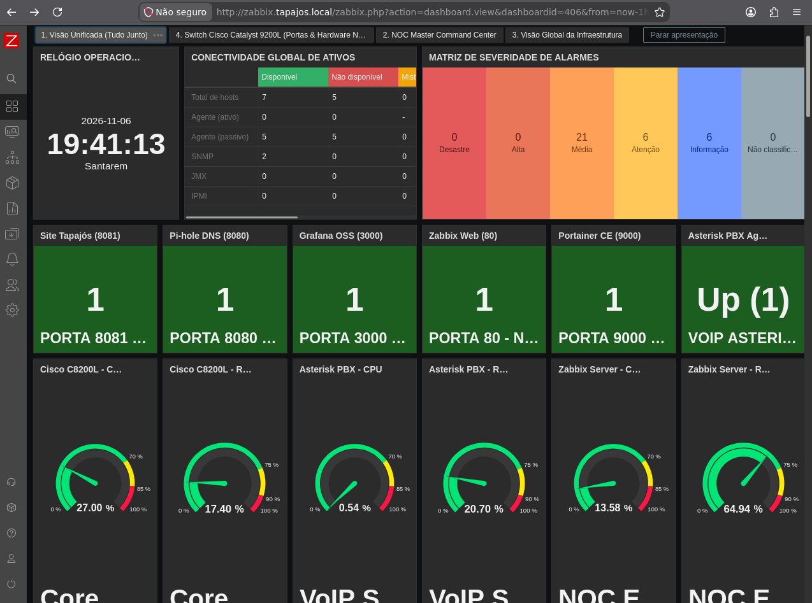
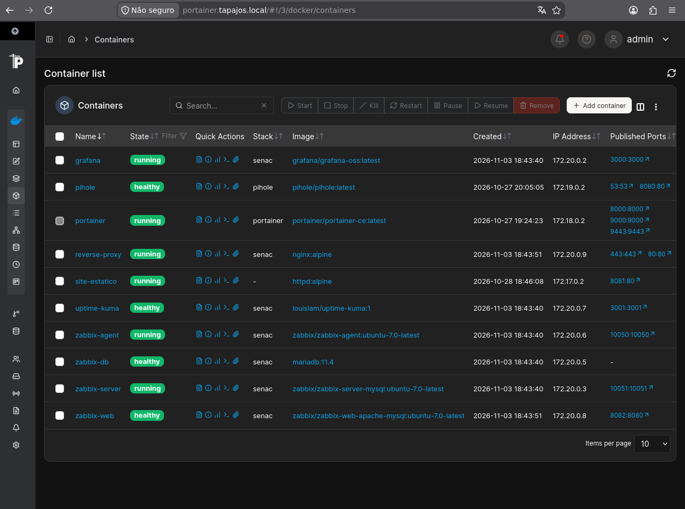

  
<a href="README.pt-BR.md"><strong>Português (Brasil) — versão completa</strong></a>

   

**A real physical laboratory. A fictional company. From the rack to a documented NOC.**

**Networking / Cisco**

      

**Linux / Containers**

    

**Monitoring / Services**

      

**Voice / Authentication**

  

## README contents

| | | |
| --- | --- | --- |
| [01 · Origin](#sec-01) | [02 · Objectives](#sec-02) | [03 · Key numbers](#sec-03) |
| [04 · Physical infrastructure](#sec-04) | [05 · All 7 VLANs](#sec-05) | [06 · Full topology](#sec-06) |
| [07 · Containers](#sec-07) | [08 · Data and service flows](#sec-08) | [09 · Telephony and authentication](#sec-09) |
| [10 · Observability](#sec-10) | [11 · Evidence gallery](#sec-11) | [12 · SNMP troubleshooting](#sec-12) |
| [13 · NOC operations](#sec-13) | [14 · Technical status](#sec-14) | [15 · Decisions and skills](#sec-15) |
| [16 · Costs](#sec-16) | [17 · Complete documentation](#sec-17) | [18 · Evidence boundaries](#sec-18) |
| [19 · Authorship](#sec-19) | [20 · Acknowledgments](#sec-20) | [21 · Contact](#sec-21) |

---

## 01 · Project origin — the Tapajós Inovações case

This is **my first project in Network Administration**. **Enterprise NOC — From Scratch** began with the original 12-slide mission brief, **“Projeto Integrador: Operação NOC Corporativo — Dossiê de Missão Técnica e Arquitetura de Redes.”** In the scenario, **Tapajós Inovações** is a **fictional client** seeking to turn a poorly documented network into a structured environment with segmentation, observability and operational procedures.

The initial brief described **four business problems** as mission requirements — **not as faults independently measured in the physical laboratory**:

| Business challenge in the brief | Technical direction |
| --- | --- |
| **Uncertified cabling** and inconsistent physical organization | Rack, patch panel, cabling organization, inventory and structured testing; certification of every link is not established by the published records. |
| **Open Wi-Fi** and insufficient access governance | Separate corporate wireless and IoT segments, with enterprise authentication as an architectural goal; Wi-Fi/FreeRADIUS integration was not tested end to end. |
| **Unstable telephony** in the fictional scenario | Asterisk PBX, IP extensions and a dedicated authentication server; independently verified complete calls are not published. |
| **No infrastructure monitoring** | Documented deployment of Zabbix, Grafana and Uptime Kuma with NOC incident procedures. |

The original mission was divided into **two complementary workstreams**: physical infrastructure (rack, structured cabling and link verification) and logical configuration (routing, VLANs, voice and monitoring). Its planning sequence covered preparation, physical organization, service convergence and validation; those steps were **objectives of the brief**, not evidence that every test was completed.

The original brief called for planning, physical organization, service integration and technical evidence. **The actual laboratory evolved beyond the first slide deck**: the current evidence includes physical Cisco devices, VLANs 10–70, two separate Archer AX53 devices, Debian, Docker, SNMP monitoring, IP telephony and a bilingual public portal. This README describes **recorded implementation**, without claiming every original objective was completed.

The laboratory is **physical and real**; the company, departments and business problem are a **simulated scenario**. The work also took place in a **collaborative setting**. This repository assembles the technical path, recorded facts, service dependencies, troubleshooting and documentation decisions.

---

## 02 · Objectives and delivered scope

The central goal is to build an operational view of corporate infrastructure: **understand, connect, observe and document equipment and services** from the physical layer to NOC dashboards.

- **Physical:** network rack, router, switch, patch panel, cabling and departmental machines.
- **Networking:** departmental VLANs, access/trunk configuration, recorded addressing and routing dependencies.
- **Systems:** two Linux machines with different roles plus Windows workstations.
- **Services:** Docker Compose, Zabbix, MariaDB, Grafana, Nginx, Apache, Pi-hole, Uptime Kuma and Portainer; Asterisk/FreeRADIUS on a separate physical server.
- **NOC operations:** dashboards, monitored host inventory, observed faults, SNMP investigations, runbooks and incident templates.
- **Technical communication:** bilingual static corporate portal, photographic evidence, navigable technical documentation and BRL/USD cost analysis.

The project **does not** claim production-grade high availability, certified security, validated restoration or approved connectivity across every VLAN.

---

## 03 · Laboratory by the numbers

| Indicator | Recorded count | Source and context |
| --- | ---: | --- |
| Logical segments | **7 VLANs** | C9200L configuration, Nov 4, 2026 |
| Principal Cisco devices | **2** | Catalyst C8200L router + C9200L switch |
| Inventoried computers | **10** | 8 Windows workstations + 2 Linux computers |
| Zabbix registered hosts | **12** | 10 computers + Cisco router and switch |
| Zabbix items | **1,820** | 1,698 enabled, 9 disabled and 113 unsupported |
| Zabbix triggers | **1,082** | 34 in problem state at capture time |
| Available host interfaces | **7 of 12** | Five hosts unavailable on Nov 6 |
| Docker containers | **10 running** | Portainer inventory, Nov 6; 3 observed stacks |
| IP telephones | **2 Grandstream** | Extensions 1001 (Sales) and 1002 (IT) |
| Wireless devices | **2 Archer AX53** | Separate corporate Wi-Fi and IoT units |
| IoT | **1 documented Alexa** | Associated with the VLAN 70 IoT Archer |
| Public evidence gallery | **25 images** | Curated corporate-portal assets |
| Technical FAQ | **52 questions** | Equivalent EN/PT coverage |

**Dates:** switch configuration and SNMP investigations on **Nov 4, 2026**; systems, Portainer and monitoring captures on **Nov 6, 2026**; cost reference on **Nov 11, 2026**. All numbers are **historical snapshots**, not live readings.

---

## 04 · Physical infrastructure — from rack to workstations

The environment includes a network rack, **Cisco Catalyst C8200L-1N-4T** router, **Catalyst C9200L-24T-4G** switch, Category 6 patch panel, cable organizer and Ethernet cabling. Departmental computers and both Linux systems are part of the documented physical topology.

The November 4 C9200L configuration captures VLANs, interface assignments and a trunk. The November 6 photographs and hardware inventory document the equipment. Photographs establish physical presence, **not** cable certification, every patch-panel mapping or end-to-end availability.

### Cisco C9200L port inventory

| Switch interface | Documented association | Evidence boundary |
| --- | --- | --- |
| `Gi1/0/1` | Cisco C8200L | Trunk **on the switch**; corresponding router-side interface not captured |
| `Gi1/0/2–3` | IT / NOC | Access VLAN 10 |
| `Gi1/0/4–6` | Accounting | Access VLAN 20 |
| `Gi1/0/7–8` | Finance | Access VLAN 30 |
| `Gi1/0/9–10` | Sales | Access VLAN 40 |
| `Gi1/0/11` | Asterisk / FreeRADIUS server | VLAN 50 assigned; **effective port mode unverified** |
| `Gi1/0/12–13` | Two Grandstream phones | Access VLAN 50 |
| `Gi1/0/14` | Dedicated IoT Archer AX53 | Access VLAN 70 |
| `Gi1/0/15` | Corporate Wi-Fi Archer AX53 | Access VLAN 60 |
| `Gi1/0/16–24`, `Gi1/1/1–4` | No individually documented assignment | Do not infer idle or disconnected ports |

**Important:** `Gi1/0/1` is a **switch** port, not a guessed router interface. The `Gi1/0/11` capture contains `switchport access vlan 50` and `spanning-tree portfast trunk`, without an explicit `switchport mode access`; its operational mode is therefore not established.

[Physical evidence and photographs](docs/evidence/physical-infrastructure.md) · [Switch port map](docs/networking/switch-port-map.md) · [IOS XE snapshot](docs/networking/switch-vlan-snapshot-2026-11-04.md)

---

## 05 · All seven VLANs — devices, roles and addressing

**Every VLAN is documented separately.** Switch-port assignments come from the configuration; IP addresses come from collected system/endpoint evidence. A gateway shown on a host **does not** establish every C8200L interface configuration.

### VLAN 10 — IT / NOC

- **Observed subnet:** `192.168.10.0/24`; **workstation gateway:** `192.168.10.1`.
- **Switch ports:** `Gi1/0/2–3`.
- **IT 1 / NOC:** Dell OptiPlex 3020, **Debian 13 (Trixie)**, `192.168.10.12`, i5-4590, ~8 GB RAM; hosts Docker services and observability.
- **IT 2:** **Windows** workstation, `192.168.10.13`; CPU, RAM and storage not documented.
- **IT 1 services:** all ten recorded containers are detailed later; they are **not ten additional computers**.

### VLAN 20 — Accounting

- **Subnet:** `192.168.20.0/24`; **observed gateway:** `192.168.20.1`.
- **Switch ports:** `Gi1/0/4–6`.
- **Accounting 1:** Windows 11 Pro 21H2, `192.168.20.11`, i5-4590, 8 GB RAM.
- **Accounting 2:** Windows, `192.168.20.12`, i5-4590, 8 GB DDR3.
- **Accounting 3:** Windows 11 Pro 21H2, `192.168.20.13`, i5-4590, 8 GB RAM.

### VLAN 30 — Finance

- **Subnet:** `192.168.30.0/24`; **observed gateway:** `192.168.30.1`.
- **Switch ports:** `Gi1/0/7–8`.
- **Finance 1:** Windows, `192.168.30.10`, i5-4590, 8 GB RAM.
- **Finance 2:** Windows, `192.168.30.11`, i5-4590, 8 GB RAM.

### VLAN 40 — Sales

- **Subnet:** `192.168.40.0/24`; **observed gateway:** `192.168.40.1`.
- **Switch ports:** `Gi1/0/9–10`.
- **Sales 1:** Windows, `192.168.40.11`, i5-4590, 8 GB RAM.
- **Sales 2:** Windows, `192.168.40.10`, i5-4590, 8 GB RAM.

### VLAN 50 — Voice, authentication and IP telephony

- **Subnet:** `192.168.50.0/24`; **gateway recorded on server:** `192.168.50.1`.
- **Switch ports:** `Gi1/0/11–13`; `Gi1/0/11` has an unresolved effective switchport-mode question.
- **Physical server:** Dell OptiPlex 3020, **Debian forky/sid at capture**, `192.168.50.2`, i5-4590, ~8 GB RAM; runs **Asterisk, FreeRADIUS, Zabbix Agent and OpenSSH**.
- **Grandstream / Sales:** extension **1001**, `192.168.50.10`.
- **Grandstream / IT:** extension **1002**, `192.168.50.11`.
- **Services:** SIP/PJSIP, RTP and RADIUS; configs and daemon states are recorded, while independent completed-call and enterprise-authentication tests are not.

### VLAN 60 — Corporate Wi-Fi

- **Switch port:** `Gi1/0/15`, access VLAN 60.
- **Physical equipment:** **TP-Link Archer AX53 Wi-Fi 6 AX3000**, dedicated to corporate wireless.
- **Internal device settings not exported:** AP/router mode, client subnet, DHCP, NAT, SSID and actual authentication are not established.
- VLAN 50 FreeRADIUS is a **planned architectural dependency**; a successful AX53 ↔ RADIUS 802.1X exchange is not documented.

### VLAN 70 — IoT and Alexa

- **Switch port:** `Gi1/0/14`, access VLAN 70.
- **Separate physical unit:** **another TP-Link Archer AX53 Wi-Fi 6 AX3000**, dedicated to IoT.
- **Associated IoT client:** **Amazon Alexa**, shown with the IoT AX53 in the documentation and topology.
- The device association **does not** prove Alexa's IP address or that wireless clients use the VLAN 70 uplink subnet. AX53 AP/router mode, DHCP, NAT, gateways and client addressing were not captured.

**Security boundary:** VLAN separation creates separate Layer 2 domains; it does not prove enforced router ACLs or successful inter-VLAN isolation tests. [Complete VLAN documentation](docs/networking/vlans.md).

---

## 06 · Full topology — physical infrastructure, machines and services

The diagram is **deliberately large**. It includes the **seven individual VLANs**, all **ten computers**, **two IP telephones**, **two Archer AX53 units**, **Alexa**, **C8200L**, **C9200L** and **ten Docker containers**. It also visualizes the **declared dependencies** among Nginx, Zabbix, MariaDB, Grafana and the supporting services.

**Legend:** solid lines indicate documented network/device associations or declared connections; dashed lines indicate logical monitoring, dependencies or intended integration, **not** successfully verified end-to-end tests. The `*.example.test` hostnames are sanitized examples, not actual public DNS records or evidence of valid certificates.

```mermaid
flowchart TB
    ROUTER["Cisco Catalyst C8200L-1N-4T<br/>Router / Layer 3 role"]
    SW["Cisco Catalyst C9200L-24T-4G<br/>Switch / VLAN assignments"]
    ROUTER ---|"Trunk recorded on SWITCH Gi1/0/1<br/>Router-side port NOT captured"| SW

    subgraph V10["VLAN 10 — IT / NOC — 192.168.10.0/24 — Gi1/0/2-3"]
      IT1["IT 1 / Main NOC<br/>Dell OptiPlex 3020 / Debian 13<br/>192.168.10.12 / i5-4590 / ~8 GB"]
      IT2["IT 2 / Windows workstation<br/>192.168.10.13<br/>Hardware not recorded"]
      subgraph CONTAINERS["Docker on IT 1 — 10 running containers in the Nov 6 inventory"]
        ENGINE["Docker Engine / Compose / bridge networks"]
        subgraph MAIN["Main Compose service network — zabbix-net"]
          ZS["zabbix-server<br/>Zabbix Server / 10051"]
          ZW["zabbix-web<br/>Apache frontend / host 8082"]
          ZA["zabbix-agent<br/>local agent / host 10050"]
          DB["zabbix-db<br/>MariaDB 11.4 / persistent bind mount"]
          GF["grafana<br/>Grafana dashboards / host 3000"]
          UK["uptime-kuma<br/>service checks / host 3001"]
          RP["reverse-proxy<br/>Nginx / host 80 + 443"]
          WEB["site-estatico<br/>Apache HTTPD / host 8081"]
        end
        subgraph PI_STACK["Separate Pi-hole Compose stack"]
          PI["pihole<br/>DNS 53 TCP/UDP / web host 8080"]
        end
        subgraph PT_STACK["Separate Portainer Compose stack"]
          PT["portainer<br/>Docker management / 8000, 9000, 9443"]
        end
      end
    end

    subgraph V20["VLAN 20 — ACCOUNTING — 192.168.20.0/24 — Gi1/0/4-6"]
      AC1["Accounting 1 / Windows 11 Pro<br/>192.168.20.11"]
      AC2["Accounting 2 / Windows<br/>192.168.20.12"]
      AC3["Accounting 3 / Windows 11 Pro<br/>192.168.20.13"]
    end
    subgraph V30["VLAN 30 — FINANCE — 192.168.30.0/24 — Gi1/0/7-8"]
      FI1["Finance 1 / Windows<br/>192.168.30.10"]
      FI2["Finance 2 / Windows<br/>192.168.30.11"]
    end
    subgraph V40["VLAN 40 — SALES — 192.168.40.0/24 — Gi1/0/9-10"]
      SA1["Sales 1 / Windows<br/>192.168.40.11"]
      SA2["Sales 2 / Windows<br/>192.168.40.10"]
    end
    subgraph V50["VLAN 50 — VOICE / AUTH — 192.168.50.0/24 — Gi1/0/11-13"]
      PBX["Dell OptiPlex 3020 / Debian forky/sid<br/>192.168.50.2 / i5-4590 / ~8 GB<br/>Asterisk 22.10.1 + FreeRADIUS 3.2.10<br/>Zabbix Agent + OpenSSH"]
      PH1["Grandstream / Sales<br/>Extension 1001 / 192.168.50.10"]
      PH2["Grandstream / IT<br/>Extension 1002 / 192.168.50.11"]
    end
    subgraph V60["VLAN 60 — CORPORATE WI-FI — Gi1/0/15"]
      AXC["TP-Link Archer AX53 / Wi-Fi 6<br/>Corporate wireless device<br/>Client mode/subnet NOT captured"]
    end
    subgraph V70["VLAN 70 — IoT — Gi1/0/14"]
      AXI["Separate TP-Link Archer AX53 / Wi-Fi 6<br/>IoT device / client subnet unknown"]
      ALEXA["Amazon Alexa / IoT client<br/>IP and DHCP details not captured"]
      AXI ---|"Wi-Fi / device association"| ALEXA
    end

    SW --- IT1
    SW --- IT2
    SW --- AC1
    SW --- AC2
    SW --- AC3
    SW --- FI1
    SW --- FI2
    SW --- SA1
    SW --- SA2
    SW --- PBX
    SW --- PH1
    SW --- PH2
    SW --- AXC
    SW --- AXI

    IT1 --> ENGINE
    ENGINE --> ZS
    ENGINE --> ZW
    ENGINE --> ZA
    ENGINE --> DB
    ENGINE --> GF
    ENGINE --> UK
    ENGINE --> RP
    ENGINE --> WEB
    ENGINE --> PI
    ENGINE --> PT

    ZS -->|"DB_SERVER_HOST=db"| DB
    ZW -->|"Zabbix DB"| DB
    ZW -->|"Zabbix backend"| ZS
    ZA -.->|"declared agent link"| ZS
    GF -.->|"Zabbix datasource / API"| ZW
    RP -->|"portal.noc.example.test"| WEB
    RP -->|"zabbix.noc.example.test"| ZW
    RP -->|"grafana.noc.example.test"| GF
    RP -->|"status.noc.example.test"| UK
    PT -.->|"Docker socket / host management"| ENGINE

    ZS -.->|"SNMPv2c / historical evidence"| ROUTER
    ZS -.->|"SNMPv2c / historical evidence"| SW
    ZS -.->|"Zabbix Agent record"| PBX
    ZS -.->|"Windows agent registrations; availability varies"| IT2
    ZS -.-> AC1
    ZS -.-> AC2
    ZS -.-> AC3
    ZS -.-> FI1
    ZS -.-> FI2
    ZS -.-> SA1
    ZS -.-> SA2
    PBX -.->|"PJSIP dialplan / tests not independently proved"| PH1
    PBX -.->|"PJSIP dialplan / tests not independently proved"| PH2
    AXC -.->|"RADIUS integration proposed / NOT verified"| PBX

    classDef network fill:#13324a,stroke:#38bdf8,color:#e7f5ff,stroke-width:2px
    classDef linux fill:#213b2e,stroke:#4ade80,color:#ecfff0,stroke-width:2px
    classDef services fill:#33291c,stroke:#f59e0b,color:#fff5dc,stroke-width:1.5px
    classDef endpoint fill:#242939,stroke:#94a3b8,color:#f1f5f9
    class ROUTER,SW,AXC,AXI network
    class IT1,PBX linux
    class ZS,ZW,ZA,DB,GF,UK,RP,WEB,PI,PT,ENGINE services
    class IT2,AC1,AC2,AC3,FI1,FI2,SA1,SA2,PH1,PH2,ALEXA endpoint

```

**Limits:** the Debian host runs three observed stacks; public Compose definitions include **eight main-stack services**, plus **Pi-hole** and **Portainer** in separate stacks. Their presence on one host does **not** establish that the latter two are on the same internal Docker network. Complete C8200L subinterfaces, NAT, WAN, routing and ACL statements were not captured.

[Consolidated logical topology](docs/networking/consolidated-logical-topology.md) · [Computer inventory](docs/endpoints/workstation-inventory.md) · [Docker architecture](docs/containers/docker-services.md)

---

## 07 · Debian 13 host — all ten containers and their functions

**IT 1 / NOC** (`192.168.10.12`) ran Docker at the **Nov 6, 2026** observation. Portainer reported **1 environment, 3 stacks, 10 running containers, 11 images, 4 volumes and 6 Docker networks**. Four containers had healthy checks in that capture; this is **not** a continuous availability guarantee.

| Container | Recorded image | Published host port(s) | Function / dependency |
| --- | --- | --- | --- |
| `reverse-proxy` | `nginx:alpine` | `80`, `443` | Nginx; routes virtual hosts to web applications |
| `zabbix-web` | `zabbix/zabbix-web-apache-mysql:ubuntu-7.0-latest` | `8082` | Apache/PHP Zabbix frontend; depends on Zabbix Server and MariaDB |
| `zabbix-server` | `zabbix/zabbix-server-mysql:ubuntu-7.0-latest` | `10051` | Monitors items/triggers; database-dependent |
| `zabbix-agent` | `zabbix/zabbix-agent:ubuntu-7.0-latest` | `10050` | Local monitoring agent in the stack |
| `zabbix-db` | `mariadb:11.4` | **No published port** | Zabbix persistent data; `./zabbix-db-data` bind mount |
| `grafana` | `grafana/grafana-oss:latest` | `3000` | Zabbix data visualization through its plugin |
| `uptime-kuma` | `louislam/uptime-kuma:1` | `3001` | Endpoint monitoring and state history |
| `site-estatico` | `httpd:alpine` | `8081` | Apache static site, **internal** to the laboratory |
| `pihole` | `pihole/pihole:latest` | `53/tcp`, `53/udp`, `8080` | DNS filtering; separate Compose file |
| `portainer` | `portainer/portainer-ce:latest` | `8000`, `9000`, `9443` | Docker management via socket; separate Compose file |

**Image versions:** `latest`/`ubuntu-7.0-latest` tags do not establish immutable digests or exact software patches. **Data and secrets:** actual passwords, TLS certificates, persistent directories and internal site content are not in the public repository; `.env.example` contains only variable examples.

The main-stack services share the declared **`zabbix-net`** Docker bridge. Public Compose files for **Pi-hole** and **Portainer** are separate; being on the same host does **not** by itself establish direct container-network reachability between all stacks.

[Docker/Portainer documentation](docs/containers/docker-services.md) · [Main Compose](docker_configs/docker-compose.yml) · [Pi-hole Compose](docker_configs/lab-ti/pihole/docker-compose.yml) · [Portainer Compose](docker_configs/lab-ti/portainer/docker-compose.yml)

---

## 08 · Service flows — DNS, proxy, Zabbix and dashboards

### 08.1 · Web application access

A client requires **addressing/routing**, **DNS resolution** and **TCP connectivity** before an application can respond. The public Nginx config listens on 80/443 and selects upstreams by hostname; it does not itself configure DNS or inter-VLAN permissions.

| Sanitized virtual hostname | Nginx internal upstream | Application |
| --- | --- | --- |
| `portal.noc.example.test` | `site-estatico:80` | Internal corporate website (Apache) |
| `zabbix.noc.example.test` | `zabbix-web:8080` | Zabbix interface/API |
| `grafana.noc.example.test` | `grafana:3000` | Grafana dashboards |
| `status.noc.example.test` | `uptime-kuma:3001` | Uptime Kuma checks |

The Nginx example also serves **HTTP port 80 without mandatory HTTPS redirection**; externally valid TLS and blocked direct backend ports are not demonstrated. Host ports `8081`, `8082`, `3000` and `3001` are published by Compose. **GitHub Pages is a separate public static deployment**, with no access to private live monitoring.

[Nginx technical guide](docs/services/nginx-reverse-proxy/README.md) · [`nginx.conf`](docker_configs/reverse-proxy/nginx.conf) · [Virtual hosts `lab.conf`](docker_configs/reverse-proxy/conf.d/lab.conf)

### 08.2 · Monitoring data path

- **Zabbix Server** processes data from **SNMP** interfaces on Cisco equipment and **Zabbix Agents** on registered computers.
- **MariaDB** stores Zabbix Server/Web data; its health check and persistent mount **do not prove validated backups or restores**.
- **Grafana** queries/visualizes Zabbix through an integration; an empty panel may involve items, API, query range or presentation.
- **Uptime Kuma** runs independent endpoint checks. The evidence shows **four monitors**, not every application and device.
- **Pi-hole** filters DNS requests from clients that actually use it; there is no proof of DNS/DHCP adoption by every VLAN.

[Zabbix](docs/monitoring/zabbix-monitoring.md) · [Grafana](docs/monitoring/grafana-monitoring.md) · [DNS/availability](docs/services/dns-and-availability.md) · [MariaDB](docs/services/mariadb-zabbix/README.md)

---

## 09 · Voice and authentication — dedicated VLAN 50 server

Telephony is **not a container on the NOC host**. It uses the **second Dell OptiPlex 3020**, at `192.168.50.2/24`, with these services **reported active at capture time**:

| Service | Recorded implementation | Evidence limit |
| --- | --- | --- |
| **Asterisk 22.10.1** | SIP/PJSIP PBX, UDP `5060`, RTP UDP `10000–20000` and dialplan | Extensions/config recorded; no independent proof of completed calls |
| **FreeRADIUS 3.2.10** | UDP `1812/1813`; EAP/802.1X architecture documented | No full log proving corporate AX53 authentication |
| **Zabbix Agent** | Linux host monitoring agent active | Historic service state is not live availability |
| **OpenSSH** | Remote administration service active | No public exposure is assumed |

| Extension | Device / department | Photographed IPv4 |
| --- | --- | --- |
| **1001** | Grandstream — Sales | `192.168.50.10` |
| **1002** | Grandstream — IT | `192.168.50.11` |
| **8888** | `Playback(hello-world)` dialplan application | Configured/intended audio playback test |
| **9999** | `Echo()` dialplan application | Configured/intended bidirectional audio test |

The server also reports AMI/TCP port `5038` **localhost-only**. Having extensions and test commands is not a successful call-detail record. See [Asterisk and FreeRADIUS — complete guide](docs/services/asterisk-freeradius.md).

---

## 10 · Observability — metrics, findings and gaps

Monitoring is documented as **Zabbix Server/Frontend 7.0.32** on Debian/Docker, with **Grafana** dashboards. Registered hosts include the router, switch, both Linux computers and eight Windows workstations.

| Nov 6, 2026 metric | Historical observation |
| --- | ---: |
| Enabled hosts | 12 |
| Available / unavailable hosts | **7 / 5** |
| Available Cisco SNMP interfaces | **2** |
| Available / unavailable passive agent interfaces | **5 / 5** |
| Templates | 356 |
| Total items | 1,820 |
| Enabled / disabled items | 1,698 / 9 |
| Unsupported items | **113** |
| Total triggers | 1,082 |
| Triggers in problem state | **34** |
| HA cluster | Inactive |

**Five unavailable hosts does not prove five powered-off machines.** An unsupported item is an item condition, not necessarily a host outage. Similarly, 34 problem triggers are not automatically 34 independently verified business incidents.

### Address discrepancies: photographed workstations vs Zabbix

Six Windows stations have different IPs across the records. This is an investigation lead for missing agent metrics, **not a proven single root cause**.

| Workstation | Photographed IPv4 | Zabbix host IPv4 |
| --- | --- | --- |
| IT 2 | `192.168.10.13` | `192.168.10.11` |
| Accounting 2 | `192.168.20.12` | `192.168.20.10` |
| Accounting 3 | `192.168.20.13` | `192.168.20.12` |
| Finance 1 | `192.168.30.10` | `192.168.30.13` |
| Sales 1 | `192.168.40.11` | `192.168.40.14` |
| Sales 2 | `192.168.40.10` | `192.168.40.13` |

[Zabbix findings](docs/monitoring/zabbix-monitoring.md) · [Grafana dashboards](docs/monitoring/grafana-monitoring.md) · [Zabbix Agent runbook](docs/noc-operations/runbooks/zabbix-agent-connectivity.md)

---

## 11 · Selected gallery — actual laboratory evidence

<table>
  <tr>
    <td width="50%" align="center"> <b>Cisco infrastructure</b> Router, switch and structured cabling</td>
    <td width="50%" align="center"> <b>Zabbix</b> Monitoring, hosts and historical alerts</td>
  </tr>
  <tr>
    <td align="center"> <b>Grafana</b> Metrics and Cisco dashboards</td>
    <td align="center"> <b>Portainer</b> Ten containers running at capture time</td>
  </tr>
</table>

These are **four representative records**, not a duplication of the 25-image portal gallery. The physical photo is a **Cisco equipment close-up rather than the wide laboratory view**. Every capture is historical and should be interpreted with its technical record.

**All 25 gallery images:** [English portal](https://kayo-willian.github.io/enterprise-noc-from-scratch/#evidence) · [Portuguese portal](https://kayo-willian.github.io/enterprise-noc-from-scratch/pt-BR/#evidence) · [Evidence log](docs/evidence/evidence-collection-2026-11-06.md).

---

## 12 · Real troubleshooting — restoring SNMP collection on the C9200L

**Documented case, Nov 4, 2026 · Cisco C9200L · SNMPv2c / Zabbix**

| Stage | Recorded investigation |
| --- | --- |
| **Symptom** | After C9200L onboarding, Zabbix marked the SNMP interface unavailable; metric collection/interface discovery could not proceed. |
| **Investigation** | IP reachability, Linux SNMP queries, switch SNMP configuration and inherited Zabbix host settings were compared. |
| **Confirmed cause** | The host's inherited SNMP community **did not match** the switch configuration. |
| **Recorded correction** | Align the community through host macro `{$SNMP_COMMUNITY}` and reload the Zabbix Server configuration cache. |
| **Result** | The SNMP interface became available and metric collection/interface discovery resumed in the historical record. |

**Two further investigations** were recorded: an incorrect **uptime monitoring item** (widget read `0` until its key was replaced) and empty event widgets caused by a **switch-only filter**, not necessarily missing monitoring. The Nov 4 corrections must not be conflated with unsupported items or unavailable agents observed on Nov 6.

[All three SNMP cases](docs/monitoring/snmp-troubleshooting.md) · [Cisco interface runbook](docs/noc-operations/runbooks/cisco-interface-unavailable.md)

---

## 13 · NOC operations — incidents, runbooks and validation

A NOC is not just a collection of green charts. The project distinguishes **monitoring signal**, **verified operational impact**, **confirmed root cause**, **hypotheses** and **authorized action**. Procedures prioritize evidence capture before intervention.

| Procedure | Focus |
| --- | --- |
| [Incident management](docs/noc-operations/incident-management.md) | Classification, priority, evidence and closing on validated impact |
| [Cisco interface](docs/noc-operations/runbooks/cisco-interface-unavailable.md) | Port state, VLAN, trunk, error counters and service correlation |
| [DNS resolution](docs/noc-operations/runbooks/dns-resolution-failure.md) | Resolver, Pi-hole, upstream, filtering and DNS vs HTTP |
| [Docker services](docs/noc-operations/runbooks/docker-service-failure.md) | Containers, health checks, logs, dependencies and change decisions |
| [Grafana no data](docs/noc-operations/runbooks/grafana-no-data.md) | Grafana ↔ Zabbix item/API/query investigation |
| [Zabbix Agent](docs/noc-operations/runbooks/zabbix-agent-connectivity.md) | IP registration, agents, firewall, network and unsupported items |
| [Host resource usage](docs/noc-operations/runbooks/host-resource-utilization.md) | CPU, memory, disk, inodes and Linux/Docker correlation |
| [Exercises and recovery validation](docs/noc-operations/incident-simulation-and-validation.md) | **Tabletop**, read-only and specifically authorized exercise modes; scenarios are not presented as executed |

The SNMP investigations were documented historical corrections. Other runbooks are **reference procedures**, not claims that every failure scenario was reproduced.

---

## 14 · Technical state — implemented, partial and unverified

| Component | Documentation classification | Evidence and remaining limits |
| --- | --- | --- |
| Rack, patch panel, Cisco hardware | **Physically present / photographed** | Equipment and organization; complete link certification not established |
| C9200L VLANs and trunk | **Configured / recorded** | Switch-side capture; router interfaces/ACLs missing |
| Linux and Windows machines | **Inventoried** | Ten computers and dated addresses; current uptime unknown |
| Debian 13 + Docker | **Running at capture time** | Ten containers; full functional reachability not established |
| Zabbix + Grafana | **Deployed with gaps** | Dashboards and alerts; five unavailable hosts and 113 unsupported items |
| C9200L SNMP investigation | **Historically resolved case** | Three Nov 4 interventions; no claim all later issues were fixed |
| MariaDB | **Configured persistence** | Bind mount and health check; **no validated backup/restore** |
| Nginx + Apache | **Web services configured** | Virtual hosts and published ports; HTTPS not enforced, external TLS not verified |
| Pi-hole | **Active / DNS query screenshots** | Observed queries; all-VLAN adoption unverified |
| Uptime Kuma | **Partial monitoring** | Four monitors; not all applications and devices |
| Asterisk / FreeRADIUS | **Services recorded active; partial validation** | PBX/RADIUS and phones; complete calls / Wi-Fi 802.1X unproven |
| Corporate Wi-Fi and IoT / Alexa | **Hardware associated; partial configs** | Two VLANs/AX53 devices; client subnet/NAT/AP mode not captured |
| HA, restorable backup, cross-VLAN tests and production security | **Not established** | Further tests/evidence required |
| Public bilingual portal | **Published** | Static GitHub Pages, not live telemetry |
| Cost workbooks and reports | **Documented** | Scenario estimates, not purchasing receipts |

---

## 15 · Engineering decisions and demonstrated skills

| Technical decision | Architectural reasoning / skill shown |
| --- | --- |
| **Cisco C8200L + C9200L** | Separate routing and switching roles; interpret L2/L3 configuration and dependencies. |
| **VLANs 10–70** | Organize broadcast domains and recognize that L3 policy must be validated separately. |
| **Debian NOC host** | Linux system administration, service co-location and shared failure-domain analysis. |
| **Docker / Compose** | Container inventory, bridge networks, persistence, exposure, local secrets and startup conditions. |
| **Zabbix + SNMP/Agents** | Host inventory, telemetry, triggers, interface status and configuration troubleshooting. |
| **Grafana** | Visualize Zabbix series and distinguish collection vs API/query presentation gaps. |
| **Nginx / Apache / MariaDB** | Web routing, HTTP/TLS boundaries, database dependencies and persistence. |
| **Asterisk / FreeRADIUS** | SIP telephony and authentication architecture without inventing verification. |
| **Pi-hole / Uptime Kuma** | DNS filtering vs name resolution vs endpoint availability checks. |
| **Runbooks and evidence** | Technical investigation, separating symptoms/causes, dates, operational reporting and bilingual documentation. |

### My contribution

This repository represents **my first project in Network Administration**. I participated in the laboratory's technical activities and dedicated a substantial part of my work to **organizing the knowledge produced by the project**: examining network configurations and topology, mapping machines and VLANs, describing Linux/Docker dependencies, interpreting dashboards, documenting troubleshooting, writing NOC procedures, building cost scenarios and presenting the result in two languages.

The physical/configuration work took place in a **collaborative setting**, and I do not claim individual ownership of every cable, switchport or service without evidence. My documented contribution centers on **consolidation, technical review, organization and publication**, with verifiable source records and stated limitations.

---

## 16 · Infrastructure costs — three scenarios

The budget separates **full equipment acquisition**, **deployment using existing assets** and **monthly operations**. The USD amounts are converted from BRL at **USD 1.00 = BRL 5.5600**, using **Nov 11, 2026** as the reference.

| Scenario | BRL amount | USD equivalent |
| --- | ---: | ---: |
| **A — Full acquisition and deployment** | **R$ 86,683.14** | **$15,590.49** |
| **B — Using existing hardware** | **R$ 7,448.85** | **$1,339.72** |
| **C — Monthly operations** | **R$ 1,084.09/month** | **$194.98/month** |

The values are **estimates**, not verified purchases. USD values are **conversions of the BRL study**, not an independent pricing survey of the US market.

[BRL report](docs/pt-BR/custos/enterprise-noc-orcamento-final-brl-2026.md) · [BRL workbook](docs/pt-BR/custos/enterprise-noc-orcamento-final-brl-2026.xlsx) · [USD report](docs/costs/enterprise-noc-final-budget-usd-2026.md) · [USD workbook](docs/costs/enterprise-noc-final-budget-usd-2026.xlsx)

---

## 17 · Complete documentation — browse technical domains

This README is a **technical front page and index**. The detailed source files remain the reference for dated captures, procedures, configuration examples and evidence boundaries.

### Network, switching and routing

[Overview](docs/networking/README.md) · [Logical topology](docs/networking/consolidated-logical-topology.md) · [VLANs](docs/networking/vlans.md) · [C8200L router](docs/networking/router-c8200l.md) · [C9200L port map](docs/networking/switch-port-map.md) · [Switch snapshot](docs/networking/switch-vlan-snapshot-2026-11-04.md) · [Wi-Fi VLAN 60](docs/networking/corporate-wifi-vlan60.md) · [IoT VLAN 70](docs/networking/iot-vlan70.md)

### Physical equipment and system inventory

[Rack photos](docs/evidence/physical-infrastructure.md) · [Workstation inventory](docs/endpoints/workstation-inventory.md) · [Evidence collection](docs/evidence/evidence-collection-2026-11-06.md)

### Linux, containers and enterprise services

[Docker](docs/containers/docker-services.md) · [Nginx](docs/services/nginx-reverse-proxy/README.md) · [MariaDB/Zabbix](docs/services/mariadb-zabbix/README.md) · [DNS and availability](docs/services/dns-and-availability.md) · [Asterisk/FreeRADIUS](docs/services/asterisk-freeradius.md)

### Zabbix, Grafana and network monitoring

[Zabbix](docs/monitoring/zabbix-monitoring.md) · [Grafana](docs/monitoring/grafana-monitoring.md) · [SNMP troubleshooting](docs/monitoring/snmp-troubleshooting.md)

### NOC operations, incidents and runbooks

[Incident management](docs/noc-operations/incident-management.md) · [Exercises and validation](docs/noc-operations/incident-simulation-and-validation.md) · [Cisco](docs/noc-operations/runbooks/cisco-interface-unavailable.md) · [DNS](docs/noc-operations/runbooks/dns-resolution-failure.md) · [Docker](docs/noc-operations/runbooks/docker-service-failure.md) · [Grafana](docs/noc-operations/runbooks/grafana-no-data.md) · [Zabbix Agent](docs/noc-operations/runbooks/zabbix-agent-connectivity.md) · [Resources](docs/noc-operations/runbooks/host-resource-utilization.md)

### Corporate portal, FAQ and costs

[English portal](https://kayo-willian.github.io/enterprise-noc-from-scratch/) · [Portuguese portal](https://kayo-willian.github.io/enterprise-noc-from-scratch/pt-BR/) · [Site architecture](docs/site/README.md) · [Technical FAQ — 52 questions](docs/faq/technical-faq.md) · [Cost analysis](docs/costs/enterprise-noc-final-budget-usd-2026.md)

**Technical indexes:** [English](docs/README.md) · [Português](docs/pt-BR/README.md).

---

## 18 · Project scope, transparency and evidence limitations

- **The laboratory is physical and real; Tapajós Inovações is fictional.** The business problem is a case study, not an incident report about a real company.
- Rack photos and hardware inventory document physical presence, **not** all link states or traffic paths.
- The C8200L participates in the architecture, but complete interfaces, ACLs, NAT, WAN and routing statements were not collected as verified evidence.
- Observing a gateway address on a client **does not** prove the corresponding router interface was configured.
- Corporate Wi-Fi and IoT use **two separate Archer AX53 units**. No client addressing, mode or confirmed 802.1X configuration is asserted.
- Ten containers were recorded running on **Nov 6, 2026**. Running process, container health and functioning application are different properties.
- Five host interfaces were unavailable and 113 Zabbix items unsupported in the captured monitoring inventory. These are not hidden or assumed to be fixed.
- Nginx, Docker host ports, TLS and DNS have **different operational boundaries**. HTTPS enforcement and access from every VLAN are not claimed.
- Persistent MariaDB files do not prove restorable backups. HA, recovery objectives, production security and complete load tests are not certified by the materials.
- The **public GitHub Pages portal** is static; it **does not** access live Zabbix or private laboratory services.
- SNMP communities, passwords, tokens, private keys, SSIDs and personal data must stay out of public documentation.

---

## 19 · Authorship and project context

**Kayo Willian** — technical training project and **first work in Network Administration**. Tapajós Inovações is the fictional enterprise structuring the case study. The documentation concentrates on what was built, configured, observed and investigated, while stating what requires additional validation.

**Repository license:** [MIT](LICENSE).

---

## 20 · Tool acknowledgments

Tools used to support organization, technical writing and editorial review:

- **OpenAI ChatGPT — GPT-6** (assistance model used for documentation drafting/review).
- **Antigravity — Gemini 3.8 Flash (High)** (tool acknowledged by the author for supporting the work).

These credits **do not** imply that AI tools physically operated the laboratory, deployed services or validated unperformed tests. Authorship and publication decisions remain with **Kayo Willian**.

---

## 21 · Contact

  

