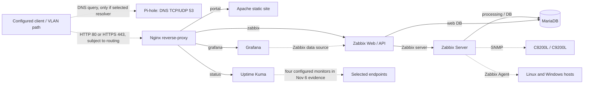

  
<a href="README.pt-BR.md"><strong>Português (Brasil) — versão completa</strong></a>

   

**A real physical laboratory. A fictional company. From the rack to a documented NOC.**

**Networking / Cisco**

      

**Linux / Containers**

    

**Monitoring / Services**

      

**Voice / Authentication**

  

## README contents

| | | |
| --- | --- | --- |
| [01 · Overview](#sec-01) | [02 · Objectives](#sec-02) | [03 · Key numbers](#sec-03) |
| [04 · Physical infrastructure](#sec-04) | [05 · All 7 VLANs](#sec-05) | [06 · Full topology](#sec-06) |
| [07 · Containers](#sec-07) | [08 · Data and service flows](#sec-08) | [09 · Telephony and authentication](#sec-09) |
| [10 · Observability](#sec-10) | [11 · Evidence gallery](#sec-11) | [12 · SNMP troubleshooting](#sec-12) |
| [13 · NOC operations](#sec-13) | [14 · Technical delivery](#sec-14) | [15 · Decisions and skills](#sec-15) |
| [16 · Costs](#sec-16) | [17 · Complete documentation](#sec-17) | [18 · Delivery scope](#sec-18) |
| [19 · Authorship](#sec-19) | [20 · Acknowledgments](#sec-20) | [21 · Contact](#sec-21) |

---

## 01 · Project overview — Enterprise NOC and Tapajós Inovações

**Enterprise NOC — From Scratch** is **my first project in Network Administration**. I planned, configured, integrated and documented a corporate infrastructure built in a **real physical laboratory**, from network racks, Cisco equipment and departmental workstations to Linux servers, containers and centralized observability.

**Tapajós Inovações** is the fictional company that gives the architecture its corporate identity. I designed the environment around seven business and operational segments: **IT/NOC, Accounting, Finance, Sales, Voice/Authentication, Corporate Wi-Fi and IoT**. Each segment has its own documented equipment, functions and dependencies.

### What this infrastructure project addresses

A corporate network is more than connected computers. It requires **physical organization, logical segmentation, reliable services, telemetry, troubleshooting and documentation**. I structured the project around four technical pillars:

| Pillar | Implemented and documented solution |
| --- | --- |
| **Physical infrastructure** | Network rack, Cisco router and switch, Cat6 patch panel, cable organization, hardware inventory and C9200L interface mapping. |
| **Networking and segmentation** | Seven VLANs, access/trunk ports, departmental networks, endpoint addressing and dedicated corporate Wi-Fi / IoT segments. |
| **Services and communications** | Two Linux servers with separate roles; Docker/Compose, Nginx reverse proxy, Apache, MariaDB, Pi-hole, Asterisk, FreeRADIUS and IP telephony. |
| **NOC and observability** | Zabbix, Grafana, Uptime Kuma, SNMP/Agent monitoring, incident records, troubleshooting and operational runbooks. |

### What this repository delivers

The repository contains **the recorded infrastructure, publishable configuration examples, detailed service documentation, monitoring results, real troubleshooting cases, inventories, financial analysis and complete technical documentation in English and Portuguese**. The [English corporate portal](https://kayo-willian.github.io/enterprise-noc-from-scratch/) is the visual showcase; this README is the entry point into the engineering work.

**Network Administration project completed and documented.** Monitoring timestamps identify the reference captures, not live telemetry.

---

## 02 · Objectives and infrastructure deliverables

My goal was to build an end-to-end infrastructure: **physical devices → VLANs and endpoints → servers and containers → enterprise services → monitoring → NOC procedures**. The result consists of independent components brought together under one architecture.

| Layer | Project deliverable |
| --- | --- |
| **Physical installation and inventory** | Network rack, C8200L, C9200L, cabling and patch panel, photographs and switch-port mapping. |
| **Cisco network** | Seven documented VLANs, router-facing trunk, departmental switch ports, wireless and IoT infrastructure. |
| **Operating systems** | Debian 13 NOC server; separate Debian voice/authentication server; eight departmental Windows workstations. |
| **Containers** | Ten Portainer-inventoried containers in three stacks, with documented services, ports, volumes and networks. |
| **Internal services** | Zabbix, Grafana, Nginx, Apache, MariaDB, Pi-hole, Uptime Kuma, Portainer, Asterisk and FreeRADIUS. |
| **Operations** | Monitoring for 12 registered hosts, metrics, triggers, a resolved SNMP incident and documented incident procedures. |
| **Public deliverables** | Bilingual technical documentation, GitHub Pages portal, 52-question FAQ, 25 selected images and a three-scenario budget. |

The focus is **infrastructure engineering and NOC operations**, not a disconnected tool demonstration. Every technical decision serves a defined purpose: organization, segmentation, service access, data persistence, observability or troubleshooting.

---

## 03 · Laboratory by the numbers

| Indicator | Recorded count | Source and context |
| --- | ---: | --- |
| Logical segments | **7 VLANs** | C9200L configuration, Nov 4, 2026 |
| Principal Cisco devices | **2** | Catalyst C8200L router + C9200L switch |
| Inventoried computers | **10** | 8 Windows workstations + 2 Linux computers |
| Zabbix registered hosts | **12** | 10 computers + Cisco router and switch |
| Zabbix items | **1,820** | 1,698 enabled, 9 disabled and 113 unsupported |
| Zabbix triggers | **1,082** | 34 in problem state at capture time |
| Available host interfaces | **7 of 12** | Five hosts unavailable on Nov 6 |
| Docker containers | **10 running** | Portainer inventory, Nov 6; 3 observed stacks |
| IP telephones | **2 Grandstream** | Extensions 1001 (Sales) and 1002 (IT) |
| Wireless devices | **2 Archer AX53** | Separate corporate Wi-Fi and IoT units |
| IoT | **1 documented Alexa** | Associated with the VLAN 70 IoT Archer |
| Public evidence gallery | **25 images** | Curated corporate-portal assets |
| Technical FAQ | **52 questions** | Equivalent EN/PT coverage |

**Dates:** switch configuration and SNMP investigations on **Nov 4, 2026**; systems, Portainer and monitoring captures on **Nov 6, 2026**; cost reference on **Nov 11, 2026**. All numbers are **historical snapshots**, not live readings.

---

## 04 · Physical infrastructure — from rack to workstations

The environment includes a network rack, **Cisco Catalyst C8200L-1N-4T** router, **Catalyst C9200L-24T-4G** switch, Category 6 patch panel, cable organizer and Ethernet cabling. Departmental computers and both Linux systems are part of the documented physical topology.

The **Nov 4 C9200L configuration** records VLANs, interfaces and the trunk. The **Nov 6 inventory and photographs** show the physical Cisco devices, rack and structured cabling, with linked port maps and system records.

### Cisco C9200L port inventory

| Switch interface | Documented association | Evidence boundary |
| --- | --- | --- |
| `Gi1/0/1` | Cisco C8200L | Router-facing trunk, configured on the **C9200L switch** |
| `Gi1/0/2–3` | IT / NOC | Access VLAN 10 |
| `Gi1/0/4–6` | Accounting | Access VLAN 20 |
| `Gi1/0/7–8` | Finance | Access VLAN 30 |
| `Gi1/0/9–10` | Sales | Access VLAN 40 |
| `Gi1/0/11` | Asterisk / FreeRADIUS server | VLAN 50 assigned; see interface commands in the snapshot |
| `Gi1/0/12–13` | Two Grandstream phones | Access VLAN 50 |
| `Gi1/0/14` | Dedicated IoT Archer AX53 | Access VLAN 70 |
| `Gi1/0/15` | Corporate Wi-Fi Archer AX53 | Access VLAN 60 |
| `Gi1/0/16–24`, `Gi1/1/1–4` | Additional device interfaces | See captured IOS XE interface configuration |

**Cisco detail:** `Gi1/0/1` is the trunk recorded on the **C9200L**. The `Gi1/0/11` configuration includes `switchport access vlan 50` and `spanning-tree portfast trunk`; its actual commands are preserved in the [switch snapshot](docs/networking/switch-vlan-snapshot-2026-11-04.md).

[Physical evidence and photographs](docs/evidence/physical-infrastructure.md) · [Switch port map](docs/networking/switch-port-map.md) · [IOS XE snapshot](docs/networking/switch-vlan-snapshot-2026-11-04.md)

---

## 05 · All seven VLANs — devices, roles and addressing

**Every VLAN is documented separately**, with its role, C9200L ports and captured system addresses. Departmental subnets are organized by function; the [C8200L guide](docs/networking/router-c8200l.md) contains the router references.

### VLAN 10 — IT / NOC

- **Observed subnet:** `192.168.10.0/24`; **workstation gateway:** `192.168.10.1`.
- **Switch ports:** `Gi1/0/2–3`.
- **IT 1 / NOC:** Dell OptiPlex 3020, **Debian 13 (Trixie)**, `192.168.10.12`, i5-4590, ~8 GB RAM; hosts Docker services and observability.
- **IT 2:** **Windows** workstation, `192.168.10.13`; the inventory records the IP and operating-system category.
- **IT 1 services:** all ten recorded containers are detailed later; they are **not ten additional computers**.

### VLAN 20 — Accounting

- **Subnet:** `192.168.20.0/24`; **observed gateway:** `192.168.20.1`.
- **Switch ports:** `Gi1/0/4–6`.
- **Accounting 1:** Windows 11 Pro 21H2, `192.168.20.11`, i5-4590, 8 GB RAM.
- **Accounting 2:** Windows, `192.168.20.12`, i5-4590, 8 GB DDR3.
- **Accounting 3:** Windows 11 Pro 21H2, `192.168.20.13`, i5-4590, 8 GB RAM.

### VLAN 30 — Finance

- **Subnet:** `192.168.30.0/24`; **observed gateway:** `192.168.30.1`.
- **Switch ports:** `Gi1/0/7–8`.
- **Finance 1:** Windows, `192.168.30.10`, i5-4590, 8 GB RAM.
- **Finance 2:** Windows, `192.168.30.11`, i5-4590, 8 GB RAM.

### VLAN 40 — Sales

- **Subnet:** `192.168.40.0/24`; **observed gateway:** `192.168.40.1`.
- **Switch ports:** `Gi1/0/9–10`.
- **Sales 1:** Windows, `192.168.40.11`, i5-4590, 8 GB RAM.
- **Sales 2:** Windows, `192.168.40.10`, i5-4590, 8 GB RAM.

### VLAN 50 — Voice, authentication and IP telephony

- **Subnet:** `192.168.50.0/24`; **gateway recorded on server:** `192.168.50.1`.
- **Switch ports:** `Gi1/0/11–13`; `Gi1/0/11` has VLAN 50 assigned in the switch snapshot.
- **Physical server:** Dell OptiPlex 3020, **Debian forky/sid at capture**, `192.168.50.2`, i5-4590, ~8 GB RAM; runs **Asterisk, FreeRADIUS, Zabbix Agent and OpenSSH**.
- **Grandstream / Sales:** extension **1001**, `192.168.50.10`.
- **Grandstream / IT:** extension **1002**, `192.168.50.11`.
- **Linux services:** Asterisk SIP/PJSIP, RTP, dialplan, FreeRADIUS, Zabbix Agent and OpenSSH.

### VLAN 60 — Corporate Wi-Fi

- **Switch port:** `Gi1/0/15`, access VLAN 60.
- **Physical equipment:** **TP-Link Archer AX53 Wi-Fi 6 AX3000**, dedicated to corporate wireless.
- **Role in the architecture:** provides corporate wireless access infrastructure. Public documentation records the device and switch connection without disclosing SSIDs or credentials.
- **Network authentication:** the FreeRADIUS service is hosted on the dedicated Debian server in VLAN 50; see the telephony and authentication section.

### VLAN 70 — IoT and Alexa

- **Switch port:** `Gi1/0/14`, access VLAN 70.
- **Separate physical unit:** **another TP-Link Archer AX53 Wi-Fi 6 AX3000**, dedicated to IoT.
- **Associated IoT client:** **Amazon Alexa**, shown with the IoT AX53 in the documentation and topology.
- **IoT device association:** the dedicated Archer AX53 connects the **Alexa** in the documented IoT architecture. Private client addresses and Wi-Fi configuration are not reproduced in the public README.

**Segmentation:** the seven VLANs organize distinct Layer 2 broadcast domains and provide the foundation for communication policies between departments and services. [Complete VLAN documentation](docs/networking/vlans.md).

---

## 06 · Full topology — physical infrastructure, machines and services

This **full infrastructure topology** displays **seven VLANs**, **ten computers**, **two IP phones**, **two Archer AX53 units**, **Alexa**, the **C8200L/C9200L** and **all ten containers**. It also shows the relationships between Nginx, Zabbix, MariaDB, Grafana, DNS and voice services.

**Legend:** solid connections indicate equipment and service associations; dashed connections identify monitoring, management and logical dependencies. `*.example.test` represents virtual-host names in the sanitized Nginx configuration.

```mermaid
flowchart TB
    ROUTER["Cisco Catalyst C8200L-1N-4T<br/>Router / Layer 3 role"]
    SW["Cisco Catalyst C9200L-24T-4G<br/>Switch / VLAN assignments"]
    ROUTER ---|"Trunk Cisco / C9200L Gi1/0/1"| SW

    subgraph V10["VLAN 10 — IT / NOC — 192.168.10.0/24 — Gi1/0/2-3"]
      IT1["IT 1 / Main NOC<br/>Dell OptiPlex 3020 / Debian 13<br/>192.168.10.12 / i5-4590 / ~8 GB"]
      IT2["IT 2 / Windows workstation<br/>192.168.10.13"]
      subgraph CONTAINERS["Docker on IT 1 — 10 running containers in the Nov 6 inventory"]
        ENGINE["Docker Engine / Compose / bridge networks"]
        subgraph MAIN["Main Compose service network — zabbix-net"]
          ZS["zabbix-server<br/>Zabbix Server / 10051"]
          ZW["zabbix-web<br/>Apache frontend / host 8082"]
          ZA["zabbix-agent<br/>local agent / host 10050"]
          DB["zabbix-db<br/>MariaDB 11.4 / persistent bind mount"]
          GF["grafana<br/>Grafana dashboards / host 3000"]
          UK["uptime-kuma<br/>service checks / host 3001"]
          RP["reverse-proxy<br/>Nginx / host 80 + 443"]
          WEB["site-estatico<br/>Apache HTTPD / host 8081"]
        end
        subgraph PI_STACK["Separate Pi-hole Compose stack"]
          PI["pihole<br/>DNS 53 TCP/UDP / web host 8080"]
        end
        subgraph PT_STACK["Separate Portainer Compose stack"]
          PT["portainer<br/>Docker management / 8000, 9000, 9443"]
        end
      end
    end

    subgraph V20["VLAN 20 — ACCOUNTING — 192.168.20.0/24 — Gi1/0/4-6"]
      AC1["Accounting 1 / Windows 11 Pro<br/>192.168.20.11"]
      AC2["Accounting 2 / Windows<br/>192.168.20.12"]
      AC3["Accounting 3 / Windows 11 Pro<br/>192.168.20.13"]
    end
    subgraph V30["VLAN 30 — FINANCE — 192.168.30.0/24 — Gi1/0/7-8"]
      FI1["Finance 1 / Windows<br/>192.168.30.10"]
      FI2["Finance 2 / Windows<br/>192.168.30.11"]
    end
    subgraph V40["VLAN 40 — SALES — 192.168.40.0/24 — Gi1/0/9-10"]
      SA1["Sales 1 / Windows<br/>192.168.40.11"]
      SA2["Sales 2 / Windows<br/>192.168.40.10"]
    end
    subgraph V50["VLAN 50 — VOICE / AUTH — 192.168.50.0/24 — Gi1/0/11-13"]
      PBX["Dell OptiPlex 3020 / Debian forky/sid<br/>192.168.50.2 / i5-4590 / ~8 GB<br/>Asterisk 22.10.1 + FreeRADIUS 3.2.10<br/>Zabbix Agent + OpenSSH"]
      PH1["Grandstream / Sales<br/>Extension 1001 / 192.168.50.10"]
      PH2["Grandstream / IT<br/>Extension 1002 / 192.168.50.11"]
    end
    subgraph V60["VLAN 60 — CORPORATE WI-FI — Gi1/0/15"]
      AXC["TP-Link Archer AX53 / Wi-Fi 6<br/>Corporate wireless device<br/>Corporate Wi-Fi uplink / VLAN 60"]
    end
    subgraph V70["VLAN 70 — IoT — Gi1/0/14"]
      AXI["Separate TP-Link Archer AX53 / Wi-Fi 6<br/>IoT access / VLAN 70"]
      ALEXA["Amazon Alexa / IoT client<br/>Smart-home endpoint / IoT"]
      AXI ---|"Wi-Fi / device association"| ALEXA
    end

    SW --- IT1
    SW --- IT2
    SW --- AC1
    SW --- AC2
    SW --- AC3
    SW --- FI1
    SW --- FI2
    SW --- SA1
    SW --- SA2
    SW --- PBX
    SW --- PH1
    SW --- PH2
    SW --- AXC
    SW --- AXI

    IT1 --> ENGINE
    ENGINE --> ZS
    ENGINE --> ZW
    ENGINE --> ZA
    ENGINE --> DB
    ENGINE --> GF
    ENGINE --> UK
    ENGINE --> RP
    ENGINE --> WEB
    ENGINE --> PI
    ENGINE --> PT

    ZS -->|"DB_SERVER_HOST=db"| DB
    ZW -->|"Zabbix DB"| DB
    ZW -->|"Zabbix backend"| ZS
    ZA -.->|"Zabbix Agent"| ZS
    GF -.->|"Zabbix datasource / API"| ZW
    RP -->|"portal.noc.example.test"| WEB
    RP -->|"zabbix.noc.example.test"| ZW
    RP -->|"grafana.noc.example.test"| GF
    RP -->|"status.noc.example.test"| UK
    PT -.->|"Docker socket / host management"| ENGINE

    ZS -.->|"SNMPv2c / monitoring"| ROUTER
    ZS -.->|"SNMPv2c / monitoring"| SW
    ZS -.->|"Zabbix Agent / monitoring"| PBX
    ZS -.->|"Zabbix Agent / monitoring"| IT2
    ZS -.-> AC1
    ZS -.-> AC2
    ZS -.-> AC3
    ZS -.-> FI1
    ZS -.-> FI2
    ZS -.-> SA1
    ZS -.-> SA2
    PBX -.->|"SIP/PJSIP / registered extension"| PH1
    PBX -.->|"SIP/PJSIP / registered extension"| PH2

    classDef network fill:#13324a,stroke:#38bdf8,color:#e7f5ff,stroke-width:2px
    classDef linux fill:#213b2e,stroke:#4ade80,color:#ecfff0,stroke-width:2px
    classDef services fill:#33291c,stroke:#f59e0b,color:#fff5dc,stroke-width:1.5px
    classDef endpoint fill:#242939,stroke:#94a3b8,color:#f1f5f9
    class ROUTER,SW,AXC,AXI network
    class IT1,PBX linux
    class ZS,ZW,ZA,DB,GF,UK,RP,WEB,PI,PT,ENGINE services
    class IT2,AC1,AC2,AC3,FI1,FI2,SA1,SA2,PH1,PH2,ALEXA endpoint

```

**Docker stack layout:** the Debian NOC host contains **eight services in the main stack**, plus **Pi-hole** and **Portainer** in separate Compose stacks. This organization is shown in the diagram and documented through the source configuration files.

[Consolidated logical topology](docs/networking/consolidated-logical-topology.md) · [Computer inventory](docs/endpoints/workstation-inventory.md) · [Docker architecture](docs/containers/docker-services.md)

---

## 07 · Debian 13 host — all ten containers and their functions

**IT 1 / NOC** (`192.168.10.12`) hosts the Docker environment recorded on **Nov 6, 2026**: **1 environment, 3 stacks, 10 running containers, 11 images, 4 volumes and 6 Docker networks**. Portainer also recorded four positive health checks.

| Container | Recorded image | Published host port(s) | Function / dependency |
| --- | --- | --- | --- |
| `reverse-proxy` | `nginx:alpine` | `80`, `443` | Nginx; routes virtual hosts to web applications |
| `zabbix-web` | `zabbix/zabbix-web-apache-mysql:ubuntu-7.0-latest` | `8082` | Apache/PHP Zabbix frontend; depends on Zabbix Server and MariaDB |
| `zabbix-server` | `zabbix/zabbix-server-mysql:ubuntu-7.0-latest` | `10051` | Monitors items/triggers; database-dependent |
| `zabbix-agent` | `zabbix/zabbix-agent:ubuntu-7.0-latest` | `10050` | Local monitoring agent in the stack |
| `zabbix-db` | `mariadb:11.4` | **No published port** | Zabbix persistent data; `./zabbix-db-data` bind mount |
| `grafana` | `grafana/grafana-oss:latest` | `3000` | Zabbix data visualization through its plugin |
| `uptime-kuma` | `louislam/uptime-kuma:1` | `3001` | Endpoint monitoring and state history |
| `site-estatico` | `httpd:alpine` | `8081` | Apache static site, **internal** to the laboratory |
| `pihole` | `pihole/pihole:latest` | `53/tcp`, `53/udp`, `8080` | DNS filtering; separate Compose file |
| `portainer` | `portainer/portainer-ce:latest` | `8000`, `9000`, `9443` | Docker management via socket; separate Compose file |

**Configuration and security:** the Compose files specify image tags, network topology, published ports and mounts. Passwords, private TLS keys, persistent data and internal content remain outside Git; `.env.example` provides local setup variables.

The main-stack services use the **`zabbix-net`** Docker network. **Pi-hole** and **Portainer** are maintained through their own Compose definitions, with the role of each stack specified in the documentation.

[Docker/Portainer documentation](docs/containers/docker-services.md) · [Main Compose](docker_configs/docker-compose.yml) · [Pi-hole Compose](docker_configs/lab-ti/pihole/docker-compose.yml) · [Portainer Compose](docker_configs/lab-ti/portainer/docker-compose.yml)

---

## 08 · Service flows — DNS, proxy, Zabbix and dashboards

### 08.1 · Web application access

The application path combines **IP addressing/routing**, **DNS resolution**, **Nginx** on ports **80/443** and the upstream selected by hostname. DNS, proxy routing and network access are distinct layers of the architecture.

| Sanitized virtual hostname | Nginx internal upstream | Application |
| --- | --- | --- |
| `portal.noc.example.test` | `site-estatico:80` | Internal corporate website (Apache) |
| `zabbix.noc.example.test` | `zabbix-web:8080` | Zabbix interface/API |
| `grafana.noc.example.test` | `grafana:3000` | Grafana dashboards |
| `status.noc.example.test` | `uptime-kuma:3001` | Uptime Kuma checks |

The Nginx configuration serves **HTTP 80 and HTTPS 443**; Compose additionally publishes application ports `8081`, `8082`, `3000` and `3001`. **GitHub Pages** is a separate, public static portal, distinct from the local Apache/Nginx services.

[Nginx technical guide](docs/services/nginx-reverse-proxy/README.md) · [`nginx.conf`](docker_configs/reverse-proxy/nginx.conf) · [Virtual hosts `lab.conf`](docker_configs/reverse-proxy/conf.d/lab.conf)

### 08.2 · Monitoring data path

- **Zabbix Server** processes data from **SNMP** interfaces on Cisco equipment and **Zabbix Agents** on registered computers.
- **MariaDB** stores Zabbix Server/Web data, with a health check and persistent host-mounted storage.
- **Grafana** queries/visualizes Zabbix through an integration; an empty panel may involve items, API, query range or presentation.
- **Uptime Kuma** records status and event history for the **four monitors** shown in the reference capture.
- **Pi-hole** records DNS queries from configured clients and applies domain-filtering policies.

[Zabbix](docs/monitoring/zabbix-monitoring.md) · [Grafana](docs/monitoring/grafana-monitoring.md) · [DNS/availability](docs/services/dns-and-availability.md) · [MariaDB](docs/services/mariadb-zabbix/README.md)

---

## 09 · IP telephony and authentication — dedicated VLAN 50 server

Voice and authentication run on a **second Dell OptiPlex 3020**, separate from the NOC Docker host. It used **Debian forky/sid** at the November 6, 2026 capture, IP `192.168.50.2/24`, and had four services recorded as active.

| Service | Server implementation | Architectural role |
| --- | --- | --- |
| **Asterisk 22.10.1** | SIP/PJSIP PBX, UDP `5060` signaling, UDP `10000–20000` RTP media and dialplan | IP telephony and internal extension management |
| **FreeRADIUS 3.2.10** | UDP `1812/1813` RADIUS, authentication configuration and EAP methods | Central network authentication service |
| **Zabbix Agent** | Active Linux monitoring agent | Integrates the server with Zabbix monitoring |
| **OpenSSH** | Linux remote administration service | Technical host administration |

### Extensions and configured dialplan features

| Extension | Association / application | Address or function |
| --- | --- | --- |
| **1001** | Grandstream telephone — Sales | `192.168.50.10` |
| **1002** | Grandstream telephone — IT | `192.168.50.11` |
| **8888** | `Playback(hello-world)` | Dialplan audio-playback application |
| **9999** | `Echo()` | Dialplan echo application |

The server configuration also documents AMI/TCP `5038` as localhost-restricted. Both Grandstream devices were photographed and their addresses recorded. **FreeRADIUS** is hosted on the same server and provides network-authentication services; the corporate Wi-Fi physical connection is shown in the C9200L VLAN 60 port map.

[Complete Asterisk and FreeRADIUS guide](docs/services/asterisk-freeradius.md) · [Voice and VLAN 50 in the topology](#sec-06)

---

## 10 · Observability — metrics, findings and gaps

Monitoring is documented as **Zabbix Server/Frontend 7.0.32** on Debian/Docker, with **Grafana** dashboards. Registered hosts include the router, switch, both Linux computers and eight Windows workstations.

| Nov 6, 2026 metric | Historical observation |
| --- | ---: |
| Enabled hosts | 12 |
| Available / unavailable hosts | **7 / 5** |
| Available Cisco SNMP interfaces | **2** |
| Available / unavailable passive agent interfaces | **5 / 5** |
| Templates | 356 |
| Total items | 1,820 |
| Enabled / disabled items | 1,698 / 9 |
| Unsupported items | **113** |
| Total triggers | 1,082 |
| Triggers in problem state | **34** |
| HA cluster | Inactive |

**Operational interpretation:** the five unavailable registrations, 113 unsupported items and 34 problem triggers are separate monitoring signals. They were captured and analyzed as part of the NOC troubleshooting work.

### Address discrepancies: photographed workstations vs Zabbix

Comparing photographed IP addresses with Zabbix registrations identified **six mismatches on Windows workstations**. This finding supports investigation of agent connectivity and collection.

| Workstation | Photographed IPv4 | Zabbix host IPv4 |
| --- | --- | --- |
| IT 2 | `192.168.10.13` | `192.168.10.11` |
| Accounting 2 | `192.168.20.12` | `192.168.20.10` |
| Accounting 3 | `192.168.20.13` | `192.168.20.12` |
| Finance 1 | `192.168.30.10` | `192.168.30.13` |
| Sales 1 | `192.168.40.11` | `192.168.40.14` |
| Sales 2 | `192.168.40.10` | `192.168.40.13` |

[Zabbix findings](docs/monitoring/zabbix-monitoring.md) · [Grafana dashboards](docs/monitoring/grafana-monitoring.md) · [Zabbix Agent runbook](docs/noc-operations/runbooks/zabbix-agent-connectivity.md)

---

## 11 · Selected gallery — actual laboratory evidence

<table>
  <tr>
    <td width="50%" align="center"> <b>Cisco infrastructure</b> Router, switch and structured cabling</td>
    <td width="50%" align="center"> <b>Zabbix</b> Monitoring, hosts and historical alerts</td>
  </tr>
  <tr>
    <td align="center"> <b>Grafana</b> Metrics and Cisco dashboards</td>
    <td align="center"> <b>Portainer</b> Ten containers running at capture time</td>
  </tr>
</table>

These are **four representative records**, not a duplication of the 25-image portal gallery. The physical photo is a **Cisco equipment close-up rather than the wide laboratory view**. Every capture is historical and should be interpreted with its technical record.

**All 25 gallery images:** [English portal](https://kayo-willian.github.io/enterprise-noc-from-scratch/#evidence) · [Portuguese portal](https://kayo-willian.github.io/enterprise-noc-from-scratch/pt-BR/#evidence) · [Evidence log](docs/evidence/evidence-collection-2026-11-06.md).

---

## 12 · Real troubleshooting — restoring SNMP collection on the C9200L

**Documented case, Nov 4, 2026 · Cisco C9200L · SNMPv2c / Zabbix**

| Stage | Recorded investigation |
| --- | --- |
| **Symptom** | After C9200L onboarding, Zabbix marked the SNMP interface unavailable; metric collection/interface discovery could not proceed. |
| **Investigation** | IP reachability, Linux SNMP queries, switch SNMP configuration and inherited Zabbix host settings were compared. |
| **Confirmed cause** | The host's inherited SNMP community **did not match** the switch configuration. |
| **Recorded correction** | Align the community through host macro `{$SNMP_COMMUNITY}` and reload the Zabbix Server configuration cache. |
| **Result** | The SNMP interface became available and metric collection/interface discovery resumed in the historical record. |

**Two further investigations** were recorded: an incorrect **uptime monitoring item** (widget read `0` until its key was replaced) and empty event widgets caused by a **switch-only filter**, not necessarily missing monitoring. The Nov 4 corrections must not be conflated with unsupported items or unavailable agents observed on Nov 6.

[All three SNMP cases](docs/monitoring/snmp-troubleshooting.md) · [Cisco interface runbook](docs/noc-operations/runbooks/cisco-interface-unavailable.md)

---

## 13 · NOC operations — incident handling and runbooks

I produced operational documentation so the infrastructure can be **observed, investigated and maintained through repeatable procedures**. The records separate alerts, symptoms, technical causes and corrective actions, with the C9200L incident as a concrete example of completed troubleshooting.

| Operational document | Scope |
| --- | --- |
| [Incident management](docs/noc-operations/incident-management.md) | Recording, prioritizing, assessing impact, tracking and closing incidents. |
| [Cisco interfaces](docs/noc-operations/runbooks/cisco-interface-unavailable.md) | Link/interface status, VLANs, trunks, error counters and network dependencies. |
| [DNS resolution](docs/noc-operations/runbooks/dns-resolution-failure.md) | DNS queries, Pi-hole, upstream resolvers, filtering and application diagnosis. |
| [Docker services](docs/noc-operations/runbooks/docker-service-failure.md) | Container states, health checks, logs, networks and dependencies. |
| [Grafana no-data issues](docs/noc-operations/runbooks/grafana-no-data.md) | Zabbix data source, API, items, queries and dashboard time ranges. |
| [Zabbix Agent connectivity](docs/noc-operations/runbooks/zabbix-agent-connectivity.md) | Host records, IP addresses, agents, firewalls and collection. |
| [Host resources](docs/noc-operations/runbooks/host-resource-utilization.md) | CPU, RAM, storage, inodes and Linux/Docker resources. |
| [Exercises and recovery](docs/noc-operations/incident-simulation-and-validation.md) | Defined scenarios, assessment criteria and recovery procedures. |

**Delivered:** a complete, navigable operational reference. These procedures address interface, DNS, Docker, dashboard and host-resource incidents; the SNMP case demonstrates a correction performed during implementation.

---

## 14 · Technical delivery — implemented and documented components

The project brings together **three completed deliverables**: installed/configured equipment and services, collected operating evidence, and the finished technical/operational documentation. This table summarizes the **project delivery**, not an outstanding-issues tracker.

| Domain | Completed deliverable | Available evidence |
| --- | --- | --- |
| **Physical infrastructure** | Network rack, patch panel, Cisco C8200L, C9200L and departmental workstations | Photographs and physical inventory. |
| **Cisco networking** | Seven VLANs, departmental switch ports, C9200L `Gi1/0/1` trunk and interface map | IOS XE configuration and segment documentation. |
| **Systems and endpoints** | Eight Windows workstations and two Linux systems with defined roles | Hardware, operating-system and captured IP inventory. |
| **Debian and Docker** | Debian 13 NOC server with ten containers and three recorded stacks | `docker ps`, Portainer, Compose and container documentation. |
| **Zabbix monitoring** | Zabbix 7.0.32 with 12 hosts, 1,820 items, triggers and dashboards | Nov 6 screenshots, including availability and item states. |
| **Grafana** | Dashboards for router, switch, workstations and services | Dashboard gallery and data-source documentation. |
| **C9200L SNMP** | Collection restored and uptime/widget-filter issues corrected | Three Nov 4 troubleshooting cases. |
| **Nginx and Apache** | Reverse proxy, virtual hosts and local web service | Nginx/Compose configuration and routing examples. |
| **MariaDB** | Zabbix database, health check and host-directory persistence | Compose config and dedicated technical guide. |
| **Pi-hole** | DNS/filtering service with observed query activity | Compose and DNS dashboards. |
| **Uptime Kuma** | Endpoint monitoring and event history | Four recorded monitors and availability events. |
| **Asterisk and FreeRADIUS** | Dedicated Debian server, active services, dialplan and RADIUS authentication | Service reports, configurations and telephone photographs. |
| **Corporate Wi-Fi and IoT** | Two dedicated Archer AX53 devices, VLANs 60/70 and Alexa associated with IoT | Port map and hardware records. |
| **NOC documentation** | Runbooks, incident guides, FAQs and bilingual technical indexes | Complete repository documents. |
| **Portal and financial analysis** | Bilingual public site, evidence gallery and BRL/USD budget | GitHub Pages, 25 images, reports and spreadsheets. |

**In summary:** a built and recorded infrastructure, deployed services, historical monitoring results, resolved troubleshooting cases and published technical documentation. This is the final **Enterprise NOC — From Scratch** deliverable.

---

## 15 · My engineering decisions and demonstrated skills

The infrastructure decisions were mine: **I designed the logical organization, configured the services, integrated networking and monitoring components, carried out troubleshooting and structured the documentation**. The work demonstrates applied skills, from commands and configurations to metrics analysis and documented technical reasoning.

| Decision / implementation | Applied knowledge |
| --- | --- |
| **Cisco C8200L + C9200L** | Routing and switching roles, IOS XE records, trunks, access ports and endpoint mapping. |
| **VLANs 10–70** | Departmental segmentation, Layer 2 domains and service connectivity requirements. |
| **Debian servers** | Linux administration, services, network interfaces and specialized host roles. |
| **Docker and Compose** | Containers, stacks, bridge networks, ports, volumes, persistence and dependencies. |
| **Zabbix / SNMP / Agents** | Host records, Cisco monitoring, items, triggers, SNMP communities and troubleshooting. |
| **Grafana** | Dashboards, time-series interpretation, Zabbix data-source integration and incident correlation. |
| **Nginx, Apache and MariaDB** | HTTP/HTTPS routing, web services, database dependencies and persistent storage. |
| **Asterisk and FreeRADIUS** | SIP telephony, PJSIP extensions, authentication services and port/protocol documentation. |
| **Pi-hole and Uptime Kuma** | DNS, filtering, availability checks and event interpretation. |
| **NOC and documentation** | Runbooks, incident management, inventory, evidence logs and bilingual technical material. |

### What I built

**I designed and built the technical infrastructure of this project:** planned the network architecture, made segmentation and service decisions, configured the laboratory components, integrated Linux, Docker and observability, and investigated actual failures during deployment. My work is reflected in the Cisco mappings, Compose and Nginx files, system screenshots, operational procedures and resolved SNMP incident.

**I also built the public presentation:** organized the inventories, wrote and consolidated the **English and Portuguese** documentation, structured the FAQ, runbooks, cost analysis and corporate portal. The README brings these deliverables together into one flow: **architecture → implementation → operations → troubleshooting → documentation**.

The experience brings together **physical infrastructure, Cisco networking, Linux administration, NOC operations and technical documentation** in one integrated solution.

---

## 16 · Infrastructure costs — three scenarios

The budget separates **full equipment acquisition**, **deployment using existing assets** and **monthly operations**. The USD amounts are converted from BRL at **USD 1.00 = BRL 5.5600**, using **Nov 11, 2026** as the reference.

| Scenario | BRL amount | USD equivalent |
| --- | ---: | ---: |
| **A — Full acquisition and deployment** | **R$ 86,683.14** | **$15,590.49** |
| **B — Using existing hardware** | **R$ 7,448.85** | **$1,339.72** |
| **C — Monthly operations** | **R$ 1,084.09/month** | **$194.98/month** |

The values are **estimates**, not verified purchases. USD values are **conversions of the BRL study**, not an independent pricing survey of the US market.

[BRL report](docs/pt-BR/custos/enterprise-noc-orcamento-final-brl-2026.md) · [BRL workbook](docs/pt-BR/custos/enterprise-noc-orcamento-final-brl-2026.xlsx) · [USD report](docs/costs/enterprise-noc-final-budget-usd-2026.md) · [USD workbook](docs/costs/enterprise-noc-final-budget-usd-2026.xlsx)

---

## 17 · Complete documentation — browse technical domains

This README is the **technical front page of the completed project**, linking the full configurations, inventories, procedures, evidence, service documentation and budgets.

### Network, switching and routing

[Overview](docs/networking/README.md) · [Logical topology](docs/networking/consolidated-logical-topology.md) · [VLANs](docs/networking/vlans.md) · [C8200L router](docs/networking/router-c8200l.md) · [C9200L port map](docs/networking/switch-port-map.md) · [Switch snapshot](docs/networking/switch-vlan-snapshot-2026-11-04.md) · [Wi-Fi VLAN 60](docs/networking/corporate-wifi-vlan60.md) · [IoT VLAN 70](docs/networking/iot-vlan70.md)

### Physical equipment and system inventory

[Rack photos](docs/evidence/physical-infrastructure.md) · [Workstation inventory](docs/endpoints/workstation-inventory.md) · [Evidence collection](docs/evidence/evidence-collection-2026-11-06.md)

### Linux, containers and enterprise services

[Docker](docs/containers/docker-services.md) · [Nginx](docs/services/nginx-reverse-proxy/README.md) · [MariaDB/Zabbix](docs/services/mariadb-zabbix/README.md) · [DNS and availability](docs/services/dns-and-availability.md) · [Asterisk/FreeRADIUS](docs/services/asterisk-freeradius.md)

### Zabbix, Grafana and network monitoring

[Zabbix](docs/monitoring/zabbix-monitoring.md) · [Grafana](docs/monitoring/grafana-monitoring.md) · [SNMP troubleshooting](docs/monitoring/snmp-troubleshooting.md)

### NOC operations, incidents and runbooks

[Incident management](docs/noc-operations/incident-management.md) · [Exercises and validation](docs/noc-operations/incident-simulation-and-validation.md) · [Cisco](docs/noc-operations/runbooks/cisco-interface-unavailable.md) · [DNS](docs/noc-operations/runbooks/dns-resolution-failure.md) · [Docker](docs/noc-operations/runbooks/docker-service-failure.md) · [Grafana](docs/noc-operations/runbooks/grafana-no-data.md) · [Zabbix Agent](docs/noc-operations/runbooks/zabbix-agent-connectivity.md) · [Resources](docs/noc-operations/runbooks/host-resource-utilization.md)

### Corporate portal, FAQ and costs

[English portal](https://kayo-willian.github.io/enterprise-noc-from-scratch/) · [Portuguese portal](https://kayo-willian.github.io/enterprise-noc-from-scratch/pt-BR/) · [Site architecture](docs/site/README.md) · [Technical FAQ — 52 questions](docs/faq/technical-faq.md) · [Cost analysis](docs/costs/enterprise-noc-final-budget-usd-2026.md)

**Technical indexes:** [English](docs/README.md) · [Português](docs/pt-BR/README.md).

---

## 18 · Delivery scope and technical sources

**Enterprise NOC — From Scratch** is a physical infrastructure project documented under the fictional enterprise **Tapajós Inovações**. The delivery includes the Cisco equipment, computers, servers, services and procedures described throughout the repository. The corporate identity is fictional; the laboratory, analyzed configurations, screenshots and troubleshooting records are real.

The **C9200L and SNMP** records refer to **Nov 4, 2026**; system, container and dashboard inventories to **Nov 6, 2026**. All numerical indicators use these capture dates as their reference. **GitHub Pages hosts a static showcase**, while the NOC services described here belong to the local laboratory.

Detailed technical guides define each component's scope. For example, **trunk `Gi1/0/1` belongs to the C9200L**, the two Archer AX53 units have separate roles, and the Zabbix captures include both available hosts and recorded availability incidents. This level of detail makes each network relationship easy to locate and the recorded operating states easy to interpret.

**Publication practices:** SNMP secrets, credentials, private TLS keys, SSIDs, tokens, personal addresses and persistent data files are not part of the public archive. The repository contains sanitized configuration examples and selected technical evidence.

---

## 19 · Authorship

**Kayo Willian — Network Administrator | Enterprise NOC — From Scratch**

This is **my first complete Network Administration project**. I am responsible for the **technical planning, architecture decisions, configurations, service integration, troubleshooting and documentation** presented in this repository.

I built this project to demonstrate how a physical corporate infrastructure connects **networking, Linux, containers, observability and NOC operations**. Tapajós Inovações is the fictional corporate identity used to organize the solution's departments and services.

**License:** [MIT](LICENSE).

---

## 20 · Tool acknowledgments

Supporting tools used for **technical writing, organization and review of the documentation**:

| Tool | Identification |
| --- | --- |
| **ChatGPT** | **OpenAI GPT-6** |
| **Antigravity** | **Gemini 3.8 Flash · High** |

**Enterprise NOC planning, implementation and authorship: Kayo Willian.**

---

## 21 · Contact

  

