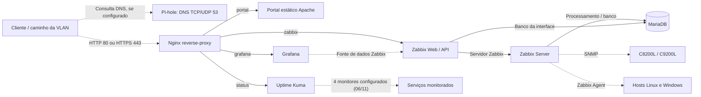
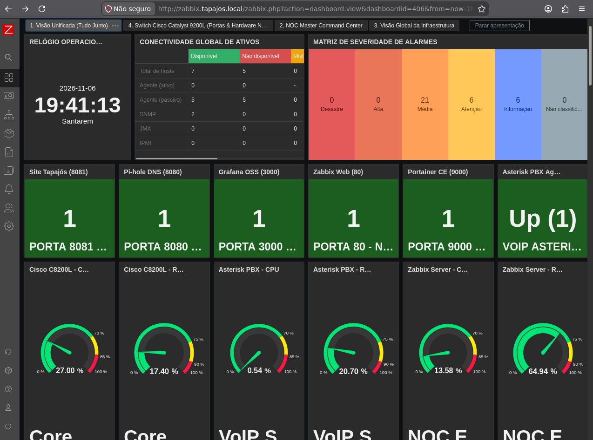
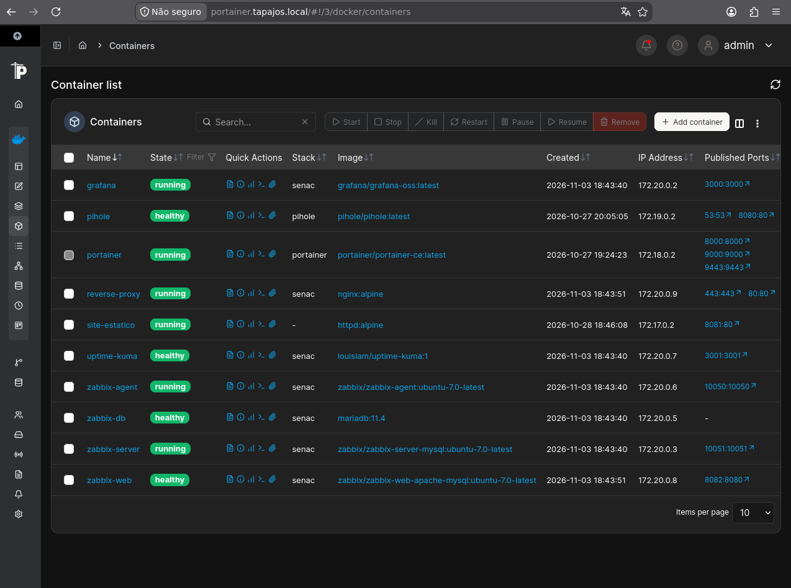

  
<a href="README.md"><strong>English — complete version</strong></a>

   

**Um laboratório físico real. Uma empresa fictícia. Do rack ao NOC documentado.**

**Redes / Cisco**

      

**Linux / Containers**

    

**Monitoramento / Serviços**

      

**Telefonia / Autenticação**

  

## Índice do README

| | | |
| --- | --- | --- |
| [01 · Apresentação](#sec-01) | [02 · Objetivos](#sec-02) | [03 · Indicadores](#sec-03) |
| [04 · Infraestrutura física](#sec-04) | [05 · As 7 VLANs](#sec-05) | [06 · Topologia integral](#sec-06) |
| [07 · Containers](#sec-07) | [08 · Fluxos e dependências](#sec-08) | [09 · Telefonia e autenticação](#sec-09) |
| [10 · Observabilidade](#sec-10) | [11 · Evidências](#sec-11) | [12 · Troubleshooting SNMP](#sec-12) |
| [13 · Operações NOC](#sec-13) | [14 · Entrega técnica](#sec-14) | [15 · Decisões e habilidades](#sec-15) |
| [16 · Custos](#sec-16) | [17 · Documentação completa](#sec-17) | [18 · Escopo da entrega](#sec-18) |
| [19 · Autoria](#sec-19) | [20 · Ferramentas](#sec-20) | [21 · Contato](#sec-21) |

---

## 01 · Apresentação — Enterprise NOC e Tapajós Inovações

O **Enterprise NOC — From Scratch** é meu **primeiro projeto como Administrador de Redes**. Planejei, configurei, integrei e documentei uma infraestrutura corporativa em **laboratório físico real**, desde o rack, os equipamentos Cisco e as estações departamentais até os servidores Linux, os serviços em containers e a observabilidade centralizada.

A **Tapajós Inovações** é a empresa fictícia que dá identidade e contexto à arquitetura. A proposta foi construir uma rede para sete segmentos de negócio e operação: **TI/NOC, Contabilidade, Financeiro, Vendas, Voz/Autenticação, Wi-Fi Corporativo e IoT**. Cada área possui equipamentos, funções e dependências descritos nas seções seguintes.

### O problema de infraestrutura que o projeto resolve

Uma rede corporativa não termina quando os computadores conseguem trocar pacotes. Ela precisa de **organização física, segmentação lógica, serviços disponíveis, telemetria, diagnóstico e documentação**. Estruturei o projeto em quatro frentes técnicas interligadas:

| Pilar | Solução construída e documentada |
| --- | --- |
| **Infraestrutura física** | Rack, roteador e switch Cisco, patch panel Cat6, organização do cabeamento, inventário de máquinas e conexões do C9200L. |
| **Redes e segmentação** | Sete VLANs, portas access/trunk, divisão por departamento, endereçamento dos endpoints e segmentos dedicados a Wi-Fi e IoT. |
| **Serviços e comunicação** | Dois servidores Linux com papéis distintos; Docker/Compose, proxy Nginx, web Apache, MariaDB, Pi-hole, Asterisk, FreeRADIUS e telefonia IP. |
| **NOC e observabilidade** | Zabbix, Grafana, Uptime Kuma, coleta SNMP/Agent, histórico de incidentes, troubleshooting e runbooks operacionais. |

### O que está entregue

O repositório reúne **a infraestrutura registrada, os arquivos de configuração publicáveis, os serviços descritos individualmente, os resultados de monitoramento, os casos reais de correção, os inventários, a análise financeira e a documentação completa em português e inglês**. O [portal corporativo PT-BR](https://kayo-willian.github.io/enterprise-noc-from-scratch/pt-BR/) é a vitrine visual; este README é a entrada técnica para toda a arquitetura.

**Projeto de Administração de Redes concluído e documentado.** As datas associadas às métricas identificam as capturas de referência, e não um painel em tempo real.

---

## 02 · Objetivo e entregas da infraestrutura

O objetivo foi integrar a infraestrutura de ponta a ponta: **equipamentos físicos → VLANs e endpoints → servidores e containers → serviços corporativos → monitoramento → procedimentos NOC**. O resultado está organizado em componentes independentes, mas conectados por uma arquitetura comum.

| Camada | Entrega do projeto |
| --- | --- |
| **Instalação e inventário** | Rack, C8200L, C9200L, cabeamento e patch panel, com imagens e mapeamento de portas. |
| **Rede Cisco** | Sete VLANs documentadas, porta trunk para o roteador, portas dos departamentos, infraestrutura sem fio e IoT. |
| **Sistemas operacionais** | Debian 13 no NOC; servidor Debian de telefonia/autenticação; oito estações Windows distribuídas por setores. |
| **Containers** | Dez containers registrados no Portainer, organizados em três stacks, com serviços, portas, volumes e redes especificados. |
| **Serviços internos** | Zabbix, Grafana, Nginx, Apache, MariaDB, Pi-hole, Uptime Kuma, Portainer, Asterisk e FreeRADIUS. |
| **Operações** | Monitoramento de 12 hosts, métricas, triggers, estudo SNMP com correção registrada e procedimentos de incidentes. |
| **Entregáveis públicos** | Documentação técnica bilíngue, portal GitHub Pages, FAQ com 52 perguntas, 25 imagens selecionadas e orçamento com três cenários. |

O foco é **engenharia de infraestrutura e operação NOC**, não uma demonstração isolada de ferramentas. Cada decisão técnica se relaciona a uma necessidade concreta: organização, segmentação, disponibilidade de serviços, persistência, monitoramento ou diagnóstico.

---

## 03 · O laboratório em números

| Indicador | Valor registrado | Fonte e contexto |
| --- | ---: | --- |
| Segmentos lógicos | **7 VLANs** | Configuração C9200L de 04/11/2026 |
| Dispositivos Cisco principais | **2** | Roteador Catalyst C8200L + switch Catalyst C9200L |
| Computadores inventariados | **10** | 8 estações Windows + 2 computadores Linux |
| Hosts cadastrados no Zabbix | **12** | 10 computadores + roteador e switch Cisco |
| Itens Zabbix | **1.820** | 1.698 habilitados, 9 desabilitados e 113 não suportados |
| Triggers Zabbix | **1.082** | 34 em estado de problema na captura |
| Interfaces de host disponíveis | **7 de 12** | Cinco hosts indisponíveis na captura de 06/11 |
| Containers Docker | **10 em execução** | Inventário/Portainer de 06/11; 3 stacks registradas |
| Telefones IP | **2 Grandstream** | Ramais 1001 (Vendas) e 1002 (TI) |
| Equipamentos Wi-Fi | **2 Archer AX53** | Unidades distintas: Wi-Fi corporativo e IoT |
| IoT | **1 Alexa documentada** | Associação com o AX53 dedicado à VLAN 70 |
| Galeria pública | **25 imagens** | Curadoria publicada no portal corporativo |
| FAQ técnico | **52 perguntas** | Mesma cobertura nas versões PT/EN |

**Datas:** configuração de switch e casos SNMP em **04/11/2026**; inventário, Portainer, sistemas e monitoramento em **06/11/2026**; referência financeira em **11/11/2026**. Os números representam **instantâneos históricos**, não medições ao vivo.

---

## 04 · Infraestrutura física — do rack às estações

O ambiente possui rack de rede, roteador **Cisco Catalyst C8200L-1N-4T**, switch **Catalyst C9200L-24T-4G**, patch panel de categoria 6, organizador de cabos e cabeamento Ethernet. Os computadores departamentais e os dois sistemas Linux fazem parte da topologia física documentada.

A configuração do **C9200L**, datada de **04/11/2026**, reúne VLANs, interfaces e trunk. O inventário e as fotografias de **06/11/2026** apresentam os equipamentos físicos, o rack e o cabeamento, com links para os mapas de portas e registros detalhados.

### Mapa de portas do Cisco C9200L

| Interface do switch | Associação documentada | Registro técnico |
| --- | --- | --- |
| `Gi1/0/1` | Cisco C8200L | **Trunk no lado do switch**; porta correspondente do roteador não capturada |
| `Gi1/0/2–3` | TI / NOC | VLAN 10, portas de acesso |
| `Gi1/0/4–6` | Contabilidade | VLAN 20, portas de acesso |
| `Gi1/0/7–8` | Financeiro | VLAN 30, portas de acesso |
| `Gi1/0/9–10` | Vendas | VLAN 40, portas de acesso |
| `Gi1/0/11` | Servidor Asterisk / FreeRADIUS | VLAN 50 atribuída; ver comandos da interface no snapshot |
| `Gi1/0/12–13` | Dois telefones Grandstream | VLAN 50, portas de acesso |
| `Gi1/0/14` | Archer AX53 exclusivo do IoT | VLAN 70, porta de acesso |
| `Gi1/0/15` | Archer AX53 do Wi-Fi corporativo | VLAN 60, porta de acesso |
| `Gi1/0/16–24`, `Gi1/1/1–4` | Interfaces adicionais do equipamento | Ver snapshot integral para o escopo capturado |

**Detalhe Cisco:** `Gi1/0/1` é o trunk identificado no **C9200L**. Na interface `Gi1/0/11`, o snapshot traz `switchport access vlan 50` e `spanning-tree portfast trunk`; os comandos estão preservados integralmente no [registro do switch](docs/pt-BR/redes/registro-switch-vlans-2026-11-04.md).

[Inventário físico e fotos](docs/pt-BR/evidencias/infraestrutura-fisica.md) · [Mapa detalhado de portas](docs/pt-BR/redes/mapa-de-portas-switch.md) · [Snapshot IOS XE](docs/pt-BR/redes/registro-switch-vlans-2026-11-04.md)

---

## 05 · As sete VLANs — equipamentos, funções e endereçamento

**Cada VLAN é apresentada individualmente**, com sua função, porta no switch e os endereços IP coletados dos equipamentos. As sub-redes departamentais foram organizadas por função; o registro completo do roteador permanece na documentação específica do Cisco C8200L.

### VLAN 10 — TI e NOC

- **Sub-rede observada:** `192.168.10.0/24`; **gateway na estação:** `192.168.10.1`.
- **Portas:** `Gi1/0/2–3` no C9200L.
- **TI 1 / NOC:** Dell OptiPlex 3020, **Debian 13 (Trixie)**, `192.168.10.12`, i5-4590, ~8 GB RAM; concentra o ambiente Docker e a observabilidade.
- **TI 2:** estação **Windows**, `192.168.10.13`; CPU, RAM e armazenamento não identificados no registro.
- **Serviços no host de TI:** as dez instâncias Docker estão listadas separadamente na seção de containers; são parte do computador Linux, **não dez computadores adicionais**.

### VLAN 20 — Contabilidade

- **Sub-rede:** `192.168.20.0/24`; **gateway observado:** `192.168.20.1`.
- **Portas:** `Gi1/0/4–6`.
- **Contabilidade 1:** Windows 11 Pro 21H2, `192.168.20.11`, i5-4590, 8 GB RAM.
- **Contabilidade 2:** Windows, `192.168.20.12`, i5-4590, 8 GB DDR3.
- **Contabilidade 3:** Windows 11 Pro 21H2, `192.168.20.13`, i5-4590, 8 GB RAM.

### VLAN 30 — Financeiro

- **Sub-rede:** `192.168.30.0/24`; **gateway observado:** `192.168.30.1`.
- **Portas:** `Gi1/0/7–8`.
- **Financeiro 1:** Windows, `192.168.30.10`, i5-4590, 8 GB RAM.
- **Financeiro 2:** Windows, `192.168.30.11`, i5-4590, 8 GB RAM.

### VLAN 40 — Vendas

- **Sub-rede:** `192.168.40.0/24`; **gateway observado:** `192.168.40.1`.
- **Portas:** `Gi1/0/9–10`.
- **Vendas 1:** Windows, `192.168.40.11`, i5-4590, 8 GB RAM.
- **Vendas 2:** Windows, `192.168.40.10`, i5-4590, 8 GB RAM.

### VLAN 50 — Voz, autenticação e telefonia IP

- **Sub-rede:** `192.168.50.0/24`; **gateway observado no servidor:** `192.168.50.1`.
- **Portas:** `Gi1/0/11–13`; condição particular de `Gi1/0/11` descrita acima.
- **Servidor físico:** Dell OptiPlex 3020, **Debian forky/sid na coleta**, `192.168.50.2`, i5-4590, ~8 GB RAM; executa **Asterisk, FreeRADIUS, Zabbix Agent e OpenSSH**.
- **Telefone Grandstream — Vendas:** ramal **1001**, `192.168.50.10`.
- **Telefone Grandstream — TI:** ramal **1002**, `192.168.50.11`.
- **Serviços implantados no Debian:** Asterisk com SIP/PJSIP, RTP e dialplan; FreeRADIUS para autenticação; Zabbix Agent e OpenSSH.

### VLAN 60 — Wi-Fi corporativo

- **Porta:** `Gi1/0/15`, configurada como access VLAN 60.
- **Equipamento físico:** **TP-Link Archer AX53 Wi-Fi 6 AX3000**, dedicado ao acesso corporativo.
- **Função na arquitetura:** disponibiliza a infraestrutura de acesso sem fio corporativo. A documentação pública registra seu equipamento e conexão ao switch, sem publicar SSID ou credenciais.
- **Servidor de autenticação da rede:** o FreeRADIUS é executado no Debian da VLAN 50 e está descrito na seção de telefonia e serviços de rede.

### VLAN 70 — IoT e Alexa

- **Porta:** `Gi1/0/14`, configurada como access VLAN 70.
- **Equipamento físico separado:** **outro TP-Link Archer AX53 Wi-Fi 6 AX3000**, dedicado ao segmento IoT.
- **Dispositivo associado:** **Amazon Alexa**, vinculada ao AX53 IoT na documentação e topologia.
- **Conexão IoT:** o equipamento Archer AX53 dedicado se relaciona à **Alexa** no inventário. Os endereços privados e parâmetros de acesso dos clientes sem fio não são reproduzidos no README.

**Segmentação:** as sete VLANs organizam domínios de broadcast Layer 2 e servem de base às regras de comunicação entre setores e serviços. [Documentação completa das VLANs](docs/pt-BR/redes/vlans.md).

---

## 06 · Topologia geral — infraestrutura física, máquinas e todos os serviços

Esta é a **topologia integral do projeto**: apresenta as **sete VLANs**, os **dez computadores**, **dois telefones IP**, **dois Archer AX53**, a **Alexa**, os equipamentos **C8200L/C9200L** e os **dez containers**. O desenho inclui as relações entre Nginx, Zabbix, MariaDB, Grafana, os serviços de DNS e os componentes de telefonia.

**Legenda:** conexões contínuas apresentam vínculos entre equipamentos e serviços; conexões tracejadas representam coleta, administração e dependências lógicas. Os hostnames `*.example.test` identificam os hosts virtuais no exemplo sanitizado do Nginx.

```mermaid
flowchart TB
    ROUTER["Cisco Catalyst C8200L-1N-4T<br/>Roteador / Camada 3"]
    SW["Cisco Catalyst C9200L-24T-4G<br/>Switch / VLANs"]
    ROUTER ---|"Trunk Cisco / C9200L Gi1/0/1"| SW

    subgraph V10["VLAN 10 — TI / NOC — 192.168.10.0/24 — Gi1/0/2-3"]
      IT1["TI 1 / NOC principal<br/>Dell OptiPlex 3020 / Debian 13<br/>192.168.10.12 / i5-4590 / ~8 GB"]
      IT2["TI 2 / Estação Windows<br/>192.168.10.13"]
      subgraph CONTAINERS["Docker no TI 1 — 10 containers em execução (06/11)"]
        ENGINE["Docker Engine / Compose / bridge networks"]
        subgraph MAIN["Rede principal do Compose — zabbix-net"]
          ZS["zabbix-server<br/>Zabbix Server / 10051"]
          ZW["zabbix-web<br/>Apache frontend / host 8082"]
          ZA["zabbix-agent<br/>agente local / host 10050"]
          DB["zabbix-db<br/>MariaDB 11.4 / persistent bind mount"]
          GF["grafana<br/>Grafana dashboards / host 3000"]
          UK["uptime-kuma<br/>checagens de serviços / host 3001"]
          RP["reverse-proxy<br/>Nginx / host 80 + 443"]
          WEB["site-estatico<br/>Apache HTTPD / host 8081"]
        end
        subgraph PI_STACK["Stack Pi-hole separada"]
          PI["pihole<br/>DNS 53 TCP/UDP / web host 8080"]
        end
        subgraph PT_STACK["Stack Portainer separada"]
          PT["portainer<br/>Gerenciamento Docker / 8000, 9000, 9443"]
        end
      end
    end

    subgraph V20["VLAN 20 — CONTABILIDADE — 192.168.20.0/24 — Gi1/0/4-6"]
      AC1["Contabilidade 1 / Windows 11 Pro<br/>192.168.20.11"]
      AC2["Contabilidade 2 / Windows<br/>192.168.20.12"]
      AC3["Contabilidade 3 / Windows 11 Pro<br/>192.168.20.13"]
    end
    subgraph V30["VLAN 30 — FINANCEIRO — 192.168.30.0/24 — Gi1/0/7-8"]
      FI1["Financeiro 1 / Windows<br/>192.168.30.10"]
      FI2["Financeiro 2 / Windows<br/>192.168.30.11"]
    end
    subgraph V40["VLAN 40 — VENDAS — 192.168.40.0/24 — Gi1/0/9-10"]
      SA1["Vendas 1 / Windows<br/>192.168.40.11"]
      SA2["Vendas 2 / Windows<br/>192.168.40.10"]
    end
    subgraph V50["VLAN 50 — VOZ / AUTENTICAÇÃO — 192.168.50.0/24 — Gi1/0/11-13"]
      PBX["Dell OptiPlex 3020 / Debian forky/sid<br/>192.168.50.2 / i5-4590 / ~8 GB<br/>Asterisk 22.10.1 + FreeRADIUS 3.2.10<br/>Zabbix Agent + OpenSSH"]
      PH1["Grandstream / Vendas<br/>Extension 1001 / 192.168.50.10"]
      PH2["Grandstream / TI<br/>Extension 1002 / 192.168.50.11"]
    end
    subgraph V60["VLAN 60 — WI-FI CORPORATIVO — Gi1/0/15"]
      AXC["TP-Link Archer AX53 / Wi-Fi 6<br/>Equipamento Wi-Fi corporativo<br/>Uplink do Wi-Fi corporativo / VLAN 60"]
    end
    subgraph V70["VLAN 70 — IoT — Gi1/0/14"]
      AXI["Segundo TP-Link Archer AX53 / Wi-Fi 6<br/>IoT access / VLAN 70"]
      ALEXA["Amazon Alexa / IoT client<br/>Dispositivo inteligente / IoT"]
      AXI ---|"Wi-Fi / associação"| ALEXA
    end

    SW --- IT1
    SW --- IT2
    SW --- AC1
    SW --- AC2
    SW --- AC3
    SW --- FI1
    SW --- FI2
    SW --- SA1
    SW --- SA2
    SW --- PBX
    SW --- PH1
    SW --- PH2
    SW --- AXC
    SW --- AXI

    IT1 --> ENGINE
    ENGINE --> ZS
    ENGINE --> ZW
    ENGINE --> ZA
    ENGINE --> DB
    ENGINE --> GF
    ENGINE --> UK
    ENGINE --> RP
    ENGINE --> WEB
    ENGINE --> PI
    ENGINE --> PT

    ZS -->|"DB_SERVER_HOST=db"| DB
    ZW -->|"Zabbix DB"| DB
    ZW -->|"Backend Zabbix"| ZS
    ZA -.->|"Zabbix Agent"| ZS
    GF -.->|"Zabbix datasource / API"| ZW
    RP -->|"portal.noc.example.test"| WEB
    RP -->|"zabbix.noc.example.test"| ZW
    RP -->|"grafana.noc.example.test"| GF
    RP -->|"status.noc.example.test"| UK
    PT -.->|"Socket Docker / administração"| ENGINE

    ZS -.->|"SNMPv2c / monitoração"| ROUTER
    ZS -.->|"SNMPv2c / monitoração"| SW
    ZS -.->|"Zabbix Agent / monitoração"| PBX
    ZS -.->|"Zabbix Agent / monitoração"| IT2
    ZS -.-> AC1
    ZS -.-> AC2
    ZS -.-> AC3
    ZS -.-> FI1
    ZS -.-> FI2
    ZS -.-> SA1
    ZS -.-> SA2
    PBX -.->|"SIP/PJSIP / ramal cadastrado"| PH1
    PBX -.->|"SIP/PJSIP / ramal cadastrado"| PH2

    classDef network fill:#13324a,stroke:#38bdf8,color:#e7f5ff,stroke-width:2px
    classDef linux fill:#213b2e,stroke:#4ade80,color:#ecfff0,stroke-width:2px
    classDef services fill:#33291c,stroke:#f59e0b,color:#fff5dc,stroke-width:1.5px
    classDef endpoint fill:#242939,stroke:#94a3b8,color:#f1f5f9
    class ROUTER,SW,AXC,AXI network
    class IT1,PBX linux
    class ZS,ZW,ZA,DB,GF,UK,RP,WEB,PI,PT,ENGINE services
    class IT2,AC1,AC2,AC3,FI1,FI2,SA1,SA2,PH1,PH2,ALEXA endpoint

```

**Organização Docker:** o host Debian principal reúne **oito serviços na stack principal**, com **Pi-hole** e **Portainer** em stacks Compose separadas. A arquitetura preserva essa distinção, assim como os dois computadores Linux com funções diferentes.

[Topologia consolidada com escopo de evidência](docs/pt-BR/redes/topologia-logica-consolidada.md) · [Inventário de computadores](docs/pt-BR/estacoes/inventario-de-computadores.md) · [Infraestrutura Docker](docs/pt-BR/containers/servicos-docker.md)

---

## 07 · Host Debian 13 — todos os containers e seus papéis

O **TI 1 / NOC** (`192.168.10.12`) hospeda o ambiente Docker documentado em **06/11/2026**: **1 ambiente, 3 stacks, 10 containers em execução, 11 imagens, 4 volumes e 6 redes Docker** no inventário Portainer. Os registros também mostram quatro verificações de saúde positivas.

| Container | Imagem documentada | Porta(s) no host | Função / dependência |
| --- | --- | --- | --- |
| `reverse-proxy` | `nginx:alpine` | `80`, `443` | Nginx; encaminha hosts virtuais para aplicações web |
| `zabbix-web` | `zabbix/zabbix-web-apache-mysql:ubuntu-7.0-latest` | `8082` | Interface Apache/PHP do Zabbix; depende do Zabbix Server e do MariaDB |
| `zabbix-server` | `zabbix/zabbix-server-mysql:ubuntu-7.0-latest` | `10051` | Coleta, processa itens/triggers; depende do banco |
| `zabbix-agent` | `zabbix/zabbix-agent:ubuntu-7.0-latest` | `10050` | Agente local de monitoração, configurado na stack |
| `zabbix-db` | `mariadb:11.4` | **Nenhuma publicada** | Dados persistentes do Zabbix; bind mount `./zabbix-db-data` |
| `grafana` | `grafana/grafana-oss:latest` | `3000` | Visualização dos dados Zabbix pelo plugin de integração |
| `uptime-kuma` | `louislam/uptime-kuma:1` | `3001` | Monitores e histórico de verificações de endpoints |
| `site-estatico` | `httpd:alpine` | `8081` | Apache HTTP Server; portal web **interno** ao laboratório |
| `pihole` | `pihole/pihole:latest` | `53/tcp`, `53/udp`, `8080` | Resolvedor/filtro DNS; Compose separado |
| `portainer` | `portainer/portainer-ce:latest` | `8000`, `9000`, `9443` | Gerencia containers via socket Docker; Compose separado |

**Reprodutibilidade:** os arquivos Compose especificam as imagens/tags publicadas, redes, portas e montagens. **Segurança:** segredos, chaves TLS, dados persistentes e conteúdo interno permanecem fora do repositório; os `.env.example` apresentam as variáveis para configuração local.

Os containers da stack principal utilizam a rede Docker **`zabbix-net`**. **Pi-hole** e **Portainer** possuem seus próprios arquivos Compose; o projeto registra a função de cada stack e os relacionamentos especificados entre serviços.

[Docker e Portainer](docs/pt-BR/containers/servicos-docker.md) · [Compose principal](docker_configs/docker-compose.yml) · [Compose Pi-hole](docker_configs/lab-ti/pihole/docker-compose.yml) · [Compose Portainer](docker_configs/lab-ti/portainer/docker-compose.yml)

---

## 08 · Fluxos internos — DNS, proxy, Zabbix e dashboards

### 08.1 · Acesso às aplicações web

O fluxo de acesso passa por **endereçamento e roteamento**, **resolução DNS**, **Nginx** nas portas **80/443** e pelo serviço interno selecionado conforme o hostname. O proxy, o DNS e as regras de acesso exercem funções distintas dentro da arquitetura.

| Host virtual demonstrativo | Destino interno do Nginx | Aplicação |
| --- | --- | --- |
| `portal.noc.example.test` | `site-estatico:80` | Portal corporativo interno (Apache) |
| `zabbix.noc.example.test` | `zabbix-web:8080` | Interface/API Zabbix |
| `grafana.noc.example.test` | `grafana:3000` | Painéis Grafana |
| `status.noc.example.test` | `uptime-kuma:3001` | Verificações Uptime Kuma |

A configuração Nginx publica **HTTP 80 e HTTPS 443**; o Compose também mapeia as portas `8081`, `8082`, `3000` e `3001` das aplicações. O **portal do GitHub Pages** é uma implantação pública estática, independente do site servido internamente por Apache/Nginx.

[Documento próprio do proxy Nginx](docs/pt-BR/servicos/nginx-proxy-reverso/README.md) · [Configuração `nginx.conf`](docker_configs/reverse-proxy/nginx.conf) · [Hosts virtuais `lab.conf`](docker_configs/reverse-proxy/conf.d/lab.conf)

### 08.2 · Caminho dos dados de monitoramento

- **Zabbix Server** processa dados oriundos de interfaces **SNMP** nos equipamentos Cisco e **Zabbix Agent** nos computadores registrados.
- **MariaDB** fornece persistência ao Zabbix Server/Web, com health check e montagem de dados no host.
- **Grafana** consulta/visualiza o Zabbix por integração; painel vazio pode ser falha de item, API, consulta, intervalo ou aplicação.
- **Uptime Kuma** registra estados e histórico de **quatro monitores** apresentados na coleta de referência.
- **Pi-hole** registra consultas DNS dos clientes configurados para utilizar o serviço e aplica as políticas de filtragem.

[Zabbix](docs/pt-BR/monitoramento/zabbix.md) · [Grafana](docs/pt-BR/monitoramento/grafana.md) · [DNS / disponibilidade](docs/pt-BR/servicos/dns-e-disponibilidade.md) · [MariaDB](docs/pt-BR/servicos/mariadb-zabbix/README.md)

---

## 09 · Telefonia e autenticação — servidor dedicado da VLAN 50

A telefonia e a autenticação foram concentradas em um **segundo Dell OptiPlex 3020**, distinto do host Docker do NOC. Esse servidor usa **Debian forky/sid** no registro de 06/11/2026, endereço `192.168.50.2/24` e executa quatro serviços documentados como ativos.

| Serviço | Implementação no servidor | Papel na arquitetura |
| --- | --- | --- |
| **Asterisk 22.10.1** | PBX SIP/PJSIP, sinalização UDP `5060`, mídia RTP UDP `10000–20000` e dialplan | Telefonia interna e gerenciamento de ramais IP |
| **FreeRADIUS 3.2.10** | Serviço RADIUS UDP `1812/1813`, configuração de autenticação e métodos EAP | Ponto central de autenticação de rede |
| **Zabbix Agent** | Serviço em execução no Debian | Integra o servidor ao monitoramento Zabbix |
| **OpenSSH** | Serviço de administração remota no Linux | Administração técnica do host |

### Ramais e recursos configurados

| Ramal | Associação / aplicação | Endereço ou função |
| --- | --- | --- |
| **1001** | Telefone Grandstream — Vendas | `192.168.50.10` |
| **1002** | Telefone Grandstream — TI | `192.168.50.11` |
| **8888** | `Playback(hello-world)` | Aplicação de reprodução de áudio no dialplan |
| **9999** | `Echo()` | Aplicação de eco no dialplan |

A configuração também descreve a interface AMI/TCP `5038` restrita ao localhost. Os dois aparelhos Grandstream foram fotografados e seus endereços registrados. O **FreeRADIUS** compartilha o servidor e oferece a função de autenticação da infraestrutura; a conexão física do Wi-Fi corporativo aparece no mapa do C9200L, na **VLAN 60**.

[Documentação completa de Asterisk e FreeRADIUS](docs/pt-BR/servicos/asterisk-freeradius.md) · [Telefonia e VLAN 50 na topologia](#sec-06)

---

## 10 · Observabilidade — dados, resultados e falhas encontradas

A infraestrutura de monitoração foi registrada em **Zabbix Server/Frontend 7.0.32**, hospedada em Debian/Docker, com **Grafana** para visualização histórica. Os cadastros de hosts contemplam roteador, switch, duas máquinas Linux e oito Windows.

| Métrica de 06/11/2026 | Resultado histórico |
| --- | ---: |
| Hosts habilitados | 12 |
| Hosts disponíveis / indisponíveis | **7 / 5** |
| Interfaces SNMP Cisco disponíveis | **2** |
| Interfaces passivas Agent disponíveis / indisponíveis | **5 / 5** |
| Templates | 356 |
| Itens totais | 1.820 |
| Itens habilitados / desabilitados | 1.698 / 9 |
| Itens não suportados | **113** |
| Triggers totais | 1.082 |
| Triggers em problema | **34** |
| Cluster HA | Inativo |

**Interpretação operacional:** os cinco hosts marcados como indisponíveis, os 113 itens não suportados e as 34 triggers em problema são indicadores diferentes, analisados e registrados no processo de troubleshooting do NOC.

### Divergências entre IPs fotografados e cadastro Zabbix

A comparação entre os endereços fotografados e os cadastros no Zabbix identificou **seis divergências de IP em estações Windows**. Esse registro orienta a investigação de conectividade e de agentes.

| Estação | Endereço fotografado | Endereço no Zabbix |
| --- | --- | --- |
| TI 2 | `192.168.10.13` | `192.168.10.11` |
| Contabilidade 2 | `192.168.20.12` | `192.168.20.10` |
| Contabilidade 3 | `192.168.20.13` | `192.168.20.12` |
| Financeiro 1 | `192.168.30.10` | `192.168.30.13` |
| Vendas 1 | `192.168.40.11` | `192.168.40.14` |
| Vendas 2 | `192.168.40.10` | `192.168.40.13` |

[Registro Zabbix](docs/pt-BR/monitoramento/zabbix.md) · [Dashboards Grafana](docs/pt-BR/monitoramento/grafana.md) · [Runbook do Zabbix Agent](docs/pt-BR/operacoes-noc/runbooks/conectividade-zabbix-agent.md)

---

## 11 · Galeria selecionada — evidências reais do laboratório

<table>
  <tr>
    <td width="50%" align="center"> <b>Infraestrutura Cisco</b> Roteador, switch e cabeamento estruturado</td>
    <td width="50%" align="center"> <b>Zabbix</b> Monitoramento, hosts e alertas históricos</td>
  </tr>
  <tr>
    <td align="center"> <b>Grafana</b> Métricas e painéis do ambiente Cisco</td>
    <td align="center"> <b>Portainer</b> Dez containers em execução na coleta</td>
  </tr>
</table>

A galeria reúne **quatro registros representativos** em vez de repetir as 25 imagens do portal. O enquadramento físico escolhido mostra de perto os equipamentos Cisco, **sem a foto panorâmica do ambiente**. Os arquivos são históricos e devem ser interpretados com as respectivas legendas técnicas.

**Galeria completa (25 imagens):** [Portal PT-BR](https://kayo-willian.github.io/enterprise-noc-from-scratch/pt-BR/#evidence) · [Portal EN](https://kayo-willian.github.io/enterprise-noc-from-scratch/#evidence) · [Acervo e datas](docs/pt-BR/evidencias/registro-coleta-2026-11-06.md).

---

## 12 · Troubleshooting real — recuperação da coleta SNMP no C9200L

**Caso documentado em 04/11/2026 · Switch Cisco C9200L · SNMPv2c / Zabbix**

| Etapa | Registro da investigação |
| --- | --- |
| **Sintoma** | Após cadastrar o C9200L no Zabbix, a interface SNMP permanecia indisponível; métricas e descoberta de interfaces não eram coletadas. |
| **Investigação** | Foram comparados alcance IP, consultas SNMP no Linux, configuração SNMP do switch e os valores herdados pelo host no Zabbix. |
| **Causa confirmada** | A comunidade SNMP herdada no host **não correspondia** à configurada no equipamento. |
| **Correção registrada** | Alinhamento da comunidade pela macro de host `{$SNMP_COMMUNITY}` e atualização do cache de configuração do Zabbix Server. |
| **Resultado** | A interface SNMP passou a ficar disponível e a coleta/descoberta de interfaces foram restabelecidas no registro histórico. |

Outros **dois casos documentados** merecem leitura: item de **uptime** selecionado incorretamente (widget mostrava `0`, corrigido pela troca de chave) e widgets de eventos vazios por **filtro limitado ao switch**, e não por ausência comprovada de monitoramento. Não se deve confundir os três casos de 04/11 com os itens não suportados ou hosts indisponíveis registrados em 06/11.

[Estudo completo dos três incidentes SNMP](docs/pt-BR/monitoramento/diagnostico-snmp.md) · [Runbook de interface Cisco](docs/pt-BR/operacoes-noc/runbooks/interface-cisco-indisponivel.md)

---

## 13 · Operações NOC — runbooks e tratamento de incidentes

Construí a documentação operacional para que a infraestrutura pudesse ser **observada, diagnosticada e mantida com procedimentos reproduzíveis**. Os registros diferenciam alertas, sintomas, causa técnica e ação corretiva, com o caso do C9200L como exemplo concreto de troubleshooting concluído.

| Documento operacional | Abrangência |
| --- | --- |
| [Gerenciamento de incidentes](docs/pt-BR/operacoes-noc/gerenciamento-de-incidentes.md) | Registro, prioridade, impacto, acompanhamento e encerramento de incidentes. |
| [Interfaces Cisco](docs/pt-BR/operacoes-noc/runbooks/interface-cisco-indisponivel.md) | Interfaces, link, VLAN, trunk, contadores de erros e correlação de rede. |
| [Resolução DNS](docs/pt-BR/operacoes-noc/runbooks/falhas-resolucao-dns.md) | Consultas DNS, Pi-hole, upstreams, filtros e diagnóstico entre nome e aplicação. |
| [Serviços Docker](docs/pt-BR/operacoes-noc/runbooks/falhas-servicos-docker.md) | Estado de containers, health checks, logs, redes e dependências. |
| [Grafana sem dados](docs/pt-BR/operacoes-noc/runbooks/grafana-sem-dados.md) | Fonte Zabbix, API, itens, consultas e intervalo de visualização. |
| [Conectividade Zabbix Agent](docs/pt-BR/operacoes-noc/runbooks/conectividade-zabbix-agent.md) | Cadastro de hosts, IP, agente, firewall e coleta. |
| [Recursos de host](docs/pt-BR/operacoes-noc/runbooks/utilizacao-recursos-sistema.md) | CPU, RAM, armazenamento, inodes e recursos Linux/Docker. |
| [Simulação e recuperação](docs/pt-BR/operacoes-noc/simulacao-e-validacao-de-incidentes.md) | Cenários, critérios de avaliação e procedimentos de recuperação descritos. |

**Entrega desta etapa:** um conjunto completo de runbooks e documentos operacionais navegáveis. Os procedimentos cobrem incidentes de interfaces, DNS, Docker, dashboards e recursos; o caso SNMP apresenta uma correção efetivamente realizada durante a implantação.

---

## 14 · Entrega técnica — componentes construídos e documentados

A implementação está organizada em **três resultados complementares**: equipamentos e serviços instalados/configurados, evidências de funcionamento coletadas e documentação operacional finalizada. A tabela apresenta o inventário da **entrega do projeto**, e não uma lista de pendências.

| Domínio | Entrega concluída | Evidência disponível |
| --- | --- | --- |
| **Infraestrutura física** | Rack, patch panel, roteador Cisco C8200L, switch C9200L e estações organizadas | Fotografias e inventário físico. |
| **Redes Cisco** | Sete VLANs, portas departamentais, trunk `Gi1/0/1` no C9200L e mapa de interfaces | Configuração IOS XE e documentação por segmento. |
| **Sistemas e endpoints** | Oito estações Windows e dois computadores Linux com funções definidas | Inventário de hardware, sistemas e endereços capturados. |
| **Debian e Docker** | Host NOC Debian 13 com dez containers e três stacks registradas | `docker ps`, Portainer, Compose e documentação dos containers. |
| **Monitoramento Zabbix** | Plataforma 7.0.32 com 12 hosts, 1.820 itens, triggers e dashboards | Capturas de 06/11, incluindo estados de disponibilidade e itens com problema. |
| **Grafana** | Dashboards de roteador, switch, computadores e serviços | Galeria de painéis e descrição das fontes de dados. |
| **SNMP no C9200L** | Coleta restabelecida e problemas de uptime/filtros corrigidos | Três casos de troubleshooting de 04/11. |
| **Nginx e Apache** | Proxy reverso, hosts virtuais e serviço web interno | Arquivos Nginx/Compose e configuração de encaminhamento. |
| **MariaDB** | Banco do Zabbix, health check e persistência em diretório do host | Configuração Compose e README técnico dedicado. |
| **Pi-hole** | Serviço DNS e filtragem com consultas registradas | Compose e dashboards DNS. |
| **Uptime Kuma** | Monitoramento de endpoints e histórico de eventos | Quatro monitores e registros de disponibilidade. |
| **Asterisk e FreeRADIUS** | Servidor Debian dedicado, serviços ativos, dialplan e autenticação RADIUS | Relatório de serviços, configurações e fotografias dos telefones. |
| **Wi-Fi corporativo e IoT** | Dois Archer AX53 dedicados, VLANs 60/70 e Alexa associada ao IoT | Mapa de portas e registros dos equipamentos. |
| **Documentação NOC** | Runbooks, incidentes, FAQs e índice técnico nos dois idiomas | Documentos completos no repositório. |
| **Portal e análise financeira** | Site público bilíngue, galeria de evidências e orçamento BRL/USD | GitHub Pages, 25 imagens, relatórios e planilhas. |

**Síntese:** infraestrutura montada e registrada, serviços implantados, observabilidade apresentada com seus resultados históricos, troubleshooting documentado e acervo técnico publicado. Essa é a entrega final do **Enterprise NOC — From Scratch**.

---

## 15 · Minhas decisões técnicas e habilidades demonstradas

As escolhas de infraestrutura foram minhas: **defini a organização lógica, configurei os serviços, integrei os componentes de rede e monitoração, conduzi o troubleshooting e estruturei a documentação**. O projeto demonstra conhecimento aplicado, desde comandos e configurações até interpretação de métricas e documentação de decisões.

| Decisão / implementação | Conhecimento aplicado |
| --- | --- |
| **Cisco C8200L + C9200L** | Funções de roteamento e switching, leitura de IOS XE, trunk, portas access e associação de endpoints. |
| **VLANs 10–70** | Segmentação por departamento, domínios Layer 2 e requisitos de comunicação entre serviços. |
| **Debian nos servidores** | Administração Linux, serviços, interfaces de rede e diferentes funções de host. |
| **Docker e Compose** | Containers, stacks, redes bridge, portas, volumes, persistência e dependências. |
| **Zabbix / SNMP / Agents** | Cadastro de hosts, monitoramento Cisco, itens, triggers, comunidade SNMP e troubleshooting. |
| **Grafana** | Dashboards, interpretação de séries, integração com fonte Zabbix e correlação de problemas. |
| **Nginx, Apache e MariaDB** | Encaminhamento HTTP/HTTPS, serviços web, dependência de banco e armazenamento persistente. |
| **Asterisk e FreeRADIUS** | Telefonia SIP, ramais PJSIP, serviços de autenticação e documentação de portas/protocolos. |
| **Pi-hole e Uptime Kuma** | DNS, filtragem, verificações de disponibilidade e interpretação de eventos. |
| **NOC e documentação** | Runbooks, gestão de incidentes, inventário, registro de evidências e material técnico bilíngue. |

### O que eu fiz

**Projetei e construí a infraestrutura técnica do projeto:** planejei a arquitetura de rede, tomei as decisões de segmentação e serviços, configurei os componentes do laboratório, integrei Linux, Docker e ferramentas de observabilidade e investiguei falhas reais durante a implantação. Meu trabalho está registrado nos mapas Cisco, nos arquivos Compose e Nginx, nas capturas dos sistemas, nos procedimentos operacionais e no caso SNMP recuperado.

**Também construí a apresentação pública:** organizei os inventários, redigi e consolidei a documentação em **português e inglês**, estruturei o FAQ, os runbooks, a análise de custos e o portal corporativo. O README reúne essas entregas em um percurso único: **arquitetura → implementação → operação → troubleshooting → documentação**.

A experiência reúne **infraestrutura física, rede Cisco, administração Linux, operação NOC e documentação técnica** em uma solução integrada.

---

## 16 · Análise financeira — três cenários para a infraestrutura

A análise usa os mesmos componentes documentados e separa: **aquisição completa**, **implantação aproveitando ativos** e **operação mensal**. Os valores foram convertidos de BRL para USD com **US$ 1,00 = R$ 5,5600** (referência de **11/11/2026**).

| Cenário | Valor em BRL | Equivalente USD |
| --- | ---: | ---: |
| **A — Aquisição e implantação integral** | **R$ 86.683,14** | **US$ 15,590.49** |
| **B — Implantação com equipamentos existentes** | **R$ 7.448,85** | **US$ 1,339.72** |
| **C — Operação mensal** | **R$ 1.084,09/mês** | **US$ 194.98/mês** |

Os valores são **estimativas**, não valores comprovadamente desembolsados. O USD é uma **conversão financeira do cenário BRL**, não uma cotação independente do mercado estrangeiro.

[Relatório BRL](docs/pt-BR/custos/enterprise-noc-orcamento-final-brl-2026.md) · [Planilha BRL](docs/pt-BR/custos/enterprise-noc-orcamento-final-brl-2026.xlsx) · [Relatório USD](docs/costs/enterprise-noc-final-budget-usd-2026.md) · [Planilha USD](docs/costs/enterprise-noc-final-budget-usd-2026.xlsx)

---

## 17 · Documentação completa — navegação por domínio técnico

Este README é a **capa técnica da entrega concluída** e um índice para os registros completos de configuração, inventário, operações, evidências, custos e serviços. Os documentos abaixo integram o repositório.

### Redes, switches e roteamento

[Visão geral](docs/pt-BR/redes/README.md) · [Topologia lógica](docs/pt-BR/redes/topologia-logica-consolidada.md) · [VLANs](docs/pt-BR/redes/vlans.md) · [Roteador C8200L](docs/pt-BR/redes/roteador-c8200l.md) · [Portas do C9200L](docs/pt-BR/redes/mapa-de-portas-switch.md) · [Snapshot do switch](docs/pt-BR/redes/registro-switch-vlans-2026-11-04.md) · [Wi-Fi VLAN 60](docs/pt-BR/redes/wifi-corporativo-vlan60.md) · [IoT VLAN 70](docs/pt-BR/redes/iot-vlan70.md)

### Infraestrutura física e inventário

[Visão do rack](docs/pt-BR/evidencias/infraestrutura-fisica.md) · [Inventário de computadores](docs/pt-BR/estacoes/inventario-de-computadores.md) · [Registro de coleta](docs/pt-BR/evidencias/registro-coleta-2026-11-06.md)

### Linux, containers e serviços corporativos

[Serviços Docker](docs/pt-BR/containers/servicos-docker.md) · [Proxy Nginx](docs/pt-BR/servicos/nginx-proxy-reverso/README.md) · [MariaDB/Zabbix](docs/pt-BR/servicos/mariadb-zabbix/README.md) · [DNS e disponibilidade](docs/pt-BR/servicos/dns-e-disponibilidade.md) · [Asterisk/FreeRADIUS](docs/pt-BR/servicos/asterisk-freeradius.md)

### Zabbix, Grafana e monitoramento de rede

[Zabbix](docs/pt-BR/monitoramento/zabbix.md) · [Grafana](docs/pt-BR/monitoramento/grafana.md) · [Troubleshooting SNMP](docs/pt-BR/monitoramento/diagnostico-snmp.md)

### Operações NOC, incidentes e runbooks

[Gerenciamento](docs/pt-BR/operacoes-noc/gerenciamento-de-incidentes.md) · [Simulação e validação](docs/pt-BR/operacoes-noc/simulacao-e-validacao-de-incidentes.md) · [Cisco](docs/pt-BR/operacoes-noc/runbooks/interface-cisco-indisponivel.md) · [DNS](docs/pt-BR/operacoes-noc/runbooks/falhas-resolucao-dns.md) · [Docker](docs/pt-BR/operacoes-noc/runbooks/falhas-servicos-docker.md) · [Grafana](docs/pt-BR/operacoes-noc/runbooks/grafana-sem-dados.md) · [Zabbix Agent](docs/pt-BR/operacoes-noc/runbooks/conectividade-zabbix-agent.md) · [Recursos](docs/pt-BR/operacoes-noc/runbooks/utilizacao-recursos-sistema.md)

### Portal corporativo, FAQ e custos

[Portal PT-BR](https://kayo-willian.github.io/enterprise-noc-from-scratch/pt-BR/) · [Portal EN](https://kayo-willian.github.io/enterprise-noc-from-scratch/) · [Documentação do site](docs/pt-BR/site/README.md) · [FAQ — 52 perguntas](docs/pt-BR/faq/perguntas-frequentes.md) · [Análise de custos](docs/pt-BR/custos/enterprise-noc-orcamento-final-brl-2026.md)

**Índices técnicos:** [Português](docs/pt-BR/README.md) · [English](docs/README.md).

---

## 18 · Escopo da entrega e base técnica

O **Enterprise NOC — From Scratch** é uma infraestrutura física documentada para a empresa fictícia **Tapajós Inovações**. A entrega contempla os equipamentos Cisco, computadores, servidores, serviços e procedimentos descritos neste repositório. A identidade corporativa é fictícia; o laboratório, as configurações analisadas, as capturas e os casos de troubleshooting são reais.

As medições do **C9200L e do SNMP** correspondem aos registros de **04/11/2026**; os inventários de máquinas, containers e dashboards, à coleta de **06/11/2026**. Os números apresentados têm essas datas como referência. **O portal GitHub Pages é uma vitrine estática**, enquanto os serviços NOC descritos pertencem ao ambiente local do laboratório.

Os documentos técnicos descrevem o escopo específico de cada componente. Por exemplo, o **trunk `Gi1/0/1` é a interface do C9200L**; as conexões dos dois Archer AX53 são distintas; e as capturas do Zabbix registram tanto hosts disponíveis quanto ocorrências de indisponibilidade. Essa precisão facilita localizar cada relação de rede e interpretar corretamente os estados registrados durante a operação.

**Boas práticas de publicação:** credenciais, comunidades SNMP, certificados privados, SSIDs, tokens, endereços pessoais e arquivos de dados persistentes não são incluídos no acervo público. O repositório contém os exemplos sanitizados de configuração e as evidências selecionadas para documentação.

---

## 19 · Autoria

**Kayo Willian — Administrador de Redes | Enterprise NOC — From Scratch**

Este é **meu primeiro projeto completo na área de Administração de Redes**. Sou responsável pelo **planejamento técnico, pelas decisões de arquitetura, pelas configurações, pela integração dos serviços, pelo troubleshooting e pela documentação** apresentada neste repositório.

O projeto foi desenvolvido por mim para demonstrar, em uma infraestrutura física, a ligação entre **rede corporativa, Linux, containers, observabilidade e operações NOC**. A Tapajós Inovações é a identidade fictícia adotada para organizar os departamentos e serviços da solução.

**Licença:** [MIT](LICENSE).

---

## 20 · Créditos de ferramentas

Ferramentas de apoio utilizadas na **redação, organização e revisão técnica da documentação**:

| Ferramenta | Identificação |
| --- | --- |
| **ChatGPT Plus** | **OpenAI GPT-6** |
| **Antigravity** | **Gemini 3.8 Flash & 4 Argon · High** |

**Autoria, planejamento e execução do Enterprise NOC: Kayo Willian.**

---

## 21 · Contato

  

