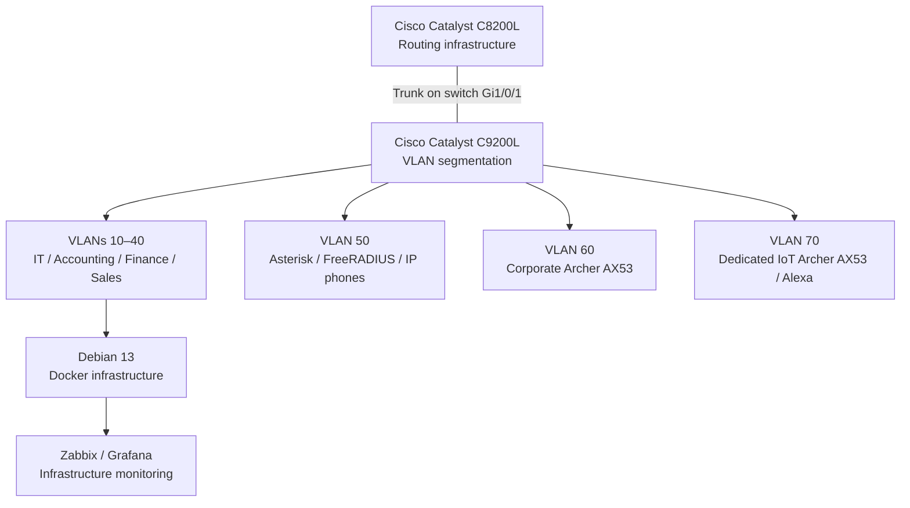

# Enterprise Infrastructure — Architecture Overview

**English** | [Português (Brasil)](../pt-BR/arquitetura/visao-geral-da-infraestrutura.md)

## Architecture

**Enterprise NOC — From Scratch** documents the physical enterprise laboratory developed around the fictional Tapajós Inovações scenario. Its infrastructure consists of:

| Layer | Components |
|---|---|
| Physical | Network rack, Cisco equipment, patch panel, structured cabling and departmental workstations |
| Network | Cisco Catalyst C8200L router, C9200L-24T-4G switch and VLANs 10–70 |
| Systems | Debian Linux infrastructure server, dedicated Asterisk/FreeRADIUS server and Windows endpoints |
| Services | Docker/Compose, Zabbix, Grafana, MariaDB, Pi-hole, Uptime Kuma, Nginx, Portainer and web services |
| Wireless and voice | Two separate TP-Link Archer AX53 devices, Amazon Alexa and Grandstream IP phones |

The diagram shows documented logical associations, **not** a verified cable-by-cable map or all traffic paths. The November 4 switch configuration establishes a router-facing trunk on **switch Gi1/0/1**, not the C8200L interface or router-side VLAN subinterfaces.

### Network and access design

VLANs 10–40 separate IT/NOC, Accounting, Finance and Sales. VLAN 50 serves voice/authentication, VLAN 60 corporate Wi-Fi and VLAN 70 IoT. The two AX53 devices are separate physical units. Their operating modes and client addressing were not captured; router ACL enforcement and end-to-end inter-VLAN isolation were not verified.

See [Consolidated Network Topology](../networking/consolidated-logical-topology.md), [VLAN Inventory](../networking/vlans.md) and [Switch Port Map](../networking/switch-port-map.md) for interfaces, addressing and equipment relationships.

### Monitoring and services

Zabbix collects host and network-device metrics through monitored interfaces, including SNMP on supported Cisco equipment. MariaDB stores Zabbix data; Grafana visualizes monitoring information through the Zabbix integration. Uptime Kuma performs separate availability checks for selected services.

The main Debian 13 system hosts the Docker infrastructure; a separate Linux computer provides Asterisk and FreeRADIUS. Recorded deployment details, dependencies and dashboard evidence are in [Docker Services](../containers/docker-services.md), [Zabbix](../monitoring/zabbix-monitoring.md), [Grafana](../monitoring/grafana-monitoring.md) and [Asterisk/FreeRADIUS](../services/asterisk-freeradius.md).

### Physical records

The laboratory includes rack power distribution, a patch panel, terminated Ethernet cables and departmental workstations. Equipment identification and photographs are documented in [Physical Infrastructure](../evidence/physical-infrastructure.md) and [Workstation Inventory](../endpoints/workstation-inventory.md).

**Evidence period:** November 4–6, 2026. The records reflect dated configurations and observations rather than continuous operational availability.
