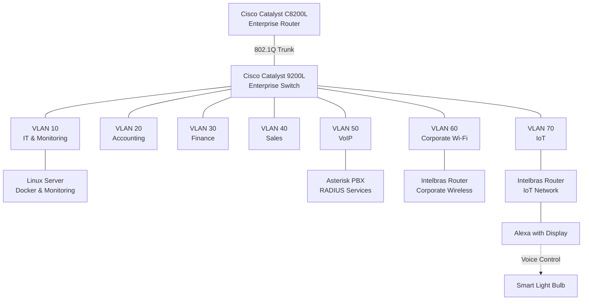
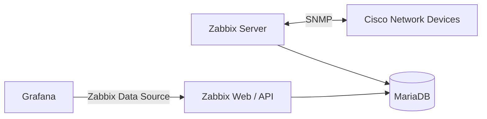

# Enterprise Infrastructure — Architecture Overview

**English | [Português (Brasil)](../pt-BR/architecture/infrastructure-overview.md)**

## Overview

This document presents the logical architecture of the Enterprise NOC — From Scratch project.

The infrastructure combines physical networking equipment, segmented corporate networks, Linux servers, containerized services, and centralized monitoring.

## Network Architecture

> **Note:** This is a logical architecture diagram. It does not represent exact switch port assignments, cabling paths, or verified physical connections.

## Monitoring Architecture

Zabbix collects infrastructure metrics, MariaDB stores monitoring data, and Grafana provides additional visualization through the Zabbix data source.

Uptime Kuma is also deployed as a separate service for availability monitoring.

## Physical Infrastructure

The laboratory includes a network rack, patch panel, structured cabling, power distribution, and manually assembled workstations.

A detailed physical topology will be documented after the final equipment and cabling inventory.

## Verification Status

**Status:** Preliminary architecture documentation.

The following details require further verification:

- Exact physical switch port assignments.
- Intelbras router models and operating modes.
- Wireless and IoT network configurations.
- Final workstation inventory.
- Updated monitoring service configuration.

This document will be updated as the infrastructure evolves.
