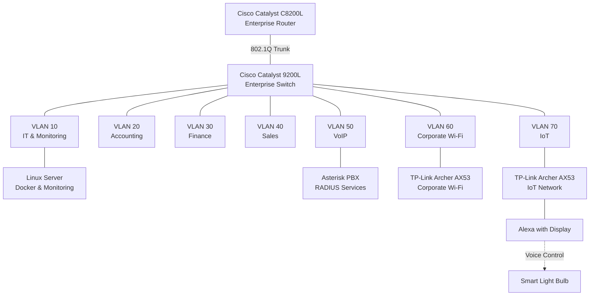
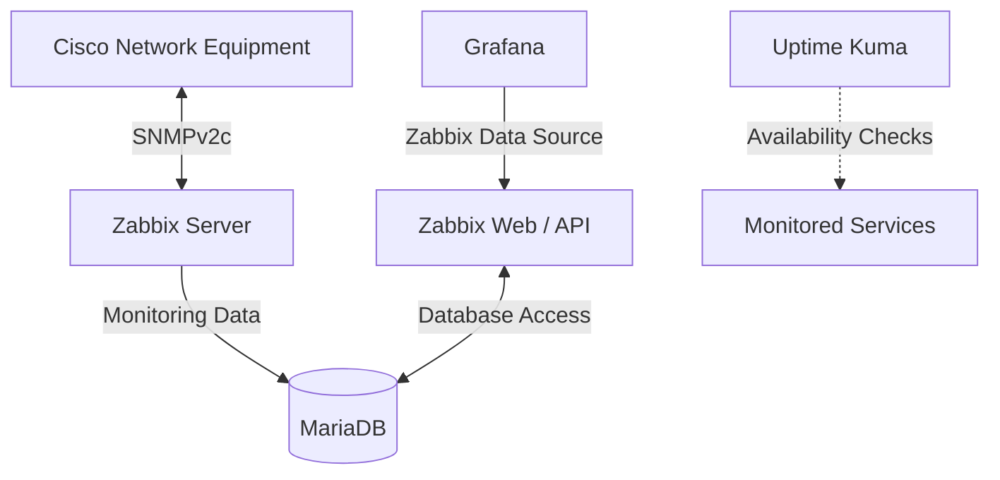

# Enterprise Infrastructure — Architecture Overview

**English | [Português (Brasil)](../pt-BR/arquitetura/visao-geral-da-infraestrutura.md)**

## Overview

This document presents the logical architecture of the **Enterprise NOC — From Scratch** project.

The laboratory simulates an enterprise IT environment, integrating physical network equipment, structured cabling, departmental VLANs, Linux servers, containerized services, and centralized network monitoring.

The architecture is organized into three main areas:

- **Physical Infrastructure:** Network equipment, workstations, rack, and structured cabling.
- **Network Infrastructure:** Cisco routing and switching, VLAN segmentation, corporate Wi-Fi, and IoT connectivity.
- **Systems & Monitoring:** Linux servers, Docker services, and NOC monitoring platforms.

## Logical Network Architecture

> **Note:** This diagram represents logical network segmentation, not an exact physical cabling diagram. The dated switch configuration records interface VLAN assignments; this logical diagram is not an end-to-end cable map.

## Network Segmentation

The infrastructure uses seven VLANs to separate different departments and network services.

| VLAN | Segment | Purpose |
|---|---|---|
| 10 | IT & Monitoring | IT infrastructure and monitoring services |
| 20 | Accounting | Accounting workstations |
| 30 | Finance | Financial department workstations |
| 40 | Sales | Sales department workstations |
| 50 | VoIP | IP telephony and associated services |
| 60 | Corporate Wi-Fi | Corporate wireless connectivity |
| 70 | IoT | Smart devices and IoT connectivity |

The wireless infrastructure includes two separate TP-Link Archer AX53 routers of the same model.

The November 4 switch snapshot assigns Gi1/0/15 to corporate Wi-Fi (VLAN 60) and Gi1/0/14 to IoT (VLAN 70). The snapshot does not contain wireless client addressing, device operating modes, or evidence of ACL enforcement.

## Monitoring Architecture

The monitoring architecture combines several complementary components:

- **Zabbix:** Collection of infrastructure metrics and monitoring information.
- **MariaDB:** Storage of Zabbix monitoring data.
- **Grafana:** Visualization of monitoring metrics through the Zabbix integration.
- **Uptime Kuma:** Availability monitoring for selected services.
- **SNMP:** Collection of network equipment information.

The monitoring environment also includes dashboards for analyzing infrastructure status and operational metrics.

## Additional Infrastructure Services

The Linux environment includes containerized applications and infrastructure services such as:

- Docker and Docker Compose.
- Portainer.
- Pi-hole.
- Nginx reverse proxy.
- Internal DNS services.
- Corporate web portal.

The dated container inventory and service roles are recorded in [Docker services](../containers/docker-services.md).

## Physical Infrastructure

The laboratory includes:

- Network rack.
- Cisco networking equipment.
- Patch panel.
- Structured Ethernet cabling.
- Manually terminated network cables.
- Rack power distribution.
- Workstations assembled for the simulated departments.

Physical photographs, the switch configuration snapshot, and the workstation inventory describe the equipment and connections documented during the collection.

## Record Scope

This overview consolidates the November 4–6, 2026, laboratory evidence. It is a logical architecture record, not an exhaustive cable survey or verification of network security policy enforcement. See the [switch snapshot](../networking/switch-vlan-snapshot-2026-11-04.md), [workstation inventory](../endpoints/workstation-inventory.md), and [physical infrastructure](../evidence/physical-infrastructure.md).
