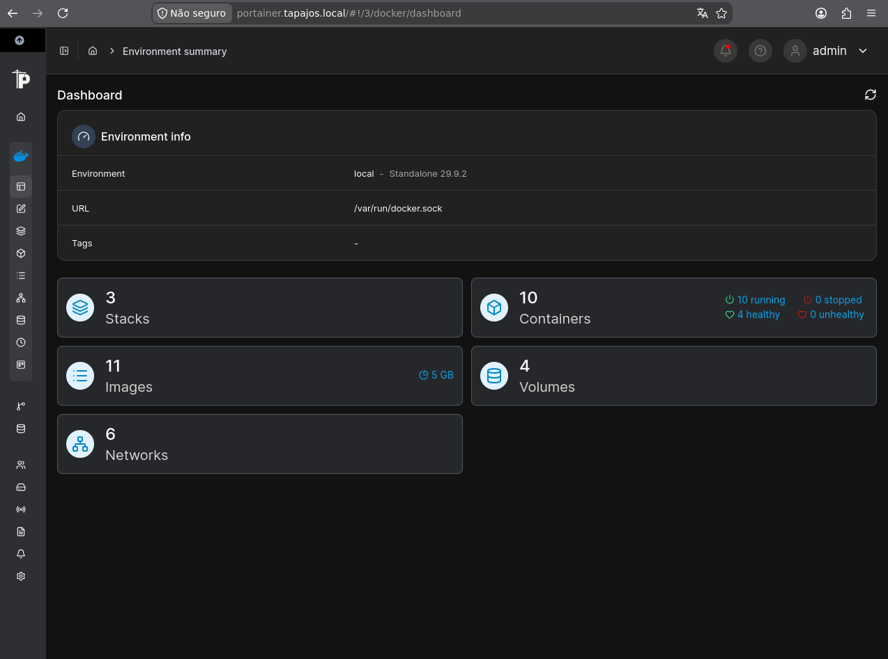
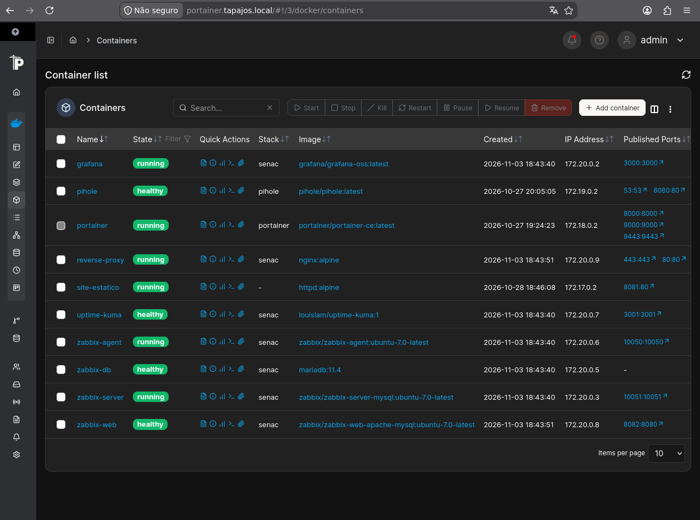
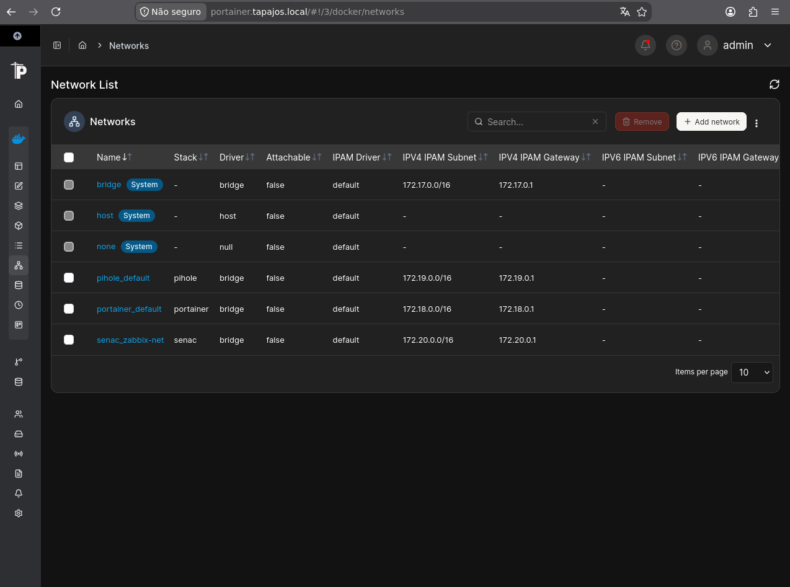

# Docker Infrastructure and Services

[English](docker-services.md) | [Português (Brasil)](../pt-BR/containers/servicos-docker.md)

## 1. Overview

The Enterprise NOC — From Scratch laboratory uses Docker to host infrastructure, monitoring, and network services.

The container environment runs on the main IT workstation, a Dell OptiPlex 3020 with an Intel Core i5-4590 processor, approximately 8 GB of RAM, and Debian GNU/Linux 13 (Trixie).

The host was identified with the IPv4 address `192.168.10.12/24` during the evidence collection.

This document describes the Docker environment observed on November 6, 2026, using the `docker ps` output and Portainer screenshots.

## 2. Docker Environment

The Portainer dashboard reported the following resources:

| Resource | Observed quantity |
|---|---:|
| Docker environments | 1 |
| Stacks | 3 |
| Containers | 10 |
| Running containers | 10 |
| Stopped containers | 0 |
| Container images | 11 |
| Volumes | 4 |
| Docker networks | 6 |

Four containers were reported as healthy, with no unhealthy containers indicated by the dashboard at the time of collection.

These values represent a specific observation, not continuous availability statistics.

## 3. Container Inventory

The `docker ps` output identified ten running containers.

| Container | Image | Purpose |
|---|---|---|
| `reverse-proxy` | `nginx:alpine` | Reverse proxy |
| `zabbix-web` | `zabbix/zabbix-web-apache-mysql:ubuntu-7.0-latest` | Zabbix web interface |
| `zabbix-server` | `zabbix/zabbix-server-mysql:ubuntu-7.0-latest` | Zabbix monitoring server |
| `uptime-kuma` | `louislam/uptime-kuma:1` | Service availability monitoring |
| `zabbix-db` | `mariadb:11.4` | Zabbix database |
| `grafana` | `grafana/grafana-oss:latest` | Monitoring dashboards and visualization |
| `zabbix-agent` | `zabbix/zabbix-agent:ubuntu-7.0-latest` | Zabbix monitoring agent |
| `site-estatico` | `httpd:alpine` | Static website |
| `pihole` | `pihole/pihole:latest` | DNS filtering and management |
| `portainer` | `portainer/portainer-ce:latest` | Container management |

Image tags are reproduced from the collected output. Tags such as `latest` do not establish an exact installed software version.

## 4. Published Service Ports

The following host ports were identified in the collected `docker ps` output:

| Container | Published host port(s) |
|---|---|
| `reverse-proxy` | 80, 443 |
| `zabbix-web` | 8082 |
| `zabbix-server` | 10051 |
| `uptime-kuma` | 3001 |
| `zabbix-db` | No published host port |
| `grafana` | 3000 |
| `zabbix-agent` | 10050 |
| `site-estatico` | 8081 |
| `pihole` | 53 TCP/UDP, 8080 |
| `portainer` | 8000, 9000, 9443 |

These ports describe the container configuration at the time of collection. A published port does not independently confirm that a service is reachable from every network segment.

## 5. Docker Networking

Portainer reported six Docker networks.

The environment includes Docker's standard networking mechanisms and networks associated with the deployed application stacks.

The collected Linux system report also identifies Docker bridge interfaces and private container subnets.

Network presence does not independently establish communication between every container or service.

## 6. Service Organization

The documented containers support several functions:

### Infrastructure and Application Access

- Nginx provides reverse-proxy functionality.
- Apache HTTP Server hosts a static website.
- Portainer provides container management.

### Monitoring and Observability

- Zabbix Server collects and processes monitoring data.
- Zabbix Web provides the monitoring interface.
- Zabbix Agent supplies monitoring data.
- Grafana provides dashboards and visualizations.
- Uptime Kuma monitors service availability.

### Supporting Services

- MariaDB provides database storage for Zabbix.
- Pi-hole provides DNS-related functionality.

The Asterisk and FreeRADIUS services are documented separately because they run on a different Linux computer.

## 7. Evidence and Limitations

The collected evidence confirms the presence of ten running Docker containers on November 6, 2026.

The Portainer screenshots also document container management, network configuration, and resource counts.

However, the evidence does not establish:

- Continuous service availability.
- Successful access from every VLAN.
- Complete application security.
- Correct operation of every monitoring item.
- High availability or redundancy.

These topics require separate verification and documentation.

## 8. Docker Compose Configuration

The following Docker Compose files document the deployment
configuration used in the laboratory.

- [Monitoring and Infrastructure Stack](../../docker_configs/docker-compose.yml)
- [Pi-hole](../../docker_configs/lab-ti/pihole/docker-compose.yml)
- [Portainer](../../docker_configs/lab-ti/portainer/docker-compose.yml)

### Reverse Proxy and Corporate Portal

The laboratory includes an Nginx reverse proxy and an
Apache HTTP Server container responsible for the corporate portal.

The collected configuration includes routes for Zabbix,
Grafana, Uptime Kuma, Portainer, Pi-hole, and the portal.

The public configuration currently documents the routes
for the portal, Zabbix, Grafana, and Uptime Kuma.

Configuration files:

- [Nginx Main Configuration](../../docker_configs/reverse-proxy/nginx.conf)
- [Reverse Proxy Rules](../../docker_configs/reverse-proxy/conf.d/lab.conf)

The public files use example domains and certificate paths.
The original environment used local DNS names and TLS certificates.

Private keys and institution-specific settings are not included.

The static website is hosted by the `site-estatico` container,
using the `httpd:alpine` image and port `8081` on the Docker host.

These files are sanitized versions of the collected configurations.
Credentials and institution-specific DNS settings have been removed.

**Evidence collection date:** November 6, 2026.
