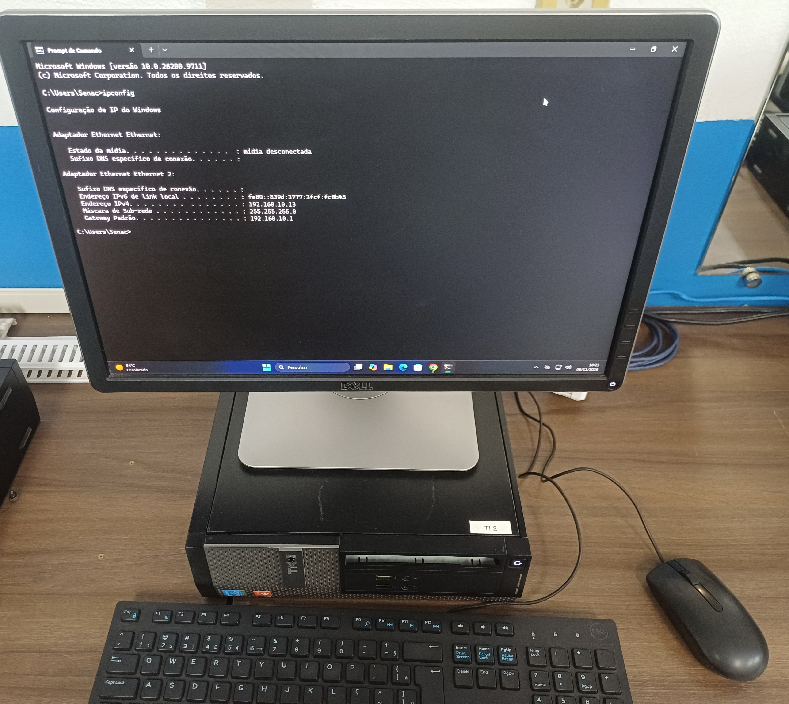
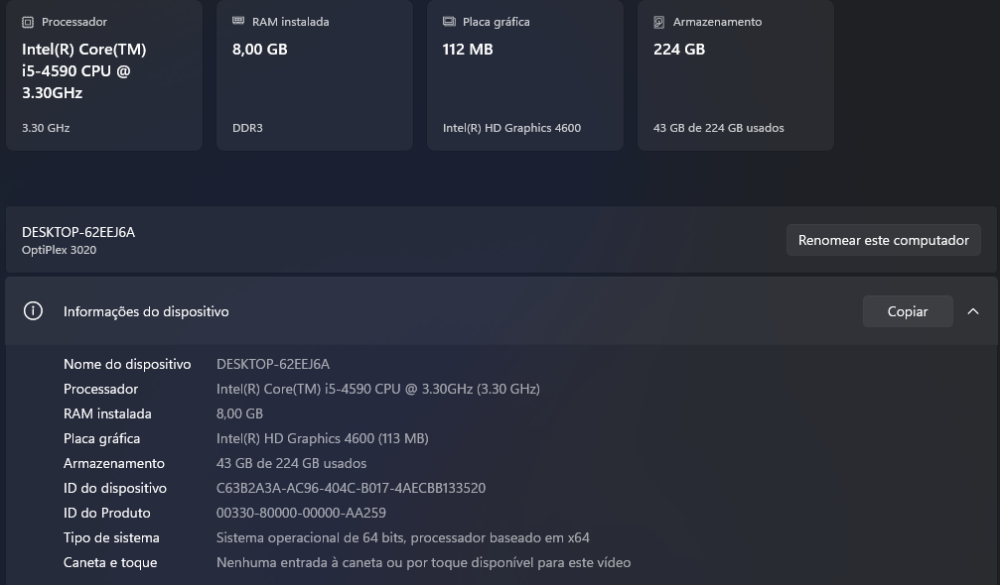
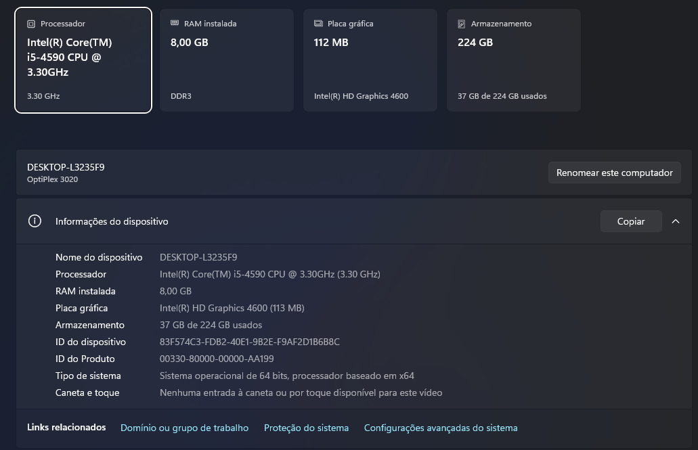
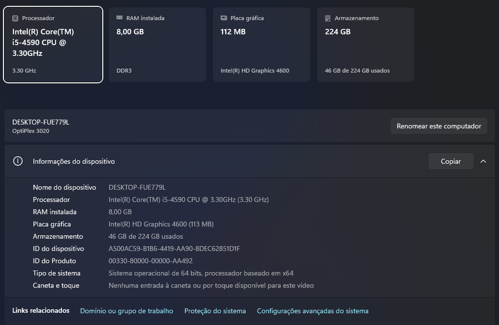

# Workstation and Server Inventory

[English](workstation-inventory.md) | [Português (Brasil)](../pt-BR/estacoes/inventario-de-computadores.md)

## Overview

The Enterprise NOC — From Scratch laboratory includes ten documented computers distributed across departmental networks and infrastructure services.

This inventory is based on hardware screenshots, network configuration photographs, and Linux system reports collected on November 6, 2026.

The environment consists of:

- 2 computers assigned to IT and infrastructure operations.
- 3 accounting workstations.
- 2 finance workstations.
- 2 sales workstations.
- 1 server dedicated to Asterisk and FreeRADIUS services.

## 1. Hardware and Network Inventory

| Device | VLAN | IPv4 address | Operating system | Processor | RAM | Storage evidence |
|---|---|---|---|---|---|---|
| IT 1 — Main NOC | 10 | 192.168.10.12 | Debian 13 | Intel Core i5-4590 | ~8 GB | 210.27 GiB root filesystem |
| IT 2 | 10 | 192.168.10.13 | Windows | — | — | — |
| Accounting 1 | 20 | 192.168.20.11 | Windows 11 Pro 21H2 | Intel Core i5-4590 | 8 GB | — |
| Accounting 2 | 20 | 192.168.20.12 | Windows | Intel Core i5-4590 | 8 GB DDR3 | 224 GB displayed |
| Accounting 3 | 20 | 192.168.20.13 | Windows 11 Pro 21H2 | Intel Core i5-4590 | 8 GB | — |
| Finance 1 | 30 | 192.168.30.10 | Windows | Intel Core i5-4590 | 8 GB | 224 GB displayed |
| Finance 2 | 30 | 192.168.30.11 | Windows | Intel Core i5-4590 | 8 GB | 224 GB displayed |
| Sales 1 | 40 | 192.168.40.11 | Windows | Intel Core i5-4590 | 8 GB | 224 GB displayed |
| Sales 2 | 40 | 192.168.40.10 | Windows | Intel Core i5-4590 | 8 GB | 224 GB displayed |
| Asterisk / FreeRADIUS | 50 | 192.168.50.2 | Debian forky/sid | Intel Core i5-4590 | ~8 GB | 211.21 GiB root filesystem |

The IPv4 addresses represent the configurations observed during evidence collection. They are not a guarantee of current addressing.

Storage values for Windows computers represent capacities displayed in the screenshots. They do not establish whether the physical drives are HDDs or SSDs.

The Linux storage values refer to the root filesystems, not necessarily the complete physical disk capacities.

## 2. Linux Infrastructure Computers

### IT 1 — Main NOC Computer

The main infrastructure computer was identified as a Dell OptiPlex 3020 running Debian 13.

The system report confirms:

- Intel Core i5-4590 processor.
- Approximately 8 GB of RAM.
- Debian GNU/Linux 13 (Trixie).
- IPv4 address 192.168.10.12/24.
- Root filesystem formatted as ext4.

The computer hosts the Docker environment used for infrastructure and monitoring services.

At the time of collection, the Docker report listed ten running containers, including Zabbix, Grafana, Portainer, Pi-hole, and Uptime Kuma.

Container configurations and service monitoring are documented separately.

### Asterisk and FreeRADIUS Server

The voice and authentication server was identified as a Dell OptiPlex 3020.

The system report confirms:

- Intel Core i5-4590 processor.
- Approximately 8 GB of RAM.
- Debian forky/sid at the time of collection.
- IPv4 address 192.168.50.2/24.
- Root filesystem formatted as ext4.

The server is associated with the laboratory's Asterisk VoIP and FreeRADIUS authentication services.

The available service documentation describes the configuration of these applications. It does not independently establish continuous service availability.

## 3. Windows Workstations — Evidence

### IT

The photograph records the network configuration of IT workstation 2.

Its processor, RAM, and storage specifications were not confirmed by the available evidence.

### Accounting

Additional evidence:

- [Accounting workstation 1 hardware](../assets/images/endpoints/accounting-01-hardware.png)
- [Accounting workstation 3 hardware](../assets/images/endpoints/accounting-03-hardware.jpg)

### Finance

Additional evidence:

- [Finance workstation 2 hardware](../assets/images/endpoints/finance-02-hardware.png)

### Sales

Additional evidence:

- [Sales workstation 2 hardware](../assets/images/endpoints/sales-02-hardware.png)

## 4. Network Segmentation

The documented computers are distributed across the following VLANs:

| VLAN | Department or purpose |
|---|---|
| 10 | IT and infrastructure |
| 20 | Accounting |
| 30 | Finance |
| 40 | Sales |
| 50 | VoIP and locally hosted authentication services |

These assignments are consistent with the collected switch configuration and workstation addressing evidence.

## 5. Monitoring Consistency

The evidence collection revealed differences between the IPv4 addresses photographed on Windows workstations and the addresses registered in Zabbix.

Six of the eight Windows workstations had differing addresses in the two records.

The laboratory uses DHCP for its workstations. The observed IP differences can contribute to unavailable monitoring agents or missing metrics when Zabbix host entries retain older addresses.

However, the address differences alone do not establish the cause of every monitoring problem.

## 6. Inventory Coverage

The dash (—) in the hardware table means the attribute was not recorded in the November 6 evidence, not that the computer lacks the component. Individual CPU, RAM, storage type and capacity fields are reported only when supported by the collected records.

The IP addresses and availability reflect the dated collection, not static DHCP reservations or the current operating state of every device.

**Evidence collection date:** November 6, 2026.
