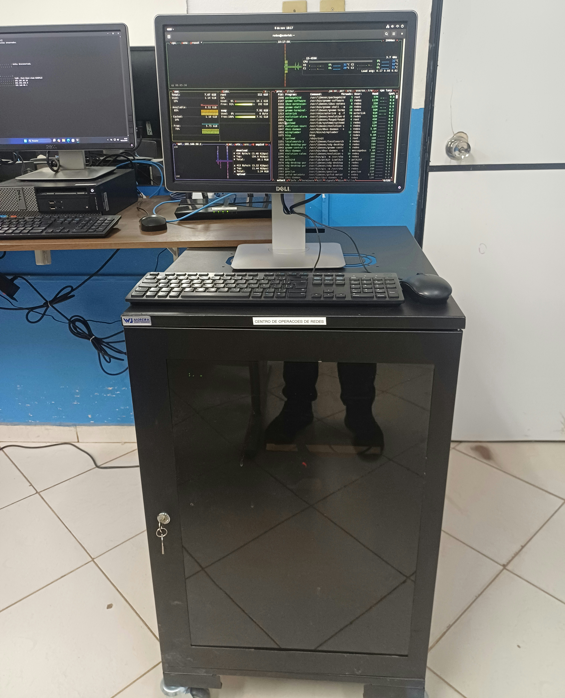
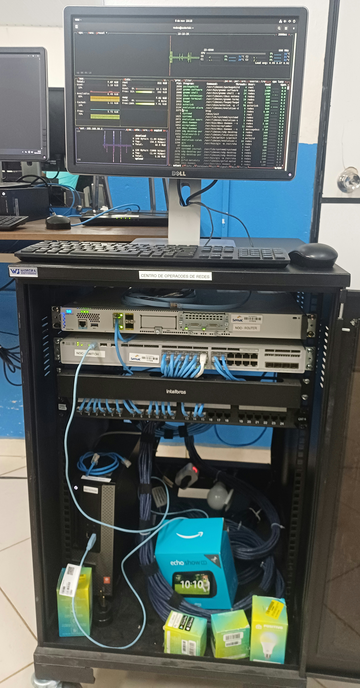

# Physical Infrastructure

[English](physical-infrastructure.md) | [Português (Brasil)](../pt-BR/evidencias/infraestrutura-fisica.md)

## Overview

The Enterprise NOC — From Scratch project includes a physical networking environment built around Cisco enterprise networking equipment, structured Ethernet cabling, and a network rack.

This document presents photographic evidence of the physical infrastructure captured on November 6, 2026.

The photographs document equipment installation, rack organization, and physical connectivity. Network configuration and service operation are documented separately.

## 1. Rack Overview

The laboratory includes a network rack positioned alongside a workstation used to access and monitor the environment.

This photograph provides an overview of the physical installation and its surrounding workspace.

## 2. Internal Rack Organization

The open rack provides visibility into the arrangement of the networking equipment, structured cabling components, and Ethernet connections.

The installation includes:

- Cisco enterprise networking equipment.
- Ethernet patch cables.
- Structured cabling termination equipment.
- Cable management components.

The photograph provides evidence of the physical arrangement, but does not independently verify the logical configuration of network interfaces.

## 3. Cisco Networking Equipment

The main networking equipment identified in the laboratory includes:

| Component | Identified equipment | Role |
|---|---|---|
| Router | Cisco Catalyst C8200L | Routing platform |
| Switch | Cisco Catalyst C9200L | Ethernet switching platform |
| Patch panel | Category 6 | Structured cabling termination |
| Cable management | Horizontal cable organizer | Ethernet cable organization |

The router and switch form part of the project's network infrastructure.

Their physical presence is confirmed by the photographs. Logical configurations, VLAN assignments, routing policies, and interface status require configuration records or monitoring evidence for verification.

## 4. Cabling and Switch Connection Records

The [November 4 C9200L configuration](../networking/switch-vlan-snapshot-2026-11-04.md) records **Gi1/0/1 on the switch** as the trunk toward the Cisco C8200L. The router-side interface is not identified in that snapshot. Departmental switchport assignments, including VLANs 10–70, are maintained in the [switch port map](../networking/switch-port-map.md).

The rack photographs show patch cables, the Category 6 patch panel and cable organization. They do not provide a cable-by-cable map from switch interfaces through patch-panel positions to workstation outlets. Hardware and network records for the ten computers are maintained in the [workstation and server inventory](../endpoints/workstation-inventory.md).

## 5. Evidence Scope

The photographs confirm the presence and physical arrangement of the documented equipment on November 6, 2026.

They do not, by themselves, establish:

- Successful communication between every network segment.
- Correct operation of every switch interface.
- Complete routing or access-control configurations.
- Continuous availability of the network.

These aspects must be evaluated using the corresponding configuration records, tests, and monitoring data.

## 6. Documentation Notes

The original photographs are preserved separately from the copies prepared for public documentation.

Published evidence must exclude credentials, institutional asset identifiers, and other information that has not been authorized for public disclosure.

**Evidence collection date:** November 6, 2026.
