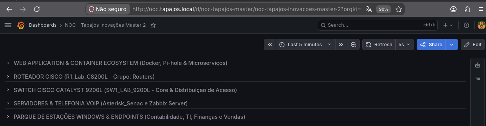
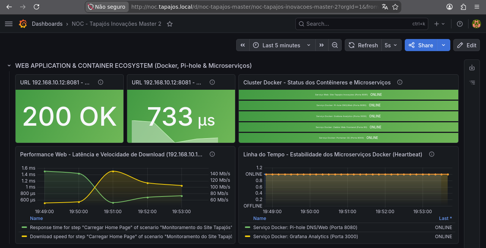
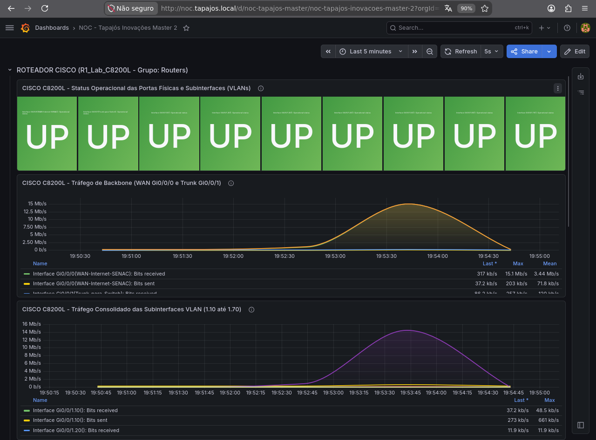
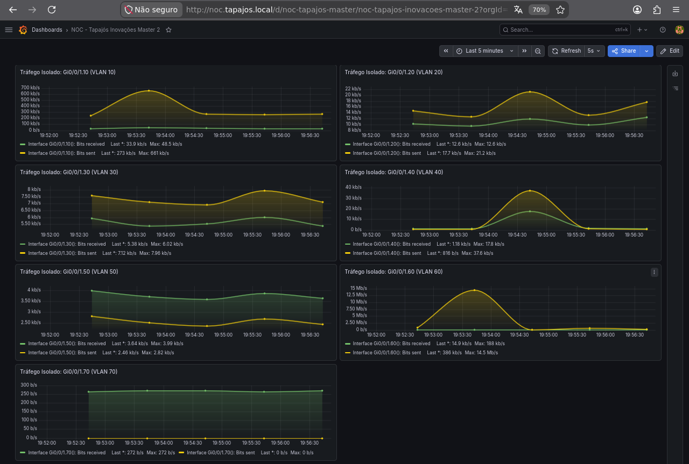
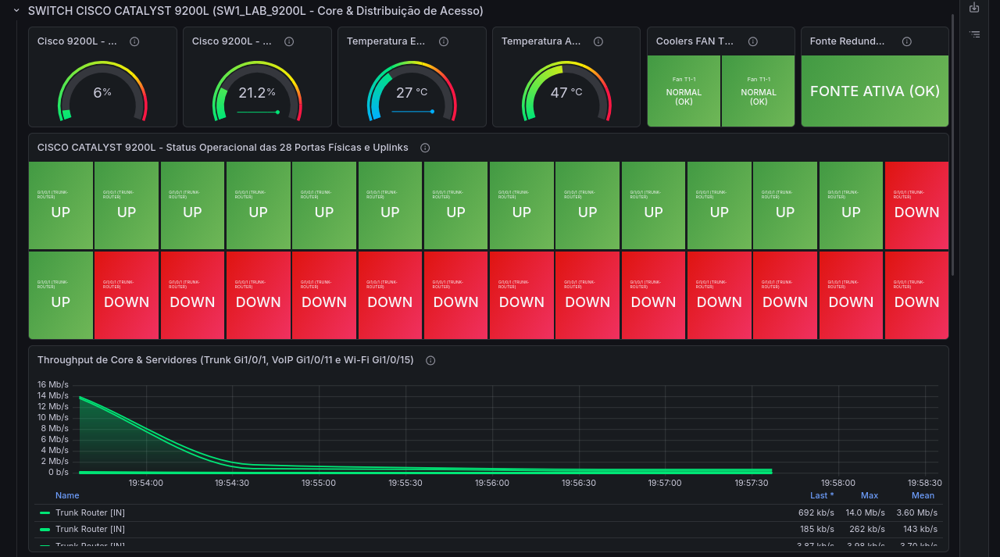
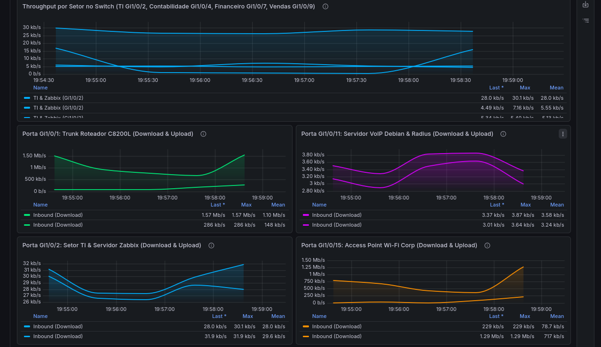
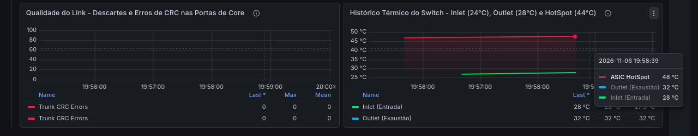
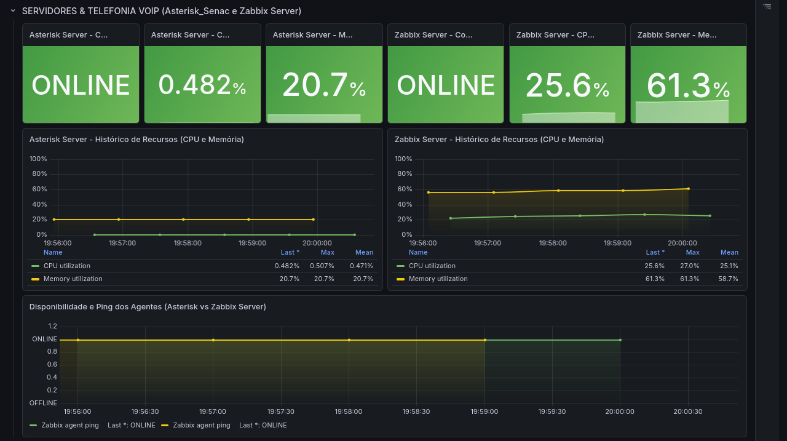
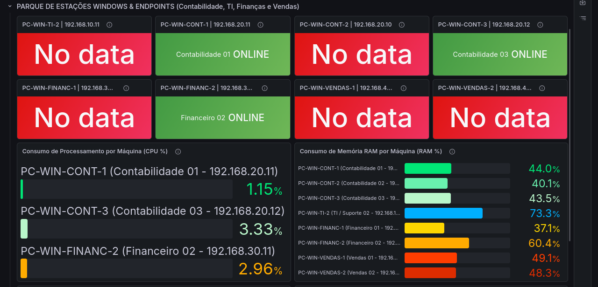
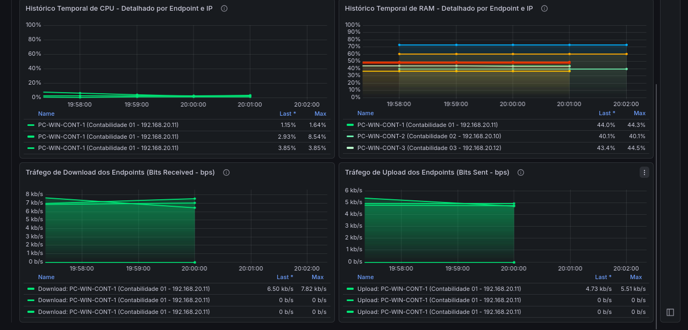

# Grafana Monitoring and Dashboards

[English](grafana-monitoring.md) | [Português (Brasil)](../pt-BR/monitoramento/grafana.md)

## 1. Overview

The Enterprise NOC — From Scratch laboratory uses Grafana to visualize monitoring data from its networking equipment, Linux servers, Windows workstations, and infrastructure services.

Grafana is deployed as a Docker container on the main infrastructure computer running Debian GNU/Linux 13.

The monitoring environment integrates Grafana with Zabbix, allowing collected metrics to be presented through customized dashboards.

This document presents the Grafana environment observed on **November 6, 2026**, using the original screenshots collected from the laboratory.

All screenshots represent historical observations rather than live monitoring feeds.

## 2. Dashboard Organization



The Grafana environment contains a consolidated NOC dashboard organized into five monitoring sections:

| Section | Monitored components |
|---|---|
| Web Application & Container Ecosystem | Web applications, Docker services, and availability checks |
| Cisco Router | Catalyst C8200L interfaces, VLANs, and network traffic |
| Cisco Switch | Catalyst C9200L hardware, interfaces, and throughput |
| Servers & VoIP | Asterisk server and Zabbix infrastructure server |
| Windows Workstations & Endpoints | Departmental computers, resource utilization, and network traffic |

The screenshot documents the dashboard structure available at the time of collection.

## 3. Web Applications and Containers



This section presents monitoring information related to the corporate website and selected Docker services.

The dashboard includes:

- HTTP response status.
- Web application response time.
- Service availability indicators.
- Historical web performance graphs.
- Docker service heartbeat information.

### 3.1 HTTP Monitoring

The collected screenshot displays an HTTP status of **200 OK** for the monitored web application.

It also presents response-time information and historical graphs associated with web performance checks.

HTTP 200 indicates that the corresponding request received a successful HTTP response during the observed check. It does not guarantee that every application feature was functioning correctly.

### 3.2 Container Availability

The dashboard displays availability indicators for selected services, including:

- Corporate website.
- Pi-hole.
- Grafana.
- Zabbix Web.
- Portainer.

These indicators do not represent the complete inventory of ten containers documented in the Docker environment.

For the complete container inventory, see [Docker Infrastructure and Services](../containers/docker-services.md).

## 4. Cisco Catalyst C8200L Router

The Cisco router monitoring section is documented in two consecutive screenshots.

### 4.1 Router Interfaces



The dashboard presents:

- Operational status indicators for selected interfaces and subinterfaces.
- WAN interface traffic.
- Trunk interface traffic.
- VLAN subinterface throughput.

The screenshot contains green `UP` indicators for the interfaces represented by its status panels.

These results describe the monitored interfaces during the observation period. They do not prove that every physical interface or routing function was operational.

### 4.2 Router Traffic History



The second screenshot continues the router monitoring section.

It contains historical throughput graphs associated with network interfaces and VLAN subinterfaces.

The graphs demonstrate that the monitoring platform received traffic measurements during the selected time window.

The displayed throughput values are historical samples, not guaranteed bandwidth or continuous performance measurements.

## 5. Cisco Catalyst C9200L Switch

The switch monitoring section is documented in three consecutive screenshots.

### 5.1 Hardware and Interface Status



This dashboard includes:

- CPU utilization.
- Memory utilization.
- Temperature readings.
- Cooling fan indicators.
- Power supply indicators.
- Interface operational status.
- Network throughput.

The screenshot displays both `UP` and `DOWN` interface indicators.

A `DOWN` interface does not necessarily represent an incident. Disconnected, unused, or administratively disabled interfaces may be down during normal operation.

**Important limitation:** multiple interface-status panels display the same label, `Gi1/0/1 TRUNK-ROUTER`.

Therefore, the screenshot cannot independently confirm that every panel corresponds to a distinct physical switch interface.

The dated screenshots do not include an item-to-interface cross-reference; repeated labels remain as observed.

### 5.2 Interface Throughput



This screenshot continues the switch dashboard with historical traffic graphs.

The graphs include traffic measurements associated with selected trunk, departmental, and infrastructure interfaces.

The historical values demonstrate the presence of collected traffic series.

They do not independently validate the interface descriptions or the complete physical port mapping.

### 5.3 Errors and Temperature



The final switch screenshot presents:

- Interface error indicators.
- CRC-related monitoring data.
- Switch temperature history.

These panels provide additional information relevant to network troubleshooting and hardware monitoring.

The displayed measurements are limited to the selected monitoring interval and configured data sources.

## 6. Linux Servers and VoIP



This section presents monitoring data for two Linux computers:

| System | Main function |
|---|---|
| Asterisk server | VoIP and FreeRADIUS services |
| Zabbix infrastructure server | Monitoring and Docker infrastructure |

The dashboard includes:

- Availability indicators.
- CPU utilization.
- RAM utilization.
- Historical resource consumption.
- Zabbix Agent availability history.

Both servers are displayed as `ONLINE` in the collected screenshot.

The CPU and RAM measurements provide a snapshot of the monitored systems during the selected time window.

The availability indicators do not independently prove successful SIP calls, RADIUS authentication, or continuous service availability.

The Asterisk and FreeRADIUS application configurations are documented separately from these system-resource metrics.

## 7. Windows Workstations and Endpoints

The Windows monitoring section is documented in two consecutive screenshots.

### 7.1 Workstation Availability and Resource Utilization



The dashboard includes eight departmental Windows workstations.

The screenshot displays:

| Dashboard state | Workstations |
|---|---:|
| `ONLINE` | 3 |
| `No data` | 5 |
| **Total** | **8** |

Some CPU and RAM measurements are available even though several status panels display `No data`.

**`No data` does not automatically mean a computer is powered off.**

It indicates that the corresponding Grafana query did not return usable data for the displayed panel and time range.

Possible explanations include incorrect host references, missing monitoring items, connectivity issues, or query configuration problems.

The available screenshots do not establish a single definitive cause.

### 7.2 Historical CPU, RAM, and Network Traffic



The second screenshot presents:

- CPU utilization over time.
- RAM utilization over time.
- Download traffic.
- Upload traffic.

The graphs contain historical series for selected Windows workstations.

Some panel legends repeat workstation identifiers, which should be verified against the configured monitoring queries.

The existence of these series does not establish complete or uninterrupted monitoring coverage across all eight computers.

### 7.3 Addressing Inconsistencies

The evidence review identified differences between workstation addresses photographed using `ipconfig` and addresses configured in Zabbix.

Six of the eight Windows workstations had inconsistent addresses between the compared records.

These differences may contribute to unavailable monitoring data, but additional verification is required.

For further information:

- [Zabbix Monitoring](zabbix-monitoring.md)
- [Workstation and Server Inventory](../endpoints/workstation-inventory.md)

## 8. Historical Monitoring Boundaries

The collected screenshots identify the following limitations:

| Area | Observation |
|---|---|
| Windows availability | Five workstation status panels displayed `No data` |
| Host addressing | Six workstation IP addresses differed between collected records |
| Switch interface labels | Multiple panels used the same interface label |
| Switch interface status | Both `UP` and `DOWN` states were displayed |
| Monitoring coverage | Recorded hosts, panels, and data series visible in the dated screenshots |
| Service availability | Status and values displayed during the historical capture period |

These limitations are preserved as part of the technical documentation.

They document the diagnostic context of the monitoring snapshots collected on November 6, 2026.

## 9. Grafana and Zabbix Integration

The laboratory uses Zabbix as a monitoring platform and Grafana as a visualization interface.

The documented architecture includes:

```text
Network Equipment / Linux / Windows
                |
       SNMP / Zabbix Agent
                |
              Zabbix
                |
          Grafana Dashboards
```

This diagram presents the monitoring relationship at a conceptual level.

The screenshots demonstrate the resulting dashboards but do not include complete Grafana data-source configurations or dashboard JSON exports.

## 10. Evidence Summary

| Evidence | Original filename |
|---|---|
| Dashboard organization | `grafana_order.png` |
| Web applications and containers | `grafana_dashboard_web_containers.png` |
| Cisco router — Part 1 | `grafana_dashboard_router1.png` |
| Cisco router — Part 2 | `grafana_dashboard_router2.png` |
| Cisco switch — Part 1 | `grafana_dashboard_switch1.png` |
| Cisco switch — Part 2 | `grafana_dashboard_switch2.png` |
| Cisco switch — Part 3 | `grafana_dashboard_switch3.png` |
| Linux servers and Asterisk | `grafana_dashboard_asterisk.png` |
| Windows workstations — Part 1 | `grafana_dashboard_pcs1.png` |
| Windows workstations — Part 2 | `grafana_dashboard_pcs2.png` |

**Evidence collection date:** November 6, 2026.

All images retain their original filenames and are presented as historical evidence of the laboratory environment.
