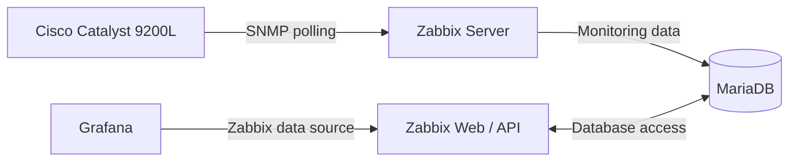

# Cisco Catalyst 9200L — SNMP Monitoring Troubleshooting

## Overview

This case study documents the integration and troubleshooting of a Cisco Catalyst 9200L switch within an enterprise Network Operations Center (NOC) monitoring environment.

The monitoring infrastructure uses Zabbix, Grafana, and SNMP to collect and visualize network equipment metrics.

**Equipment:** Cisco Catalyst 9200L  
**Monitoring platform:** Zabbix 7.0 LTS  
**Visualization:** Grafana  
**Protocol:** SNMPv2c  
**Environment:** Physical enterprise networking laboratory  
**Implementation date:** November 4, 2026

## Monitoring Architecture



This diagram represents the logical monitoring data flow rather than the physical network topology.

## Incident 1 — SNMP Interface Unavailable

### Symptoms

After registering the Catalyst 9200L in Zabbix, the SNMP interface remained unavailable.

Monitoring requests were unsuccessful, preventing the collection of switch metrics.

### Investigation

The troubleshooting process included:

1. Verifying IP connectivity between the monitoring server and the switch.
2. Checking SNMP service accessibility.
3. Testing SNMP queries from the Linux terminal.
4. Reviewing the SNMP configuration on the Cisco switch.
5. Inspecting the SNMP community macro configured in Zabbix.

### Root Cause

The switch and monitoring platform were not using matching SNMP community values.

The Zabbix host inherited a default community value that did not match the configured switch.

### Resolution

The SNMP configuration was aligned between the switch and Zabbix.

A host-level `{$SNMP_COMMUNITY}` macro was configured, and the Zabbix server configuration cache was reloaded.

```bash
docker exec zabbix-server zabbix_server -R config_cache_reload
```

### Result

The SNMP interface became available, allowing Zabbix to collect monitoring data and discover switch interfaces.

## Incident 2 — Incorrect System Uptime

### Symptoms

A dashboard widget displayed a system uptime value of zero despite the switch being operational.

### Root Cause

The dashboard referenced an uptime item based on the Host Resources MIB that returned an incorrect value for this device.

### Resolution

The monitoring item was changed from:

`system.hw.uptime[hrSystemUptime.0]`

To:

`system.net.uptime[sysUpTime.0]`

### Result

The dashboard began displaying the switch's reported uptime correctly.

## Incident 3 — Empty Monitoring Dashboard

### Symptoms

Some monitoring widgets displayed no data or an empty alarm list.

### Root Cause

The affected widgets were filtered to display information only from the newly registered switch.

Because the switch had no active problems, the alarm widgets showed no results.

### Resolution

The dashboard filters were adjusted to include the broader NOC monitoring environment.

### Result

The widgets displayed the relevant operational alerts and monitoring information.

## Monitoring Improvements

Following the integration, the monitoring environment was expanded to include switch-specific information such as:

- CPU and memory utilization.
- Hardware temperature.
- Power supply and fan status.
- Physical interface availability.
- Network throughput.
- Interface errors and discarded packets.
- System uptime.

The monitoring information was incorporated into Zabbix and Grafana dashboards.

## Security Considerations

The original implementation used SNMPv2c.

SNMPv2c community strings are not encrypted. SNMPv3 with authentication and encryption should be considered for production deployments.

Actual community values, credentials, and internal addressing information are intentionally excluded from this public documentation.

## Lessons Learned

This implementation demonstrated several important troubleshooting principles:

1. IP connectivity does not guarantee successful SNMP monitoring.
2. Monitoring templates must be validated against the actual equipment.
3. Incorrect dashboard filters can make operational data appear unavailable.
4. Configuration changes should be followed by functional validation.
5. Monitoring problems must be investigated across the network device, monitoring platform, and visualization layers.

## Documentation Status

**Status:** Initial technical case study completed.

Additional screenshots and configuration evidence may be added after final verification and sanitization.
