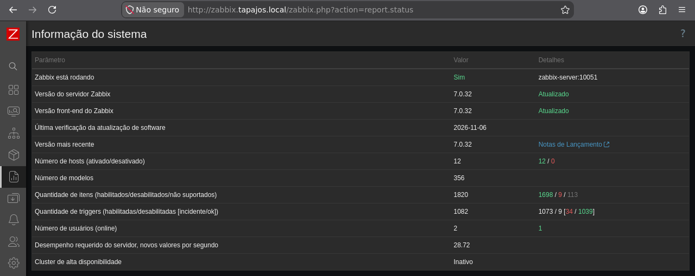
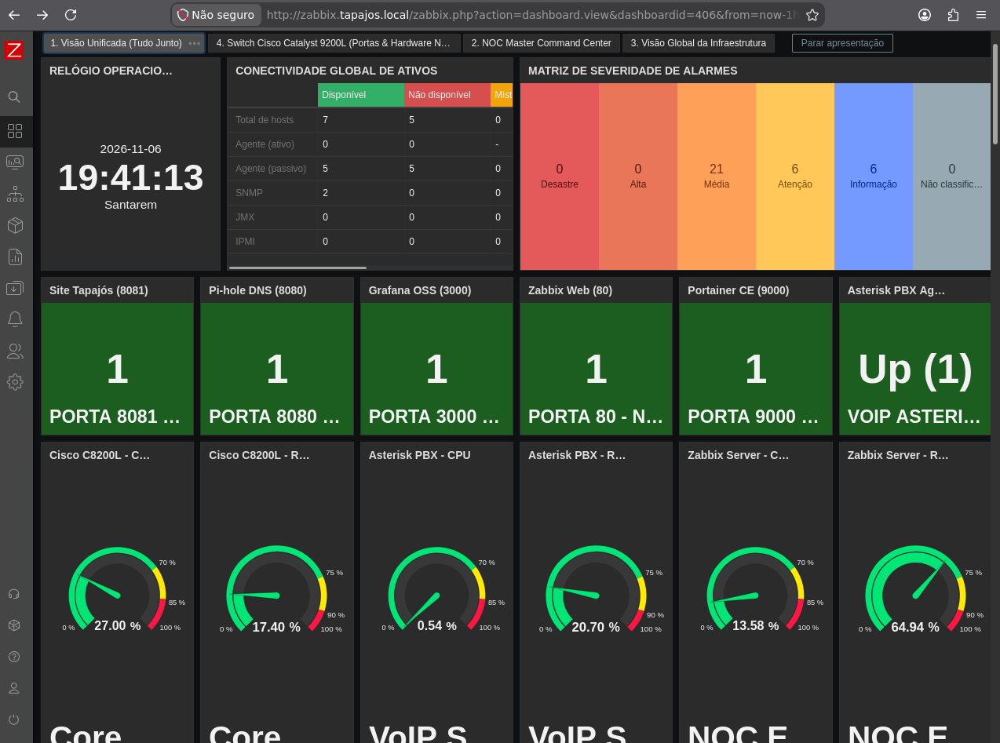
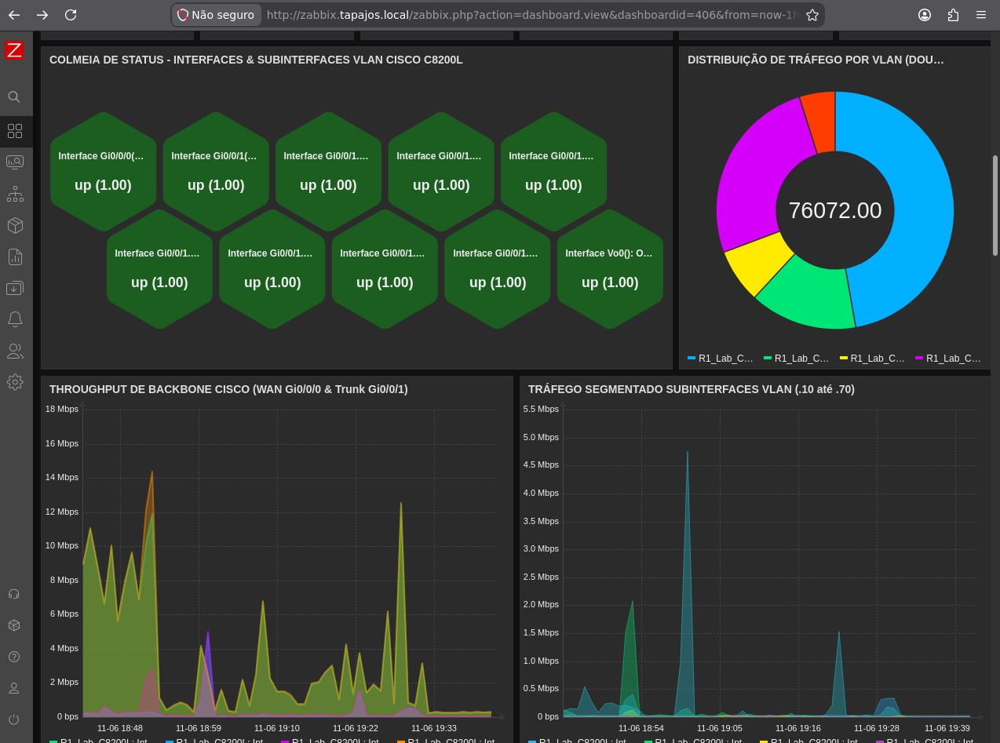
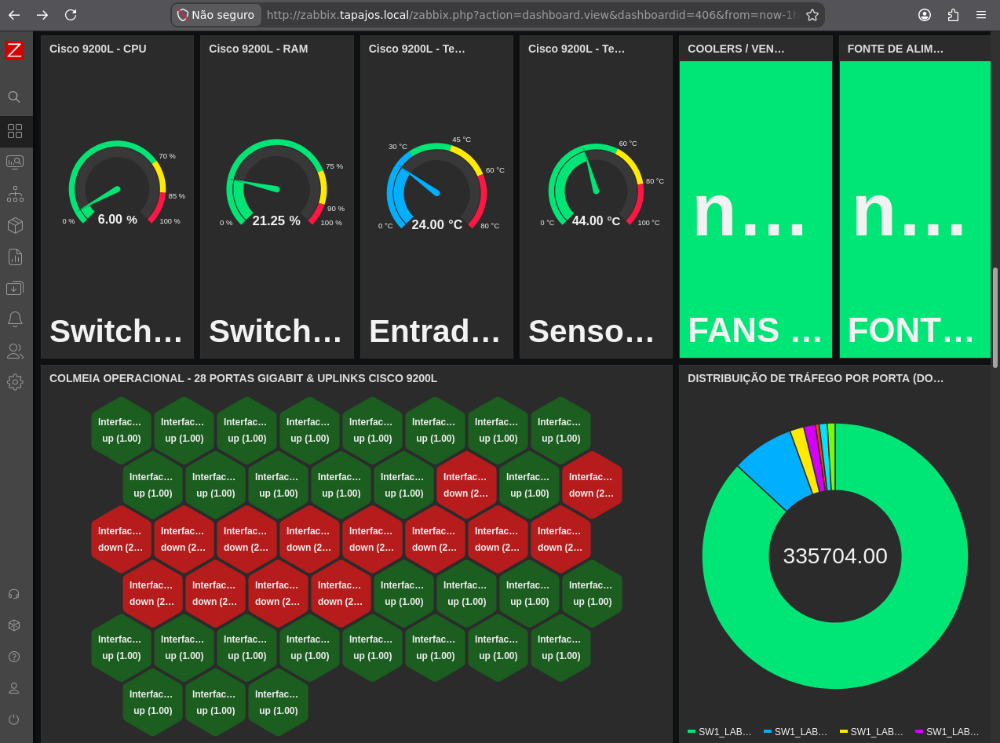
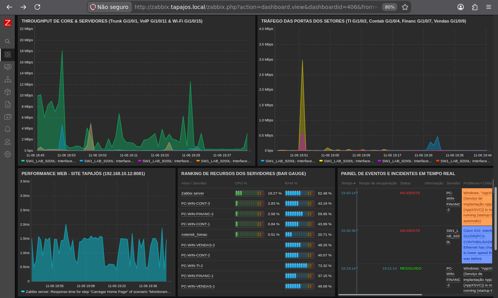
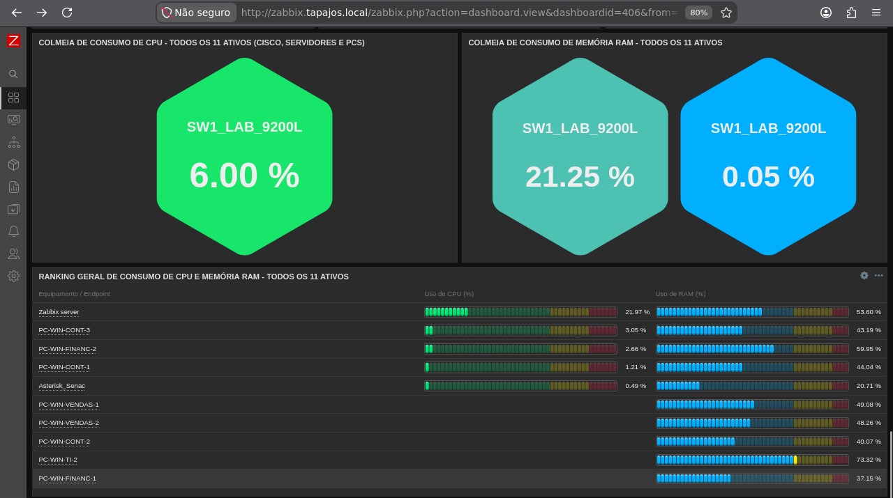
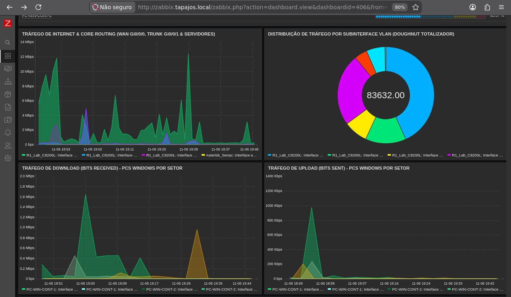
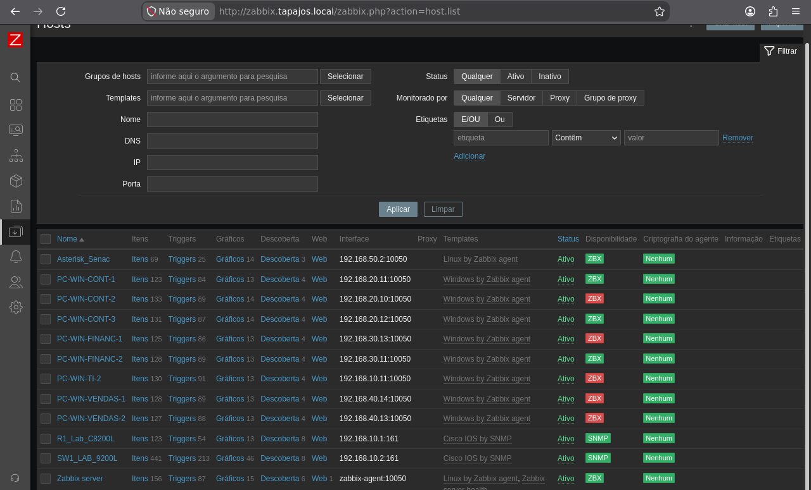
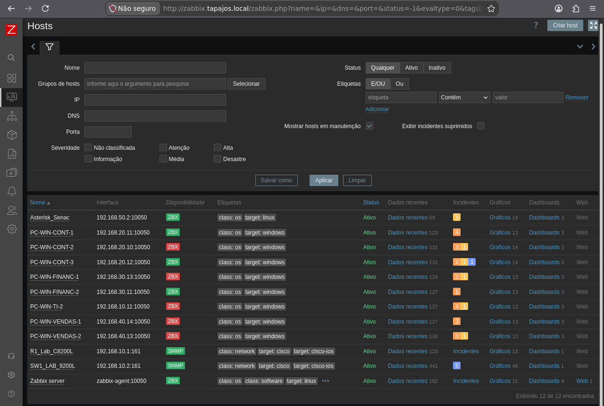

# Zabbix — Infrastructure Monitoring

**English** | [Português (Brasil)](../pt-BR/monitoramento/zabbix.md)

**Evidence date:** November 6, 2026 · **Platform:** Zabbix 7.0.32 · **Deployment:** Debian 13 / Docker

## Monitoring Architecture

The main Debian infrastructure computer hosts Zabbix Server, Zabbix Web, Zabbix Agent and MariaDB. Grafana uses Zabbix monitoring data for visualization; the container deployment is documented in [Docker Services](../containers/docker-services.md).

| Monitored systems | Hosts | Monitoring interface |
|---|---:|---|
| Cisco Catalyst C8200L router and C9200L switch | 2 | SNMP (UDP 161) |
| Debian infrastructure and Asterisk/FreeRADIUS servers | 2 | Zabbix Agent |
| Departmental Windows workstations | 8 | Zabbix Agent |
| **Total** | **12** | |

The dashboards also include HTTP checks, infrastructure resource indicators and service availability observations. The following values and captures describe the environment **at collection time**, not live or continuous measurements.

## System Snapshot

| Parameter | Recorded value |
|---|---:|
| Zabbix Server / Frontend | 7.0.32 / 7.0.32 |
| Registered / enabled hosts | 12 / 12 |
| Templates | 356 |
| Total / enabled / disabled items | 1,820 / 1,698 / 9 |
| Unsupported items | **113** |
| Total / enabled / disabled triggers | 1,082 / 1,073 / 9 |
| Triggers in problem state | **34** |
| High-availability cluster | Inactive |

The server was running during the capture. Unsupported items require item-level diagnosis; the aggregate count does not identify their causes.

## Dashboard Evidence

### 1. Unified NOC Dashboard

The dashboard combines host availability, alarm severity, Cisco metrics, Linux resource usage, service checks and Asterisk indicators.

| Host availability | Recorded count |
|---|---:|
| Available | 7 |
| Unavailable | 5 |
| **Total** | **12** |

The interface breakdown shows **five available and five unavailable passive Zabbix Agent interfaces**, plus **two available SNMP interfaces**. Positive service checks are shown for the corporate website, Pi-hole, Grafana, Zabbix Web, Portainer and Asterisk. Each check reflects only its configured test at that time.

### 2. Cisco C8200L — Interfaces and VLAN Traffic

Interface/subinterface status, WAN and trunk throughput, VLAN-related traffic and historical network series are displayed. The visible interface indicators are operational; this is **not** independent verification of router-side VLAN configuration, NAT, routing or ACL enforcement.

### 3. Cisco C9200L — Hardware and Interfaces

CPU, RAM, temperature, cooling, power and Ethernet interface status/traffic are monitored. Both `up` and `down` states appear. Unused or disabled ports may legitimately be down; truncated interface labels require item-to-port verification.

### 4. Traffic, Services and Events

Shows core/server throughput, departmental switch-port traffic, corporate website response, CPU/RAM and problem/resolved-event entries. An event marked resolved in this historical view is not evidence that other monitoring issues were also resolved.

### 5. Infrastructure Resource Usage

CPU and RAM indicators and resource rankings for monitored systems. Several labels repeat the switch name; the screenshot does not establish separate item identities for those repeated labels.

### 6. Router and Workstation Throughput

Historical internet/core traffic, VLAN subinterface throughput, and Windows workstation upload/download series. Only the displayed items and intervals are evidenced.

## Host Inventory and Interface Availability

The configured hosts correspond to **eight Windows workstations, two Linux servers and two Cisco devices**. The Cisco devices use SNMP interfaces; the computers use Zabbix Agent monitoring.

The host list records interfaces, availability indicators, data/graph access and problem counts. All 12 hosts are **enabled**, but five were reported **unavailable** in the collection: enabled status does not imply agent reachability.

## Workstation Address Discrepancies

The photographed `ipconfig` addresses and Zabbix host registrations differ for six Windows workstations:

| Workstation | Photographed IPv4 | Zabbix host IPv4 |
|---|---|---|
| IT 2 | `192.168.10.13` | `192.168.10.11` |
| Accounting 2 | `192.168.20.12` | `192.168.20.10` |
| Accounting 3 | `192.168.20.13` | `192.168.20.12` |
| Finance 1 | `192.168.30.10` | `192.168.30.13` |
| Sales 1 | `192.168.40.11` | `192.168.40.14` |
| Sales 2 | `192.168.40.10` | `192.168.40.13` |

Accounting 1 and Finance 2 matched in the compared records. DHCP changes **may** contribute to unavailable agents or missing metrics, but agent configuration, reachability, firewalls and item settings also require inspection. The table represents November 6 observations, not currently assigned IPs.

## Open Monitoring Findings

| Observed condition | Verification still required |
|---|---|
| 113 unsupported items | Identify affected item keys, errors and supported metrics |
| 34 problem-state triggers | Correlate trigger conditions with actual service impact |
| Five unavailable hosts | Verify current agent interfaces, addressing and network paths |
| Six address discrepancies | Compare current DHCP leases with Zabbix host interfaces |
| `down` interfaces and repeated labels | Confirm expected port roles and item-to-interface mapping |

**Related records:** [Grafana dashboards](grafana-monitoring.md) · [Cisco SNMP troubleshooting — November 4](snmp-troubleshooting.md) · [Workstation inventory](../endpoints/workstation-inventory.md)

The nine original screenshots above were collected on **November 6, 2026**. No later remediation is inferred from them.
