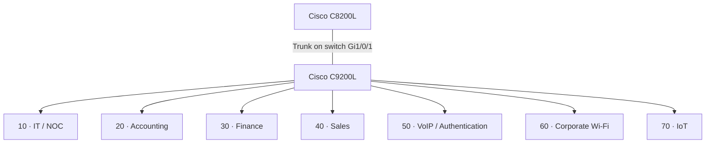

# Networking & Architecture

**Enterprise NOC — From Scratch**

**English** | [Português (Brasil)](../pt-BR/redes/README.md)

## Network overview

The Tapajós Inovações enterprise laboratory uses physical Cisco equipment, seven VLANs, Linux servers, departmental workstations, IP telephony, and two separate wireless devices. This section documents the network as recorded on **November 4–6, 2026**.

| Component | Equipment / role |
|---|---|
| Router | Cisco Catalyst C8200L-1N-4T |
| Switch | Cisco Catalyst C9200L-24T-4G, IOS XE 17.15 |
| Infrastructure server | Dell OptiPlex 3020, Debian 13, monitoring and Docker |
| Voice / authentication server | Debian Linux, Asterisk and FreeRADIUS |
| Wireless | Two TP-Link Archer AX53 devices: corporate Wi-Fi and IoT |
| Endpoints | Windows workstations, Grandstream IP phones, Amazon Alexa |

### Logical segmentation

| VLAN | Switch ports | Documented network |
|---|---|---|
| 10 | Gi1/0/2–3 | `192.168.10.0/24` |
| 20 | Gi1/0/4–6 | `192.168.20.0/24` |
| 30 | Gi1/0/7–8 | `192.168.30.0/24` |
| 40 | Gi1/0/9–10 | `192.168.40.0/24` |
| 50 | Gi1/0/11–13 | `192.168.50.0/24` |
| 60 | Gi1/0/15 | Client subnet not established |
| 70 | Gi1/0/14 | Client subnet not established |

The trunk is configured on the **switch**; its router-side interface and complete routing configuration were not captured. VLAN 50 is assigned to Gi1/0/11, but that port's operating mode is not established by the snapshot. VLAN separation does not, by itself, prove router ACL enforcement.

## Technical documentation

| Document | Scope |
|---|---|
| [Consolidated logical topology](consolidated-logical-topology.md) | Endpoints, services, network relationships, and addressing |
| [VLAN segmentation](vlans.md) | VLAN inventory, addressing, and access-policy design |
| [Cisco C8200L](router-c8200l.md) | Router role, observed gateways, and monitoring |
| [Switch port map](switch-port-map.md) | Individual C9200L interface assignments |
| [Switch configuration snapshot](switch-vlan-snapshot-2026-11-04.md) | Historical IOS XE configuration and Spanning Tree |
| [Corporate Wi-Fi · VLAN 60](corporate-wifi-vlan60.md) | Corporate Archer AX53 and switch integration |
| [IoT · VLAN 70](iot-vlan70.md) | Dedicated Archer AX53 and Alexa connectivity |

## Related records

[Infrastructure architecture](../architecture/infrastructure-overview.md) · [Workstation inventory](../endpoints/workstation-inventory.md) · [Physical infrastructure](../evidence/physical-infrastructure.md) · [Asterisk / FreeRADIUS](../services/asterisk-freeradius.md) · [Zabbix](../monitoring/zabbix-monitoring.md) · [Grafana](../monitoring/grafana-monitoring.md)

**Evidence scope:** Switch configuration captured November 4; equipment, addressing, and monitoring records collected in November 2026. The records do not include a complete C8200L export, router ACL test results, wireless configuration exports, or a cable-by-cable map.
