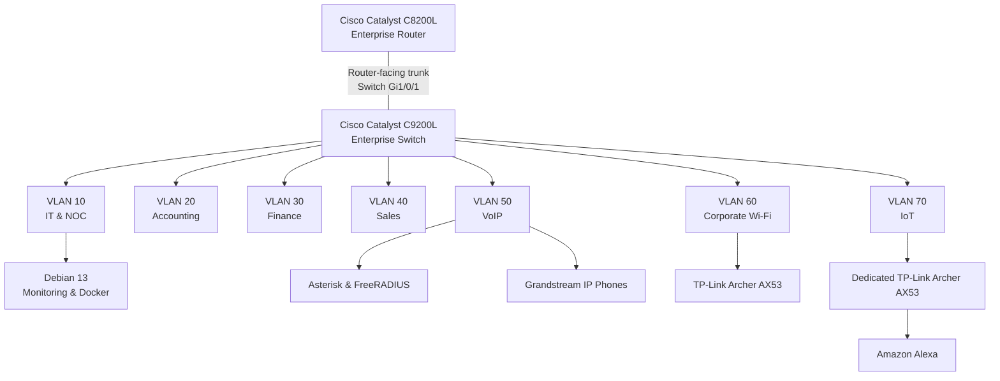

# Networking & Architecture

**Enterprise NOC — From Scratch**

**English** | [Português (Brasil)](../pt-BR/redes/README.md)

---

## Overview

The Networking & Architecture section documents the network infrastructure of the **Enterprise NOC — From Scratch** project, developed around a simulated enterprise environment for Tapajós Inovações.

The infrastructure integrates physical Cisco networking equipment, structured cabling, departmental VLANs, Linux servers, Windows workstations, IP telephony, corporate wireless connectivity, IoT devices, and centralized monitoring.

This section consolidates the logical network architecture, equipment roles, VLAN segmentation, interface assignments, IP addressing observations, and supporting configuration records.

The documentation is based on the laboratory's technical records and evidence collected in November 2026.

## Network Architecture

The network infrastructure includes the following components:

| Component | Equipment | Function |
|---|---|---|
| Enterprise Router | Cisco Catalyst C8200L-1N-4T | Central routing infrastructure |
| Enterprise Switch | Cisco Catalyst C9200L-24T-4G | Ethernet switching and VLAN segmentation |
| Corporate Wireless | TP-Link Archer AX53 | Corporate Wi-Fi connectivity |
| IoT Wireless | TP-Link Archer AX53 | Dedicated IoT connectivity |
| Main Infrastructure Server | Debian GNU/Linux 13 | Docker services and infrastructure monitoring |
| Voice and Authentication Server | Debian Linux | Asterisk and FreeRADIUS |
| IP Telephony | Grandstream IP Phones | Departmental voice communication |

The corporate wireless and IoT environments use **two separate TP-Link Archer AX53 devices**, each associated with a dedicated network segment.

### Logical Organization

The diagram represents the documented logical network organization.

The router-facing trunk is identified on switch interface `Gi1/0/1`. The corresponding C8200L interface and complete router-side VLAN subinterface configuration are not included in the collected configuration records.

The diagram does not represent an exhaustive physical cabling map or independently verify inter-VLAN routing.

## VLAN Segmentation

The enterprise network is organized into seven VLANs.

| VLAN | Network Segment | Documented Switch Interfaces |
|---|---|---|
| **10** | IT & NOC | Gi1/0/2–3 |
| **20** | Accounting | Gi1/0/4–6 |
| **30** | Finance | Gi1/0/7–8 |
| **40** | Sales | Gi1/0/9–10 |
| **50** | VoIP & Authentication | Gi1/0/11–13 |
| **60** | Corporate Wi-Fi | Gi1/0/15 |
| **70** | IoT | Gi1/0/14 |

The switch configuration also identifies:

- **Gi1/0/1:** Router-facing trunk.
- **Gi1/0/11:** VLAN 50 assignment without an explicit `switchport mode access` statement.
- **Gi1/0/12–13:** Access interfaces associated with Grandstream IP telephones.
- **Gi1/0/14:** IoT wireless equipment.
- **Gi1/0/15:** Corporate wireless equipment.

The historical trunk configuration does not include an explicit allowed-VLAN list or a custom native VLAN.

VLAN segmentation establishes separate Layer 2 broadcast domains. Inter-VLAN communication and access restrictions depend on additional Layer 3 configuration and security policies.

The available switch configuration does not independently establish the successful operation of all inter-VLAN routes or the enforcement of router ACLs.

## IP Addressing

The November 6, 2026, workstation and server inventory documents the following network addresses:

| VLAN | Documented Network | Examples |
|---|---|---|
| 10 | `192.168.10.0/24` | Main NOC server: `192.168.10.12` |
| 20 | `192.168.20.0/24` | Accounting workstations: `192.168.20.11–13` |
| 30 | `192.168.30.0/24` | Finance workstations: `192.168.30.10–11` |
| 40 | `192.168.40.0/24` | Sales workstations: `192.168.40.10–11` |
| 50 | `192.168.50.0/24` | Asterisk/FreeRADIUS: `192.168.50.2` |
| 60 | Not established by the available client addressing records | Corporate Wi-Fi |
| 70 | Not established by the available client addressing records | IoT |

The collected workstation records identify the following default gateway addresses:

| VLAN | Observed Default Gateway |
|---|---|
| 10 | `192.168.10.1` |
| 20 | `192.168.20.1` |
| 30 | `192.168.30.1` |
| 40 | `192.168.40.1` |

These addresses represent the collected equipment and workstation records.

The use of DHCP may result in address changes between different collection periods. Observed gateway settings do not independently establish the complete router configuration.

## Technical Documentation

The following documents provide detailed information about the network architecture and its components.

| Document | Description |
|---|---|
| [Consolidated Logical Topology](consolidated-logical-topology.md) | Network architecture, equipment relationships, VLAN organization, addressing, and infrastructure integration. |
| [VLAN Segmentation](vlans.md) | VLAN inventory, departmental separation, corporate Wi-Fi, and IoT segmentation. |
| [Cisco Catalyst C8200L](router-c8200l.md) | Router architecture, observed addressing, monitoring evidence, and access-policy design. |
| [Cisco Catalyst C9200L — Switch Port Map](switch-port-map.md) | Interface inventory and documented device assignments. |
| [Cisco Switch Configuration Snapshot](switch-vlan-snapshot-2026-11-04.md) | Historical IOS XE configuration, VLAN assignments, trunk configuration, and Spanning Tree. |
| [Corporate Wi-Fi — VLAN 60](corporate-wifi-vlan60.md) | Wireless equipment, switch integration, network segmentation, and evidence scope. |
| [IoT Network — VLAN 70](iot-vlan70.md) | Dedicated IoT infrastructure, Alexa connectivity, and documented switching assignments. |

### Recommended Reading Order

For a complete understanding of the network infrastructure:

1. [Consolidated Logical Topology](consolidated-logical-topology.md)
2. [VLAN Segmentation](vlans.md)
3. [Cisco Catalyst C8200L](router-c8200l.md)
4. [Cisco Switch Configuration Snapshot](switch-vlan-snapshot-2026-11-04.md)
5. [Switch Port Mapping](switch-port-map.md)
6. [Corporate Wi-Fi — VLAN 60](corporate-wifi-vlan60.md)
7. [IoT Network — VLAN 70](iot-vlan70.md)

## Infrastructure Monitoring

The networking environment is integrated with centralized monitoring platforms.

The documented monitoring architecture includes:

- **Zabbix:** Infrastructure monitoring, network equipment availability, and metric collection.
- **Grafana:** Visualization of historical infrastructure metrics.
- **SNMP:** Collection of supported Cisco equipment information.
- **Uptime Kuma:** Availability checks for selected infrastructure services.

The available screenshots include monitoring information from the Cisco router and switch.

The original switch configuration snapshot was collected before the subsequent SNMP monitoring configuration.

Monitoring screenshots represent observations from their collection period rather than continuous availability or complete configuration coverage.

### Monitoring Documentation

- [Zabbix Monitoring](../monitoring/zabbix-monitoring.md)
- [Grafana Monitoring](../monitoring/grafana-monitoring.md)
- [SNMP Troubleshooting](../monitoring/snmp-troubleshooting.md)

## Related Infrastructure Documentation

The network infrastructure connects several additional technical areas.

| Area | Documentation |
|---|---|
| Infrastructure Architecture | [Architecture Overview](../architecture/infrastructure-overview.md) |
| Linux and Docker | [Docker Services](../containers/docker-services.md) |
| Workstations and Servers | [Workstation Inventory](../endpoints/workstation-inventory.md) |
| Voice and Authentication | [Asterisk and FreeRADIUS](../services/asterisk-freeradius.md) |
| Physical Infrastructure | [Physical Infrastructure](../evidence/physical-infrastructure.md) |
| Technical Evidence | [Evidence Collection](../evidence/evidence-collection-2026-11-06.md) |
| NOC Operations | [Incident Management](../noc-operations/incident-management.md) |
| Technical FAQ | [Frequently Asked Questions](../faq/technical-faq.md) |

## Configuration and Evidence Scope

The network documentation combines several sources:

- Cisco Catalyst C9200L configuration captured on November 4, 2026.
- Workstation and server inventory collected on November 6, 2026.
- Physical equipment photographs.
- Zabbix and Grafana monitoring screenshots.
- Technical records describing network equipment and infrastructure services.

The documentation distinguishes between implemented configuration records, observed operating conditions, and architectural requirements.

The available records do not constitute:

- A complete C8200L running-configuration export.
- Independent verification of every inter-VLAN communication path.
- Evidence of router ACL enforcement.
- A complete physical cable map.
- Configuration exports for both TP-Link Archer AX53 devices.
- Verification of wireless authentication through FreeRADIUS.
- Continuous availability records for every network component.

These boundaries preserve the distinction between the documented laboratory infrastructure and implementation details not established by the collected evidence.

---

**Enterprise NOC — From Scratch**  
**Section:** Networking & Architecture  
**Documentation:** English / Portuguese (Brazil)
