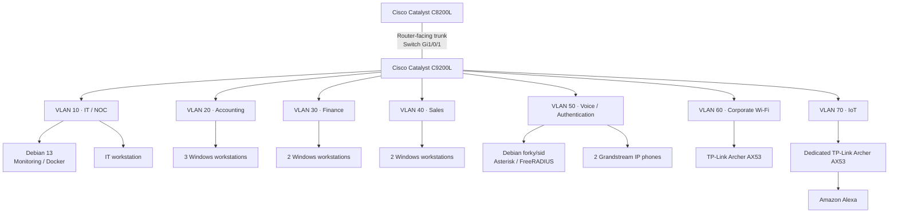

# Consolidated Logical Network Topology

**Enterprise NOC — From Scratch**

**English** | [Português (Brasil)](../pt-BR/redes/topologia-logica-consolidada.md)

## Topology

The diagram shows the network relationships documented in the **November 4–6, 2026** laboratory records. Connections represent equipment associations, not verified end-to-end traffic or a cable-by-cable survey.

The switch-side `Gi1/0/1` trunk is recorded in the C9200L configuration. Neither the corresponding C8200L port nor the router's complete VLAN subinterfaces were captured.

## Equipment and addressing

| Segment | Equipment / examples | Network or address |
|---|---|---|
| VLAN 10 · IT / NOC | Main Debian 13 server; IT workstation | `192.168.10.12`; `192.168.10.13` |
| VLAN 20 · Accounting | Three Windows workstations | `192.168.20.11–13` |
| VLAN 30 · Finance | Two Windows workstations | `192.168.30.10–11` |
| VLAN 40 · Sales | Two Windows workstations | `192.168.40.10–11` |
| VLAN 50 · Voice | Debian Asterisk / FreeRADIUS | `192.168.50.2/24` |
| VLAN 50 · Phones | Grandstream extensions 1001 (Sales), 1002 (IT) | `192.168.50.10`; `192.168.50.11` |
| VLAN 60 · Corporate Wi-Fi | TP-Link Archer AX53, switch `Gi1/0/15` | Client subnet not established |
| VLAN 70 · IoT | Separate Archer AX53, Alexa, switch `Gi1/0/14` | Client subnet not established |

The documented departmental networks (VLANs 10–50) use `/24` masks. The main NOC computer is a Dell OptiPlex 3020 running Debian 13; the voice server was recorded with Debian forky/sid.

| VLAN | Gateway recorded on equipment |
|---|---|
| 10 | `192.168.10.1` — IT workstation |
| 20 | `192.168.20.1` — Accounting workstation |
| 30 | `192.168.30.1` — Finance workstation |
| 40 | `192.168.40.1` — Sales workstation |
| 50 | `192.168.50.1` — Asterisk/FreeRADIUS server |

Gateway observations do not identify all router interfaces. DHCP is used on workstations; six differences between observed addresses and Zabbix host entries were documented.

## Services and monitoring

The main Debian server hosts Docker-based infrastructure services. The November 6 inventory recorded **10 running containers**, including Zabbix, Grafana, Portainer, Pi-hole and Uptime Kuma; related infrastructure includes MariaDB and web services.

Zabbix and Grafana provide historical monitoring views of Cisco equipment, hosts, and services. The captured dashboards include unavailable hosts and unsupported items; they do not establish uninterrupted availability.

## Evidence boundaries

- The C9200L snapshot documents VLANs, port assignments, and a trunk; it does not prove router ACL enforcement or all inter-VLAN paths.
- Gi1/0/11 has `switchport access vlan 50` and `spanning-tree portfast trunk`, but no explicit access-mode statement. Its effective mode is not established.
- The two AX53 devices have different roles. Their operating modes, client subnets, DHCP, and NAT settings were not captured; FreeRADIUS-to-Wi-Fi authentication was not verified.
- Endpoint addressing, Docker status, and monitoring screenshots are dated observations, not continuous service guarantees.

## References

[Networking overview](README.md) · [VLANs](vlans.md) · [Router](router-c8200l.md) · [Switch port map](switch-port-map.md) · [Switch snapshot](switch-vlan-snapshot-2026-11-04.md) · [Corporate Wi-Fi](corporate-wifi-vlan60.md) · [IoT](iot-vlan70.md) · [Workstation inventory](../endpoints/workstation-inventory.md) · [Docker services](../containers/docker-services.md) · [Asterisk / FreeRADIUS](../services/asterisk-freeradius.md) · [Physical infrastructure](../evidence/physical-infrastructure.md)
