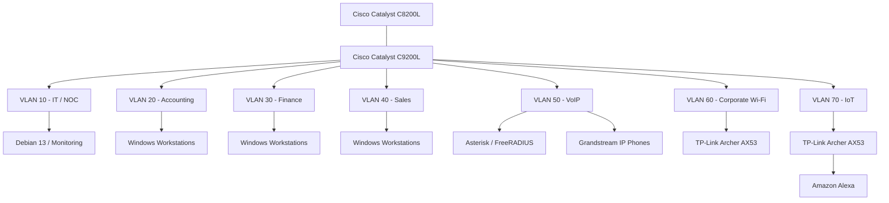

# Consolidated Logical Network Topology

**English** | [Português (Brasil)](../pt-BR/redes/topologia-logica-consolidada.md)

**Project:** Enterprise NOC — From Scratch  
**Environment:** Physical enterprise network laboratory  
**Network equipment:** Cisco Catalyst C8200L and Cisco Catalyst C9200L  
**Network segmentation:** Seven VLANs  
**Evidence period:** November 4–6, 2026  

---

## 1. Overview

The Enterprise NOC infrastructure combines physical Cisco networking equipment, departmental workstations, Linux servers, wireless connectivity, IP telephony, and centralized monitoring.

The network is organized into seven VLANs, separating administrative infrastructure, business departments, voice services, corporate wireless connectivity, and IoT devices.

This document consolidates the physical and logical relationships described throughout the project's technical documentation.

The topology represents the laboratory infrastructure and the network configuration recorded during the evidence collection period.

## 2. Logical Network Topology



The diagram represents logical network organization rather than a complete physical cabling map.

The connection between the Cisco Catalyst C8200L and the Cisco Catalyst C9200L is associated with the router-facing trunk configured on switch interface `Gi1/0/1`.

The switch configuration establishes the trunk on the switch side. The corresponding router interface and complete inter-VLAN routing configuration are not included in the collected records.

## 3. Network Segmentation

The infrastructure uses the following VLAN organization:

| VLAN | Department or Service | Function |
|---|---|---|
| 10 | IT / NOC | Infrastructure administration, Linux services, and monitoring |
| 20 | Accounting | Departmental Windows workstations |
| 30 | Finance | Departmental Windows workstations |
| 40 | Sales | Departmental Windows workstations |
| 50 | VoIP | IP telephony and Asterisk/FreeRADIUS services |
| 60 | Corporate Wi-Fi | Corporate wireless connectivity |
| 70 | IoT | Amazon Alexa and IoT wireless connectivity |

VLAN segmentation provides separate Layer 2 broadcast domains for the documented network segments.

Communication between different VLANs requires Layer 3 forwarding. The presence of VLANs and a switch trunk alone does not demonstrate successful inter-VLAN routing or enforcement of network isolation policies.

## 4. Cisco Catalyst C9200L — Interface Mapping

The switch configuration collected on November 4, 2026, records the following interface assignments:

| Switch Interface | Network Segment | Configuration Record |
|---|---|---|
| Gi1/0/1 | Cisco Catalyst C8200L | Trunk |
| Gi1/0/2–3 | VLAN 10 — IT / NOC | Access |
| Gi1/0/4–6 | VLAN 20 — Accounting | Access |
| Gi1/0/7–8 | VLAN 30 — Finance | Access |
| Gi1/0/9–10 | VLAN 40 — Sales | Access |
| Gi1/0/11 | VLAN 50 — Asterisk/FreeRADIUS | VLAN 50 assigned |
| Gi1/0/12–13 | VLAN 50 — Grandstream phones | Access |
| Gi1/0/14 | VLAN 70 — IoT | Access |
| Gi1/0/15 | VLAN 60 — Corporate Wi-Fi | Access |

### Interface Gi1/0/11

The historical configuration for `Gi1/0/11` contains:

```cisco
switchport access vlan 50
spanning-tree portfast trunk
```

The available snapshot does not include an explicit `switchport mode access` statement for this interface.

The topology records `Gi1/0/11` assigned to VLAN 50 as documented in the switch snapshot, without assigning a switchport operating mode.

Interfaces without specific configuration statements are not represented as disconnected, disabled, or available.

## 5. Linux Infrastructure and Network Services

The laboratory includes two Linux computers with distinct infrastructure roles.

### 5.1 Main NOC Computer

The main infrastructure computer runs Debian GNU/Linux 13 and is associated with VLAN 10.

The November 6 inventory records the address:

`192.168.10.12/24`

Its documented responsibilities include:

- Docker container hosting.
- Zabbix monitoring.
- Grafana dashboards.
- MariaDB database services.
- Uptime Kuma.
- Pi-hole.
- Portainer.
- Web infrastructure and reverse proxy services.

The Docker inventory recorded ten running containers during the November 6 collection.

### 5.2 Asterisk and FreeRADIUS Server

A separate Linux computer provides voice and network authentication services.

The collected records identify:

| Component | Documented Information |
|---|---|
| Network segment | VLAN 50 |
| Server address | `192.168.50.2/24` |
| IP telephony | Asterisk |
| Network authentication | FreeRADIUS |
| IP telephones | Two Grandstream devices |

The documented telephone extensions are:

| Extension | Department | IP Address |
|---|---|---|
| 1001 | Sales | `192.168.50.10` |
| 1002 | IT | `192.168.50.11` |

These values describe the collected laboratory configuration and equipment records.

## 6. Corporate Wireless and IoT Networks

The wireless infrastructure uses two separate TP-Link Archer AX53 devices.

### VLAN 60 — Corporate Wi-Fi

The corporate wireless segment is associated with switch interface `Gi1/0/15`.

Its purpose is to provide wireless connectivity through a dedicated network segment, separate from the departmental and IoT VLANs.

### VLAN 70 — IoT

The IoT network is associated with switch interface `Gi1/0/14`.

The documented connectivity is:

```text
Amazon Alexa
     |
   Wi-Fi
     |
TP-Link Archer AX53
     |
  Ethernet
     |
Cisco Catalyst C9200L
     |
   VLAN 70
```

The collected switch configuration documents VLAN assignments but does not contain the internal operating modes, NAT settings, or DHCP configurations of the wireless routers.

Consequently, the diagram does not presume that wireless clients necessarily use addresses from the corresponding VLAN subnets.

## 7. Observed IP Addressing

The workstation evidence collected on November 6 identifies the following default gateways:

| VLAN | Observed Default Gateway |
|---|---|
| 10 | `192.168.10.1` |
| 20 | `192.168.20.1` |
| 30 | `192.168.30.1` |
| 40 | `192.168.40.1` |

These addresses were recorded from workstation network configurations.

The laboratory uses DHCP for workstation addressing.

IP addresses observed during different collection periods may differ, particularly when compared with host addresses previously configured in monitoring systems.

The gateway observations do not establish the complete router configuration or all DHCP allocation mechanisms.

## 8. Monitoring Architecture

The network integrates infrastructure monitoring and service observability.

The documented monitoring environment includes:

| Component | Function |
|---|---|
| Zabbix | Collection of infrastructure and service monitoring information |
| Grafana | Visualization of monitoring metrics |
| SNMP | Monitoring of supported Cisco network equipment |
| Uptime Kuma | Availability checks for selected services |
| MariaDB | Storage of Zabbix monitoring data |

Monitoring information is collected from network equipment, Linux servers, Windows workstations, and selected services.

The available dashboards include historical interface metrics, host availability, resource utilization, network throughput, and service indicators.

Monitoring screenshots from November 6 include unavailable hosts and unsupported items. These observations are preserved as part of the laboratory's technical record.

## 9. Physical Infrastructure

The physical environment includes:

- Cisco Catalyst C8200L router.
- Cisco Catalyst C9200L switch.
- Network rack.
- Patch panel.
- Structured Ethernet cabling.
- Departmental workstations.
- Linux infrastructure computers.
- Grandstream IP telephones.
- TP-Link wireless equipment.

The laboratory uses T568A wiring for its manually assembled Ethernet cables.

The available photographs document the equipment organization and network infrastructure.


## 10. Technical Scope

This document consolidates the network design, recorded switch configuration, physical equipment inventory, and supporting service evidence.

The topology is a logical representation of the collected infrastructure.

It does not represent:

- An exhaustive physical cable map.
- A complete Cisco router running configuration.
- Router ACL entries and enforcement, which are outside the collected switch configuration.
- A record of successful communication between every VLAN.
- Continuous monitoring availability.
- A complete export of wireless router configurations.

These boundaries distinguish the documented physical laboratory from implementation details not contained in the available records.

## 11. Related Documentation

- [VLAN Segmentation](vlans.md)
- [Cisco Catalyst C8200L Router](router-c8200l.md)
- [Cisco Switch Configuration Snapshot](switch-vlan-snapshot-2026-11-04.md)
- [Switch Port Mapping](switch-port-map.md)
- [Corporate Wi-Fi — VLAN 60](corporate-wifi-vlan60.md)
- [IoT Network — VLAN 70](iot-vlan70.md)
- [Docker Infrastructure](../containers/docker-services.md)
- [Asterisk and FreeRADIUS](../services/asterisk-freeradius.md)
- [Zabbix Monitoring](../monitoring/zabbix-monitoring.md)
- [Grafana Monitoring](../monitoring/grafana-monitoring.md)
- [Physical Infrastructure](../evidence/physical-infrastructure.md)

---

**Evidence reference:** November 4–6, 2026.  
**Document type:** Consolidated logical network topology.
