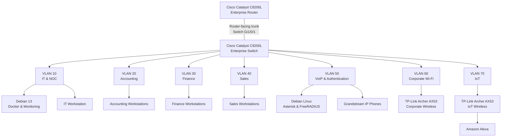
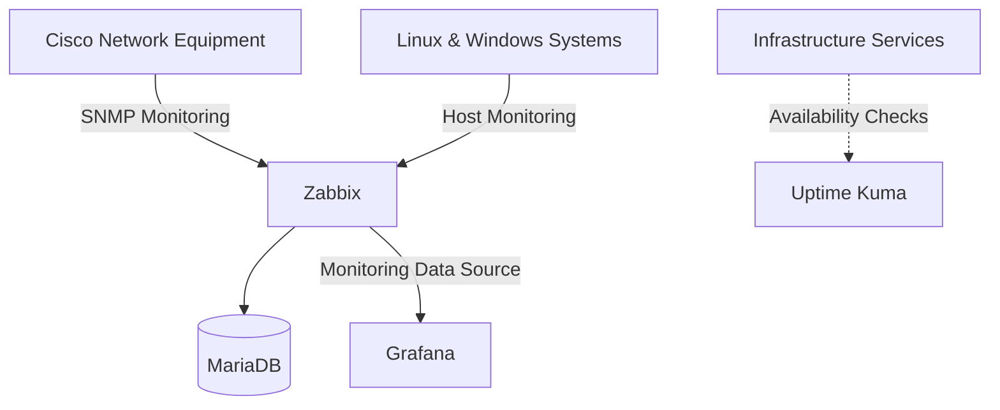

# Consolidated Logical Network Topology

**Enterprise NOC — From Scratch**

**English** | [Português (Brasil)](../pt-BR/redes/topologia-logica-consolidada.md)

---

## 1. Overview

The **Enterprise NOC — From Scratch** project documents a physical enterprise network laboratory designed around the infrastructure requirements of Tapajós Inovações.

The network integrates Cisco routing and switching equipment, departmental workstations, Linux servers, containerized applications, IP telephony, wireless networks, IoT devices, and centralized infrastructure monitoring.

This document consolidates the logical relationships between these components, providing a unified reference for the network architecture and its supporting services.

| Attribute | Documented Information |
|---|---|
| Project | Enterprise NOC — From Scratch |
| Environment | Physical enterprise network laboratory |
| Enterprise Router | Cisco Catalyst C8200L-1N-4T |
| Enterprise Switch | Cisco Catalyst C9200L-24T-4G |
| Network Segmentation | Seven VLANs |
| Main Infrastructure Platform | Debian GNU/Linux 13 |
| Voice and Authentication Platform | Debian Linux |
| Monitoring | Zabbix, Grafana, and SNMP |
| Evidence Period | November 4–6, 2026 |

The topology combines the network configuration recorded on November 4 with equipment inventories, service records, and monitoring evidence collected during the following days.

It represents the documented logical architecture rather than a complete physical cabling diagram or a record of every operational communication path.

## 2. Consolidated Network Topology

The following diagram presents the principal components and network segments of the enterprise infrastructure.



The diagram illustrates the logical organization of the laboratory infrastructure.

The Cisco Catalyst C9200L provides the documented VLAN assignments and the router-facing trunk. The Cisco Catalyst C8200L is the central routing component in the network architecture.

**The trunk is identified on switch interface `Gi1/0/1`.** The corresponding router interface and complete router-side configuration were not included in the collected records.

Connections in the diagram represent documented equipment associations and logical network relationships. They do not independently establish the operational status of every physical link.

### 2.1 Architecture Layers

The infrastructure is organized into four functional areas.

| Area | Components | Responsibility |
|---|---|---|
| Routing | Cisco Catalyst C8200L | Central routing infrastructure |
| Switching and Segmentation | Cisco Catalyst C9200L | Ethernet connectivity and VLAN assignments |
| Endpoints and Services | Linux servers, Windows workstations, IP phones, wireless equipment | Enterprise systems and network services |
| Monitoring | Zabbix, Grafana, SNMP, Uptime Kuma | Infrastructure monitoring and service availability observations |

These areas provide a consolidated view of the laboratory without implying that all components are implemented on separate physical devices.

## 3. Cisco Network Infrastructure

### 3.1 Cisco Catalyst C8200L

The Cisco Catalyst C8200L-1N-4T is the enterprise router associated with the segmented network.

Its documented architectural responsibilities include routing integration, network addressing, and access-policy design.

The collected records identify the physical equipment and its relationship with the Catalyst C9200L.

However, the available material does not contain a complete C8200L running-configuration export.

Consequently, specific router interfaces, `802.1Q` subinterfaces, routing statements, DHCP pools, NAT rules, and ACL entries are not presented as verified deployed configurations.

Further information is available in the [Cisco Catalyst C8200L documentation](router-c8200l.md).

### 3.2 Cisco Catalyst C9200L

The Cisco Catalyst C9200L-24T-4G provides the documented Ethernet switching and VLAN segmentation.

The November 4, 2026, configuration snapshot identifies Cisco IOS XE version `17.15` and the provisioned platform `c9200l-24t-4g`.

The switch configuration includes:

- Seven VLAN assignments.
- A router-facing trunk on `Gi1/0/1`.
- Departmental access interfaces.
- Interfaces associated with IP telephony and authentication services.
- Dedicated switch ports for corporate Wi-Fi and IoT.
- Rapid PVST+ configuration.

The collected trunk configuration contains:

```cisco
interface GigabitEthernet1/0/1
 description TRUNK-PARA-ROTEADOR
 switchport mode trunk
```

The snapshot does not contain an explicit allowed-VLAN list or a custom native VLAN assignment for this trunk.

The switch-side configuration does not establish the corresponding router interface or prove successful inter-VLAN communication.

Detailed configuration records are available in:

- [Cisco Switch Configuration Snapshot](switch-vlan-snapshot-2026-11-04.md)
- [Switch Port Mapping](switch-port-map.md)

## 4. VLAN Segmentation and Interface Mapping

The enterprise network uses seven VLANs to separate infrastructure administration, business departments, voice services, corporate wireless connectivity, and IoT devices.

### 4.1 VLAN Inventory

| VLAN | Network Segment | Function | Switch Interfaces |
|---|---|---|---|
| **10** | IT & NOC | Infrastructure administration and monitoring | Gi1/0/2–3 |
| **20** | Accounting | Departmental workstations | Gi1/0/4–6 |
| **30** | Finance | Departmental workstations | Gi1/0/7–8 |
| **40** | Sales | Departmental workstations | Gi1/0/9–10 |
| **50** | VoIP & Authentication | Asterisk, FreeRADIUS, and IP telephony | Gi1/0/11–13 |
| **60** | Corporate Wi-Fi | Corporate wireless connectivity | Gi1/0/15 |
| **70** | IoT | Dedicated IoT wireless connectivity | Gi1/0/14 |

The interface assignments are based on the historical Catalyst C9200L configuration.

The VLAN inventory must not be interpreted as an explicitly configured list of VLANs permitted on the router-facing trunk.

### 4.2 Switch Interface Summary

| Interface | Documented Connection | Configuration |
|---|---|---|
| Gi1/0/1 | Cisco Catalyst C8200L | Trunk |
| Gi1/0/2–3 | IT & NOC | Access VLAN 10 |
| Gi1/0/4–6 | Accounting | Access VLAN 20 |
| Gi1/0/7–8 | Finance | Access VLAN 30 |
| Gi1/0/9–10 | Sales | Access VLAN 40 |
| Gi1/0/11 | Asterisk/FreeRADIUS server | VLAN 50 assigned; operating mode not established |
| Gi1/0/12–13 | Grandstream IP phones | Access VLAN 50 |
| Gi1/0/14 | IoT wireless equipment | Access VLAN 70 |
| Gi1/0/15 | Corporate wireless equipment | Access VLAN 60 |

Interfaces `Gi1/0/16–24` and `Gi1/1/1–4` have no specific interface configuration statements in the collected snapshot.

Their operational or physical connection status cannot be determined from that absence alone.

### 4.3 Interface Gi1/0/11

The Asterisk/FreeRADIUS server is associated with `Gi1/0/11`.

The historical configuration contains:

```cisco
interface GigabitEthernet1/0/11
 description SERVIDOR-DEBIAN-VOIP-E-RADIUS
 switchport access vlan 50
 spanning-tree portfast trunk
```

The configuration does not explicitly include `switchport mode access`.

The `spanning-tree portfast trunk` statement configures Spanning Tree behavior and does not independently establish the interface's effective switching mode.

Therefore, the topology preserves the recorded VLAN 50 assignment without classifying `Gi1/0/11` as an operationally confirmed access or trunk interface.

### 4.4 Layer 2 and Layer 3 Segmentation

VLANs provide separate Layer 2 broadcast domains.

Communication between different VLANs requires Layer 3 forwarding.

The architectural access-policy design distinguishes administrative systems, departmental networks, voice infrastructure, wireless connectivity, and IoT devices.

The available records establish switch-side segmentation but do not contain the complete router ACL configuration or independent verification of all inter-VLAN communication paths.

The intended network separation must therefore be distinguished from verified router access-control enforcement.

## 5. Linux Infrastructure and Network Services

The laboratory includes two Linux infrastructure computers with different responsibilities.

### 5.1 Main NOC Server — VLAN 10

The main infrastructure computer is documented as a Dell OptiPlex 3020 running Debian GNU/Linux 13.

| Attribute | Documented Information |
|---|---|
| Network Segment | VLAN 10 |
| IPv4 Address | `192.168.10.12/24` |
| Operating System | Debian GNU/Linux 13 |
| Processor | Intel Core i5-4590 |
| Memory | Approximately 8 GB |
| Main Role | Infrastructure services and monitoring |

The documented service environment includes:

- Docker and Docker Compose.
- Zabbix.
- Grafana.
- MariaDB.
- Portainer.
- Pi-hole.
- Uptime Kuma.
- Nginx and web infrastructure services.

The November 6 Docker inventory recorded **ten running containers** on the main infrastructure computer.

That count represents the collected environment at the time of observation, not a guarantee of continuous container availability.

### 5.2 Voice and Authentication Server — VLAN 50

A second Linux computer provides the documented Asterisk and FreeRADIUS services.

| Attribute | Documented Information |
|---|---|
| Network Segment | VLAN 50 |
| IPv4 Address | `192.168.50.2/24` |
| Default Gateway | `192.168.50.1` |
| Operating System | Debian forky/sid, as recorded |
| Processor | Intel Core i5-4590 |
| Memory | Approximately 8 GB |
| Voice Service | Asterisk |
| Authentication Service | FreeRADIUS |

The Linux environment recorded for this server differs from the Debian 13 installation used on the main NOC computer.

The default gateway is documented in the server configuration records. Its presence does not independently identify the corresponding router interface.

### 5.3 IP Telephony

Two Grandstream IP telephones are associated with the Asterisk infrastructure.

| Extension | Department | Documented IP Address |
|---|---|---|
| 1001 | Sales | `192.168.50.10` |
| 1002 | IT | `192.168.50.11` |

The available records document the devices, extensions, addressing, and Asterisk service environment.

They do not independently establish successful telephone calls between the devices.

### 5.4 FreeRADIUS Integration

FreeRADIUS provides centralized authentication functionality in the documented infrastructure.

The authentication architecture relates the server in VLAN 50 to the corporate wireless environment in VLAN 60.

However, the presence of FreeRADIUS does not independently establish that the TP-Link Archer AX53 was configured to authenticate Wi-Fi clients through RADIUS.

The wireless equipment configuration and authentication transaction records are not included in the collected evidence.

Additional information is available in:

- [Docker Infrastructure and Services](../containers/docker-services.md)
- [Asterisk and FreeRADIUS](../services/asterisk-freeradius.md)

## 6. Corporate Wireless and IoT Networks

The wireless infrastructure uses two separate TP-Link Archer AX53 devices.

Each is associated with a dedicated network segment.

### 6.1 Corporate Wi-Fi — VLAN 60

| Attribute | Documented Information |
|---|---|
| Equipment | TP-Link Archer AX53 |
| Wireless Standard | Wi-Fi 6 |
| Product Class | AX3000 |
| Network Segment | Corporate Wi-Fi |
| VLAN | 60 |
| Switch Interface | `Gi1/0/15` |

The corporate wireless infrastructure is assigned to VLAN 60 in the Catalyst C9200L switch configuration.

The collected equipment records do not include the Archer AX53 operating mode, DHCP configuration, client addressing, NAT settings, or wireless authentication parameters.

### 6.2 IoT — VLAN 70

The IoT segment includes a separate TP-Link Archer AX53 associated with an Amazon Alexa device.

| Attribute | Documented Information |
|---|---|
| Equipment | Dedicated TP-Link Archer AX53 |
| Network Segment | IoT |
| VLAN | 70 |
| Switch Interface | `Gi1/0/14` |
| Documented Wireless Device | Amazon Alexa |

The documented topology associates the Alexa device with the IoT wireless network.

```text
Amazon Alexa
     |
   Wi-Fi
     |
TP-Link Archer AX53
     |
  Ethernet
     |
Cisco Catalyst C9200L
  Gi1/0/14
  Access VLAN 70
```

The switch configuration establishes the VLAN assignment but does not identify the wireless router's internal operating mode.

Depending on the wireless device configuration, clients may participate directly in the associated VLAN subnet or use a separate subnet behind the router.

The available evidence does not establish which operating mode was deployed.

Consequently, the Alexa IP address, wireless client subnet, DHCP service, NAT behavior, and IoT default gateway are not asserted as recorded configurations.

### 6.3 Wireless Segmentation

VLANs 60 and 70 are separate logical segments in the enterprise design.

The documented access-policy requirements distinguish corporate wireless connectivity from IoT devices and sensitive enterprise resources.

The switch-side VLAN assignments do not independently establish router ACL enforcement or end-to-end traffic isolation.

See:

- [Corporate Wi-Fi — VLAN 60](corporate-wifi-vlan60.md)
- [IoT Network — VLAN 70](iot-vlan70.md)

## 7. Documented IP Addressing

The November 6 infrastructure inventory identifies addressing information for the departmental workstations, Linux servers, and IP telephones.

### 7.1 Network Addressing Inventory

| VLAN | Documented Network | Addressing Examples |
|---|---|---|
| 10 | `192.168.10.0/24` | Main NOC: `192.168.10.12`; IT 2: `192.168.10.13` |
| 20 | `192.168.20.0/24` | Accounting: `192.168.20.11–13` |
| 30 | `192.168.30.0/24` | Finance: `192.168.30.10–11` |
| 40 | `192.168.40.0/24` | Sales: `192.168.40.10–11` |
| 50 | `192.168.50.0/24` | Asterisk/FreeRADIUS: `192.168.50.2`; IP phones: `192.168.50.10–11` |
| 60 | Not established by available client addressing records | Corporate Wi-Fi |
| 70 | Not established by available client addressing records | IoT |

The documented `/24` networks are based on collected host addresses and subnet masks.

### 7.2 Observed Default Gateways

| VLAN | Recorded Default Gateway | Evidence |
|---|---|---|
| 10 | `192.168.10.1` | IT workstation configuration |
| 20 | `192.168.20.1` | Accounting workstation configuration |
| 30 | `192.168.30.1` | Finance workstation configuration |
| 40 | `192.168.40.1` | Sales workstation configuration |
| 50 | `192.168.50.1` | Asterisk/FreeRADIUS server record |

These values represent gateway settings recorded on the corresponding hosts.

The records do not independently establish the ownership or router-interface configuration of every gateway address.

No default gateway is attributed to VLANs 60 and 70 without supporting addressing evidence.

### 7.3 DHCP and Historical Address Differences

The laboratory uses DHCP for workstation addressing.

The November 6 inventory identified six differences between workstation IPv4 addresses and corresponding host interface addresses previously registered in Zabbix.

These differences can contribute to monitoring problems when hosts retain outdated addressing information.

However, DHCP changes are not established as the cause of every monitoring alert.

The documented addresses represent historical observations rather than guaranteed current assignments or confirmed DHCP reservations.

## 8. Monitoring and Observability Architecture

The network infrastructure includes centralized monitoring and service observability.

### 8.1 Monitoring Components

| Component | Documented Function |
|---|---|
| Zabbix | Infrastructure and service monitoring |
| Grafana | Visualization of collected monitoring metrics |
| SNMP | Monitoring information from supported Cisco equipment |
| MariaDB | Storage of Zabbix monitoring data |
| Uptime Kuma | Availability checks for selected services |

The monitoring environment incorporates information from Cisco network equipment, Linux servers, Windows workstations, and selected infrastructure services.

### 8.2 Monitoring Relationships



The diagram summarizes the documented monitoring relationships. It does not represent an exhaustive inventory of monitoring protocols or service dependencies.

### 8.3 Historical Monitoring Evidence

The collected screenshots include:

- Router and switch interface metrics.
- Host availability observations.
- CPU and memory utilization.
- Network throughput and traffic indicators.
- Service monitoring information.
- Unavailable hosts and unsupported monitoring items.

These results represent the monitoring state recorded during evidence collection.

They do not establish continuous availability or successful operation of every monitored component.

The original November 4 switch configuration was collected before the later SNMP monitoring configuration reflected in the screenshots.

Further information is available in:

- [Zabbix Monitoring](../monitoring/zabbix-monitoring.md)
- [Grafana Monitoring](../monitoring/grafana-monitoring.md)
- [SNMP Troubleshooting](../monitoring/snmp-troubleshooting.md)

## 9. Physical Infrastructure

The enterprise laboratory includes physical network equipment and structured cabling.

The documented environment contains:

- Cisco Catalyst C8200L router.
- Cisco Catalyst C9200L switch.
- Network rack and power distribution.
- Category 6 patch panel.
- Structured Ethernet cabling.
- Manually assembled Ethernet cables using T568A wiring.
- Departmental workstations.
- Linux infrastructure computers.
- Grandstream IP telephones.
- TP-Link wireless equipment.

### 9.1 Physical Equipment Evidence


The photograph documents the physical networking equipment and rack infrastructure.

Additional photographs record the rack organization and surrounding equipment.

The available physical evidence does not constitute an exhaustive cable-by-cable connectivity survey.

See [Physical Infrastructure](../evidence/physical-infrastructure.md).

## 10. Technical Evidence and Scope

The consolidated topology is based on the following evidence:

| Evidence | Date or Period | Documented Scope |
|---|---|---|
| Cisco C9200L configuration snapshot | November 4, 2026 | VLANs, trunk, interface assignments, Spanning Tree |
| Workstation and server inventory | November 6, 2026 | Equipment, operating systems, IPv4 addressing |
| Docker and Portainer inventory | November 6, 2026 | Containerized services and observed container state |
| Asterisk/FreeRADIUS records | November 2026 | Voice and authentication server, telephone extensions |
| Wireless equipment records | November 2026 | Corporate Wi-Fi and IoT equipment associations |
| Zabbix and Grafana captures | November 2026 | Historical monitoring observations |
| Physical photographs | November 2026 | Equipment presence and rack organization |

The topology consolidates the documented architecture, equipment assignments, and recorded configuration.

It does not represent:

- A complete physical cabling map.
- A complete Cisco C8200L running configuration.
- Verified router-side VLAN subinterfaces.
- Independent confirmation of every inter-VLAN communication path.
- Router ACL entries or verified access-control enforcement.
- Complete DHCP, NAT, or external routing configuration.
- Configuration exports from both TP-Link Archer AX53 devices.
- Verified wireless client addressing for VLANs 60 and 70.
- Continuous availability of all infrastructure services.

These boundaries preserve the distinction between the collected technical evidence and implementation details not established by the available records.

## 11. Related Documentation

### Networking & Architecture

- [Networking & Architecture — Overview](README.md)
- [VLAN Segmentation](vlans.md)
- [Cisco Catalyst C8200L](router-c8200l.md)
- [Cisco Catalyst C9200L — Configuration Snapshot](switch-vlan-snapshot-2026-11-04.md)
- [Cisco Catalyst C9200L — Switch Port Mapping](switch-port-map.md)
- [Corporate Wi-Fi — VLAN 60](corporate-wifi-vlan60.md)
- [IoT Network — VLAN 70](iot-vlan70.md)

### Infrastructure and Services

- [Infrastructure Architecture](../architecture/infrastructure-overview.md)
- [Docker Infrastructure and Services](../containers/docker-services.md)
- [Workstation and Server Inventory](../endpoints/workstation-inventory.md)
- [Asterisk and FreeRADIUS](../services/asterisk-freeradius.md)
- [Physical Infrastructure](../evidence/physical-infrastructure.md)

### Monitoring and Operations

- [Zabbix Monitoring](../monitoring/zabbix-monitoring.md)
- [Grafana Monitoring](../monitoring/grafana-monitoring.md)
- [SNMP Troubleshooting](../monitoring/snmp-troubleshooting.md)
- [Incident Management](../noc-operations/incident-management.md)

---

**Evidence reference:** November 4–6, 2026  
**Document type:** Consolidated logical network topology.
