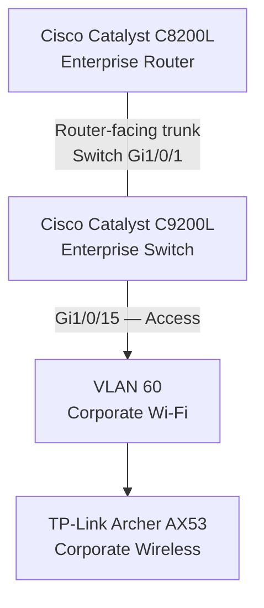

# Corporate Wi-Fi — VLAN 60

**Enterprise NOC — From Scratch**

**English** | [Português (Brasil)](../pt-BR/redes/wifi-corporativo-vlan60.md)

---

## 1. Overview

The **Enterprise NOC — From Scratch** infrastructure includes a dedicated network segment for corporate wireless connectivity.

**VLAN 60** is assigned to the corporate Wi-Fi environment, providing logical separation from departmental workstations, administrative infrastructure, voice services, and IoT connectivity.

The documented wireless equipment is a **TP-Link Archer AX53**, associated with interface `Gi1/0/15` on the Cisco Catalyst C9200L switch.

This document consolidates the equipment identification, switch configuration, network architecture, access-policy design, authentication relationships, and historical technical evidence.

| Attribute | Documented Information |
|---|---|
| Network Segment | Corporate Wi-Fi |
| VLAN ID | 60 |
| Wireless Equipment | TP-Link Archer AX53 |
| Wireless Generation | Wi-Fi 6 |
| Product Class | AX3000 |
| Enterprise Switch | Cisco Catalyst C9200L-24T-4G |
| Switch Interface | `Gi1/0/15` |
| Interface Configuration | Access VLAN 60 |
| Enterprise Router | Cisco Catalyst C8200L-1N-4T |
| Configuration Reference | November 4, 2026 |
| Equipment Evidence | November 6, 2026 |

The available records establish the equipment identification and switch-side VLAN assignment. They do not include the wireless router's complete operating configuration.

## 2. Wireless Equipment

### 2.1 TP-Link Archer AX53

The corporate wireless equipment was identified from physical evidence collected on **November 6, 2026**.

| Characteristic | Identification |
|---|---|
| Manufacturer | TP-Link |
| Model | Archer AX53 |
| Wireless Standard | Wi-Fi 6 |
| Product Class | AX3000 |
| Documented Role | Corporate wireless connectivity |
| Associated VLAN | 60 |

The AX53 is documented as part of the enterprise wireless infrastructure.

Its identification is supported by the collected equipment evidence rather than inferred from the switch configuration.

### 2.2 Corporate and IoT Equipment Separation

The laboratory includes two separate TP-Link Archer AX53 devices.

| Equipment | Network Segment | Switch Interface |
|---|---|---|
| Corporate Archer AX53 | VLAN 60 — Corporate Wi-Fi | `Gi1/0/15` |
| Dedicated IoT Archer AX53 | VLAN 70 — IoT | `Gi1/0/14` |

Both devices belong to the same product family but have distinct roles in the documented network architecture.

The corporate wireless device is not represented as simultaneously providing the separate IoT network.

### 2.3 Published Evidence

The original equipment photograph contains sensitive wireless information and unique device identifiers.

For this reason, the original photograph is not included in the public documentation.

No wireless passwords, SSIDs, administrative credentials, authentication secrets, or device-specific identifiers are reproduced in this document.

## 3. Integration with the Cisco Catalyst C9200L

The Cisco Catalyst C9200L configuration captured on **November 4, 2026**, assigns `Gi1/0/15` to the corporate Wi-Fi segment.

### 3.1 Switch Interface Assignment

| Component | Recorded Information |
|---|---|
| Switch | Cisco Catalyst C9200L |
| Interface | `Gi1/0/15` |
| Assigned VLAN | 60 |
| Switchport Mode | Access |
| Documented Connection | Corporate wireless equipment |

The switch record establishes the VLAN assignment configured on the Ethernet interface.

It does not independently establish the physical link state, the wireless device's operating mode, or successful connectivity for wireless clients.

### 3.2 Relationship with the Enterprise Router

The network architecture includes a Cisco Catalyst C8200L router connected to the C9200L through the router-facing trunk configured on switch interface `Gi1/0/1`.

The switch configuration establishes the trunk on the C9200L side.

The corresponding C8200L interface, complete router-side VLAN configuration, and access-control implementation are not included in the collected records.

The documented network VLAN inventory is not an explicitly configured allowed-VLAN list for the trunk.

## 4. Logical Network Architecture

The corporate wireless environment is associated with VLAN 60 on the Catalyst C9200L.

The diagram presents the documented logical relationship between the equipment and the corporate wireless segment.

It does not represent a complete physical cable map or establish the internal routing, NAT, DHCP, or wireless-client configuration of the Archer AX53.

### 4.1 Relationship with Other VLANs

The enterprise network includes seven VLANs with distinct responsibilities.

| VLAN | Network Segment | Relationship to Corporate Wi-Fi |
|---|---|---|
| 10 | IT & NOC | Administrative and monitoring infrastructure |
| 20 | Accounting | Departmental network |
| 30 | Finance | Departmental network |
| 40 | Sales | Departmental network |
| 50 | VoIP & Authentication | Asterisk and FreeRADIUS services |
| 60 | Corporate Wi-Fi | Dedicated corporate wireless segment |
| 70 | IoT | Separate wireless network |

VLAN 60 is logically separated at Layer 2 from the other documented VLANs.

Communication between VLANs requires Layer 3 forwarding, and restrictions on that communication depend on the corresponding routing and security configurations.

## 5. Operating Mode and IP Addressing

The collected equipment records do not include a configuration export from the corporate Archer AX53.

Consequently, the installed operating mode and internal addressing configuration cannot be established from the available evidence.

### 5.1 Access Point and Router Modes

The effect of the wireless device on client addressing depends on its operating mode.

| Operating Mode | General Network Behavior |
|---|---|
| Access Point | Wireless clients may participate directly in the IP network associated with the upstream VLAN |
| Router with NAT | Wireless clients may use a separate internal subnet behind the device |

These are possible operating models, not confirmed configurations of the installed Archer AX53.

The switch-side access VLAN assignment does not independently identify which mode was used.

### 5.2 Wireless Client Addressing

The available records do not establish:

- The corporate wireless client subnet.
- Wireless client IPv4 addresses.
- The wireless default gateway.
- The DHCP server or address pool.
- NAT configuration.
- Internal device addressing.

No `192.168.60.0/24` network, `192.168.60.1` gateway, or other conventionally numbered address is attributed to the deployment without corresponding evidence.

The documented fact is the **VLAN 60 assignment on switch interface `Gi1/0/15`**.

## 6. Network Segmentation and Access Policy

The enterprise architecture assigns corporate wireless connectivity to a dedicated logical segment.

The access-policy design distinguishes corporate Wi-Fi from the administrative, departmental, voice, and IoT networks.

### 6.1 Architectural Requirements

The documented security model provides for:

- Restricting unauthorized access from wireless clients to administrative infrastructure.
- Separating corporate wireless connectivity from the IoT network.
- Allowing communication with internal services only where authorized and required.
- Controlling inter-VLAN traffic through the relevant Layer 3 security policies.

These requirements describe the logical network security design.

### 6.2 Enforcement Evidence

The historical C9200L configuration establishes the VLAN 60 switchport assignment.

It does not independently demonstrate:

- Router ACL enforcement.
- Successful isolation of wireless clients from other VLANs.
- Firewall rules applied to the corporate wireless environment.
- End-to-end inter-VLAN access-control tests.

The documented architecture must therefore be distinguished from independently verified security-policy enforcement.

## 7. Authentication and FreeRADIUS

The Enterprise NOC infrastructure includes a FreeRADIUS server associated with VLAN 50.

The documented server information is:

| Attribute | Recorded Information |
|---|---|
| Service | FreeRADIUS |
| Host Operating System | Debian Linux |
| Server IPv4 Address | `192.168.50.2/24` |
| Network Segment | VLAN 50 |
| Authentication Protocol | RADIUS |
| Standard Authentication Port | UDP 1812 |
| Standard Accounting Port | UDP 1813 |

The network authentication architecture relates FreeRADIUS to the corporate wireless environment.

However, the available evidence does not establish that the Archer AX53 was configured as an operational RADIUS client.

### 7.1 Authentication Scope

The collected records do not include:

- Corporate Wi-Fi SSID configuration.
- Wireless encryption settings.
- RADIUS client definitions for the Archer AX53.
- Shared-secret configuration.
- Wireless authentication transaction logs.
- Successful authentication tests involving corporate Wi-Fi clients.

The FreeRADIUS installation is documented independently from the wireless equipment configuration.

Their presence in the same infrastructure does not, by itself, demonstrate an operational authentication integration.

Additional technical information is available in [Asterisk and FreeRADIUS](../services/asterisk-freeradius.md).

## 8. Monitoring and Observability

The Enterprise NOC laboratory uses Zabbix and Grafana for infrastructure monitoring.

The collected monitoring evidence includes information from Cisco network equipment and infrastructure services.

The published monitoring records do not contain a dedicated dashboard identifying direct metrics from the corporate Archer AX53.

### 8.1 Monitoring Coverage

| Component | Documented Monitoring Evidence |
|---|---|
| Cisco Catalyst C8200L | Router-related Zabbix/Grafana observations |
| Cisco Catalyst C9200L | Switch-related monitoring metrics |
| TP-Link Archer AX53 — Corporate Wi-Fi | No dedicated direct-monitoring dashboard in the collected records |

The presence of monitoring information for the Cisco infrastructure does not establish direct monitoring of the wireless router or its clients.

### 8.2 Monitoring References

- [Zabbix Monitoring](../monitoring/zabbix-monitoring.md)
- [Grafana Monitoring](../monitoring/grafana-monitoring.md)
- [SNMP Troubleshooting](../
