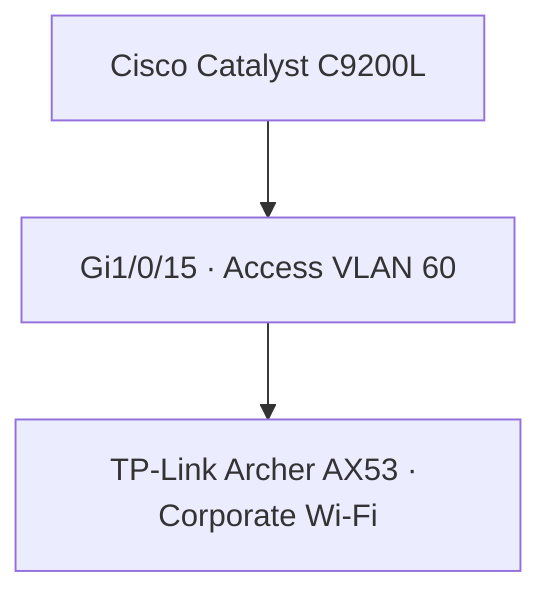

# Corporate Wi-Fi — VLAN 60

**Enterprise NOC — From Scratch**

**English** | [Português (Brasil)](../pt-BR/redes/wifi-corporativo-vlan60.md)

## Equipment and switch connection

| Attribute | Documented record |
|---|---|
| Equipment | TP-Link Archer AX53 · Wi-Fi 6 AX3000 |
| Network role | Corporate wireless |
| VLAN | 60 |
| Switch | Cisco Catalyst C9200L-24T-4G |
| Port | `Gi1/0/15` — access VLAN 60 |
| Evidence | Switch configuration, November 4, 2026; device photograph, November 6 |

The corporate Archer AX53 is **a separate physical unit** from the Archer AX53 used for IoT on VLAN 70 (`Gi1/0/14`). Device identification comes from the collected photograph; the VLAN assignment comes from the Cisco switch configuration.

The original equipment photograph includes wireless credentials or unique identifiers and is not published in the public documentation.

## Logical connection

The router-facing trunk on C9200L `Gi1/0/1` belongs to the wider network architecture; its router-side configuration was not captured. The connection shown here records the corporate wireless device's switch association, not tested wireless-client connectivity.

## Addressing and authentication

The Archer AX53 configuration was not collected, so the following are **not established**: AP versus router mode, client IP subnet, default gateway, DHCP, NAT, SSID and encryption settings.

In AP mode, clients may join the upstream VLAN's IP network. In router mode, they may use a separate subnet behind the device. Neither mode is presented as deployed. In particular, `192.168.60.0/24` and `192.168.60.1` are not asserted without addressing evidence.

FreeRADIUS is documented on the Debian voice/authentication server in VLAN 50 (`192.168.50.2`; standard RADIUS ports UDP 1812/1813). The available records do **not** confirm that the AX53 was configured as a RADIUS client or that wireless authentication succeeded.

## Security and monitoring

VLAN 60 is a separate Layer 2 segment. The access-policy design restricts unauthorized traffic to internal networks; the switch assignment does not verify router ACL enforcement or client isolation tests.

Zabbix and Grafana records document monitoring of Cisco equipment. No dedicated dashboard with direct corporate Archer AX53 metrics appears in the collected inventory.

## Operational Design and Verification Requirements

The documented **Gi1/0/15 access VLAN 60** setting establishes where the corporate Archer AX53 attaches to the Catalyst C9200L. It does not determine the AX53's **operating mode** or the Layer 3 addressing used by wireless clients.

**Access-point versus router mode:** in AP mode, the device could bridge wireless clients to the upstream segment; in router mode, it could present its own DHCP, private client subnet and NAT boundary. Those alternatives change where client gateways and security controls must be verified. Neither is asserted as the laboratory's deployed configuration; no AX53 configuration export was collected.

**Authentication dependency:** FreeRADIUS 3.2.10 is documented on the voice/authentication Debian host at `192.168.50.2` in VLAN 50, using RADIUS UDP `1812/1813`. That establishes a server, **not** a working Wi-Fi 802.1X deployment. Verification would require the AX53's actual enterprise-authentication capabilities and settings, compatible RADIUS client definition, certificate validation at clients, permitted routing between VLANs and timestamped authentication results.

**Monitoring dependency:** network-device SNMP panels are evidence about the Cisco devices, not client association, RSSI, DHCP leasing or wireless login success on the AX53. To evaluate corporate Wi-Fi itself, the relevant access device and client evidence would need to be collected separately.

The key design question is whether the switch-port VLAN corresponds directly to the **wireless client network** or only to the **AX53's uplink**. The captured evidence supports the uplink; it does not answer the client-side question. See [VLAN segmentation](vlans.md) and [FreeRADIUS records](../services/asterisk-freeradius.md).

## References

[Networking overview](README.md) · [VLANs](vlans.md) · [Port map](switch-port-map.md) · [Switch snapshot](switch-vlan-snapshot-2026-11-04.md) · [IoT · VLAN 70](iot-vlan70.md) · [Asterisk / FreeRADIUS](../services/asterisk-freeradius.md) · [Physical infrastructure](../evidence/physical-infrastructure.md)
