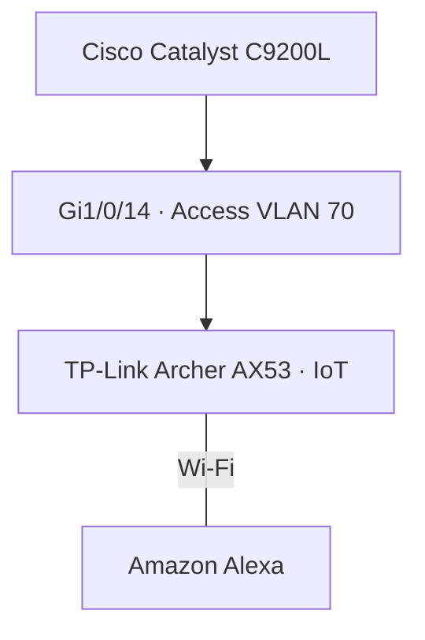

# IoT Network — VLAN 70

**Enterprise NOC — From Scratch**

**English** | [Português (Brasil)](../pt-BR/redes/iot-vlan70.md)

## Equipment and connection

| Attribute | Documented record |
|---|---|
| Network segment | VLAN 70 · IoT |
| Wireless equipment | Dedicated TP-Link Archer AX53 · Wi-Fi 6 AX3000 |
| Associated device | Amazon Alexa |
| Switch | Cisco Catalyst C9200L-24T-4G |
| Port | `Gi1/0/14` — access VLAN 70 |
| Evidence | November 4 switch configuration and November equipment inventory |

The corporate Wi-Fi network uses a **different** Archer AX53 on VLAN 60 (`Gi1/0/15`).

The diagram records the IoT device association and Ethernet connection to the switch. It does not imply that Alexa uses an IP address directly from an upstream VLAN 70 subnet.

## Addressing and segmentation

The Archer AX53 configuration export was not collected. Its AP/router operating mode, DHCP configuration, NAT behavior, client subnet, default gateway, SSID and Alexa IP address are **not established**.

- **AP mode:** wireless clients may participate in the upstream VLAN's subnet.
- **Router mode with NAT:** clients may occupy a separate internal subnet.

These are possible configurations, not verified settings of the laboratory device.

VLAN 70 separates the IoT Ethernet segment from corporate Wi-Fi VLAN 60 at Layer 2. Restricting traffic to other enterprise resources requires Layer 3 policy; router ACL enforcement was not verified in the collected records.

## Monitoring and publication scope

Zabbix/Grafana screenshots show monitoring of Cisco infrastructure. No direct Alexa or IoT Archer AX53 monitoring metrics appear in the published inventory.

This record documents the switch assignment and device relationship, not successful IoT client tests or a complete wireless configuration. SSIDs, passwords, RADIUS secrets and unique device identifiers are not published.

## References

[Networking overview](README.md) · [VLANs](vlans.md) · [Switch port map](switch-port-map.md) · [Switch snapshot](switch-vlan-snapshot-2026-11-04.md) · [Corporate Wi-Fi · VLAN 60](corporate-wifi-vlan60.md) · [Logical topology](consolidated-logical-topology.md) · [Physical infrastructure](../evidence/physical-infrastructure.md)
