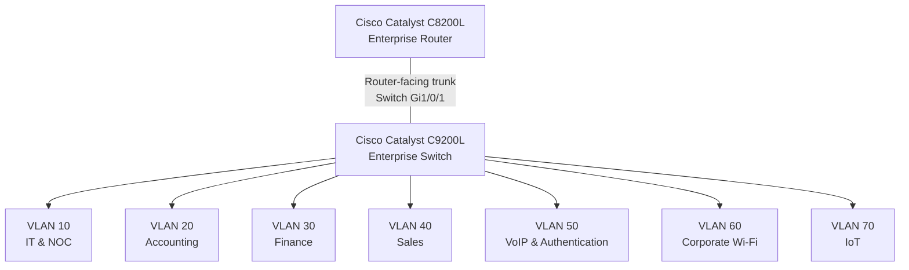

# Cisco Catalyst C8200L — Router Architecture and Technical Evidence

**Enterprise NOC — From Scratch**

**English** | [Português (Brasil)](../pt-BR/redes/roteador-c8200l.md)

---

## 1. Overview

The **Cisco Catalyst C8200L-1N-4T** is the central routing component in the Enterprise NOC network architecture.

The laboratory combines physical Cisco networking equipment, departmental VLANs, Linux servers, Windows workstations, IP telephony, wireless infrastructure, and centralized monitoring.

This document consolidates the router's architectural role, physical equipment evidence, recorded network addressing, segmentation requirements, and monitoring observations.

The technical information is based on infrastructure records collected between **November 4 and 6, 2026**.

| Attribute | Documented Information |
|---|---|
| Manufacturer | Cisco |
| Model | Catalyst C8200L-1N-4T |
| Network Role | Enterprise routing infrastructure |
| Associated Switch | Cisco Catalyst C9200L-24T-4G |
| Network Segments | VLANs 10, 20, 30, 40, 50, 60, and 70 |
| Router-Facing Switch Interface | `Gi1/0/1` |
| Monitoring Platforms | Zabbix and Grafana |
| Evidence Period | November 4–6, 2026 |

The collected records identify the router hardware, its role in the network architecture, and the switch-side trunk connection.

A complete C8200L running-configuration export is not part of the available technical evidence.

## 2. Physical Infrastructure

The Cisco Catalyst C8200L is installed in the laboratory's network rack alongside the Catalyst C9200L switch and structured cabling infrastructure.

The available photographs identify the router as a **C8200L-1N-4T**.

### 2.1 Physical Evidence


The photograph documents the physical presence of the router, switch, and associated cabling components.

The image does not independently establish the router's interface configuration, routing table, or operational state.

### 2.2 Connection to the Catalyst C9200L

The Cisco switch configuration captured on November 4, 2026, contains the following statements:

```cisco
interface GigabitEthernet1/0/1
 description TRUNK-PARA-ROTEADOR
 switchport mode trunk
```

These commands identify `Gi1/0/1` on the **Catalyst C9200L switch** as the interface configured for the router-facing trunk.

The configuration does not include an explicit allowed-VLAN list or a custom native VLAN assignment for that trunk.

The corresponding physical interface on the C8200L is not identified in the collected switch record.

Therefore, `Gi1/0/1` must not be interpreted as the router's interface identifier.

The complete router-side trunk and VLAN subinterface configuration is not included in the available records.

## 3. Logical Network Architecture

The router is associated with an enterprise network organized into seven VLANs.

The following diagram represents the documented logical relationship between the routing infrastructure and the network segments.



The diagram represents the logical network design and switch-side segmentation.

It does not establish the precise C8200L interface configuration or independently verify communication between every VLAN.

### 3.1 VLAN Inventory

| VLAN | Network Segment | Documented Function |
|---|---|---|
| **10** | IT & NOC | Infrastructure administration, Linux services, and monitoring |
| **20** | Accounting | Departmental workstations |
| **30** | Finance | Departmental workstations |
| **40** | Sales | Departmental workstations |
| **50** | VoIP & Authentication | Asterisk, FreeRADIUS, and IP telephony |
| **60** | Corporate Wi-Fi | Corporate wireless connectivity |
| **70** | IoT | Dedicated wireless connectivity for smart devices |

The VLAN assignments are documented in the November 4 Catalyst C9200L configuration snapshot.

VLAN segmentation establishes separate Layer 2 broadcast domains.

Communication between different VLANs requires Layer 3 forwarding. The available records do not establish the complete implementation or successful operation of all inter-VLAN routing paths.

### 3.2 Router and Switch Responsibilities

The documented architecture separates the responsibilities of the two principal Cisco devices.

| Component | Architectural Responsibility | Supporting Evidence |
|---|---|---|
| Catalyst C8200L | Central routing infrastructure | Physical equipment, technical records, and monitoring observations |
| Catalyst C9200L | Ethernet switching and VLAN segmentation | IOS XE configuration snapshot |
| Router-facing trunk | Logical connection between routing and switching components | Switch interface `Gi1/0/1` configuration |

The presence of a trunk on the switch does not, by itself, confirm the existence or configuration of corresponding `802.1Q` subinterfaces on the router.

No specific C8200L subinterface names are attributed to the deployed configuration without supporting evidence.

## 4. Observed IP Addressing

The collected infrastructure records include IPv4 addresses and default gateways associated with several network segments.

### 4.1 Documented Network Addressing

| VLAN | Documented Network | Addressing Examples |
|---|---|---|
| 10 | `192.168.10.0/24` | Main NOC: `192.168.10.12`; IT 2: `192.168.10.13` |
| 20 | `192.168.20.0/24` | Accounting: `192.168.20.11–13` |
| 30 | `192.168.30.0/24` | Finance: `192.168.30.10–11` |
| 40 | `192.168.40.0/24` | Sales: `192.168.40.10–11` |
| 50 | `192.168.50.0/24` | Asterisk/FreeRADIUS: `192.168.50.2`; IP phones: `192.168.50.10–11` |
| 60 | Not established by available client addressing records | Corporate Wi-Fi |
| 70 | Not established by available client addressing records | IoT |

The documented `/24` networks are based on collected host addresses and subnet masks.

The available records do not establish the client IP addressing schemes for VLANs 60 and 70.

The operating modes and internal network configurations of the TP-Link Archer AX53 devices are not included in the switch configuration snapshot.

### 4.2 Observed Default Gateways

The November 6 workstation records identify the following default gateways:

| VLAN | Observed Default Gateway | Evidence |
|---|---|---|
| 10 | `192.168.10.1` | IT workstation configuration |
| 20 | `192.168.20.1` | Accounting workstation configuration |
| 30 | `192.168.30.1` | Finance workstation configuration |
| 40 | `192.168.40.1` | Sales workstation configuration |

The Asterisk/FreeRADIUS server documentation also records:

| Network Segment | Documented Server Address | Recorded Default Gateway |
|---|---|---|
| VLAN 50 | `192.168.50.2/24` | `192.168.50.1` |

The November 4 technical records additionally associate `192.168.10.1` with the Cisco router.

These observations document endpoint gateway settings and the addressing information preserved in the technical records.

They do not independently confirm the ownership of every gateway address or identify the corresponding router interfaces.

In particular, `192.168.50.1` is documented as the default gateway of the Asterisk/FreeRADIUS server, not as a verified C8200L interface address.

### 4.3 DHCP Addressing

The laboratory uses DHCP for workstation addressing.

The collected evidence includes differences between workstation addresses observed during inventory collection and addresses previously registered in Zabbix.

Address changes between collection periods may affect monitoring when host interface records retain earlier values.

The available documentation does not establish the DHCP server, relay configuration, address pools, or reservation policies used across all network segments.

## 5. Network Segmentation and Access Policy Design

The enterprise network architecture distinguishes administrative infrastructure, business departments, voice services, corporate wireless connectivity, and IoT devices.

The following requirements describe the documented logical access-policy design.

They must not be interpreted as verified router ACL configurations.

### 5.1 Administrative Network — VLAN 10

VLAN 10 is designated for IT administration and infrastructure monitoring.

The access-policy design provides for authorized management systems to reach infrastructure services and network equipment when required.

Management access is intended to remain restricted to authorized systems and services.

### 5.2 Departmental Networks — VLANs 20, 30, and 40

Accounting, Finance, and Sales operate within separate VLANs.

The access-policy design provides for separation between departmental networks, with exceptions for explicitly authorized services.

The existence of separate VLANs demonstrates Layer 2 segmentation but does not independently establish Layer 3 traffic restrictions.

### 5.3 Voice and Authentication — VLAN 50

VLAN 50 is associated with the Asterisk and FreeRADIUS server and two Grandstream IP telephones.

The documented equipment includes:

| Component | Address |
|---|---|
| Asterisk / FreeRADIUS Server | `192.168.50.2` |
| Grandstream — Sales | `192.168.50.10` |
| Grandstream — IT | `192.168.50.11` |

The access-policy design considers the network connectivity required by voice and authentication services.

The presence of FreeRADIUS does not independently establish successful wireless authentication through the TP-Link equipment.

### 5.4 Corporate Wi-Fi — VLAN 60

VLAN 60 is designated for corporate wireless connectivity.

The associated TP-Link Archer AX53 is documented on switch interface `Gi1/0/15`.

The logical security design provides for restrictions on unauthorized access to internal enterprise resources.

The available records do not include the wireless router configuration, its client addressing information, or verified ACL enforcement.

### 5.5 IoT Network — VLAN 70

VLAN 70 is dedicated to IoT connectivity.

A separate TP-Link Archer AX53 is associated with switch interface `Gi1/0/14` and the documented Amazon Alexa environment.

The access-policy design separates IoT connectivity from sensitive enterprise resources.

The collected records do not establish the wireless router's internal operating mode or the Alexa client's IP address.

### 5.6 Access Control Evidence

The technical records include the switch-side VLAN configuration and the network access-policy design.

They do not contain a complete C8200L ACL configuration export or recorded tests demonstrating enforcement of those policies.

Accordingly, the documented restrictions represent architectural requirements rather than independently verified router behavior.

## 6. Router Monitoring

The Cisco Catalyst C8200L is represented in the laboratory's Zabbix and Grafana monitoring environment.

The collected evidence includes router-related monitoring information and interface metrics.

### 6.1 Grafana — Router Monitoring

**Dashboard — Part 1**


**Dashboard — Part 2**


The screenshots preserve router monitoring observations from the evidence collection period.

They do not independently establish:

- Continuous device availability.
- Complete monitoring coverage of every interface.
- Successful forwarding between all VLANs.
- Correct enforcement of security policies.
- The router's complete operational configuration.

### 6.2 Zabbix and SNMP

The Zabbix host inventory contains a monitoring interface associated with the Cisco router using SNMP.

This provides evidence of the router's integration into the monitoring environment.

The available monitoring records do not include an export of the complete SNMP configuration applied directly to the C8200L.

The monitoring screenshots document collected observations rather than a complete router configuration audit.

Additional information is available in:

- [Zabbix Monitoring](../monitoring/zabbix-monitoring.md)
- [Grafana Monitoring](../monitoring/grafana-monitoring.md)
- [SNMP Troubleshooting](../monitoring/snmp-troubleshooting.md)

## 7. DHCP, NAT, and External Connectivity

The router's architectural role includes integration with the segmented enterprise network.

However, the collected technical evidence does not establish every routing and external connectivity configuration associated with the C8200L.

| Component | Available Evidence | Documentation Scope |
|---|---|---|
| DHCP | Workstation addresses and gateway settings | Server, relay, and pool configuration not established |
| Inter-VLAN Routing | VLAN design, switch-side trunk, and endpoint gateway settings | Router-side configuration and end-to-end forwarding not independently verified |
| NAT | No corresponding router configuration export | NAT rules and translations not established |
| WAN Connectivity | Physical router and network architecture records | External interface and default route not established |
| Access Control | Logical segmentation requirements | Router ACL entries and enforcement not established |
| SNMP | Zabbix/Grafana monitoring observations | Complete router-side SNMP configuration not available |

No uncollected router commands, interface identifiers, routing statements, or NAT policies are represented as deployed.

## 8. Technical Evidence and Record Scope

The C8200L documentation combines information from multiple laboratory records.

| Evidence Source | Collection Period | Documented Information |
|---|---|---|
| Physical equipment photographs | November 2026 | Router identification and rack installation |
| Cisco Catalyst C9200L configuration | November 4, 2026 | Router-facing trunk on switch interface `Gi1/0/1` |
| Network technical records | November 4, 2026 | Router-related addressing information |
| Workstation and server inventory | November 6, 2026 | IPv4 addresses and observed default gateways |
| Zabbix host inventory | November 2026 | Router monitoring association |
| Grafana dashboards | November 2026 | Historical router and interface metrics |

The records support the router's documented role in the enterprise network.

They do not constitute a complete C8200L running-configuration export.

The available evidence does not establish:

- The router-side physical interface connected to the C9200L.
- Specific `802.1Q` subinterface identifiers and configuration.
- Complete inter-VLAN routing behavior.
- Successful communication between every network segment.
- Router ACL entries and enforcement.
- Complete DHCP and NAT configurations.
- The external routing interface and default route.
- Continuous availability of all router monitoring metrics.

These boundaries distinguish the documented infrastructure from technical details not included in the collected configuration records.

## 9. Related Documentation

### Networking & Architecture

- [Networking & Architecture — Overview](README.md)
- [Consolidated Logical Network Topology](consolidated-logical-topology.md)
- [VLAN Segmentation](vlans.md)
- [Cisco Catalyst C9200L — Switch Port Mapping](switch-port-map.md)
- [Cisco Catalyst C9200L — Configuration Snapshot](switch-vlan-snapshot-2026-11-04.md)
- [Corporate Wi-Fi — VLAN 60](corporate-wifi-vlan60.md)
- [IoT Network — VLAN 70](iot-vlan70.md)

### Infrastructure and Monitoring

- [Infrastructure Architecture](../architecture/infrastructure-overview.md)
- [Physical Infrastructure](../evidence/physical-infrastructure.md)
- [Workstation and Server Inventory](../endpoints/workstation-inventory.md)
- [Asterisk and FreeRADIUS](../services/asterisk-freeradius.md)
- [Zabbix Monitoring](../monitoring/zabbix-monitoring.md)
- [Grafana Monitoring](../monitoring/grafana-monitoring.md)

---

**Evidence reference:** November 4–6, 2026  
**Document type:** Cisco Catalyst C8200L architecture and technical evidence.
