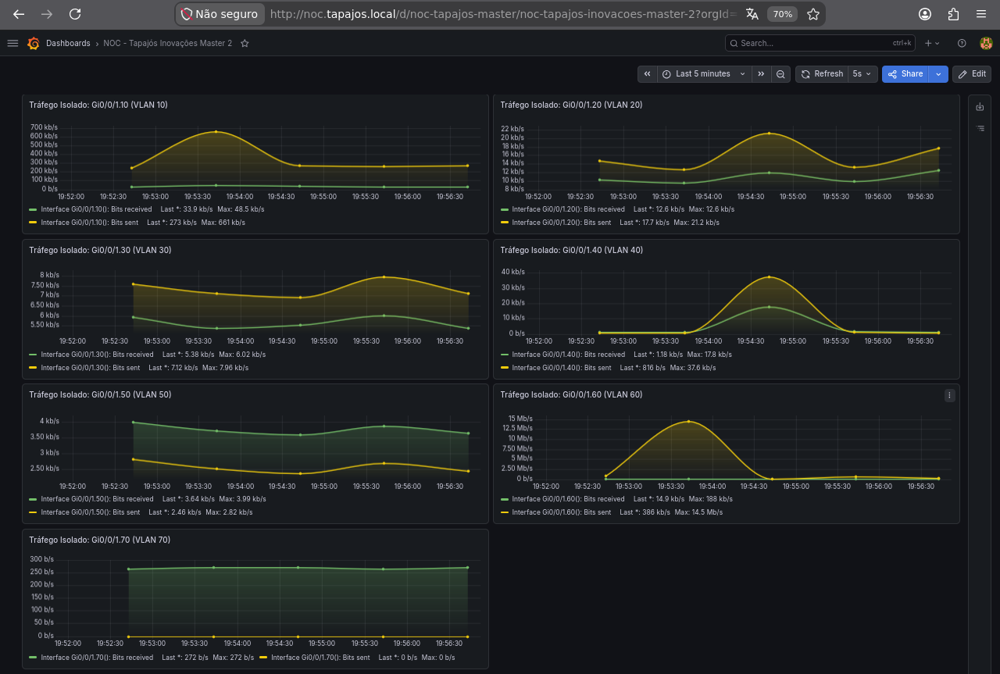

# Cisco Catalyst C8200L — Router

**Enterprise NOC — From Scratch**

**English** | [Português (Brasil)](../pt-BR/redes/roteador-c8200l.md)

## Equipment and role

| Attribute | Record |
|---|---|
| Model | Cisco Catalyst C8200L-1N-4T |
| Role | Central routing infrastructure |
| Associated switch | Cisco Catalyst C9200L-24T-4G |
| Evidence | Equipment photographs, network records and Zabbix/Grafana captures, November 4–6, 2026 |


The switch configuration captured on November 4 identifies its router-facing connection:

```cisco
interface GigabitEthernet1/0/1
 description TRUNK-PARA-ROTEADOR
 switchport mode trunk
```

**Gi1/0/1 is a C9200L switch interface**, not a documented router interface. The capture contains neither an explicit trunk allowed-VLAN list nor a custom native VLAN. The corresponding C8200L port and `802.1Q` subinterfaces were not captured.

## Observed addressing

Workstation photographs and server records provide these gateway settings:

| VLAN | Gateway recorded on | Gateway address |
|---|---|---|
| 10 · IT / NOC | IT workstation | `192.168.10.1` |
| 20 · Accounting | Accounting workstation | `192.168.20.1` |
| 30 · Finance | Finance workstation | `192.168.30.1` |
| 40 · Sales | Sales workstation | `192.168.40.1` |
| 50 · Voice | Asterisk/FreeRADIUS server | `192.168.50.1` |

November 4 technical records also associate `192.168.10.1` with the router. The other recorded gateway settings, including VLAN 50, **do not establish specific C8200L interface addresses**.

The laboratory uses DHCP for workstations; the records do not identify the complete DHCP server, relay, or pool configuration.

## Access-policy design

| Segment | Documented requirement |
|---|---|
| VLAN 10 | Authorized management and monitoring access |
| VLANs 20, 30, 40 | Departmental separation; exceptions for approved services |
| VLAN 50 | Voice and authentication service access |
| VLAN 60 | Corporate wireless access with restrictions on internal resources |
| VLAN 70 | Separate IoT connectivity and restricted enterprise access |

These are **architectural requirements**, not verified ACL entries. VLAN assignments were captured on the switch, but router ACLs and end-to-end isolation tests were not.

## Monitoring evidence

The C8200L appears in Zabbix host records with an SNMP monitoring interface and in historical Grafana dashboards.




These captures document metrics from the collection period; they do not establish uninterrupted availability or full monitoring coverage.

## Configuration scope

A complete C8200L running configuration was not collected. Router-side interfaces, routing statements, NAT translations, WAN settings, default route, DHCP configuration, ACL enforcement, and SNMP configuration are therefore **not asserted as verified**. The network design and observed endpoint gateways remain documented in their respective records.

## References

[Networking overview](README.md) · [Logical topology](consolidated-logical-topology.md) · [VLANs](vlans.md) · [Switch snapshot](switch-vlan-snapshot-2026-11-04.md) · [Switch port map](switch-port-map.md) · [Workstation inventory](../endpoints/workstation-inventory.md) · [Zabbix](../monitoring/zabbix-monitoring.md) · [Grafana](../monitoring/grafana-monitoring.md)
