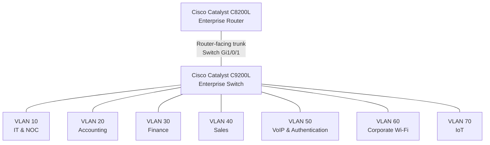
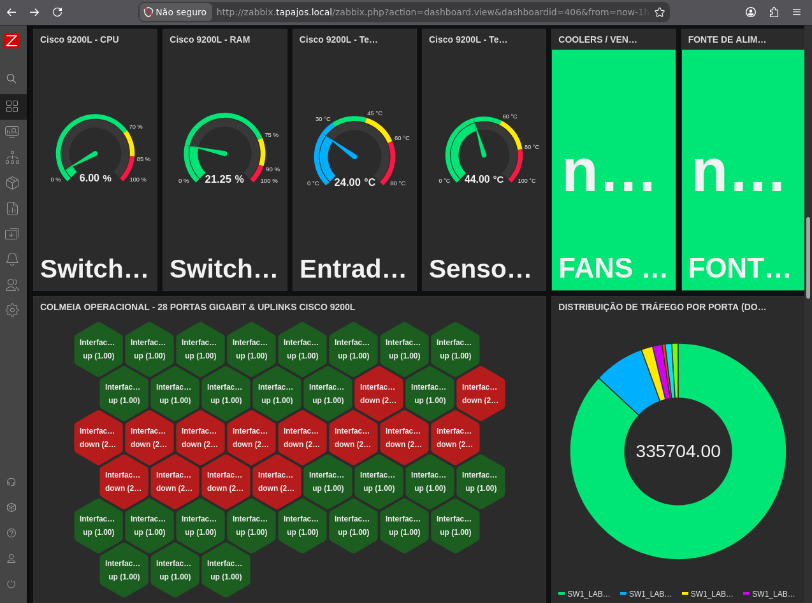
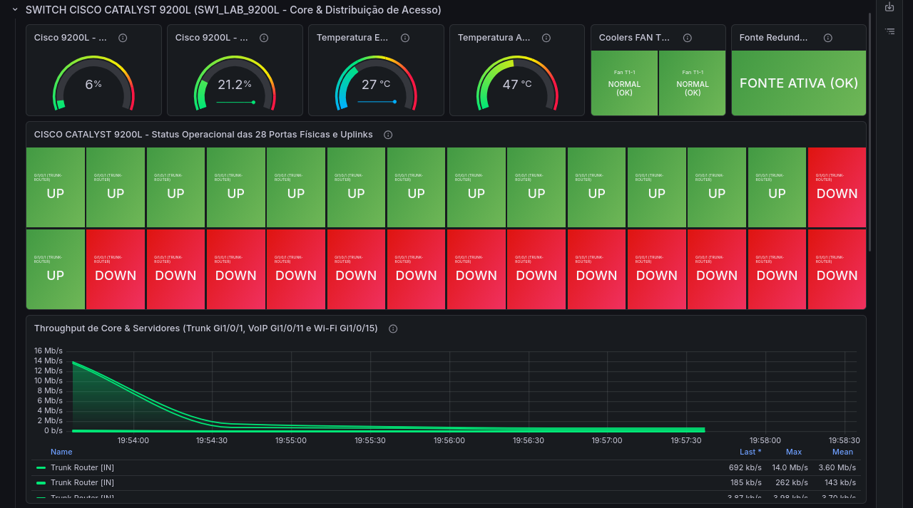

# Cisco Catalyst C9200L — VLAN and Interface Configuration

**Enterprise NOC — From Scratch**

**English** | [Português (Brasil)](../pt-BR/redes/registro-switch-vlans-2026-11-04.md)

---

## 1. Overview

This document presents the VLAN segmentation and interface configuration recorded on the **Cisco Catalyst C9200L-24T-4G** switch used in the Enterprise NOC infrastructure.

The switch provides connectivity for departmental workstations, Linux servers, IP telephones, corporate wireless equipment, and IoT infrastructure.

The technical reference is a Cisco IOS XE `show running-config` capture collected on **November 4, 2026**, through a serial console connection from the Linux computer assigned to Asterisk and FreeRADIUS.

| Attribute | Recorded Information |
|---|---|
| Manufacturer | Cisco |
| Model | Catalyst C9200L-24T-4G |
| Operating System | Cisco IOS XE |
| Recorded Version | 17.15 |
| Provisioned Platform | `c9200l-24t-4g` |
| Configuration Date | November 4, 2026 |
| Network Segmentation | Seven VLANs |
| Router-Facing Interface | `Gi1/0/1` |

The configuration snapshot documents the switch settings at the time of collection. It predates subsequent SNMP monitoring changes and does not represent the complete current configuration or operational state of the equipment.

## 2. Network Infrastructure

The documented infrastructure includes the following network components:

| Component | Model or Specification | Function |
|---|---|---|
| Enterprise Router | Cisco Catalyst C8200L | Central routing infrastructure |
| Enterprise Switch | Cisco Catalyst C9200L-24T-4G | Ethernet switching and VLAN segmentation |
| Structured Cabling | Category 6 patch panel | Physical network termination |
| Corporate Wireless | TP-Link Archer AX53 | Corporate Wi-Fi connectivity |
| IoT Wireless | Dedicated TP-Link Archer AX53 | IoT network connectivity |

The corporate Wi-Fi and IoT environments use two separate TP-Link Archer AX53 devices.

The identification of the dedicated IoT wireless device comes from the consolidated equipment inventory, rather than the Cisco configuration commands themselves.

### 2.1 Physical Evidence


The photograph documents the physical presence of the Cisco router, Catalyst switch, and structured cabling components.

The image does not independently establish the operational status of individual switch interfaces.

Additional photographs and equipment descriptions are available in the [Physical Infrastructure](../evidence/physical-infrastructure.md) documentation.

## 3. VLAN Segmentation

The configuration snapshot identifies seven VLANs used to organize the enterprise network.

| VLAN | Department or Service | Documented Switch Interfaces |
|---|---|---|
| **10** | IT & NOC | Gi1/0/2–3 |
| **20** | Accounting | Gi1/0/4–6 |
| **30** | Finance | Gi1/0/7–8 |
| **40** | Sales | Gi1/0/9–10 |
| **50** | VoIP & Authentication | Gi1/0/11–13 |
| **60** | Corporate Wi-Fi | Gi1/0/15 |
| **70** | IoT | Gi1/0/14 |

The table consolidates the VLAN assignments found in the historical configuration.

For `Gi1/0/11`, VLAN 50 appears in the recorded configuration, but the effective switchport operating mode is not independently established.

### 3.1 Logical Network Organization



The diagram represents the documented logical segmentation of the network.

The router-facing trunk is identified on switch interface `Gi1/0/1`. The router-side interface and complete VLAN subinterface configuration were not included in the collected records.

The diagram does not represent a complete physical cable map or independent verification of inter-VLAN routing.

### 3.2 Segmentation and Routing

The documented VLANs establish separate Layer 2 broadcast domains.

Communication between different VLANs requires Layer 3 forwarding. Access restrictions between network segments depend on additional routing and security configurations.

The switch configuration confirms VLAN assignments and a configured trunk interface, but it does not independently demonstrate successful communication between all VLANs or enforcement of router ACLs.

## 4. Switch Interface Configuration

The following table presents the individual interface assignments identified in the November 4 configuration.

| Interface | Recorded Configuration | Documented Segment or Equipment |
|---|---|---|
| Gi1/0/1 | Trunk | Cisco Catalyst C8200L |
| Gi1/0/2 | Access VLAN 10 | IT / NOC |
| Gi1/0/3 | Access VLAN 10 | IT / NOC |
| Gi1/0/4 | Access VLAN 20 | Accounting |
| Gi1/0/5 | Access VLAN 20 | Accounting |
| Gi1/0/6 | Access VLAN 20 | Accounting |
| Gi1/0/7 | Access VLAN 30 | Finance |
| Gi1/0/8 | Access VLAN 30 | Finance |
| Gi1/0/9 | Access VLAN 40 | Sales |
| Gi1/0/10 | Access VLAN 40 | Sales |
| Gi1/0/11 | Access VLAN 50 assigned; operating mode not established | Asterisk / FreeRADIUS server |
| Gi1/0/12 | Access VLAN 50 | Grandstream IP phone |
| Gi1/0/13 | Access VLAN 50 | Grandstream IP phone |
| Gi1/0/14 | Access VLAN 70 | IoT wireless equipment |
| Gi1/0/15 | Access VLAN 60 | Corporate Wi-Fi equipment |

The table combines switch configuration statements and documented equipment assignments. It does not independently confirm physical link status or end-to-end connectivity.

Interfaces `Gi1/0/16–24` and `Gi1/1/1–4` appear without specific interface configuration statements in the collected snapshot.

Their absence from the interface configuration does not establish whether the ports were physically connected, disconnected, administratively disabled, or operationally down.

### 4.1 Router-Facing Trunk — Gi1/0/1

The recorded configuration contains:

```cisco
interface GigabitEthernet1/0/1
 description TRUNK-PARA-ROTEADOR
 switchport mode trunk
```

These statements establish that `Gi1/0/1` was configured as a trunk interface on the switch.

The collected configuration does not contain an explicit `switchport trunk allowed vlan` statement or a custom native VLAN assignment for this interface.

Although the architecture documents VLANs 10 through 70, the list of project VLANs must not be interpreted as an explicitly configured trunk allowed-VLAN list.

The collected material also does not include the corresponding C8200L interface configuration or its VLAN subinterfaces.

### 4.2 Departmental Access Ports

The following commands reproduce the configuration recorded for an Accounting workstation interface:

```cisco
interface GigabitEthernet1/0/4
 description PCS-CONTABILIDADE
 switchport access vlan 20
 switchport mode access
 spanning-tree portfast
```

The configuration assigns the interface to VLAN 20 and explicitly sets the switchport to access mode.

Equivalent access-port configurations are documented for the other departmental segments and the dedicated voice, wireless, and IoT interfaces, except for the particular case of `Gi1/0/11`.

### 4.3 Special Case — Gi1/0/11

The interface associated with the Debian Asterisk/FreeRADIUS server contains:

```cisco
interface GigabitEthernet1/0/11
 description SERVIDOR-DEBIAN-VOIP-E-RADIUS
 switchport access vlan 50
 spanning-tree portfast trunk
```

Unlike the other documented access interfaces, the collected statements do not explicitly include:

```cisco
switchport mode access
```

The `spanning-tree portfast trunk` command configures Spanning Tree behavior; its presence does not independently establish that the interface was operating in trunk mode.

Similarly, `switchport access vlan 50` records an access VLAN assignment but does not, by itself, establish the effective operating mode of the interface.

Consequently, `Gi1/0/11` is documented with VLAN 50 assigned in the historical configuration, without classifying its operational mode as confirmed access or trunk.

The original commands are preserved without modification.

### 4.4 Corporate Wi-Fi and IoT Interfaces

The wireless infrastructure uses two dedicated network segments.

| Network | Equipment | Switch Interface | VLAN |
|---|---|---|---|
| Corporate Wi-Fi | TP-Link Archer AX53 | Gi1/0/15 | 60 |
| IoT | TP-Link Archer AX53 | Gi1/0/14 | 70 |

The configuration snapshot establishes the switch-side VLAN assignments.

It does not contain the operating modes, DHCP settings, NAT configuration, or wireless client addresses of either TP-Link device.

The corresponding equipment roles are documented in the [Corporate Wi-Fi](corporate-wifi-vlan60.md) and [IoT Network](iot-vlan70.md) sections.

## 5. Observed IP Addressing

The network records collected on November 6, 2026, include addressing information from Windows workstations, Linux computers, and IP telephony equipment.

| VLAN | Documented Network | Addressing Examples |
|---|---|---|
| 10 | `192.168.10.0/24` | Main NOC: `192.168.10.12`; IT 2: `192.168.10.13` |
| 20 | `192.168.20.0/24` | Accounting: `192.168.20.11–13` |
| 30 | `192.168.30.0/24` | Finance: `192.168.30.10–11` |
| 40 | `192.168.40.0/24` | Sales: `192.168.40.10–11` |
| 50 | `192.168.50.0/24` | Asterisk/FreeRADIUS: `192.168.50.2`; IP phones: `192.168.50.10–11` |
| 60 | Not established by available client addressing records | Corporate Wi-Fi |
| 70 | Not established by available client addressing records | IoT |

The `/24` networks are based on documented host addresses and subnet masks.

The available records do not establish the wireless client addressing schemes for VLANs 60 and 70.

### 5.1 Observed Default Gateways

The collected workstation configurations identify the following default gateways:

| VLAN | Observed Gateway |
|---|---|
| 10 | `192.168.10.1` |
| 20 | `192.168.20.1` |
| 30 | `192.168.30.1` |
| 40 | `192.168.40.1` |

These values represent the gateways configured on the observed workstations.

They do not independently establish the ownership of every gateway address or the complete router configuration.

The switch snapshot does not include router DHCP pools, relay configuration, VLAN subinterfaces, NAT rules, or ACL entries.

### 5.2 Addressing and Monitoring Consistency

The November 6 inventory identified **six differences** between photographed Windows workstation IPv4 addresses and the corresponding host interfaces registered in Zabbix.

The laboratory uses DHCP for workstation addressing.

Address changes between collection periods may contribute to monitoring discrepancies, but the available evidence does not establish a single cause for every unavailable host or unsupported monitoring item.

Additional information is available in:

- [Workstation and Server Inventory](../endpoints/workstation-inventory.md)
- [Zabbix Monitoring](../monitoring/zabbix-monitoring.md)

## 6. Spanning Tree Configuration

The collected Cisco IOS XE configuration contains:

```cisco
spanning-tree mode rapid-pvst
spanning-tree extend system-id
```

These commands document the configuration of **Rapid PVST+** on the Catalyst switch.

Several access interfaces also contain:

```cisco
spanning-tree portfast
```

The special configuration of `Gi1/0/11` contains `spanning-tree portfast trunk`, as recorded in Section 4.3.

The available configuration does not include a complete operational Spanning Tree report.

Therefore, it does not independently establish the active root bridge, root ports, blocked interfaces, or convergence events during the collection period.

## 7. Switch Monitoring

The original switch configuration was captured before the subsequent SNMP monitoring configuration.

Later monitoring evidence from Zabbix and Grafana includes dashboards displaying:

- CPU utilization.
- Memory utilization.
- Hardware sensor information.
- Interface status.
- Network traffic measurements.
- Interface errors.

### 7.1 Zabbix Evidence



### 7.2 Grafana Evidence



The screenshots demonstrate the presence of monitoring information during the evidence collection period.

They do not constitute a complete export of the switch's final SNMP configuration or establish continuous monitoring availability.

Some recorded Grafana interface panels contain repeated labels. These labels are not treated as independent physical-interface measurements without a corresponding item mapping.

Monitoring details are available in the dedicated [Zabbix](../monitoring/zabbix-monitoring.md), [Grafana](../monitoring/grafana-monitoring.md), and [SNMP Troubleshooting](../monitoring/snmp-troubleshooting.md) documentation.

## 8. Historical Configuration Scope

The November 4, 2026, snapshot documents the configuration of the Cisco Catalyst C9200L during the recorded laboratory period.

The available records establish:

- Seven documented VLAN assignments.
- A router-facing trunk configured on `Gi1/0/1`.
- Departmental access-port configurations.
- Switch-side assignments for voice, corporate Wi-Fi, and IoT infrastructure.
- The specific configuration statements recorded for `Gi1/0/11`.
- Rapid PVST+ configuration.

The snapshot does not constitute:

- A complete or current switch running configuration.
- A router-side configuration export.
- Verification of successful inter-VLAN communication.
- Evidence of router ACL enforcement.
- An operational status report for all interfaces.
- A complete physical cable map.
- Configuration exports for the wireless equipment.
- Confirmation of client IP addressing for VLANs 60 and 70.

The subsequent monitoring screenshots document additional observations but do not replace the historical configuration snapshot.

## 9. Related Documentation

### Networking & Architecture

- [Networking & Architecture — Overview](README.md)
- [Consolidated Logical Topology](consolidated-logical-topology.md)
- [VLAN Segmentation](vlans.md)
- [Cisco Catalyst C8200L](router-c8200l.md)
- [Switch Port Mapping](switch-port-map.md)
- [Corporate Wi-Fi — VLAN 60](corporate-wifi-vlan60.md)
- [IoT Network — VLAN 70](iot-vlan70.md)

### Infrastructure and Monitoring

- [Infrastructure Architecture](../architecture/infrastructure-overview.md)
- [Physical Infrastructure](../evidence/physical-infrastructure.md)
- [Workstation and Server Inventory](../endpoints/workstation-inventory.md)
- [Asterisk and FreeRADIUS](../services/asterisk-freeradius.md)
- [Zabbix Monitoring](../monitoring/zabbix-monitoring.md)
- [Grafana Monitoring](../monitoring/grafana-monitoring.md)

---

**Configuration captured:** November 4, 2026  
**Additional infrastructure evidence:** November 6, 2026  
**Document type:** Historical Cisco Catalyst C9200L configuration snapshot.
