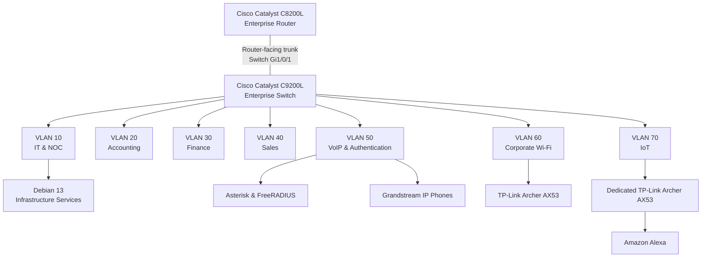

# VLAN Segmentation — Enterprise Network

**Enterprise NOC — From Scratch**

**English** | [Português (Brasil)](../pt-BR/redes/vlans.md)

---

## 1. Overview

The Enterprise NOC infrastructure uses **Virtual Local Area Networks (VLANs)** to organize enterprise connectivity into separate logical network segments.

The network architecture includes seven VLANs dedicated to IT administration, business departments, voice services, corporate wireless connectivity, and Internet of Things (IoT) devices.

VLAN assignments are documented through the Cisco Catalyst C9200L configuration collected on **November 4, 2026**, supplemented by equipment inventories and network records collected during the following days.

| Attribute | Documented Information |
|---|---|
| Network Architecture | Segmented enterprise network |
| Enterprise Router | Cisco Catalyst C8200L-1N-4T |
| Enterprise Switch | Cisco Catalyst C9200L-24T-4G |
| Number of VLANs | Seven |
| VLAN IDs | 10, 20, 30, 40, 50, 60, 70 |
| Configuration Reference | November 4, 2026 |
| Additional Evidence | November 6, 2026 |

The VLAN configuration establishes logical separation at Layer 2.

Communication between VLANs requires Layer 3 forwarding. The collected switch configuration does not independently establish the complete router configuration or enforcement of inter-VLAN access restrictions.

## 2. Network Architecture

The VLAN infrastructure is associated with the Cisco Catalyst C9200L switch and the Cisco Catalyst C8200L router.

The Catalyst C9200L provides the documented Ethernet switching and VLAN assignments.

The Catalyst C8200L is the central routing component in the enterprise architecture.

### 2.1 Logical Segmentation



The diagram represents documented equipment associations and logical segmentation.

The router-facing trunk is configured on switch interface `Gi1/0/1`. The corresponding router-side interface and complete inter-VLAN routing configuration are not included in the collected records.

The diagram does not represent a complete physical cabling map or independent verification of communication between all VLANs.

## 3. VLAN Inventory

The enterprise network contains the following VLAN assignments.

| VLAN ID | Network Segment | Function | Documented Switch Interfaces |
|---|---|---|---|
| **10** | IT & NOC | Infrastructure administration, Linux services, and monitoring | Gi1/0/2–3 |
| **20** | Accounting | Accounting department workstations | Gi1/0/4–6 |
| **30** | Finance | Finance department workstations | Gi1/0/7–8 |
| **40** | Sales | Sales department workstations | Gi1/0/9–10 |
| **50** | VoIP & Authentication | IP telephony, Asterisk, and FreeRADIUS | Gi1/0/11–13 |
| **60** | Corporate Wi-Fi | Corporate wireless connectivity | Gi1/0/15 |
| **70** | IoT | Dedicated wireless connectivity for smart devices | Gi1/0/14 |

The assignments are based on the historical Cisco Catalyst C9200L configuration.

The network segments have distinct responsibilities, allowing infrastructure services and departmental equipment to be organized independently.

### 3.1 VLAN 10 — IT & NOC

VLAN 10 is assigned to IT administration and infrastructure monitoring.

The documented equipment includes the main NOC computer running Debian GNU/Linux 13 and an additional IT workstation.

The main infrastructure computer is associated with the address `192.168.10.12/24`.

Its documented responsibilities include hosting Docker services, Zabbix, Grafana, MariaDB, Portainer, Pi-hole, Uptime Kuma, and web infrastructure components.

Switch interfaces `Gi1/0/2–3` are assigned to VLAN 10.

### 3.2 VLAN 20 — Accounting

VLAN 20 is assigned to the Accounting department.

The November 6 inventory records three Accounting workstations with addresses in the `192.168.20.0/24` network.

The switch configuration assigns interfaces `Gi1/0/4–6` to this VLAN.

### 3.3 VLAN 30 — Finance

VLAN 30 is assigned to the Finance department.

The collected workstation inventory identifies two Finance computers with addresses in the `192.168.30.0/24` network.

Switch interfaces `Gi1/0/7–8` are assigned to VLAN 30.

### 3.4 VLAN 40 — Sales

VLAN 40 is assigned to the Sales department.

The collected inventory identifies two Sales workstations with addresses in the `192.168.40.0/24` network.

Switch interfaces `Gi1/0/9–10` are assigned to VLAN 40.

### 3.5 VLAN 50 — VoIP & Authentication

VLAN 50 is associated with the laboratory's voice and authentication infrastructure.

The documented equipment includes:

- Debian Linux server hosting Asterisk and FreeRADIUS.
- Two Grandstream IP telephones.

The recorded server address is `192.168.50.2/24`.

The documented telephone extensions and addresses are:

| Extension | Department | IP Address |
|---|---|---|
| 1001 | Sales | `192.168.50.10` |
| 1002 | IT | `192.168.50.11` |

The switch configuration associates interfaces `Gi1/0/11–13` with VLAN 50.

Interface `Gi1/0/11` has a particular configuration that is described separately in Section 4.

### 3.6 VLAN 60 — Corporate Wi-Fi

VLAN 60 is designated for corporate wireless connectivity.

The wireless equipment is identified as a TP-Link Archer AX53, associated with switch interface `Gi1/0/15`.

The segment is logically separated from the departmental and IoT VLANs.

The wireless router's internal configuration and client IP addressing are not established by the collected switch records.

### 3.7 VLAN 70 — IoT

VLAN 70 is designated for Internet of Things connectivity.

The documented environment includes an Amazon Alexa associated with a dedicated TP-Link Archer AX53.

The switch configuration assigns `Gi1/0/14` to VLAN 70.

The corporate Wi-Fi and IoT networks use two physically separate TP-Link Archer AX53 devices.

The IoT wireless router's operating mode and internal addressing are not established by the available configuration records.

## 4. Cisco Catalyst C9200L — VLAN Configuration

The historical switch configuration documents the router-facing trunk and the VLAN assignments for the enterprise network.

### 4.1 Router-Facing Trunk

Interface `Gi1/0/1` contains:

```cisco
interface GigabitEthernet1/0/1
 description TRUNK-PARA-ROTEADOR
 switchport mode trunk
```

These statements establish that `Gi1/0/1` was configured as a trunk on the Catalyst C9200L.

The collected configuration does not include an explicit `switchport trunk allowed vlan` statement or a custom native VLAN assignment.

Although the project contains VLANs 10 through 70, the VLAN inventory must not be interpreted as an explicitly configured allowed-VLAN list on the trunk.

The router-side interface and corresponding VLAN subinterfaces are not included in the available evidence.

### 4.2 Departmental Access Interfaces

The departmental interfaces use documented access-port configurations.

An example from the Accounting segment is:

```cisco
interface GigabitEthernet1/0/4
 description PCS-CONTABILIDADE
 switchport access vlan 20
 switchport mode access
 spanning-tree portfast
```

This configuration assigns the interface to VLAN 20 and explicitly configures access mode.

The historical snapshot contains corresponding VLAN assignments for the other documented departmental and service interfaces.

### 4.3 Interface Gi1/0/11

Interface `Gi1/0/11` is associated with the Asterisk/FreeRADIUS server.

The recorded configuration contains:

```cisco
interface GigabitEthernet1/0/11
 description SERVIDOR-DEBIAN-VOIP-E-RADIUS
 switchport access vlan 50
 spanning-tree portfast trunk
```

Unlike the standard departmental access interfaces, this configuration does not explicitly include `switchport mode access`.

The `spanning-tree portfast trunk` statement does not independently establish the effective switchport operating mode.

Therefore, VLAN 50 is documented as the configured access VLAN, while the interface's actual operating mode remains unestablished by the collected snapshot.

The original configuration statements are preserved without modification.

## 5. Documented IP Addressing

The workstation and server records collected on November 6, 2026, contain the following addressing information.

| VLAN | Documented Network | Examples |
|---|---|---|
| 10 | `192.168.10.0/24` | Main NOC: `192.168.10.12`; IT 2: `192.168.10.13` |
| 20 | `192.168.20.0/24` | Accounting: `192.168.20.11–13` |
| 30 | `192.168.30.0/24` | Finance: `192.168.30.10–11` |
| 40 | `192.168.40.0/24` | Sales: `192.168.40.10–11` |
| 50 | `192.168.50.0/24` | Asterisk/FreeRADIUS: `192.168.50.2`; IP phones: `192.168.50.10–11` |
| 60 | Not established by available client addressing records | Corporate Wi-Fi |
| 70 | Not established by available client addressing records | IoT |

The documented `/24` networks are based on collected host addressing information.

The available records do not establish the wireless client subnets associated with VLANs 60 and 70.

### 5.1 Observed Default Gateways

| VLAN | Recorded Default Gateway | Evidence |
|---|---|---|
| 10 | `192.168.10.1` | IT workstation configuration |
| 20 | `192.168.20.1` | Accounting workstation configuration |
| 30 | `192.168.30.1` | Finance workstation configuration |
| 40 | `192.168.40.1` | Sales workstation configuration |
| 50 | `192.168.50.1` | Asterisk/FreeRADIUS server record |

These values represent gateway settings recorded on the corresponding systems.

They do not independently establish the router interface responsible for each gateway address.

No gateway addresses are attributed to VLANs 60 or 70 without supporting addressing evidence.

### 5.2 DHCP and Historical Addresses

The laboratory uses DHCP for workstation addressing.

The November 6 inventory identified differences between workstation IPv4 addresses and earlier host interface records in Zabbix.

These discrepancies may affect monitoring when a host's registered address does not match its observed address.

The recorded values represent historical observations, not confirmed static assignments or DHCP reservations.

## 6. Network Segmentation and Access Policy

VLAN segmentation provides separate Layer 2 broadcast domains for the enterprise network.

Communication between VLANs requires Layer 3 forwarding, and traffic restrictions depend on the corresponding routing and access-control configurations.

The documented access-policy design distinguishes the following requirements.

| Network Segment | Architectural Access Requirement |
|---|---|
| VLAN 10 — IT & NOC | Authorized administration and infrastructure monitoring |
| VLAN 20 — Accounting | Departmental separation with approved service exceptions |
| VLAN 30 — Finance | Departmental separation with approved service exceptions |
| VLAN 40 — Sales | Departmental separation with approved service exceptions |
| VLAN 50 — VoIP & Authentication | Access appropriate to voice and authentication services |
| VLAN 60 — Corporate Wi-Fi | Restricted unauthorized access to internal resources |
| VLAN 70 — IoT | Separation of IoT connectivity from sensitive enterprise resources |

These requirements represent the logical security design.

The available evidence does not contain a complete C8200L ACL configuration export or recorded tests demonstrating enforcement of these restrictions.

Consequently, the documented VLAN separation must not be presented as proof of complete Layer 3 isolation.

## 7. Corporate Wireless and IoT Integration

### 7.1 Corporate Wireless Equipment

The corporate wireless segment uses a TP-Link Archer AX53 identified in the November 6 equipment evidence.

| Attribute | Documented Information |
|---|---|
| Manufacturer | TP-Link |
| Model | Archer AX53 |
| Wireless Generation | Wi-Fi 6 |
| Product Class | AX3000 |
| Network Segment | VLAN 60 |
| Switch Interface | `Gi1/0/15` |

The historical switch configuration establishes the VLAN 60 assignment.

The available evidence does not include the Archer AX53 operating mode, wireless authentication settings, client addressing, DHCP, or NAT configuration.

The FreeRADIUS server is documented in VLAN 50. Its presence does not independently prove that the corporate wireless equipment used RADIUS authentication.

### 7.2 IoT Wireless Equipment

The IoT segment uses a second TP-Link Archer AX53.

| Attribute | Documented Information |
|---|---|
| Manufacturer | TP-Link |
| Model | Archer AX53 |
| Wireless Generation | Wi-Fi 6 |
| Product Class | AX3000 |
| Network Segment | VLAN 70 |
| Switch Interface | `Gi1/0/14` |
| Associated Device | Amazon Alexa |

The documented connectivity associates the Alexa with the dedicated IoT wireless network.

In access point mode, wireless clients can participate directly in the associated VLAN IP network.

In router mode with NAT, clients may instead use a separate subnet behind the wireless router.

The collected records do not establish which operating mode was used.

Accordingly, the Alexa IP address, wireless client subnet, DHCP server, NAT behavior, and IoT default gateway are not asserted as documented configurations.

### 7.3 Segmentation Boundaries

The switch-side assignments establish separate VLANs for corporate Wi-Fi and IoT connectivity.

They do not independently demonstrate:

- Wireless client addressing.
- Wireless authentication transactions.
- Router ACL enforcement.
- Successful isolation tests between wireless and departmental networks.
- Direct monitoring of the wireless devices.

These details are distinguished from the documented switch configuration and network design.

## 8. Technical Evidence and Scope

This document consolidates the VLAN design and historical network records collected during November 2026.

| Evidence Source | Recorded Information |
|---|---|
| Cisco C9200L configuration — November 4 | VLAN assignments, trunk, and access-port configuration |
| Workstation inventory — November 6 | Departmental addressing and gateway observations |
| Linux server inventory — November 6 | Infrastructure server addressing and network roles |
| Asterisk/FreeRADIUS documentation | VLAN 50 server, gateway, and IP telephony |
| Wireless equipment records | Corporate Wi-Fi and IoT device associations |
| Physical photographs | Network equipment and structured cabling |

The evidence establishes the VLAN organization documented on the switch and its association with the laboratory equipment.

It does not constitute:

- A complete C8200L running-configuration export.
- Independent verification of all inter-VLAN communication paths.
- Evidence of router ACL enforcement.
- A complete physical cabling map.
- Verified wireless client IP addressing for VLANs 60 and 70.
- Configuration exports from both TP-Link Archer AX53 devices.
- Confirmation of continuous service or network availability.

The absence of these details defines the scope of the historical record rather than an outstanding requirement to complete this documentation.

## 9. Related Documentation

### Networking & Architecture

- [Networking & Architecture — Overview](README.md)
- [Consolidated Logical Topology](consolidated-logical-topology.md)
- [Cisco Catalyst C8200L](router-c8200l.md)
- [Cisco Catalyst C9200L — Configuration Snapshot](switch-vlan-snapshot-2026-11-04.md)
- [Cisco Catalyst C9200L — Switch Port Mapping](switch-port-map.md)
- [Corporate Wi-Fi — VLAN 60](corporate-wifi-vlan60.md)
- [IoT Network — VLAN 70](iot-vlan70.md)

### Infrastructure and Services

- [Infrastructure Architecture](../architecture/infrastructure-overview.md)
- [Workstation and Server Inventory](../endpoints/workstation-inventory.md)
- [Asterisk and FreeRADIUS](../services/asterisk-freeradius.md)
- [Physical Infrastructure](../evidence/physical-infrastructure.md)

---

**Evidence reference:** November 4–6, 2026  
**Document type:** Enterprise VLAN segmentation and historical configuration record.
