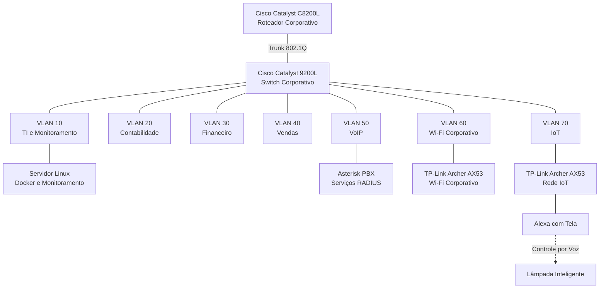
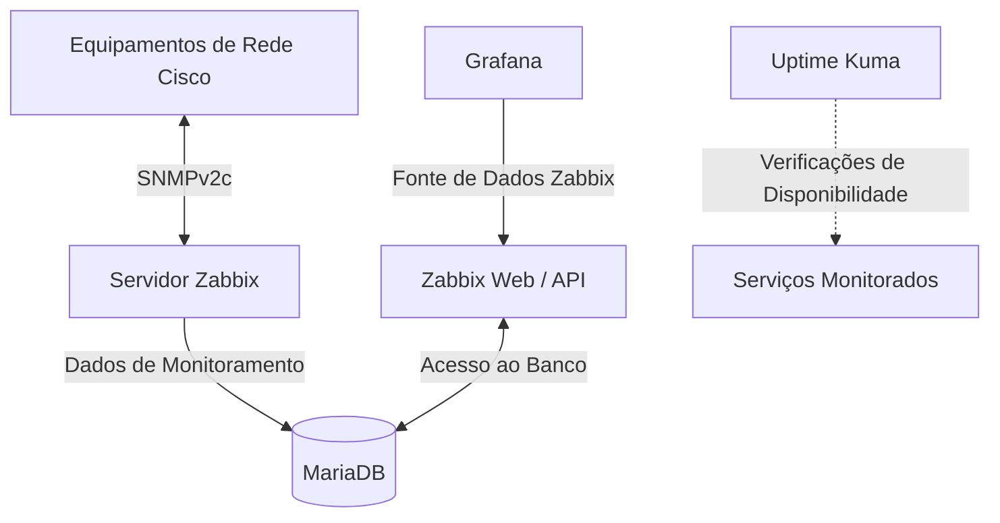

# Infraestrutura Corporativa — Visão Geral da Arquitetura

**[English](../../architecture/infrastructure-overview.md) | Português (Brasil)**

## Visão Geral

Este documento apresenta a arquitetura lógica do projeto **Enterprise NOC — Do Zero**.

O laboratório simula um ambiente corporativo de TI, integrando equipamentos físicos de rede, cabeamento estruturado, VLANs departamentais, servidores Linux, serviços conteinerizados e monitoramento centralizado da infraestrutura.

A arquitetura está organizada em três áreas principais:

- **Infraestrutura Física:** Equipamentos de rede, estações de trabalho, rack e cabeamento estruturado.
- **Infraestrutura de Redes:** Roteamento e comutação Cisco, segmentação por VLANs, Wi-Fi corporativo e conectividade IoT.
- **Sistemas e Monitoramento:** Servidores Linux, serviços Docker e plataformas de monitoramento NOC.

## Arquitetura Lógica da Rede

> **Observação:** este diagrama representa a segmentação lógica da rede, não o cabeamento físico exato. A configuração datada do switch registra as VLANs das interfaces; o diagrama lógico não corresponde a um mapa completo de cabos.

## Segmentação de Rede

A infraestrutura utiliza sete VLANs para separar departamentos e serviços de rede.

| VLAN | Segmento | Finalidade |
|---|---|---|
| 10 | TI e Monitoramento | Infraestrutura de TI e serviços de monitoramento |
| 20 | Contabilidade | Estações de trabalho da contabilidade |
| 30 | Financeiro | Estações de trabalho do setor financeiro |
| 40 | Vendas | Estações de trabalho do setor de vendas |
| 50 | VoIP | Telefonia IP e serviços associados |
| 60 | Wi-Fi Corporativo | Conectividade sem fio corporativa |
| 70 | IoT | Dispositivos inteligentes e conectividade IoT |

A infraestrutura sem fio inclui dois roteadores TP-Link Archer AX53 separados do mesmo modelo.

A captura do switch de 04/11/2026 atribui Gi1/0/15 ao Wi-Fi corporativo (VLAN 60) e Gi1/0/14 ao IoT (VLAN 70). Essa captura não contém o endereçamento dos clientes wireless, o modo operacional dos equipamentos nem comprovação de aplicação das ACLs.

## Arquitetura de Monitoramento

A arquitetura de monitoramento integra diferentes componentes:

- **Zabbix:** Coleta de métricas e informações da infraestrutura.
- **MariaDB:** Armazenamento dos dados de monitoramento do Zabbix.
- **Grafana:** Visualização de métricas por meio da integração com o Zabbix.
- **Uptime Kuma:** Monitoramento de disponibilidade de serviços selecionados.
- **SNMP:** Coleta de informações dos equipamentos de rede.

O ambiente também possui dashboards para análise do estado da infraestrutura e de suas métricas operacionais.

## Serviços Adicionais de Infraestrutura

O ambiente Linux inclui aplicações conteinerizadas e serviços como:

- Docker e Docker Compose.
- Portainer.
- Pi-hole.
- Proxy reverso Nginx.
- Serviços internos de DNS.
- Portal web corporativo.

O inventário datado dos containers e as funções dos serviços estão em [Serviços Docker](../containers/servicos-docker.md).

## Infraestrutura Física

O laboratório possui:

- Rack de rede.
- Equipamentos Cisco.
- Patch panel.
- Cabeamento Ethernet estruturado.
- Cabos de rede confeccionados manualmente.
- Distribuição elétrica no rack.
- Estações de trabalho montadas para os departamentos simulados.

As fotografias físicas, a configuração coletada do switch e o inventário das estações registram os equipamentos e as conexões documentados na coleta.

## Escopo do Registro

Esta visão geral reúne as evidências do laboratório coletadas de 04 a 06/11/2026. Trata-se de um registro de arquitetura lógica, não de um levantamento completo dos cabos ou de testes de aplicação das políticas de segurança. Consulte o [registro do switch](../redes/registro-switch-vlans-2026-11-04.md), o [inventário das estações](../estacoes/inventario-de-computadores.md) e a [infraestrutura física](../evidencias/infraestrutura-fisica.md).
