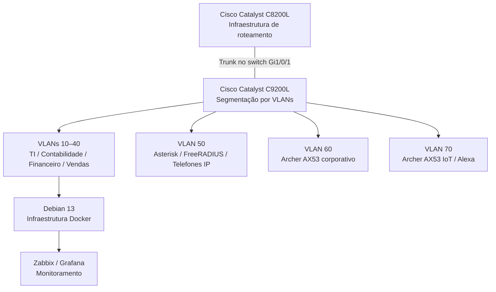

# Infraestrutura Corporativa — Visão Geral da Arquitetura

[English](../../architecture/infrastructure-overview.md) | **Português (Brasil)**

## Arquitetura

O **Enterprise NOC — From Scratch** documenta o laboratório físico corporativo desenvolvido para o cenário fictício da Tapajós Inovações. A infraestrutura contém:

| Camada | Componentes |
|---|---|
| Física | Rack de rede, equipamentos Cisco, patch panel, cabeamento estruturado e estações departamentais |
| Rede | Roteador Cisco Catalyst C8200L, switch C9200L-24T-4G e VLANs 10–70 |
| Sistemas | Servidor de infraestrutura Debian Linux, servidor Asterisk/FreeRADIUS dedicado e estações Windows |
| Serviços | Docker/Compose, Zabbix, Grafana, MariaDB, Pi-hole, Uptime Kuma, Nginx, Portainer e serviços web |
| Wireless e voz | Dois TP-Link Archer AX53 separados, Amazon Alexa e telefones IP Grandstream |

O diagrama apresenta associações lógicas documentadas, **não** um mapa individual de cabos ou todos os caminhos de tráfego verificados. A configuração de 4 de novembro identifica o trunk na **Gi1/0/1 do switch**, sem estabelecer a interface do C8200L ou suas subinterfaces VLAN.

### Projeto de redes e acesso

As VLANs 10–40 separam TI/NOC, Contabilidade, Financeiro e Vendas. A VLAN 50 atende voz/autenticação, a 60 ao Wi-Fi corporativo e a 70 ao IoT. Os dois AX53 são equipamentos físicos distintos. Seus modos de operação e endereçamento dos clientes não foram coletados; a aplicação de ACLs e o isolamento ponta a ponta entre VLANs não foram verificados.

Consulte a [Topologia Lógica](../redes/topologia-logica-consolidada.md), o [Inventário de VLANs](../redes/vlans.md) e o [Mapa de Portas](../redes/mapa-de-portas-switch.md) para interfaces, endereçamento e relações entre equipamentos.

### Monitoramento e serviços

O Zabbix coleta métricas dos hosts e equipamentos de rede por interfaces de monitoramento, incluindo SNMP nos equipamentos Cisco compatíveis. O MariaDB armazena dados do Zabbix; o Grafana apresenta as métricas por meio da integração com o Zabbix. O Uptime Kuma executa verificações de disponibilidade de serviços selecionados.

O sistema Debian 13 principal hospeda a infraestrutura Docker; outro computador Linux fornece Asterisk e FreeRADIUS. Configurações registradas, dependências e dashboards estão em [Serviços Docker](../containers/servicos-docker.md), [Zabbix](../monitoramento/zabbix.md), [Grafana](../monitoramento/grafana.md) e [Asterisk/FreeRADIUS](../servicos/asterisk-freeradius.md).

### Registros físicos

O laboratório inclui distribuição elétrica do rack, patch panel, cabos Ethernet terminados e estações departamentais. A identificação dos equipamentos e as fotografias estão em [Infraestrutura Física](../evidencias/infraestrutura-fisica.md) e [Inventário de Computadores](../estacoes/inventario-de-computadores.md).

**Período das evidências:** 4 a 6 de novembro de 2026. Os registros representam configurações e observações datadas, não disponibilidade operacional contínua.
