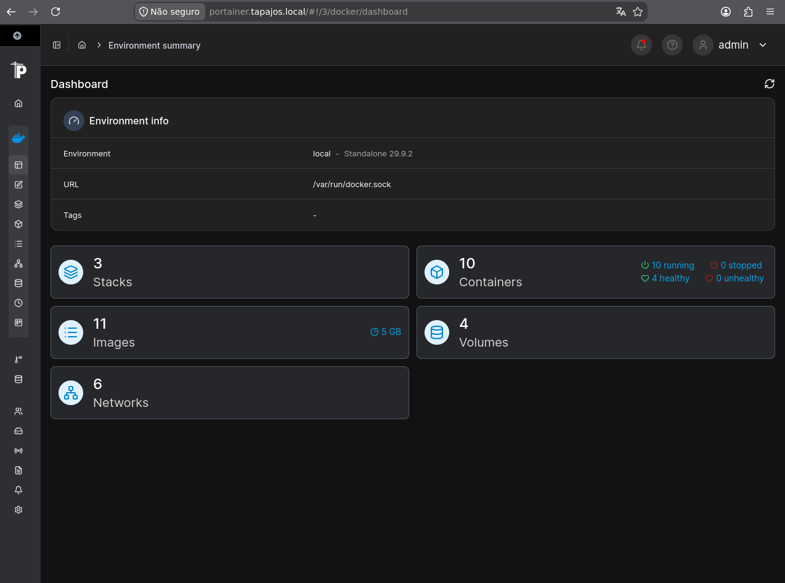
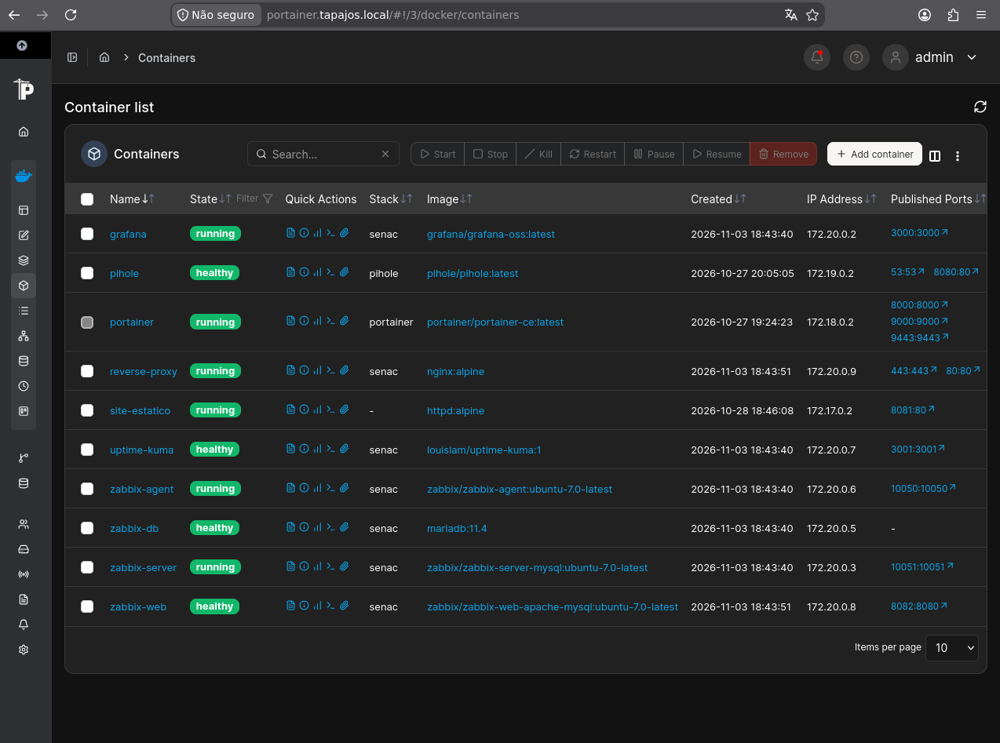
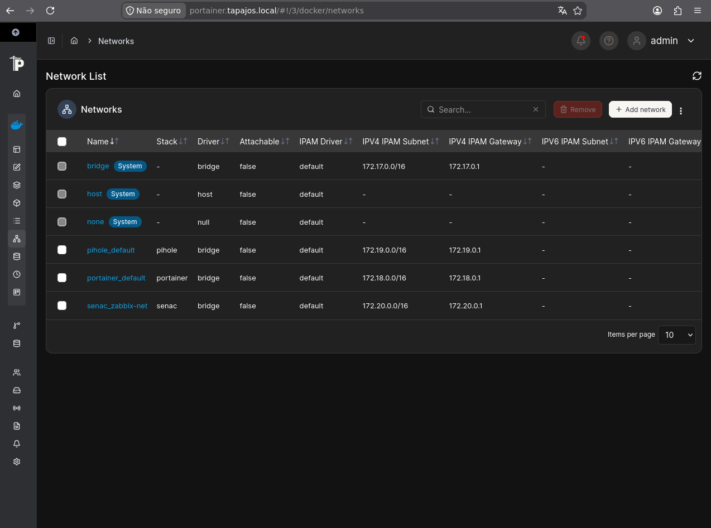

# Infraestrutura Docker e Serviços

[English](../../containers/docker-services.md) | [Português (Brasil)](servicos-docker.md)

## 1. Visão Geral

O laboratório Enterprise NOC — From Scratch utiliza Docker para hospedar serviços de infraestrutura, monitoramento e rede.

O ambiente de containers é executado no computador principal de TI, um Dell OptiPlex 3020 com processador Intel Core i5-4590, aproximadamente 8 GB de memória RAM e Debian GNU/Linux 13 (Trixie).

Durante a coleta de evidências, o computador foi identificado com o endereço IPv4 `192.168.10.12/24`.

Este documento descreve o ambiente Docker observado em 6 de novembro de 2026, utilizando a saída do comando `docker ps` e capturas do Portainer.

## 2. Ambiente Docker

O dashboard do Portainer apresentou os seguintes recursos:

| Recurso | Quantidade observada |
|---|---:|
| Ambientes Docker | 1 |
| Stacks | 3 |
| Containers | 10 |
| Containers em execução | 10 |
| Containers parados | 0 |
| Imagens de containers | 11 |
| Volumes | 4 |
| Redes Docker | 6 |

Quatro containers foram identificados como saudáveis, sem indicação de containers não saudáveis no momento da coleta.

Esses valores representam uma observação específica, não estatísticas de disponibilidade contínua.

## 3. Inventário dos Containers

A saída do comando `docker ps` identificou dez containers em execução.

| Container | Imagem | Finalidade |
|---|---|---|
| `reverse-proxy` | `nginx:alpine` | Proxy reverso |
| `zabbix-web` | `zabbix/zabbix-web-apache-mysql:ubuntu-7.0-latest` | Interface web do Zabbix |
| `zabbix-server` | `zabbix/zabbix-server-mysql:ubuntu-7.0-latest` | Servidor de monitoramento Zabbix |
| `uptime-kuma` | `louislam/uptime-kuma:1` | Monitoramento de disponibilidade |
| `zabbix-db` | `mariadb:11.4` | Banco de dados do Zabbix |
| `grafana` | `grafana/grafana-oss:latest` | Dashboards e visualização de métricas |
| `zabbix-agent` | `zabbix/zabbix-agent:ubuntu-7.0-latest` | Agente de monitoramento Zabbix |
| `site-estatico` | `httpd:alpine` | Hospedagem de site estático |
| `pihole` | `pihole/pihole:latest` | Filtragem e gerenciamento DNS |
| `portainer` | `portainer/portainer-ce:latest` | Gerenciamento de containers |

As tags das imagens foram reproduzidas conforme o registro coletado. Tags como `latest` não permitem determinar, isoladamente, a versão exata instalada.

## 4. Portas Publicadas

As seguintes portas do host foram identificadas na saída do comando `docker ps`:

| Container | Porta(s) publicada(s) no host |
|---|---|
| `reverse-proxy` | 80, 443 |
| `zabbix-web` | 8082 |
| `zabbix-server` | 10051 |
| `uptime-kuma` | 3001 |
| `zabbix-db` | Nenhuma porta publicada no host |
| `grafana` | 3000 |
| `zabbix-agent` | 10050 |
| `site-estatico` | 8081 |
| `pihole` | 53 TCP/UDP, 8080 |
| `portainer` | 8000, 9000, 9443 |

As portas representam a configuração observada durante a coleta. Uma porta publicada não comprova, isoladamente, que o serviço esteja acessível a partir de todas as redes do laboratório.

## 5. Redes Docker

O Portainer registrou seis redes Docker.

O ambiente utiliza mecanismos padrão de rede do Docker e redes associadas às stacks de aplicações implantadas.

O relatório do sistema Linux também identifica interfaces bridge do Docker e sub-redes privadas utilizadas pelos containers.

A existência dessas redes não comprova, isoladamente, a comunicação entre todos os containers ou serviços.

## 6. Organização dos Serviços

Os containers documentados atendem a diferentes funções.

### Infraestrutura e Acesso às Aplicações

- Nginx disponibiliza funcionalidades de proxy reverso.
- Apache HTTP Server hospeda um site estático.
- Portainer permite gerenciar os containers.

### Monitoramento e Observabilidade

- Zabbix Server coleta e processa dados de monitoramento.
- Zabbix Web disponibiliza a interface de monitoramento.
- Zabbix Agent fornece dados para monitoramento.
- Grafana apresenta dashboards e visualizações.
- Uptime Kuma monitora a disponibilidade dos serviços.

### Serviços Complementares

- MariaDB armazena os dados utilizados pelo Zabbix.
- Pi-hole disponibiliza funcionalidades relacionadas ao DNS.

Os serviços Asterisk e FreeRADIUS são documentados separadamente, pois são executados em outro computador Linux.

## 7. Evidências e Limitações

As evidências coletadas confirmam a presença de dez containers Docker em execução em 6 de novembro de 2026.

As capturas do Portainer também documentam o gerenciamento de containers, a configuração de redes e as quantidades de recursos.

Entretanto, essas evidências não comprovam:

- Disponibilidade contínua dos serviços.
- Acesso bem-sucedido a partir de todas as VLANs.
- Segurança completa das aplicações.
- Funcionamento correto de todos os itens de monitoramento.
- Alta disponibilidade ou redundância.

Esses aspectos precisam de verificações e documentação específicas.

**Data da coleta das evidências:** 6 de novembro de 2026.
