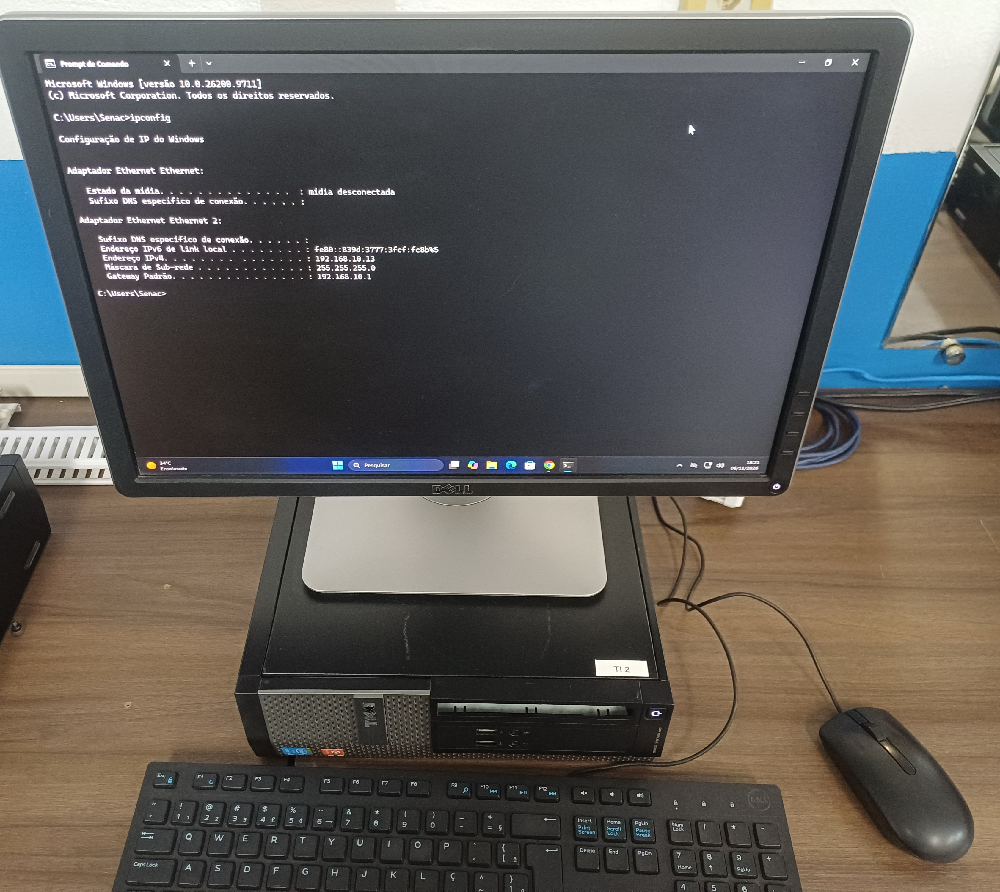
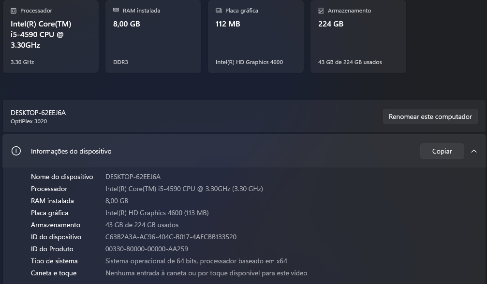
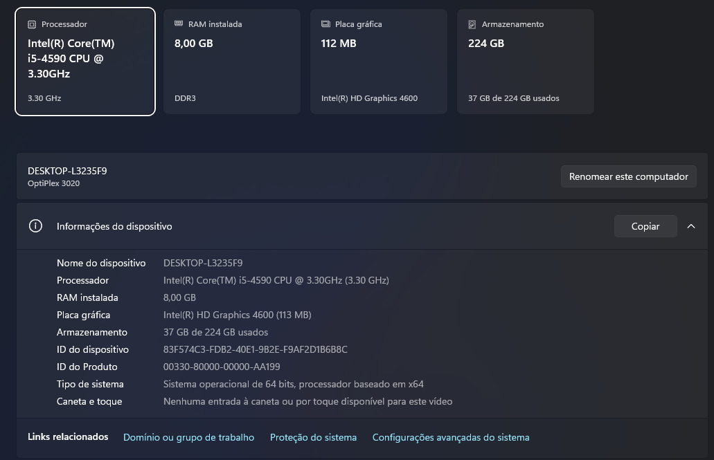
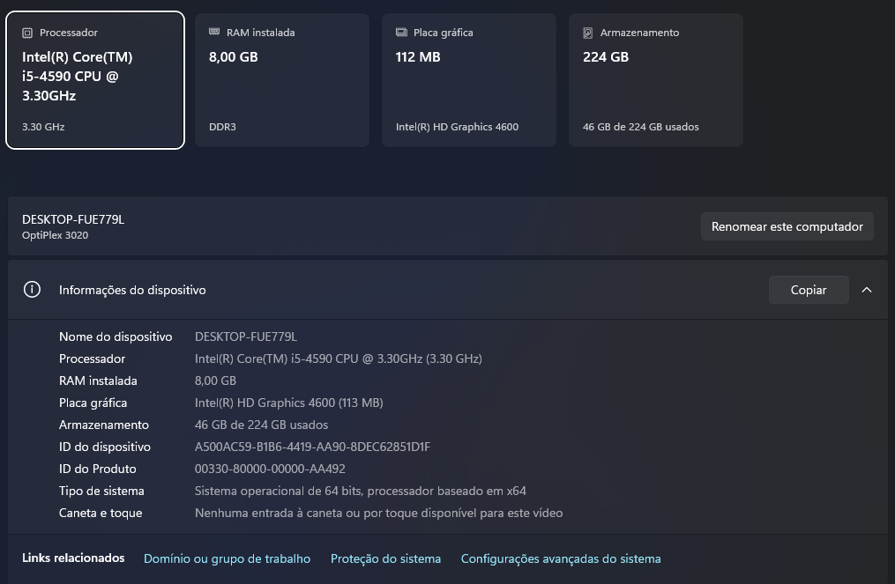

# Inventário de Computadores e Servidores

[English](../../endpoints/workstation-inventory.md) | [Português (Brasil)](inventario-de-computadores.md)

## Visão Geral

O laboratório Enterprise NOC — From Scratch possui dez computadores documentados, distribuídos entre redes departamentais e serviços de infraestrutura.

O inventário foi elaborado com base em capturas das especificações de hardware, fotografias das configurações de rede e relatórios de sistemas Linux coletados em 6 de novembro de 2026.

O ambiente possui:

- 2 computadores destinados à TI e às operações de infraestrutura.
- 3 estações de Contabilidade.
- 2 estações do Financeiro.
- 2 estações de Vendas.
- 1 servidor dedicado aos serviços Asterisk e FreeRADIUS.

## 1. Inventário de Hardware e Rede

| Equipamento | VLAN | Endereço IPv4 | Sistema operacional | Processador | RAM | Evidência de armazenamento |
|---|---|---|---|---|---|---|
| TI 1 — NOC Principal | 10 | 192.168.10.12 | Debian 13 | Intel Core i5-4590 | ~8 GB | Sistema de arquivos raiz de 210,27 GiB |
| TI 2 | 10 | 192.168.10.13 | Windows | — | — | — |
| Contabilidade 1 | 20 | 192.168.20.11 | Windows 11 Pro 21H2 | Intel Core i5-4590 | 8 GB | — |
| Contabilidade 2 | 20 | 192.168.20.12 | Windows | Intel Core i5-4590 | 8 GB DDR3 | 224 GB exibidos |
| Contabilidade 3 | 20 | 192.168.20.13 | Windows 11 Pro 21H2 | Intel Core i5-4590 | 8 GB | — |
| Financeiro 1 | 30 | 192.168.30.10 | Windows | Intel Core i5-4590 | 8 GB | 224 GB exibidos |
| Financeiro 2 | 30 | 192.168.30.11 | Windows | Intel Core i5-4590 | 8 GB | 224 GB exibidos |
| Vendas 1 | 40 | 192.168.40.11 | Windows | Intel Core i5-4590 | 8 GB | 224 GB exibidos |
| Vendas 2 | 40 | 192.168.40.10 | Windows | Intel Core i5-4590 | 8 GB | 224 GB exibidos |
| Asterisk / FreeRADIUS | 50 | 192.168.50.2 | Debian forky/sid | Intel Core i5-4590 | ~8 GB | Sistema de arquivos raiz de 211,21 GiB |

Os endereços IPv4 representam as configurações observadas durante a coleta de evidências. Não garantem que o endereçamento permaneça igual atualmente.

Os valores de armazenamento dos computadores Windows correspondem às capacidades exibidas nas capturas; o tipo físico das unidades não consta desses registros.

Os valores dos computadores Linux correspondem aos sistemas de arquivos raiz, não necessariamente à capacidade total dos discos físicos.

## 2. Computadores Linux da Infraestrutura

### TI 1 — Computador Principal do NOC

O computador principal da infraestrutura foi identificado como um Dell OptiPlex 3020 executando Debian 13.

O relatório do sistema confirma:

- Processador Intel Core i5-4590.
- Aproximadamente 8 GB de memória RAM.
- Debian GNU/Linux 13 (Trixie).
- Endereço IPv4 192.168.10.12/24.
- Sistema de arquivos raiz formatado em ext4.

Esse computador hospeda o ambiente Docker utilizado pelos serviços de infraestrutura e monitoramento.

No momento da coleta, o relatório do Docker apresentava dez containers em execução, incluindo Zabbix, Grafana, Portainer, Pi-hole e Uptime Kuma.

As configurações dos containers e o monitoramento dos serviços são documentados separadamente.

### Servidor Asterisk e FreeRADIUS

O servidor de telefonia e autenticação foi identificado como um Dell OptiPlex 3020.

O relatório do sistema confirma:

- Processador Intel Core i5-4590.
- Aproximadamente 8 GB de memória RAM.
- Debian forky/sid no momento da coleta.
- Endereço IPv4 192.168.50.2/24.
- Sistema de arquivos raiz formatado em ext4.

O servidor está associado aos serviços Asterisk VoIP e FreeRADIUS do laboratório.

A documentação registra a configuração das aplicações; os estados operacionais são apresentados nas evidências históricas de monitoramento.

## 3. Estações Windows — Evidências

### TI

A fotografia registra a configuração de rede da segunda estação de TI.

Não foi possível confirmar processador, memória RAM ou armazenamento dessa estação utilizando as evidências disponíveis.

### Contabilidade

Evidências complementares:

- [Hardware da estação Contabilidade 1](../../assets/images/endpoints/accounting-01-hardware.png)
- [Hardware da estação Contabilidade 3](../../assets/images/endpoints/accounting-03-hardware.jpg)

### Financeiro

Evidência complementar:

- [Hardware da estação Financeiro 2](../../assets/images/endpoints/finance-02-hardware.png)

### Vendas

Evidência complementar:

- [Hardware da estação Vendas 2](../../assets/images/endpoints/sales-02-hardware.png)

## 4. Segmentação de Rede

Os computadores documentados estão distribuídos nas seguintes VLANs:

| VLAN | Setor ou finalidade | Portas do C9200L (configuração de 4 de novembro) |
|---|---|---|
| 10 | TI e infraestrutura | Gi1/0/2–3 |
| 20 | Contabilidade | Gi1/0/4–6 |
| 30 | Financeiro | Gi1/0/7–8 |
| 40 | Vendas | Gi1/0/9–10 |
| 50 | VoIP e serviços locais de autenticação | Gi1/0/11–13 |

As atribuições constam do [registro do switch de 4 de novembro](../redes/mapa-de-portas-switch.md). A Gi1/0/11 possui atribuição de VLAN 50, mas seu modo efetivo de operação não está definido nas declarações coletadas. A documentação não inclui um mapeamento completo do cabeamento entre patch panel e estações.

## 5. Consistência do Monitoramento

A coleta identificou diferenças entre os endereços IPv4 fotografados nas estações Windows e os endereços cadastrados no Zabbix.

Seis dos oito computadores Windows apresentavam endereços diferentes entre os dois registros.

O laboratório utiliza DHCP nas estações. Divergências de endereço podem contribuir para agentes indisponíveis ou métricas ausentes quando os cadastros do Zabbix mantêm endereços anteriores.

As divergências de endereçamento são observações históricas e não identificam, por si só, a causa de todos os alertas.

## 6. Abrangência do Inventário

O inventário contém oito estações Windows e duas máquinas Linux. O [inventário do Zabbix](../monitoramento/zabbix.md#hosts-e-disponibilidade-das-interfaces) inclui ainda o C8200L e o C9200L, totalizando doze hosts cadastrados.

O traço (—) na tabela de hardware indica característica não registrada nas evidências de 06/11, e não ausência física do componente. CPU, RAM, tipo e capacidade de armazenamento são apresentados somente quando documentados nas capturas.

Os endereços IP e a disponibilidade representam a coleta datada, não reservas fixas de DHCP nem o estado atual de todas as estações.

**Data da coleta das evidências:** 6 de novembro de 2026.
