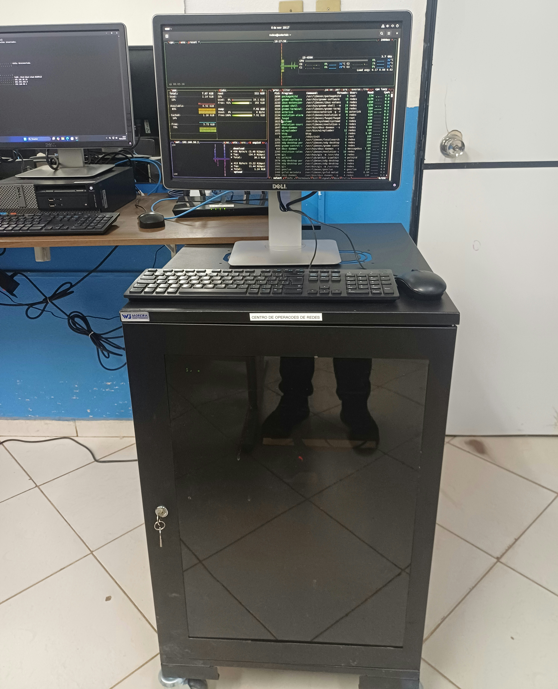
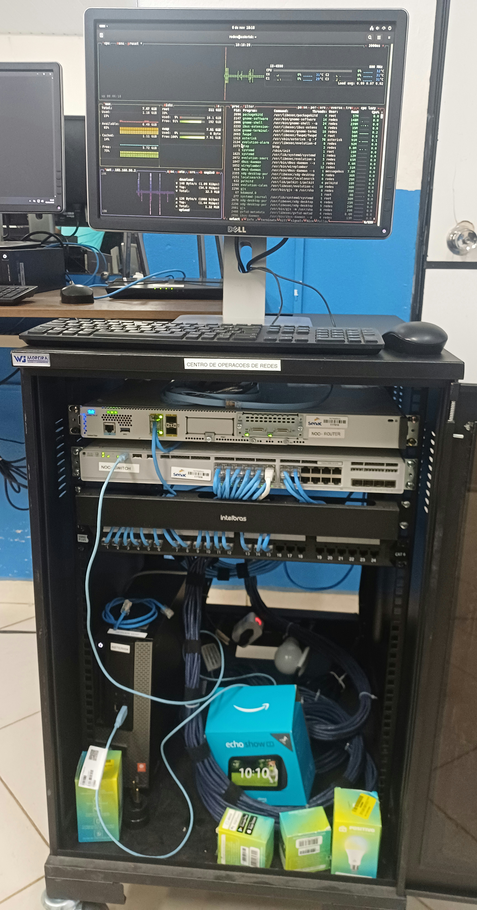

# Infraestrutura Física

[English](../../evidence/physical-infrastructure.md) | [Português (Brasil)](infraestrutura-fisica.md)

## Visão Geral

O projeto Enterprise NOC — From Scratch utiliza um ambiente físico de redes composto por equipamentos corporativos Cisco, cabeamento estruturado Ethernet e um rack de telecomunicações.

Este documento apresenta evidências fotográficas da infraestrutura física, registradas em 6 de novembro de 2026.

As fotografias documentam a instalação dos equipamentos, a organização do rack e as conexões físicas. As configurações de rede e o funcionamento dos serviços são documentados separadamente.

## 1. Visão Geral do Rack

O laboratório possui um rack de rede localizado próximo a uma estação de trabalho utilizada para acessar e monitorar o ambiente.

A fotografia apresenta uma visão geral da instalação física e do espaço onde os equipamentos estão organizados.

## 2. Organização Interna do Rack

Com o rack aberto, é possível observar a disposição dos equipamentos de rede, os componentes do cabeamento estruturado e as conexões Ethernet.

A instalação inclui:

- Equipamentos corporativos de rede Cisco.
- Cabos de conexão Ethernet.
- Componentes de terminação do cabeamento estruturado.
- Organizadores de cabos.

A fotografia comprova a disposição física dos componentes, mas não verifica isoladamente a configuração lógica das interfaces de rede.

## 3. Equipamentos de Rede Cisco

Os principais equipamentos identificados no laboratório são:

| Componente | Equipamento identificado | Função |
|---|---|---|
| Roteador | Cisco Catalyst C8200L | Plataforma de roteamento |
| Switch | Cisco Catalyst C9200L | Plataforma de comutação Ethernet |
| Patch panel | Categoria 6 | Terminação do cabeamento estruturado |
| Organização de cabos | Organizador horizontal | Organização dos cabos Ethernet |

O roteador e o switch integram a infraestrutura de rede do projeto.

A presença física desses equipamentos está comprovada pelas fotografias. Entretanto, a verificação de configurações lógicas, VLANs, políticas de roteamento e estados das interfaces depende de registros de configuração ou evidências de monitoramento.

## 4. Cabeamento e Registros de Conexão do Switch

A [configuração do C9200L coletada em 4 de novembro](../redes/registro-switch-vlans-2026-11-04.md) registra a **Gi1/0/1 do switch** como trunk em direção ao Cisco C8200L. A interface do lado do roteador não foi identificada nessa coleta. As atribuições das interfaces, incluindo as VLANs 10–70, estão registradas no [mapa de portas do switch](../redes/mapa-de-portas-switch.md).

As fotografias do rack apresentam cabos de conexão, o patch panel Categoria 6 e os componentes de organização. Elas não estabelecem um mapa completo entre interfaces do switch, posições no patch panel e tomadas das estações. Os registros de hardware e rede dos dez computadores estão no [inventário de computadores e servidores](../estacoes/inventario-de-computadores.md).

## 5. Escopo das Evidências

As fotografias confirmam a presença e a disposição física dos equipamentos documentados em 6 de novembro de 2026.

As fotografias registram os equipamentos e o cabeamento, não os seguintes resultados operacionais:

- Comunicação bem-sucedida entre todos os segmentos de rede.
- Funcionamento correto de todas as interfaces do switch.
- Configuração completa de roteamento e controle de acesso.
- Disponibilidade contínua da rede.

Esses aspectos devem ser avaliados por meio dos registros de configuração, testes e dados de monitoramento correspondentes.

## 6. Observações sobre a Documentação

As fotografias originais são preservadas separadamente das cópias preparadas para a documentação pública.

As evidências publicadas não devem conter credenciais, identificações patrimoniais institucionais ou outras informações cuja divulgação não tenha sido autorizada.

**Data da coleta das evidências:** 6 de novembro de 2026.
