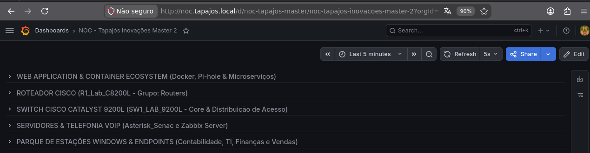
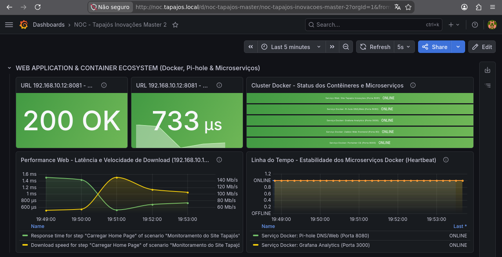
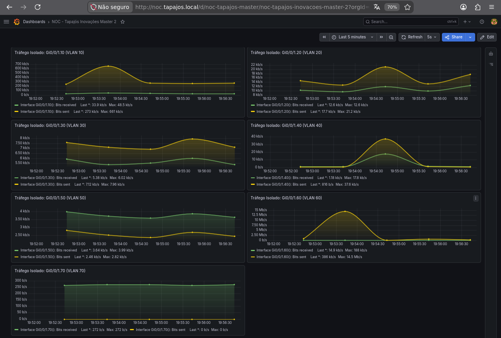
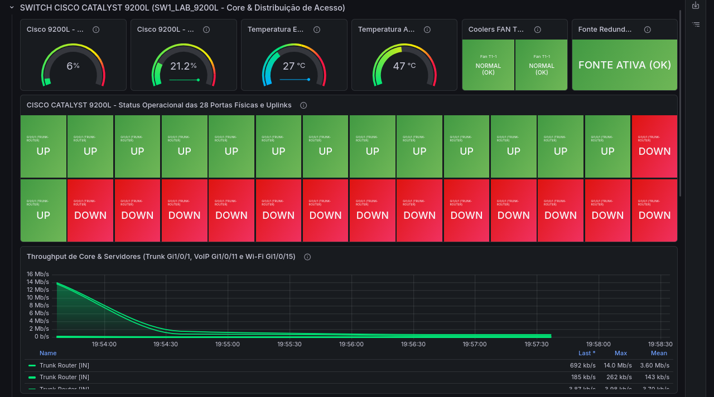
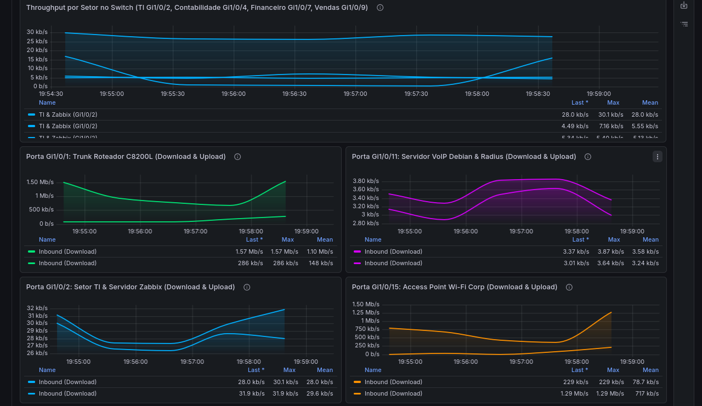
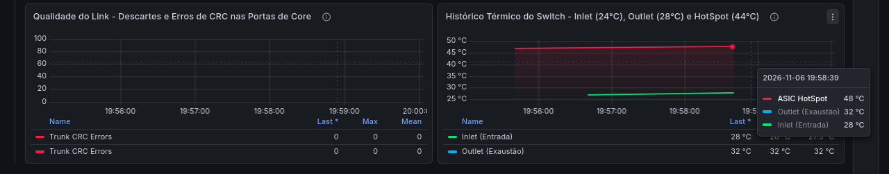
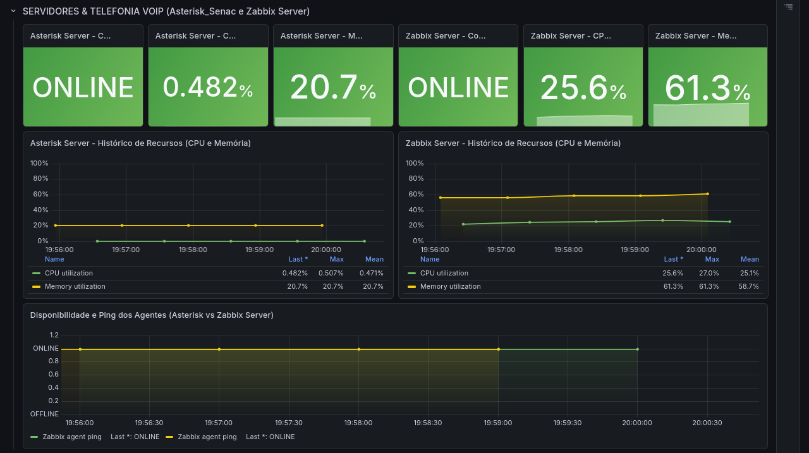
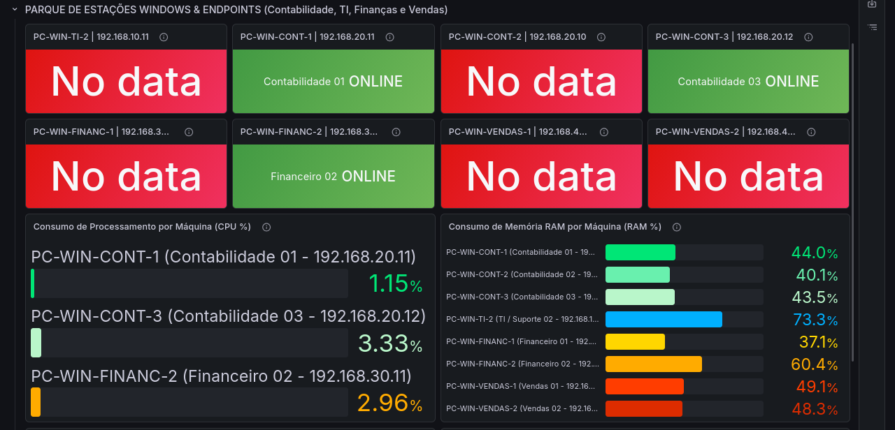
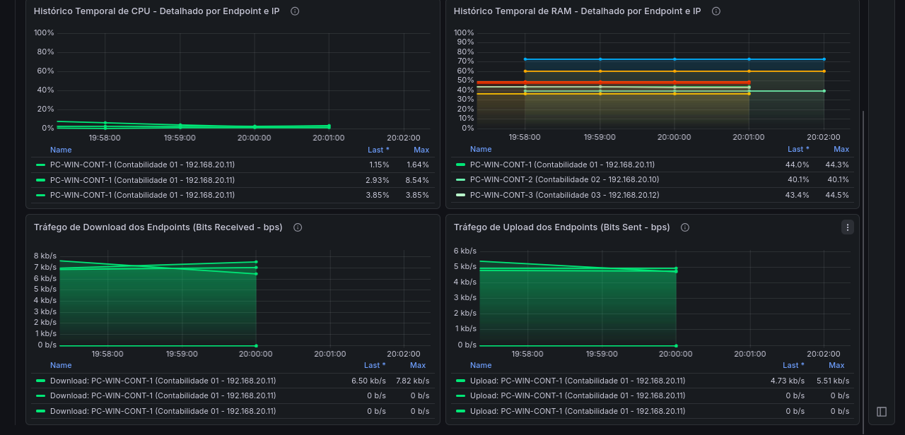

# Monitoramento com Grafana e Dashboards

[English](../../monitoring/grafana-monitoring.md) | [Português (Brasil)](grafana.md)

## 1. Visão Geral

O laboratório Enterprise NOC — From Scratch utiliza o Grafana para visualizar dados de monitoramento dos equipamentos de rede, servidores Linux, estações Windows e serviços de infraestrutura.

O Grafana é executado como container Docker no computador principal da infraestrutura, utilizando Debian GNU/Linux 13.

O ambiente integra o Grafana ao Zabbix, permitindo apresentar as métricas coletadas por meio de dashboards personalizados.

Este documento apresenta o ambiente Grafana observado em **6 de novembro de 2026**, utilizando as capturas originais coletadas no laboratório.

Todas as imagens representam observações históricas, não painéis de monitoramento em tempo real.

## 2. Organização dos Dashboards

O ambiente Grafana possui um dashboard consolidado do NOC, organizado em cinco seções de monitoramento:

| Seção | Componentes monitorados |
|---|---|
| Aplicações Web e Containers | Aplicações web, serviços Docker e verificações de disponibilidade |
| Roteador Cisco | Interfaces, VLANs e tráfego do Catalyst C8200L |
| Switch Cisco | Hardware, interfaces e throughput do Catalyst C9200L |
| Servidores e VoIP | Servidor Asterisk e servidor de infraestrutura Zabbix |
| Estações Windows e Endpoints | Computadores dos setores, consumo de recursos e tráfego de rede |

A captura documenta a estrutura do dashboard disponível no momento da coleta.

## 3. Aplicações Web e Containers

Esta seção apresenta informações de monitoramento relacionadas ao site corporativo e a determinados serviços Docker.

O dashboard inclui:

- Status das respostas HTTP.
- Tempo de resposta da aplicação web.
- Indicadores de disponibilidade dos serviços.
- Gráficos históricos de desempenho web.
- Informações de heartbeat dos serviços Docker.

### 3.1 Monitoramento HTTP

A captura apresenta o status HTTP **200 OK** para a aplicação web monitorada.

Também são exibidos tempos de resposta e gráficos históricos relacionados às verificações de desempenho.

O código HTTP 200 indica que a requisição correspondente recebeu uma resposta bem-sucedida durante a verificação. Entretanto, isso não garante que todas as funcionalidades da aplicação estivessem operando corretamente.

### 3.2 Disponibilidade dos Containers

O dashboard apresenta indicadores de disponibilidade de serviços selecionados:

- Site corporativo.
- Pi-hole.
- Grafana.
- Zabbix Web.
- Portainer.

Esses indicadores não representam o inventário completo dos dez containers documentados no ambiente Docker.

Para consultar o inventário completo, acesse [Infraestrutura Docker e Serviços](../containers/servicos-docker.md).

## 4. Roteador Cisco Catalyst C8200L

O monitoramento do roteador Cisco está documentado em duas capturas consecutivas.

### 4.1 Interfaces do Roteador

O dashboard apresenta:

- Indicadores de estado operacional das interfaces e subinterfaces selecionadas.
- Tráfego da interface WAN.
- Tráfego da interface trunk.
- Throughput das subinterfaces das VLANs.

A captura apresenta indicadores verdes `UP` para as interfaces representadas nos painéis de status.

Esses resultados descrevem o estado das interfaces monitoradas durante o período registrado; a captura não é um inventário operacional de todas as interfaces físicas e funções de roteamento.

### 4.2 Histórico de Tráfego do Roteador

A segunda captura apresenta a continuação do monitoramento do roteador.

Ela contém gráficos históricos de throughput associados às interfaces de rede e subinterfaces das VLANs.

Os gráficos demonstram que a plataforma recebeu medições de tráfego durante o intervalo selecionado.

Os valores exibidos representam amostras históricas, não garantias de largura de banda ou desempenho contínuo.

## 5. Switch Cisco Catalyst C9200L

O monitoramento do switch está documentado em três capturas consecutivas.

### 5.1 Hardware e Estado das Interfaces

O dashboard apresenta:

- Utilização de CPU.
- Utilização de memória RAM.
- Leituras de temperatura.
- Indicadores dos ventiladores.
- Indicadores da fonte de alimentação.
- Estado operacional das interfaces.
- Throughput de rede.

A captura apresenta interfaces identificadas como `UP` e `DOWN`.

Uma interface em estado `DOWN` não representa necessariamente uma falha. Interfaces desconectadas, sem utilização ou administrativamente desabilitadas podem permanecer nesse estado durante a operação normal.

**Limitação identificada:** vários painéis de estado apresentam o mesmo rótulo, `Gi1/0/1 TRUNK-ROUTER`.

A captura apresenta os painéis e seus rótulos originais, sem associar cada rótulo a uma interface física distinta.

As capturas históricas não incluem a correspondência completa entre os itens do Zabbix e as interfaces físicas do switch; os rótulos repetidos são preservados.

### 5.2 Throughput das Interfaces

Esta captura apresenta a continuação do dashboard com gráficos históricos de tráfego.

Os gráficos incluem medições associadas a interfaces selecionadas de trunk, setores e infraestrutura.

Os valores históricos demonstram a existência de séries de tráfego coletadas.

Entretanto, não validam isoladamente as descrições das interfaces nem o mapeamento físico completo das portas.

### 5.3 Erros e Temperatura

A última captura apresenta:

- Indicadores de erros nas interfaces.
- Informações relacionadas a erros CRC.
- Histórico de temperatura do switch.

Esses painéis fornecem informações relevantes para o diagnóstico de problemas de rede e monitoramento do hardware.

As medições apresentadas estão limitadas ao intervalo selecionado e às fontes de dados configuradas.

## 6. Servidores Linux e VoIP

Esta seção apresenta os dados de monitoramento de dois computadores Linux:

| Sistema | Função principal |
|---|---|
| Servidor Asterisk | Serviços VoIP e FreeRADIUS |
| Servidor de infraestrutura Zabbix | Infraestrutura de monitoramento e Docker |

O dashboard apresenta:

- Indicadores de disponibilidade.
- Utilização de CPU.
- Utilização de memória RAM.
- Histórico do consumo de recursos.
- Histórico de disponibilidade dos agentes Zabbix.

Ambos os servidores aparecem como `ONLINE` na captura.

As medições de CPU e RAM representam o estado dos sistemas durante o intervalo selecionado.

Os indicadores representam métricas de monitoramento e não registros de chamadas SIP ou transações RADIUS.

As configurações das aplicações Asterisk e FreeRADIUS são documentadas separadamente dessas métricas de recursos.

## 7. Estações Windows e Endpoints

O monitoramento das estações Windows está documentado em duas capturas consecutivas.

### 7.1 Disponibilidade e Utilização de Recursos

O dashboard apresenta oito estações Windows distribuídas pelos setores do laboratório.

Na captura, os indicadores apresentam:

| Estado no dashboard | Estações |
|---|---:|
| `ONLINE` | 3 |
| `No data` | 5 |
| **Total** | **8** |

Algumas medições de CPU e RAM estão disponíveis, embora diversos painéis de status apresentem `No data`.

**O indicador `No data` não significa automaticamente que o computador esteja desligado.**

Ele indica que a consulta correspondente do Grafana não retornou dados utilizáveis para aquele painel e intervalo.

As possíveis explicações incluem referências incorretas aos hosts, ausência de itens de monitoramento, problemas de conectividade ou configuração das consultas.

As capturas registram os sintomas observados, sem identificar uma causa única para todos os painéis com ausência de dados.

### 7.2 Histórico de CPU, RAM e Tráfego de Rede

A segunda captura apresenta:

- Histórico de utilização de CPU.
- Histórico de utilização de memória RAM.
- Tráfego de download.
- Tráfego de upload.

Os gráficos contêm séries históricas de determinadas estações Windows.

Algumas legendas repetem identificadores de computadores. Os rótulos foram preservados conforme exibidos, sem atribuir a cada um uma medição independente.

As séries apresentadas documentam a cobertura registrada durante a coleta, sem caracterizar medição contínua fora desse período.

### 7.3 Divergências de Endereçamento

A revisão das evidências identificou diferenças entre os endereços das estações fotografados com `ipconfig` e aqueles cadastrados no Zabbix.

Seis das oito estações Windows apresentavam endereços divergentes entre os registros comparados.

Essas diferenças podem contribuir para a indisponibilidade de dados de monitoramento, mas exigem verificações adicionais.

Documentações relacionadas:

- [Monitoramento com Zabbix](zabbix.md)
- [Inventário de Computadores e Servidores](../estacoes/inventario-de-computadores.md)

## 8. Resultados Históricos

As capturas de 6 de novembro incluem **cinco painéis de estações com `No data`**, rótulos repetidos de interfaces Cisco e indicações `UP`/`DOWN`. Seis endereços de estações também divergiam dos cadastros do Zabbix, conforme o [monitoramento Zabbix](zabbix.md). As capturas não estabelecem uma causa comum.

## 9. Integração entre Grafana e Zabbix

O Grafana apresenta métricas do ambiente Zabbix, incluindo equipamentos monitorados por SNMP e Zabbix Agent. As evidências publicadas consistem em capturas dos dashboards; não foram coletadas configurações completas das fontes de dados ou exportações JSON dos painéis.

## 10. Resumo das Evidências

| Evidência | Nome original |
|---|---|
| Organização dos dashboards | `grafana_order.png` |
| Aplicações web e containers | `grafana_dashboard_web_containers.png` |
| Roteador Cisco — Parte 1 | `grafana_dashboard_router1.png` |
| Roteador Cisco — Parte 2 | `grafana_dashboard_router2.png` |
| Switch Cisco — Parte 1 | `grafana_dashboard_switch1.png` |
| Switch Cisco — Parte 2 | `grafana_dashboard_switch2.png` |
| Switch Cisco — Parte 3 | `grafana_dashboard_switch3.png` |
| Servidores Linux e Asterisk | `grafana_dashboard_asterisk.png` |
| Estações Windows — Parte 1 | `grafana_dashboard_pcs1.png` |
| Estações Windows — Parte 2 | `grafana_dashboard_pcs2.png` |

**Data da coleta das evidências:** 6 de novembro de 2026.

Todas as imagens preservam seus nomes originais e são apresentadas como evidências históricas do ambiente do laboratório.
