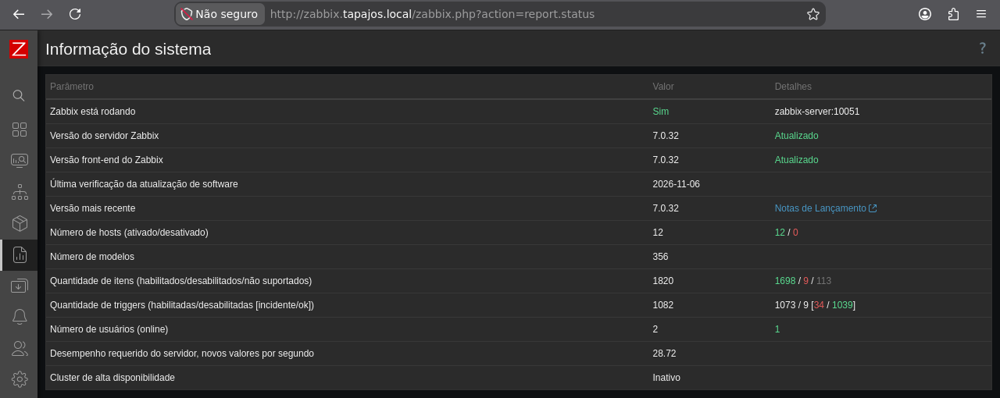
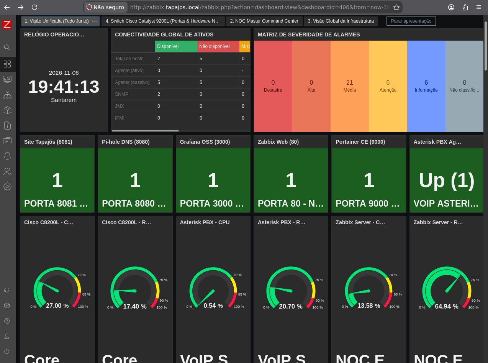
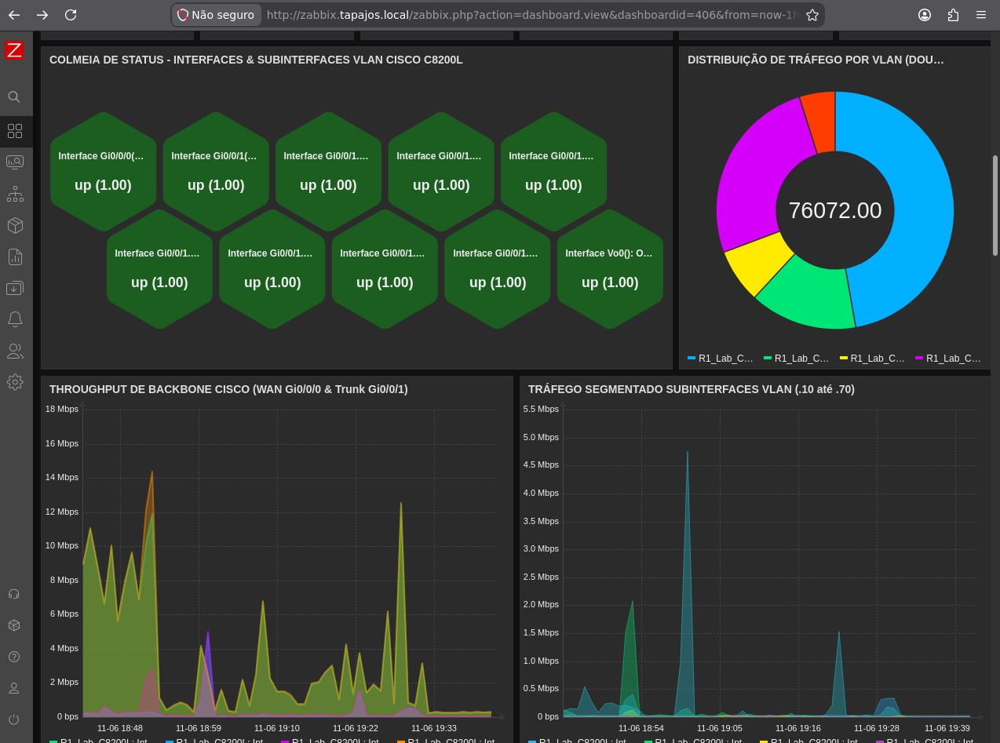
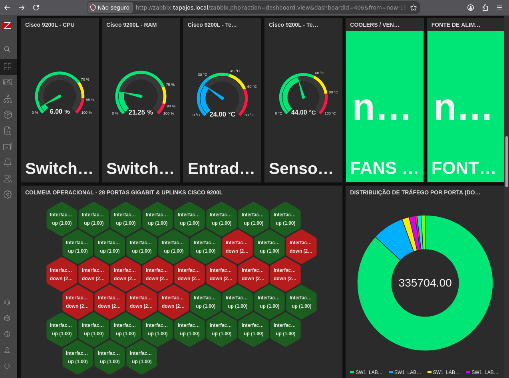
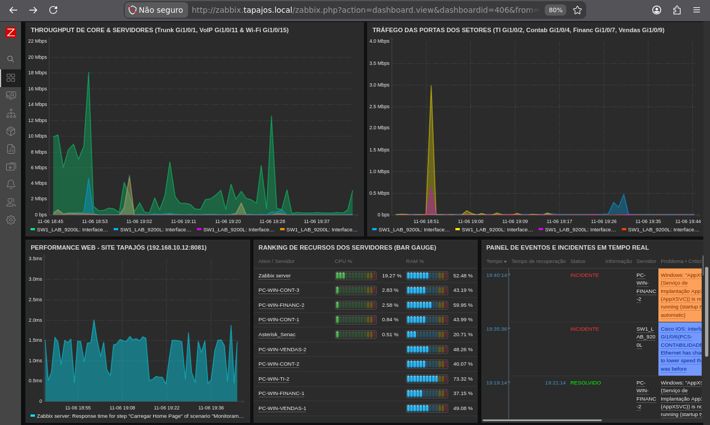
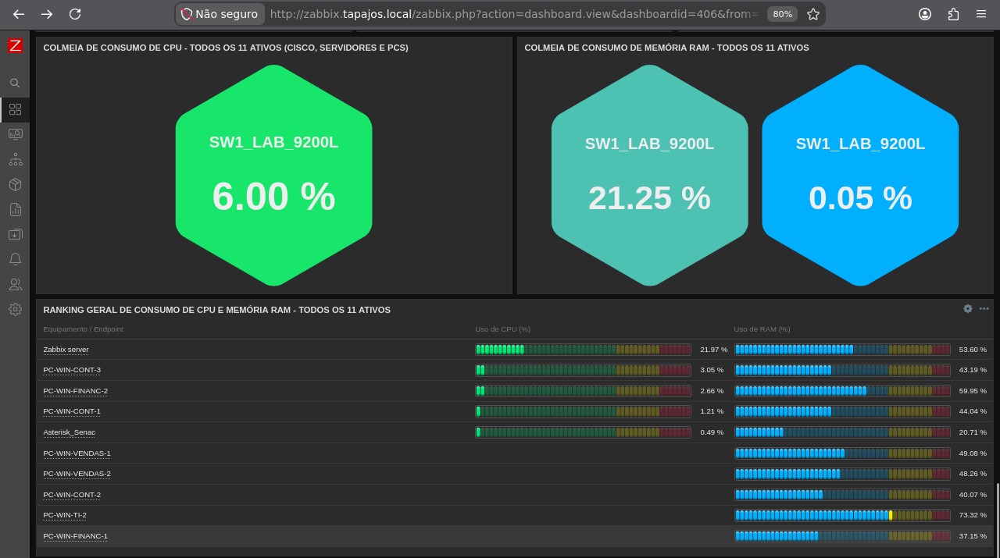
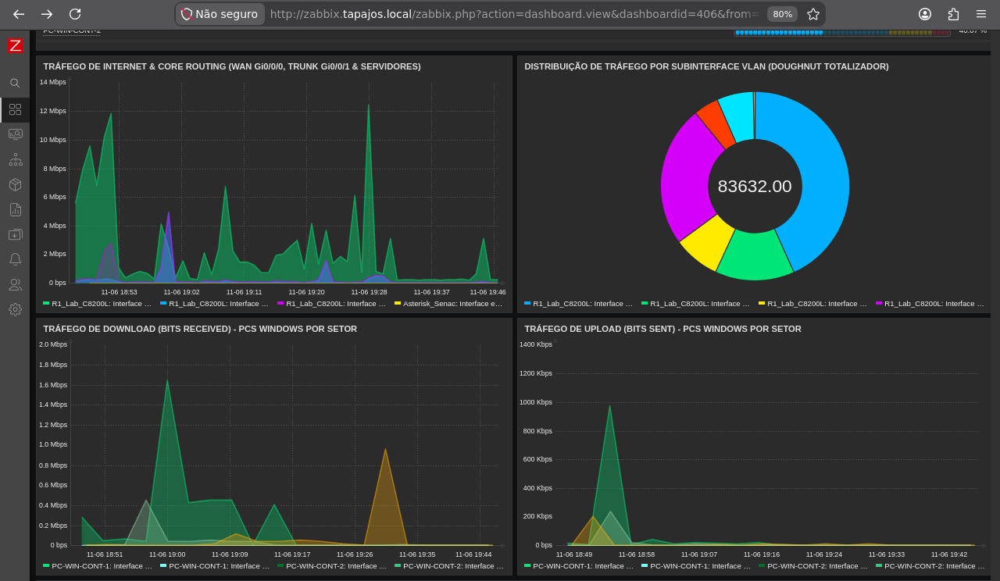
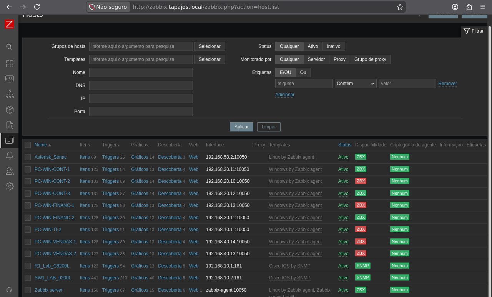
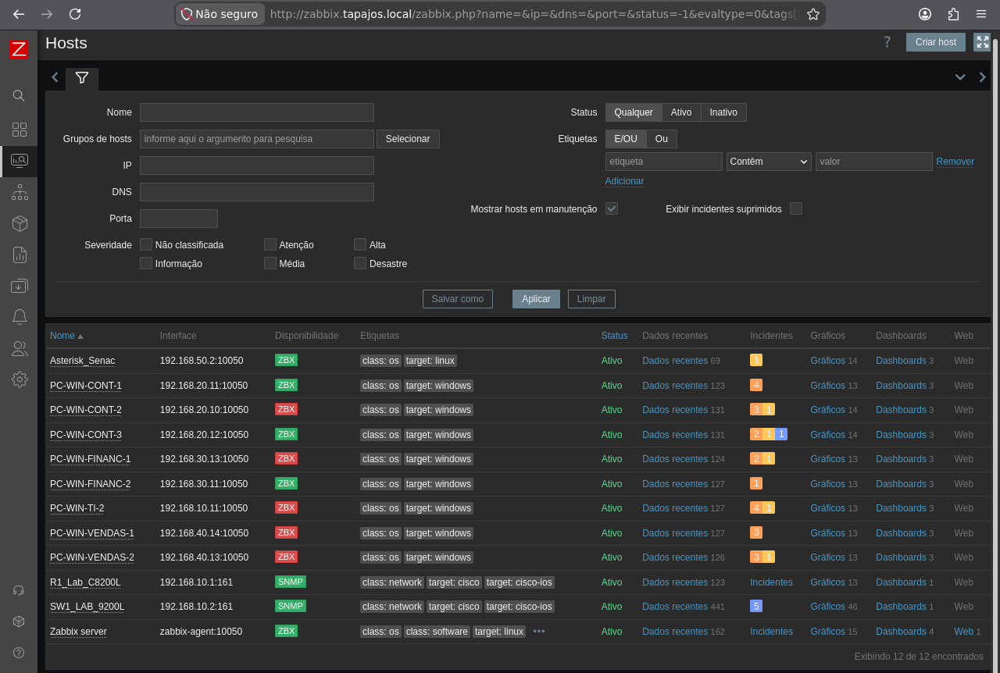

# Zabbix — Monitoramento da Infraestrutura

[English](../../monitoring/zabbix-monitoring.md) | **Português (Brasil)**

**Data das evidências:** 6 de novembro de 2026 · **Plataforma:** Zabbix 7.0.32 · **Implantação:** Debian 13 / Docker

## Arquitetura de Monitoramento

O computador Debian principal hospeda Zabbix Server, Zabbix Web, Zabbix Agent e MariaDB. O Grafana utiliza os dados do Zabbix para visualização; a implantação dos containers está documentada em [Serviços Docker](../containers/servicos-docker.md).

| Sistemas monitorados | Hosts | Interface de monitoramento |
|---|---:|---|
| Roteador Cisco Catalyst C8200L e switch C9200L | 2 | SNMP (UDP 161) |
| Servidores Debian de infraestrutura e Asterisk/FreeRADIUS | 2 | Zabbix Agent |
| Estações Windows dos setores | 8 | Zabbix Agent |
| **Total** | **12** | |

Os dashboards também registram verificações HTTP, recursos de infraestrutura e disponibilidade de serviços. Os valores e capturas seguintes representam o **momento da coleta**, não medições em tempo real ou contínuas.

## Informações do Sistema

| Parâmetro | Valor registrado |
|---|---:|
| Zabbix Server / Frontend | 7.0.32 / 7.0.32 |
| Hosts cadastrados / habilitados | 12 / 12 |
| Templates | 356 |
| Itens totais / habilitados / desabilitados | 1.820 / 1.698 / 9 |
| Itens não suportados | **113** |
| Triggers totais / habilitadas / desabilitadas | 1.082 / 1.073 / 9 |
| Triggers em estado de problema | **34** |
| Cluster de alta disponibilidade | Inativo |

O servidor estava em execução durante a captura. Itens não suportados exigem diagnóstico individual; o total não identifica suas causas.

## Evidências dos Dashboards

### 1. Dashboard Unificado do NOC

Reúne disponibilidade de hosts, severidade de alarmes, métricas Cisco, recursos Linux, verificações de serviços e indicadores Asterisk.

| Disponibilidade dos hosts | Quantidade registrada |
|---|---:|
| Disponíveis | 7 |
| Indisponíveis | 5 |
| **Total** | **12** |

O detalhamento apresenta **cinco interfaces passivas Zabbix Agent disponíveis e cinco indisponíveis**, além de **duas interfaces SNMP disponíveis**. Há verificações positivas para site corporativo, Pi-hole, Grafana, Zabbix Web, Portainer e Asterisk. Cada resultado corresponde apenas ao teste configurado naquele momento.

### 2. Cisco C8200L — Interfaces e Tráfego das VLANs

Exibe estado das interfaces/subinterfaces, throughput WAN/trunk, tráfego relacionado às VLANs e séries históricas. Os indicadores exibidos estão operacionais, mas **não** verificam independentemente as subinterfaces do roteador, NAT, roteamento ou ACLs.

### 3. Cisco C9200L — Hardware e Interfaces

Monitora CPU, RAM, temperatura, ventilação, alimentação e estado/tráfego das interfaces Ethernet. Aparecem estados `up` e `down`. Portas ociosas ou desabilitadas podem estar down normalmente; rótulos truncados exigem conferência entre itens e portas.

### 4. Tráfego, Serviços e Eventos

Apresenta throughput do núcleo/servidores, tráfego das portas dos setores, resposta do site, CPU/RAM e eventos de problema/resolução. Um evento histórico marcado como resolvido não demonstra a solução dos demais problemas de monitoramento.

### 5. Utilização de Recursos

Indicadores de CPU/RAM e classificação do consumo entre sistemas monitorados. Alguns rótulos repetem o nome do switch; a captura não comprova que representem itens distintos.

### 6. Throughput do Roteador e das Estações

Séries históricas do tráfego de internet/núcleo, subinterfaces das VLANs e upload/download das estações Windows. Somente os itens e períodos exibidos estão evidenciados.

## Hosts e Disponibilidade das Interfaces

Os hosts cadastrados correspondem a **oito estações Windows, dois servidores Linux e dois equipamentos Cisco**. Os equipamentos Cisco utilizam SNMP; os computadores utilizam monitoramento por Zabbix Agent.

A lista apresenta interfaces, indicadores de disponibilidade, acesso a dados/gráficos e quantidade de problemas. Os 12 hosts estão **habilitados**, mas cinco foram registrados como **indisponíveis**: host habilitado não significa agente acessível.

## Divergências de Endereçamento

As fotografias do `ipconfig` e os cadastros dos hosts no Zabbix divergem em seis estações Windows:

| Estação | IPv4 fotografado | IPv4 no Zabbix |
|---|---|---|
| TI 2 | `192.168.10.13` | `192.168.10.11` |
| Contabilidade 2 | `192.168.20.12` | `192.168.20.10` |
| Contabilidade 3 | `192.168.20.13` | `192.168.20.12` |
| Financeiro 1 | `192.168.30.10` | `192.168.30.13` |
| Vendas 1 | `192.168.40.11` | `192.168.40.14` |
| Vendas 2 | `192.168.40.10` | `192.168.40.13` |

Contabilidade 1 e Financeiro 2 apresentaram endereços coincidentes nos registros comparados. Mudanças de DHCP **podem** contribuir para agentes indisponíveis ou métricas ausentes, mas também devem ser analisadas configurações de agentes, conectividade, firewall e itens. A tabela representa as observações de 6 de novembro, não os IPs atuais.

## Diferenças Entre Coleta, Alertas e Disponibilidade

O laboratório utiliza **SNMP** para roteador/switch Cisco e **Zabbix Agent** para os dois servidores Debian e oito computadores Windows. O Zabbix Server processa itens e triggers com armazenamento no MariaDB; o Grafana apresenta séries selecionadas. Essa cadeia permite localizar problemas: no equipamento, interface agent/SNMP, processamento do Zabbix ou consulta do dashboard.

A captura de 6 de novembro mostra **12 hosts habilitados**, mas somente **7 disponíveis**. Habilitação administrativa não equivale a alcance do agente. Os **113 itens não suportados** exigem inspeção de cada erro; o total não prova uma causa comum. As **34 triggers em problema** representam condições configuradas, não necessariamente 34 interrupções empresariais comprovadas.

### Interpretando a Ausência de uma Métrica

1. Identificar host, item, última amostra válida, endereço IP/DNS cadastrado e tipo de interface.
2. Para agente, verificar cadastro hostname/IP, lease DHCP atual, serviço, roteamento e firewall. Seis endereços divergiam entre fotografias e cadastro Zabbix: são **hipóteses possíveis**, não causa comum comprovada dos cinco hosts indisponíveis.
3. Para SNMP, separar alcance IP, autenticação, suporte ao item e descoberta. O [caso C9200L de 4/11](diagnostico-snmp.md) demonstra uma comunidade SNMP divergente e a correção, mas não explica automaticamente outros itens não suportados.
4. Correlacionar a mensagem real de item/trigger com o serviço esperado. Uma porta não utilizada pode aparecer down sem incidente; host disponível pode ter aplicação falhando.
5. Verificar a aplicação separadamente para encerrar incidentes: CPU não comprova chamada Asterisk ou autenticação RADIUS.

São **princípios de diagnóstico**, não novos testes executados nesta revisão. O [runbook Zabbix Agent](../operacoes-noc/runbooks/conectividade-zabbix-agent.md) e a [gestão de incidentes](../operacoes-noc/gerenciamento-de-incidentes.md) definem procedimentos e evidências.

## Pendências de Monitoramento

| Condição observada | Verificação necessária |
|---|---|
| 113 itens não suportados | Identificar chaves, erros e métricas suportadas |
| 34 triggers em estado de problema | Correlacionar condições com impacto real nos serviços |
| Cinco hosts indisponíveis | Verificar agentes, endereçamento e caminhos de rede atuais |
| Seis divergências de endereço | Comparar concessões DHCP atuais com interfaces do Zabbix |
| Interfaces `down` e rótulos repetidos | Confirmar função esperada das portas e associação item/interface |

**Registros relacionados:** [Dashboards Grafana](grafana.md) · [Diagnóstico SNMP de 4 de novembro](diagnostico-snmp.md) · [Inventário das estações](../estacoes/inventario-de-computadores.md)

As nove capturas originais acima foram coletadas em **6 de novembro de 2026**. Não se presume correção posterior a partir dessas imagens.
