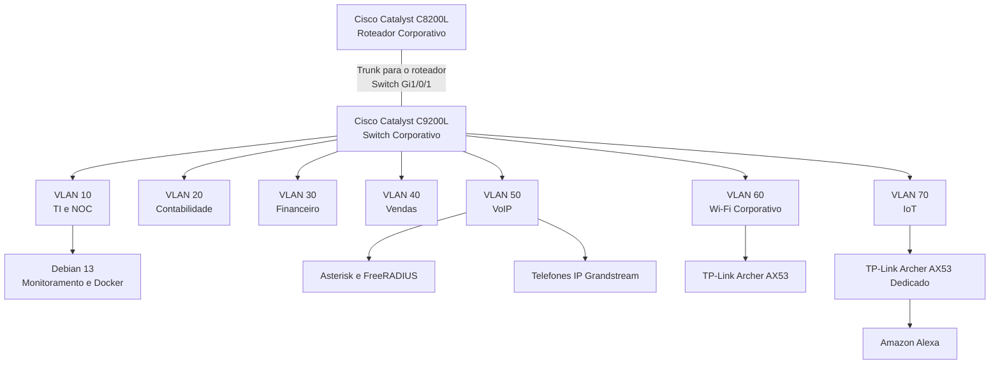

# Redes e Arquitetura

**Enterprise NOC — From Scratch**

[English](../../networking/README.md) | **Português (Brasil)**

---

## Visão Geral

A seção de Redes e Arquitetura documenta a infraestrutura de rede do projeto **Enterprise NOC — From Scratch**, desenvolvido a partir de um ambiente corporativo simulado para a empresa Tapajós Inovações.

A infraestrutura integra equipamentos físicos Cisco, cabeamento estruturado, VLANs departamentais, servidores Linux, estações Windows, telefonia IP, conectividade Wi-Fi corporativa, dispositivos IoT e monitoramento centralizado.

Esta seção reúne a arquitetura lógica da rede, as funções dos equipamentos, a segmentação por VLANs, o mapeamento das interfaces, os registros de endereçamento IP e as configurações documentadas.

A documentação utiliza os registros técnicos e as evidências coletadas no laboratório durante novembro de 2026.

## Arquitetura da Rede

A infraestrutura de rede inclui os seguintes componentes:

| Componente | Equipamento | Função |
|---|---|---|
| Roteador Corporativo | Cisco Catalyst C8200L-1N-4T | Infraestrutura central de roteamento |
| Switch Corporativo | Cisco Catalyst C9200L-24T-4G | Comutação Ethernet e segmentação por VLANs |
| Rede Wi-Fi Corporativa | TP-Link Archer AX53 | Conectividade wireless corporativa |
| Rede Wireless IoT | TP-Link Archer AX53 | Conectividade dedicada a dispositivos IoT |
| Servidor Principal | Debian GNU/Linux 13 | Serviços Docker e monitoramento da infraestrutura |
| Servidor de Voz e Autenticação | Debian Linux | Asterisk e FreeRADIUS |
| Telefonia IP | Telefones Grandstream | Comunicação telefônica departamental |

As redes Wi-Fi corporativa e IoT utilizam **dois equipamentos TP-Link Archer AX53 distintos**, cada um associado ao seu segmento de rede.

### Organização Lógica

O diagrama representa a organização lógica documentada da rede.

O trunk voltado ao roteador foi identificado na interface `Gi1/0/1` do switch. A interface correspondente do C8200L e a configuração completa das subinterfaces VLAN do roteador não estão presentes nos registros coletados.

O desenho não representa um mapa físico completo do cabeamento nem constitui comprovação independente do roteamento entre VLANs.

## Segmentação por VLANs

A infraestrutura corporativa está organizada em sete VLANs.

| VLAN | Segmento de Rede | Interfaces Documentadas |
|---|---|---|
| **10** | TI e NOC | Gi1/0/2–3 |
| **20** | Contabilidade | Gi1/0/4–6 |
| **30** | Financeiro | Gi1/0/7–8 |
| **40** | Vendas | Gi1/0/9–10 |
| **50** | VoIP e Autenticação | Gi1/0/11–13 |
| **60** | Wi-Fi Corporativo | Gi1/0/15 |
| **70** | IoT | Gi1/0/14 |

A configuração do switch também identifica:

- **Gi1/0/1:** Trunk voltado ao roteador.
- **Gi1/0/11:** VLAN 50 atribuída, sem comando explícito `switchport mode access`.
- **Gi1/0/12–13:** Interfaces de acesso associadas aos telefones IP Grandstream.
- **Gi1/0/14:** Equipamento wireless da rede IoT.
- **Gi1/0/15:** Equipamento wireless da rede corporativa.

A configuração histórica do trunk não apresenta uma lista explícita de VLANs permitidas nem uma VLAN nativa personalizada.

A segmentação por VLANs estabelece domínios de broadcast separados na camada 2. A comunicação entre segmentos e as restrições de acesso dependem de configurações adicionais de camada 3 e das políticas de segurança.

A configuração disponível do switch não comprova isoladamente o funcionamento de todas as rotas entre VLANs nem a aplicação das ACLs do roteador.

## Endereçamento IP

O inventário de servidores e estações coletado em 6 de novembro de 2026 registra os seguintes endereços:

| VLAN | Rede Documentada | Exemplos |
|---|---|---|
| 10 | `192.168.10.0/24` | Servidor NOC principal: `192.168.10.12` |
| 20 | `192.168.20.0/24` | Estações da Contabilidade: `192.168.20.11–13` |
| 30 | `192.168.30.0/24` | Estações do Financeiro: `192.168.30.10–11` |
| 40 | `192.168.40.0/24` | Estações de Vendas: `192.168.40.10–11` |
| 50 | `192.168.50.0/24` | Servidor Asterisk/FreeRADIUS: `192.168.50.2` |
| 60 | Não estabelecida pelos registros disponíveis dos clientes | Wi-Fi Corporativo |
| 70 | Não estabelecida pelos registros disponíveis dos clientes | IoT |

As configurações das estações também registram os seguintes gateways padrão:

| VLAN | Gateway Padrão Observado |
|---|---|
| 10 | `192.168.10.1` |
| 20 | `192.168.20.1` |
| 30 | `192.168.30.1` |
| 40 | `192.168.40.1` |

Esses valores representam os registros coletados dos equipamentos e das estações.

A utilização de DHCP pode provocar alterações nos endereços entre diferentes períodos de coleta. Os gateways observados não constituem, isoladamente, uma exportação completa da configuração do roteador.

## Documentação Técnica

Os documentos abaixo apresentam os detalhes da arquitetura de rede e de seus componentes.

| Documento | Descrição |
|---|---|
| [Topologia Lógica Consolidada](topologia-logica-consolidada.md) | Arquitetura da rede, relacionamento dos equipamentos, organização das VLANs, endereçamento e integração da infraestrutura. |
| [Segmentação por VLANs](vlans.md) | Inventário de VLANs, separação departamental, Wi-Fi corporativo e rede IoT. |
| [Cisco Catalyst C8200L](roteador-c8200l.md) | Arquitetura do roteador, endereçamento observado, evidências de monitoramento e projeto das políticas de acesso. |
| [Cisco Catalyst C9200L — Mapa de Portas](mapa-de-portas-switch.md) | Inventário das interfaces e atribuições documentadas dos equipamentos. |
| [Registro de Configuração do Switch](registro-switch-vlans-2026-11-04.md) | Configuração histórica do IOS XE, VLANs, trunk e Spanning Tree. |
| [Wi-Fi Corporativo — VLAN 60](wifi-corporativo-vlan60.md) | Equipamento wireless, integração com o switch, segmentação e escopo das evidências. |
| [Rede IoT — VLAN 70](iot-vlan70.md) | Infraestrutura dedicada aos dispositivos IoT, conectividade da Alexa e atribuições registradas no switch. |

### Ordem Recomendada de Leitura

Para compreender a infraestrutura de rede:

1. [Topologia Lógica Consolidada](topologia-logica-consolidada.md)
2. [Segmentação por VLANs](vlans.md)
3. [Cisco Catalyst C8200L](roteador-c8200l.md)
4. [Registro de Configuração do Switch](registro-switch-vlans-2026-11-04.md)
5. [Mapa de Portas do Switch](mapa-de-portas-switch.md)
6. [Wi-Fi Corporativo — VLAN 60](wifi-corporativo-vlan60.md)
7. [Rede IoT — VLAN 70](iot-vlan70.md)

## Monitoramento da Infraestrutura

O ambiente de redes está integrado às plataformas de monitoramento centralizado.

A arquitetura de monitoramento documentada inclui:

- **Zabbix:** Monitoramento da infraestrutura, disponibilidade dos equipamentos de rede e coleta de métricas.
- **Grafana:** Visualização das métricas históricas da infraestrutura.
- **SNMP:** Coleta de informações dos equipamentos Cisco compatíveis.
- **Uptime Kuma:** Verificações de disponibilidade de serviços selecionados.

As capturas disponíveis apresentam informações de monitoramento do roteador e do switch Cisco.

A configuração original do switch foi coletada antes da configuração posterior do monitoramento SNMP.

As capturas dos dashboards representam observações dos períodos de coleta, não a disponibilidade contínua dos equipamentos nem a cobertura completa de suas configurações.

### Documentação de Monitoramento

- [Monitoramento com Zabbix](../monitoramento/zabbix.md)
- [Monitoramento com Grafana](../monitoramento/grafana.md)
- [Diagnóstico SNMP](../monitoramento/diagnostico-snmp.md)

## Documentação Relacionada

A infraestrutura de rede integra diferentes áreas técnicas do projeto.

| Área | Documentação |
|---|---|
| Arquitetura da Infraestrutura | [Visão Geral da Arquitetura](../arquitetura/visao-geral-da-infraestrutura.md) |
| Linux e Docker | [Serviços Docker](../containers/servicos-docker.md) |
| Computadores e Servidores | [Inventário de Computadores](../estacoes/inventario-de-computadores.md) |
| Voz e Autenticação | [Asterisk e FreeRADIUS](../servicos/asterisk-freeradius.md) |
| Infraestrutura Física | [Infraestrutura Física](../evidencias/infraestrutura-fisica.md) |
| Evidências Técnicas | [Registro de Coleta](../evidencias/registro-coleta-2026-11-06.md) |
| Operações NOC | [Gerenciamento de Incidentes](../operacoes-noc/gerenciamento-de-incidentes.md) |
| FAQ Técnica | [Perguntas Frequentes](../faq/perguntas-frequentes.md) |

## Escopo das Configurações e Evidências

A documentação de redes reúne informações provenientes de diferentes registros:

- Configuração do Cisco Catalyst C9200L coletada em 4 de novembro de 2026.
- Inventário de estações e servidores coletado em 6 de novembro de 2026.
- Fotografias dos equipamentos físicos.
- Capturas de monitoramento do Zabbix e Grafana.
- Registros técnicos dos equipamentos e serviços de infraestrutura.

A documentação diferencia as configurações registradas, as condições operacionais observadas e os requisitos previstos na arquitetura.

Os registros disponíveis não constituem:

- Uma exportação completa da configuração em execução do C8200L.
- Comprovação independente de todas as rotas de comunicação entre VLANs.
- Evidência da aplicação efetiva das ACLs do roteador.
- Um mapa físico completo do cabeamento.
- Exportações das configurações dos dois equipamentos TP-Link Archer AX53.
- Comprovação da autenticação wireless por meio do FreeRADIUS.
- Registros de disponibilidade contínua de todos os componentes de rede.

Essas delimitações preservam a distinção entre a infraestrutura documentada do laboratório e os detalhes de implementação não estabelecidos pelas evidências disponíveis.

---

**Enterprise NOC — From Scratch**  
**Seção:** Redes e Arquitetura  
**Documentação:** Português (Brasil) / Inglês
