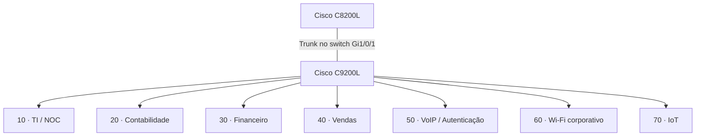

# Redes e Arquitetura

**Enterprise NOC — From Scratch**

[English](../../networking/README.md) | **Português (Brasil)**

## Visão geral da rede

O laboratório corporativo da Tapajós Inovações utiliza equipamentos físicos Cisco, sete VLANs, servidores Linux, estações departamentais, telefonia IP e dois equipamentos wireless distintos. Esta seção documenta a rede conforme os registros de **4 a 6 de novembro de 2026**.

| Componente | Equipamento / função |
|---|---|
| Roteador | Cisco Catalyst C8200L-1N-4T |
| Switch | Cisco Catalyst C9200L-24T-4G, IOS XE 17.15 |
| Servidor de infraestrutura | Dell OptiPlex 3020, Debian 13, monitoramento e Docker |
| Servidor de voz / autenticação | Debian Linux, Asterisk e FreeRADIUS |
| Wireless | Dois TP-Link Archer AX53: Wi-Fi corporativo e IoT |
| Terminais | Estações Windows, telefones IP Grandstream e Amazon Alexa |

### Segmentação lógica

| VLAN | Portas do switch | Rede documentada |
|---|---|---|
| 10 | Gi1/0/2–3 | `192.168.10.0/24` |
| 20 | Gi1/0/4–6 | `192.168.20.0/24` |
| 30 | Gi1/0/7–8 | `192.168.30.0/24` |
| 40 | Gi1/0/9–10 | `192.168.40.0/24` |
| 50 | Gi1/0/11–13 | `192.168.50.0/24` |
| 60 | Gi1/0/15 | Sub-rede dos clientes não estabelecida |
| 70 | Gi1/0/14 | Sub-rede dos clientes não estabelecida |

O trunk está configurado no **switch**; a interface correspondente no roteador e sua configuração completa não foram coletadas. A Gi1/0/11 possui VLAN 50 atribuída, mas a captura não estabelece seu modo operacional. A separação por VLANs não comprova, por si só, a aplicação de ACLs no roteador.

## Documentação técnica

| Documento | Escopo |
|---|---|
| [Topologia lógica consolidada](topologia-logica-consolidada.md) | Equipamentos, serviços, relações de rede e endereçamento |
| [Segmentação por VLANs](vlans.md) | Inventário de VLANs, endereçamento e projeto de controle de acesso |
| [Cisco C8200L](roteador-c8200l.md) | Função do roteador, gateways observados e monitoramento |
| [Mapa de portas do switch](mapa-de-portas-switch.md) | Atribuições das interfaces do C9200L |
| [Registro de configuração do switch](registro-switch-vlans-2026-11-04.md) | Configuração histórica do IOS XE e Spanning Tree |
| [Wi-Fi corporativo · VLAN 60](wifi-corporativo-vlan60.md) | Archer AX53 corporativo e integração com o switch |
| [IoT · VLAN 70](iot-vlan70.md) | Archer AX53 dedicado e conectividade da Alexa |

## Registros relacionados

[Arquitetura da infraestrutura](../arquitetura/visao-geral-da-infraestrutura.md) · [Inventário de computadores](../estacoes/inventario-de-computadores.md) · [Infraestrutura física](../evidencias/infraestrutura-fisica.md) · [Asterisk / FreeRADIUS](../servicos/asterisk-freeradius.md) · [Zabbix](../monitoramento/zabbix.md) · [Grafana](../monitoramento/grafana.md)

**Escopo das evidências:** Configuração do switch coletada em 4 de novembro; registros de equipamentos, endereçamento e monitoramento de novembro de 2026. Não há exportação completa do C8200L, testes de ACLs, configurações dos roteadores wireless ou mapa individual de todos os cabos.
