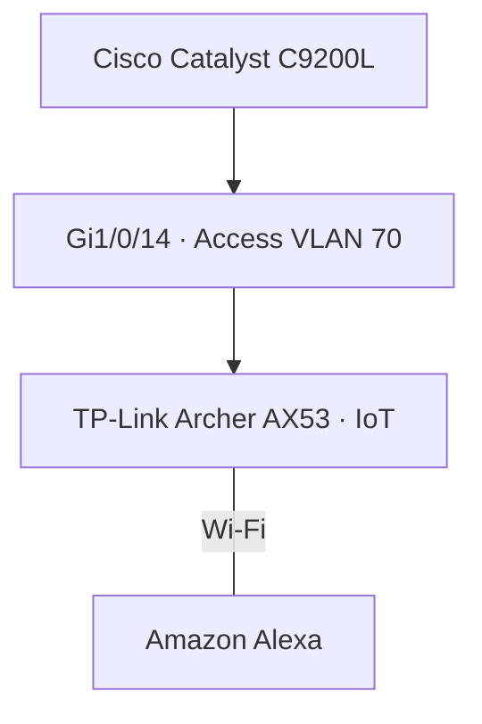

# Rede IoT — VLAN 70

**Enterprise NOC — From Scratch**

[English](../../networking/iot-vlan70.md) | **Português (Brasil)**

## Equipamento e conexão

| Característica | Registro documentado |
|---|---|
| Segmento de rede | VLAN 70 · IoT |
| Equipamento wireless | TP-Link Archer AX53 dedicado · Wi-Fi 6 AX3000 |
| Dispositivo associado | Amazon Alexa |
| Switch | Cisco Catalyst C9200L-24T-4G |
| Porta | `Gi1/0/14` — access VLAN 70 |
| Evidências | Configuração do switch de 04/11 e inventário dos equipamentos de novembro |

O Wi-Fi corporativo utiliza **outro** Archer AX53 na VLAN 60 (`Gi1/0/15`).

O diagrama registra a associação do dispositivo IoT e a conexão Ethernet ao switch. Não pressupõe que a Alexa utilize endereço IP diretamente de uma sub-rede upstream da VLAN 70.

## Endereçamento e segmentação

A configuração do Archer AX53 não foi exportada. Seu modo de operação AP/roteador, parâmetros DHCP, NAT, sub-rede dos clientes, gateway padrão, SSID e endereço IP da Alexa **não estão estabelecidos**.

- **Modo AP:** clientes wireless podem participar da sub-rede da VLAN upstream.
- **Modo roteador com NAT:** clientes podem utilizar uma sub-rede interna separada.

São configurações possíveis, não parâmetros verificados do equipamento do laboratório.

A VLAN 70 separa o segmento Ethernet IoT do Wi-Fi corporativo da VLAN 60 em camada 2. Restringir o tráfego aos demais recursos corporativos exige política de camada 3; a aplicação das ACLs do roteador não foi verificada nos registros coletados.

## Monitoramento e escopo da publicação

As capturas do Zabbix/Grafana apresentam o monitoramento da infraestrutura Cisco. O inventário publicado não contém métricas diretas da Alexa ou do Archer AX53 IoT.

Este registro documenta a atribuição da interface no switch e a associação dos equipamentos, não testes bem-sucedidos dos clientes IoT nem a configuração wireless completa. SSIDs, senhas, segredos RADIUS e identificadores exclusivos não são publicados.

## Referências

[Visão geral de Redes](README.md) · [VLANs](vlans.md) · [Mapa de portas](mapa-de-portas-switch.md) · [Registro do switch](registro-switch-vlans-2026-11-04.md) · [Wi-Fi corporativo · VLAN 60](wifi-corporativo-vlan60.md) · [Topologia lógica](topologia-logica-consolidada.md) · [Infraestrutura física](../evidencias/infraestrutura-fisica.md)
