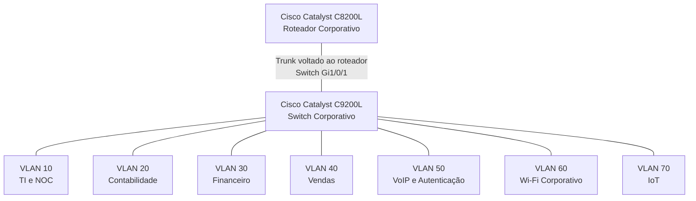

# Cisco Catalyst C9200L — Configuração de VLANs e Interfaces

**Enterprise NOC — From Scratch**

[English](../../networking/switch-vlan-snapshot-2026-11-04.md) | **Português (Brasil)**

---

## 1. Visão Geral

Este documento apresenta a segmentação por VLANs e a configuração das interfaces registradas no switch **Cisco Catalyst C9200L-24T-4G**, utilizado na infraestrutura do Enterprise NOC.

O equipamento disponibiliza conectividade para estações de trabalho departamentais, servidores Linux, telefones IP, equipamentos Wi-Fi corporativos e infraestrutura IoT.

A referência técnica é uma captura do comando `show running-config` do Cisco IOS XE, coletada em **4 de novembro de 2026**, por meio de uma conexão serial a partir do computador Linux destinado aos serviços Asterisk e FreeRADIUS.

| Característica | Informação Registrada |
|---|---|
| Fabricante | Cisco |
| Modelo | Catalyst C9200L-24T-4G |
| Sistema Operacional | Cisco IOS XE |
| Versão Registrada | 17.15 |
| Plataforma Provisionada | `c9200l-24t-4g` |
| Data da Configuração | 04/11/2026 |
| Segmentação da Rede | Sete VLANs |
| Interface Voltada ao Roteador | `Gi1/0/1` |

A captura documenta os parâmetros do switch no momento da coleta. Ela antecede alterações posteriores relacionadas ao monitoramento SNMP e não representa a configuração completa atual nem o estado operacional do equipamento.

## 2. Infraestrutura de Rede

A infraestrutura documentada inclui os seguintes componentes:

| Componente | Modelo ou Especificação | Função |
|---|---|---|
| Roteador Corporativo | Cisco Catalyst C8200L | Infraestrutura central de roteamento |
| Switch Corporativo | Cisco Catalyst C9200L-24T-4G | Comutação Ethernet e segmentação por VLANs |
| Cabeamento Estruturado | Patch panel Categoria 6 | Terminação física do cabeamento |
| Wi-Fi Corporativo | TP-Link Archer AX53 | Conectividade wireless corporativa |
| Wi-Fi IoT | TP-Link Archer AX53 dedicado | Conectividade da rede IoT |

As redes Wi-Fi corporativa e IoT utilizam dois equipamentos TP-Link Archer AX53 separados.

A identificação do equipamento wireless dedicado à rede IoT foi obtida do inventário consolidado, não dos comandos presentes na configuração Cisco.

### 2.1 Evidência Física


A fotografia documenta a presença física do roteador Cisco, do switch Catalyst e dos componentes de cabeamento estruturado.

A imagem não comprova isoladamente o estado operacional de cada interface do switch.

Outras fotografias e descrições dos equipamentos estão disponíveis na documentação de [Infraestrutura Física](../evidencias/infraestrutura-fisica.md).

## 3. Segmentação por VLANs

A captura de configuração identifica sete VLANs utilizadas na organização da rede corporativa.

| VLAN | Departamento ou Serviço | Interfaces Documentadas |
|---|---|---|
| **10** | TI e NOC | Gi1/0/2–3 |
| **20** | Contabilidade | Gi1/0/4–6 |
| **30** | Financeiro | Gi1/0/7–8 |
| **40** | Vendas | Gi1/0/9–10 |
| **50** | VoIP e Autenticação | Gi1/0/11–13 |
| **60** | Wi-Fi Corporativo | Gi1/0/15 |
| **70** | IoT | Gi1/0/14 |

A tabela reúne as atribuições de VLANs presentes na configuração histórica.

Na interface `Gi1/0/11`, a VLAN 50 aparece na configuração registrada, mas o modo operacional efetivo da porta não foi estabelecido de forma independente.

### 3.1 Organização Lógica da Rede



O diagrama representa a segmentação lógica documentada da rede.

O trunk voltado ao roteador foi identificado na interface `Gi1/0/1` do switch. A interface correspondente no roteador e a configuração completa das subinterfaces VLAN não estão presentes nos registros coletados.

O desenho não representa um mapa físico completo do cabeamento nem comprova de forma independente o roteamento entre VLANs.

### 3.2 Segmentação e Roteamento

As VLANs documentadas estabelecem domínios de broadcast separados na camada 2.

A comunicação entre diferentes VLANs exige encaminhamento em camada 3. As restrições de acesso entre segmentos dependem de configurações adicionais de roteamento e segurança.

A configuração do switch comprova as atribuições de VLANs e a existência de uma interface trunk configurada, mas não demonstra isoladamente a comunicação entre todas as VLANs nem a aplicação efetiva das ACLs do roteador.

## 4. Configuração das Interfaces do Switch

A tabela apresenta as atribuições individuais das interfaces identificadas na configuração de 4 de novembro.

| Interface | Configuração Registrada | Segmento ou Equipamento Documentado |
|---|---|---|
| Gi1/0/1 | Trunk | Cisco Catalyst C8200L |
| Gi1/0/2 | Access VLAN 10 | TI / NOC |
| Gi1/0/3 | Access VLAN 10 | TI / NOC |
| Gi1/0/4 | Access VLAN 20 | Contabilidade |
| Gi1/0/5 | Access VLAN 20 | Contabilidade |
| Gi1/0/6 | Access VLAN 20 | Contabilidade |
| Gi1/0/7 | Access VLAN 30 | Financeiro |
| Gi1/0/8 | Access VLAN 30 | Financeiro |
| Gi1/0/9 | Access VLAN 40 | Vendas |
| Gi1/0/10 | Access VLAN 40 | Vendas |
| Gi1/0/11 | VLAN de acesso 50 atribuída; modo operacional não estabelecido | Servidor Asterisk / FreeRADIUS |
| Gi1/0/12 | Access VLAN 50 | Telefone IP Grandstream |
| Gi1/0/13 | Access VLAN 50 | Telefone IP Grandstream |
| Gi1/0/14 | Access VLAN 70 | Equipamento wireless IoT |
| Gi1/0/15 | Access VLAN 60 | Equipamento Wi-Fi corporativo |

A tabela combina os comandos de configuração do switch com as atribuições dos equipamentos documentados. Não comprova isoladamente o estado físico dos enlaces ou a comunicação ponta a ponta.

As interfaces `Gi1/0/16–24` e `Gi1/1/1–4` aparecem sem comandos específicos de configuração na captura coletada.

A ausência desses comandos não estabelece se as portas estavam fisicamente conectadas, desconectadas, administrativamente desabilitadas ou operacionalmente inativas.

### 4.1 Trunk para o Roteador — Gi1/0/1

A configuração registrada apresenta:

```cisco
interface GigabitEthernet1/0/1
 description TRUNK-PARA-ROTEADOR
 switchport mode trunk
```

Esses comandos estabelecem que a interface `Gi1/0/1` estava configurada como trunk no switch.

A configuração coletada não contém um comando explícito `switchport trunk allowed vlan` nem uma atribuição personalizada de VLAN nativa nessa interface.

Embora a arquitetura documente as VLANs 10 a 70, a lista de VLANs do projeto não deve ser interpretada como uma lista explicitamente configurada de VLANs permitidas no trunk.

O material coletado também não inclui a configuração da interface correspondente no C8200L nem suas subinterfaces VLAN.

### 4.2 Portas de Acesso Departamentais

Os comandos abaixo reproduzem a configuração registrada para uma interface de estação de trabalho da Contabilidade:

```cisco
interface GigabitEthernet1/0/4
 description PCS-CONTABILIDADE
 switchport access vlan 20
 switchport mode access
 spanning-tree portfast
```

A configuração atribui a interface à VLAN 20 e estabelece explicitamente o modo access.

Configurações equivalentes de portas de acesso estão documentadas para os demais segmentos departamentais e para as interfaces dedicadas aos serviços de voz, Wi-Fi e IoT, com exceção da particularidade registrada em `Gi1/0/11`.

### 4.3 Particularidade da Interface Gi1/0/11

A interface associada ao servidor Debian Asterisk/FreeRADIUS apresenta:

```cisco
interface GigabitEthernet1/0/11
 description SERVIDOR-DEBIAN-VOIP-E-RADIUS
 switchport access vlan 50
 spanning-tree portfast trunk
```

Diferentemente das demais interfaces de acesso documentadas, os comandos coletados não incluem explicitamente:

```cisco
switchport mode access
```

O comando `spanning-tree portfast trunk` configura o comportamento do Spanning Tree; sua presença não comprova isoladamente que a interface estava operando no modo trunk.

Da mesma forma, `switchport access vlan 50` registra a atribuição de uma VLAN de acesso, mas não estabelece, por si só, o modo operacional efetivo da interface.

Consequentemente, a `Gi1/0/11` é documentada com a VLAN 50 atribuída na configuração histórica, sem classificar seu modo operacional como access ou trunk confirmado.

Os comandos originais foram preservados sem alterações.

### 4.4 Interfaces de Wi-Fi Corporativo e IoT

A infraestrutura wireless utiliza dois segmentos dedicados.

| Rede | Equipamento | Interface do Switch | VLAN |
|---|---|---|---|
| Wi-Fi Corporativo | TP-Link Archer AX53 | Gi1/0/15 | 60 |
| IoT | TP-Link Archer AX53 | Gi1/0/14 | 70 |

A captura de configuração estabelece as atribuições de VLANs no lado do switch.

Ela não contém os modos de operação, parâmetros DHCP, configuração NAT ou endereços IP dos clientes wireless de nenhum dos dois equipamentos TP-Link.

As funções dos dispositivos estão documentadas nas seções [Wi-Fi Corporativo](wifi-corporativo-vlan60.md) e [Rede IoT](iot-vlan70.md).

## 5. Endereçamento IP Observado

Os registros de rede coletados em 6 de novembro de 2026 incluem informações de endereçamento de estações Windows, computadores Linux e equipamentos de telefonia IP.

| VLAN | Rede Documentada | Exemplos de Endereçamento |
|---|---|---|
| 10 | `192.168.10.0/24` | NOC principal: `192.168.10.12`; TI 2: `192.168.10.13` |
| 20 | `192.168.20.0/24` | Contabilidade: `192.168.20.11–13` |
| 30 | `192.168.30.0/24` | Financeiro: `192.168.30.10–11` |
| 40 | `192.168.40.0/24` | Vendas: `192.168.40.10–11` |
| 50 | `192.168.50.0/24` | Asterisk/FreeRADIUS: `192.168.50.2`; telefones IP: `192.168.50.10–11` |
| 60 | Não estabelecida pelos registros disponíveis dos clientes | Wi-Fi corporativo |
| 70 | Não estabelecida pelos registros disponíveis dos clientes | IoT |

As redes `/24` foram determinadas a partir dos endereços e das máscaras de sub-rede documentados nos equipamentos.

Os registros disponíveis não estabelecem os esquemas de endereçamento utilizados pelos clientes wireless das VLANs 60 e 70.

### 5.1 Gateways Padrão Observados

As configurações coletadas nas estações identificam os seguintes gateways padrão:

| VLAN | Gateway Observado |
|---|---|
| 10 | `192.168.10.1` |
| 20 | `192.168.20.1` |
| 30 | `192.168.30.1` |
| 40 | `192.168.40.1` |

Esses valores representam os gateways configurados nas estações observadas.

Eles não comprovam isoladamente a propriedade de todos os endereços de gateway nem a configuração completa do roteador.

A captura do switch não inclui os pools DHCP do roteador, configurações de relay, subinterfaces VLAN, regras NAT ou entradas ACL.

### 5.2 Consistência do Endereçamento e Monitoramento

O inventário de 6 de novembro identificou **seis divergências** entre os endereços IPv4 fotografados nas estações Windows e as interfaces correspondentes cadastradas no Zabbix.

O laboratório utiliza DHCP para o endereçamento das estações.

Alterações nos endereços entre diferentes períodos de coleta podem contribuir para divergências no monitoramento, mas as evidências disponíveis não estabelecem uma causa única para todos os hosts indisponíveis ou itens de monitoramento não suportados.

Informações complementares estão disponíveis em:

- [Inventário de Computadores e Servidores](../estacoes/inventario-de-computadores.md)
- [Monitoramento com Zabbix](../monitoramento/zabbix.md)

## 6. Configuração do Spanning Tree

A configuração coletada do Cisco IOS XE contém:

```cisco
spanning-tree mode rapid-pvst
spanning-tree extend system-id
```

Esses comandos documentam a configuração do **Rapid PVST+** no switch Catalyst.

Diversas interfaces de acesso também apresentam:

```cisco
spanning-tree portfast
```

A configuração particular da `Gi1/0/11` contém `spanning-tree portfast trunk`, conforme registrado na Seção 4.3.

A configuração disponível não inclui um relatório operacional completo do Spanning Tree.

Portanto, não estabelece de forma independente o root bridge ativo, as root ports, as interfaces bloqueadas ou eventos de convergência durante o período de coleta.

## 7. Monitoramento do Switch

A configuração original do switch foi coletada antes da configuração posterior do monitoramento SNMP.

As evidências subsequentes do Zabbix e Grafana incluem dashboards que apresentam:

- Utilização de CPU.
- Utilização de memória.
- Informações dos sensores de hardware.
- Estado das interfaces.
- Medições de tráfego de rede.
- Erros de interfaces.

### 7.1 Evidência no Zabbix


### 7.2 Evidência no Grafana


As capturas demonstram a presença de informações de monitoramento durante o período de coleta das evidências.

Elas não constituem uma exportação completa da configuração final do SNMP do switch nem comprovam disponibilidade contínua do monitoramento.

Alguns painéis registrados no Grafana apresentam identificações repetidas de interfaces. Esses rótulos não são interpretados como medições independentes de interfaces físicas sem o correspondente mapeamento dos itens.

Os detalhes de monitoramento estão disponíveis nas documentações de [Zabbix](../monitoramento/zabbix.md), [Grafana](../monitoramento/grafana.md) e [Diagnóstico SNMP](../monitoramento/diagnostico-snmp.md).

## 8. Escopo da Configuração Histórica

A captura de 4 de novembro de 2026 documenta a configuração do Cisco Catalyst C9200L durante o período registrado do laboratório.

Os registros disponíveis estabelecem:

- Sete atribuições de VLANs documentadas.
- Um trunk voltado ao roteador configurado em `Gi1/0/1`.
- Configurações das portas de acesso departamentais.
- Atribuições no switch para as infraestruturas de voz, Wi-Fi corporativo e IoT.
- Os comandos específicos registrados para `Gi1/0/11`.
- Configuração do Rapid PVST+.

A captura não constitui:

- Uma configuração completa ou atual do switch.
- Uma exportação da configuração do roteador.
- Comprovação da comunicação entre VLANs.
- Evidência de aplicação efetiva das ACLs do roteador.
- Um relatório do estado operacional de todas as interfaces.
- Um mapa físico completo do cabeamento.
- Exportações de configuração dos equipamentos wireless.
- Confirmação do endereçamento IP dos clientes das VLANs 60 e 70.

As capturas posteriores do monitoramento documentam observações adicionais, mas não substituem o registro histórico da configuração.

## 9. Documentação Relacionada

### Redes e Arquitetura

- [Redes e Arquitetura — Visão Geral](README.md)
- [Topologia Lógica Consolidada](topologia-logica-consolidada.md)
- [Segmentação por VLANs](vlans.md)
- [Cisco Catalyst C8200L](roteador-c8200l.md)
- [Mapa de Portas do Switch](mapa-de-portas-switch.md)
- [Wi-Fi Corporativo — VLAN 60](wifi-corporativo-vlan60.md)
- [Rede IoT — VLAN 70](iot-vlan70.md)

### Infraestrutura e Monitoramento

- [Arquitetura da Infraestrutura](../arquitetura/visao-geral-da-infraestrutura.md)
- [Infraestrutura Física](../evidencias/infraestrutura-fisica.md)
- [Inventário de Computadores e Servidores](../estacoes/inventario-de-computadores.md)
- [Asterisk e FreeRADIUS](../servicos/asterisk-freeradius.md)
- [Monitoramento com Zabbix](../monitoramento/zabbix.md)
- [Monitoramento com Grafana](../monitoramento/grafana.md)

---

**Configuração coletada:** 04/11/2026  
**Evidências complementares da infraestrutura:** 06/11/2026  
**Tipo de documento:** Registro histórico da configuração do Cisco Catalyst C9200L.
