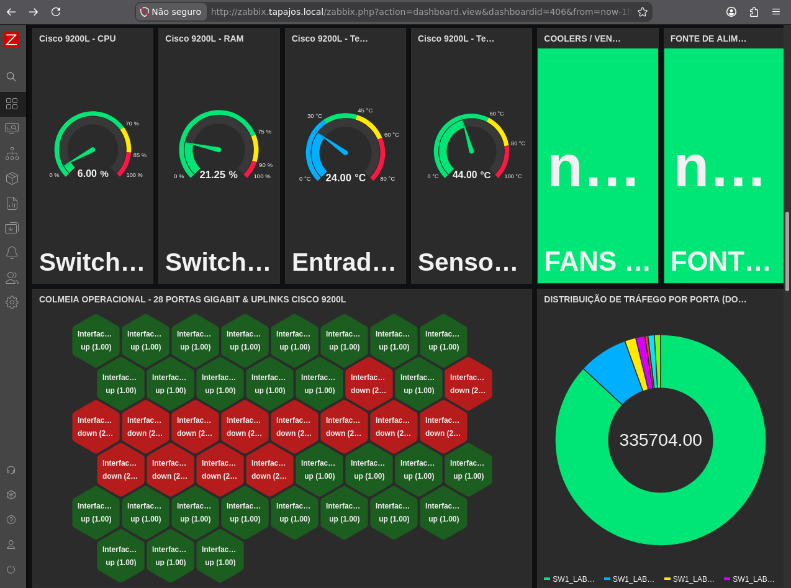
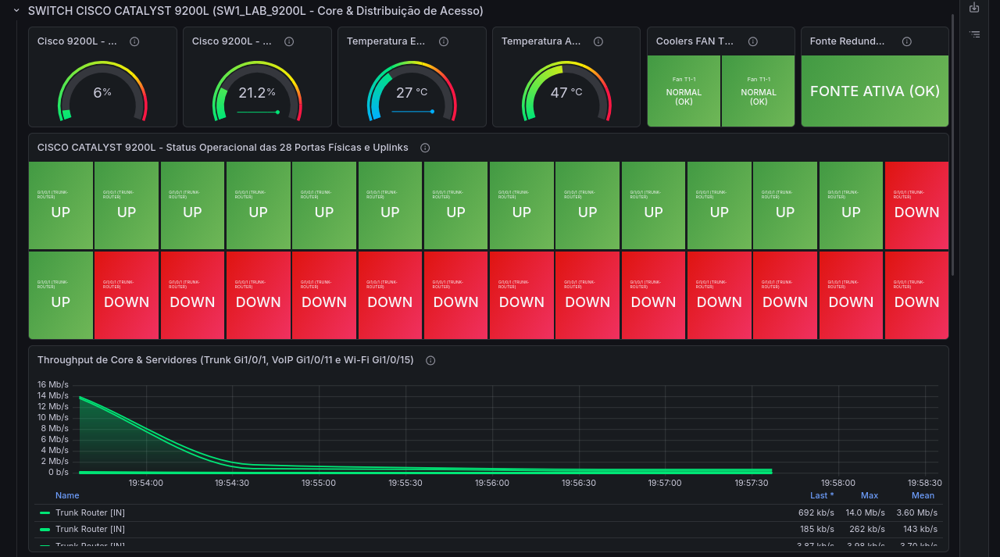

# Cisco Catalyst 9200L — Configuração de VLANs e Portas

[English](../../networking/switch-vlan-snapshot-2026-11-04.md) | [Português (Brasil)](registro-switch-vlans-2026-11-04.md)

## 1. Visão Geral

O laboratório Enterprise NOC — From Scratch utiliza um switch Cisco Catalyst C9200L para conectar estações departamentais, servidores Linux, telefones IP e equipamentos de rede sem fio.

Este documento descreve as VLANs e configurações das interfaces identificadas em uma captura do comando `show running-config` do Cisco IOS XE, realizada em **4 de novembro de 2026**.

A configuração foi coletada por meio de uma conexão serial a partir do computador Linux destinado aos serviços Asterisk e FreeRADIUS.

**Limitação da evidência:** A captura foi realizada antes da ativação do monitoramento SNMP do switch. Portanto, não deve ser interpretada como a configuração completa ou atual do equipamento.

## 2. Equipamentos de Rede

A infraestrutura documentada inclui:

| Equipamento | Modelo | Função |
|---|---|---|
| Roteador | Cisco Catalyst C8200L | Roteamento entre segmentos de rede |
| Switch | Cisco Catalyst C9200L-24T-4G | Comutação Ethernet e segmentação por VLANs |
| Cabeamento estruturado | Patch panel Categoria 6 | Terminação física do cabeamento |
| Roteador Wi-Fi | TP-Link Archer AX53 | Rede Wi-Fi corporativa |
| Equipamento sem fio adicional | Modelo não confirmado | Rede IoT |

A configuração coletada identifica o Cisco IOS XE versão `17.15` e a plataforma `c9200l-24t-4g`.

### Evidência Física


A fotografia comprova a presença física do roteador Cisco, do switch Catalyst e dos componentes de cabeamento estruturado.

Entretanto, a imagem não comprova isoladamente o estado operacional de todas as interfaces conectadas.

## 3. Segmentação por VLANs

A configuração do switch apresenta as seguintes atribuições:

| VLAN | Setor ou finalidade | Interfaces do switch |
|---|---|---|
| 10 | TI e infraestrutura NOC | Gi1/0/2–3 |
| 20 | Contabilidade | Gi1/0/4–6 |
| 30 | Financeiro | Gi1/0/7–8 |
| 40 | Vendas | Gi1/0/9–10 |
| 50 | VoIP e servidor Asterisk/FreeRADIUS | Gi1/0/11–13 |
| 60 | Wi-Fi corporativo | Gi1/0/15 |
| 70 | Rede IoT | Gi1/0/14 |

As atribuições foram obtidas diretamente da configuração coletada do switch.

A existência e a operação de todas as VLANs na infraestrutura completa exigem verificações adicionais de estado das VLANs e roteamento.

### 3.1 Organização Lógica

```text
                     Cisco C8200L
                        Roteador
                           |
                         802.1Q
                           |
                    Gi1/0/1 — Trunk
                           |
                     Cisco C9200L
                         Switch
                           |
         +-----------------+-----------------+
         |                 |                 |
      VLAN 10           VLAN 20           VLAN 30
      TI / NOC        Contabilidade       Financeiro
         |
      VLAN 40           VLAN 50           VLAN 60
       Vendas         VoIP / RADIUS     Wi-Fi Corporativo

                        VLAN 70
                          IoT
```

O diagrama representa a segmentação lógica documentada.

Ele não constitui um mapa completo de conexões físicas nem comprova todas as rotas de comunicação.

## 4. Mapeamento das Portas do Switch

A tabela apresenta as interfaces identificadas na configuração de 4 de novembro.

| Interface | Configuração | Descrição / Conexão prevista |
|---|---|---|
| Gi1/0/1 | Trunk | Conexão com o roteador Cisco |
| Gi1/0/2 | Access VLAN 10 | Computadores TI / NOC |
| Gi1/0/3 | Access VLAN 10 | Computadores TI / NOC |
| Gi1/0/4 | Access VLAN 20 | Computadores Contabilidade |
| Gi1/0/5 | Access VLAN 20 | Computadores Contabilidade |
| Gi1/0/6 | Access VLAN 20 | Computadores Contabilidade |
| Gi1/0/7 | Access VLAN 30 | Computadores Financeiro |
| Gi1/0/8 | Access VLAN 30 | Computadores Financeiro |
| Gi1/0/9 | Access VLAN 40 | Computadores Vendas |
| Gi1/0/10 | Access VLAN 40 | Computadores Vendas |
| Gi1/0/11 | VLAN 50 atribuída; modo operacional não confirmado | Servidor Debian Asterisk/FreeRADIUS |
| Gi1/0/12 | Access VLAN 50 | VoIP / Grandstream |
| Gi1/0/13 | Access VLAN 50 | VoIP / Grandstream |
| Gi1/0/14 | Access VLAN 70 | Equipamento Wi-Fi IoT |
| Gi1/0/15 | Access VLAN 60 | Wi-Fi corporativo |

As interfaces Gi1/0/16 até Gi1/0/24 e Gi1/1/1 até Gi1/1/4 aparecem sem configurações específicas no registro coletado.

Isso não comprova que essas portas estivessem desconectadas, desabilitadas ou operacionalmente inativas.

### 4.1 Trunk para o Roteador

A configuração contém:

```cisco
interface GigabitEthernet1/0/1
 description TRUNK-PARA-ROTEADOR
 switchport mode trunk
```

Esse trecho comprova que a interface Gi1/0/1 estava configurada no modo trunk.

O registro não apresenta uma lista explícita de VLANs permitidas nem uma VLAN nativa personalizada nessa interface.

A configuração correspondente do roteador, incluindo suas subinterfaces, não estava presente no material coletado.

### 4.2 Portas de Acesso dos Setores

O exemplo abaixo reproduz a configuração registrada para uma porta da Contabilidade:

```cisco
interface GigabitEthernet1/0/4
 description PCS-CONTABILIDADE
 switchport access vlan 20
 switchport mode access
 spanning-tree portfast
```

Configurações equivalentes de portas de acesso aparecem nos segmentos de TI, Financeiro, Vendas, VoIP, Wi-Fi corporativo e IoT.

### 4.3 Particularidade da Gi1/0/11

A interface associada ao servidor Asterisk/FreeRADIUS apresenta:

```cisco
interface GigabitEthernet1/0/11
 description SERVIDOR-DEBIAN-VOIP-E-RADIUS
 switchport access vlan 50
 spanning-tree portfast trunk
```

Diferentemente das demais interfaces departamentais, não aparece explicitamente o comando:

```cisco
switchport mode access
```

Além disso, o comando `spanning-tree portfast trunk` difere daquele utilizado nas outras portas de computadores.

**O modo operacional de comutação da interface Gi1/0/11 precisa ser confirmado.**

A configuração original foi preservada nesta documentação, sem modificações ou suposições sobre seu comportamento operacional.

## 5. Endereçamento IP Observado

As fotografias dos computadores e os inventários Linux de 6 de novembro apresentam as seguintes informações.

| VLAN | Rede observada ou derivada dos endereços /24 | Exemplos documentados |
|---|---|---|
| 10 | 192.168.10.0/24 | NOC principal: 192.168.10.12; TI 2: 192.168.10.13 |
| 20 | 192.168.20.0/24 | Contabilidade: 192.168.20.11–13 |
| 30 | 192.168.30.0/24 | Financeiro: 192.168.30.10–11 |
| 40 | 192.168.40.0/24 | Vendas: 192.168.40.10–11 |
| 50 | 192.168.50.0/24 | Asterisk: 192.168.50.2; VoIP: 192.168.50.10–11 |
| 60 | Não confirmado | Wi-Fi corporativo |
| 70 | Não confirmado | Rede IoT |

As redes `/24` foram derivadas dos endereços e das máscaras registrados nos computadores.

As capturas das estações também identificam `.1` como gateway padrão nas redes departamentais documentadas.

O material disponível não inclui a configuração atual do roteador necessária para verificar as interfaces de gateway, DHCP, ACLs e políticas de roteamento entre VLANs.

### Consistência do Endereçamento

A auditoria de 6 de novembro identificou seis diferenças entre os endereços IPv4 fotografados nas estações Windows e aqueles cadastrados no Zabbix.

Os endereços fotografados foram preservados como registros históricos.

As divergências estão documentadas em:

- [Inventário de Computadores e Servidores](../estacoes/inventario-de-computadores.md)
- [Monitoramento com Zabbix](../monitoramento/zabbix.md)

## 6. Spanning Tree

A configuração coletada contém:

```cisco
spanning-tree mode rapid-pvst
spanning-tree extend system-id
```

Portanto, o Rapid PVST+ estava configurado no switch.

A maioria das portas de acesso documentadas também apresenta o comando `spanning-tree portfast`.

O arquivo coletado não contém um relatório completo do estado operacional do Spanning Tree.

A identificação do root bridge, de interfaces bloqueadas e da topologia completa não foi verificada independentemente.

## 7. Monitoramento do Switch

A configuração original do switch foi coletada antes da habilitação do monitoramento SNMP.

As evidências posteriores do Zabbix e Grafana apresentam dashboards com:

- Utilização de CPU.
- Utilização de memória.
- Sensores do hardware.
- Estado das interfaces.
- Medições de tráfego.
- Erros das interfaces.

### Evidência no Zabbix



### Evidência no Grafana



Essas capturas demonstram a existência de dados de monitoramento no momento da coleta.

Entretanto, não apresentam a configuração final completa do SNMP.

Alguns painéis do Grafana também possuem identificações repetidas de interfaces, que precisam ser verificadas nos respectivos itens de monitoramento.

## 8. Limitações Conhecidas

| Componente | Limitação |
|---|---|
| Configuração do roteador | Running-config atual completo não disponível |
| Roteamento entre VLANs | Configuração detalhada não verificada independentemente |
| ACLs | Políticas efetivas de controle de acesso não confirmadas |
| DHCP | Configuração completa não disponível |
| Gerenciamento do switch | Endereço de gerenciamento exige confirmação na configuração atual |
| VLAN 60 | Endereçamento e autenticação Wi-Fi não totalmente verificados |
| VLAN 70 | Modelo e endereçamento do equipamento IoT não confirmados |
| Gi1/0/11 | Modo operacional da interface exige confirmação |
| SNMP | Configuração de 4 de novembro anterior à ativação do monitoramento |
| Cabeamento físico | Mapeamento completo entre cabos, patch panel e equipamentos não verificado |

As limitações foram mantidas para distinguir configurações documentadas de suposições.

## 9. Documentação Relacionada

- [Infraestrutura Física](../evidencias/infraestrutura-fisica.md)
- [Inventário de Computadores e Servidores](../estacoes/inventario-de-computadores.md)
- [Asterisk e FreeRADIUS](../servicos/asterisk-freeradius.md)
- [Monitoramento com Zabbix](../monitoramento/zabbix.md)
- [Monitoramento com Grafana](../monitoramento/grafana.md)

**Data da configuração do switch:** 4 de novembro de 2026.

**Evidências complementares da infraestrutura:** 6 de novembro de 2026.

**Estado da documentação:** Registro histórico de configuração, não uma verificação da configuração final em execução.
