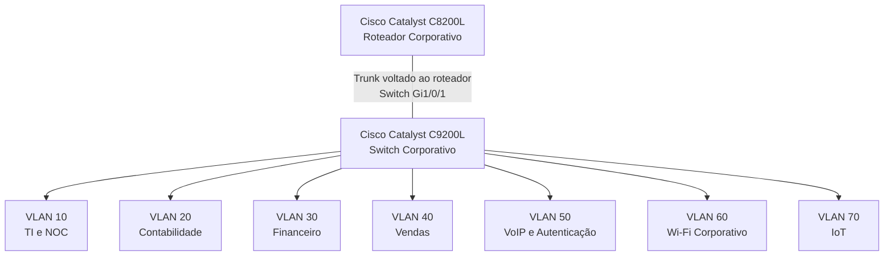
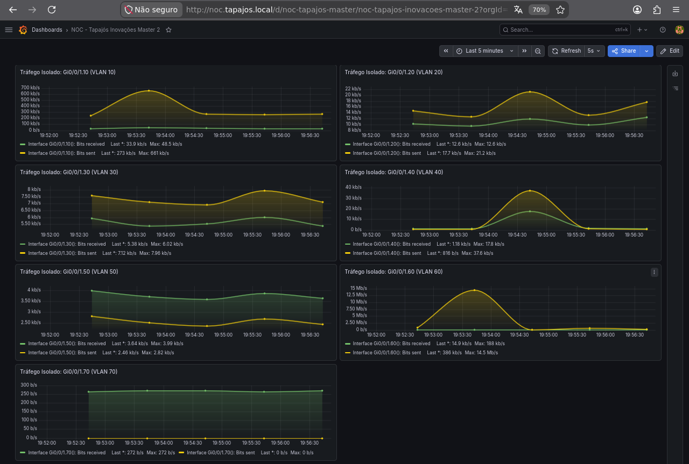

# Cisco Catalyst C8200L — Arquitetura e Evidências Técnicas do Roteador

**Enterprise NOC — From Scratch**

[English](../../networking/router-c8200l.md) | **Português (Brasil)**

---

## 1. Visão Geral

O **Cisco Catalyst C8200L-1N-4T** é o componente central de roteamento da arquitetura de rede do Enterprise NOC.

O laboratório integra equipamentos físicos Cisco, VLANs departamentais, servidores Linux, estações Windows, telefonia IP, infraestrutura wireless e monitoramento centralizado.

Este documento reúne a função do roteador na arquitetura, as evidências físicas do equipamento, os registros de endereçamento, os requisitos de segmentação e as observações do monitoramento.

As informações técnicas utilizam registros coletados entre **4 e 6 de novembro de 2026**.

| Característica | Informação Documentada |
|---|---|
| Fabricante | Cisco |
| Modelo | Catalyst C8200L-1N-4T |
| Função na Rede | Infraestrutura de roteamento corporativo |
| Switch Associado | Cisco Catalyst C9200L-24T-4G |
| Segmentos de Rede | VLANs 10, 20, 30, 40, 50, 60 e 70 |
| Interface do Switch Voltada ao Roteador | `Gi1/0/1` |
| Plataformas de Monitoramento | Zabbix e Grafana |
| Período das Evidências | 04 a 06/11/2026 |

Os registros coletados identificam o equipamento físico, sua função na arquitetura e a conexão trunk configurada no lado do switch.

Uma exportação completa da configuração em execução do C8200L não integra as evidências técnicas disponíveis.

## 2. Infraestrutura Física

O Cisco Catalyst C8200L está instalado no rack de rede do laboratório, juntamente com o switch Catalyst C9200L e a infraestrutura de cabeamento estruturado.

As fotografias disponíveis identificam o roteador como um **C8200L-1N-4T**.

### 2.1 Evidência Física


A fotografia documenta a presença física do roteador, do switch e dos componentes de cabeamento associados.

A imagem não comprova isoladamente a configuração das interfaces do roteador, sua tabela de roteamento ou seu estado operacional.

### 2.2 Conexão com o Catalyst C9200L

A configuração do switch Cisco coletada em 4 de novembro de 2026 contém os seguintes comandos:

```cisco
interface GigabitEthernet1/0/1
 description TRUNK-PARA-ROTEADOR
 switchport mode trunk
```

Esses comandos identificam a `Gi1/0/1` do **switch Catalyst C9200L** como a interface configurada para o trunk voltado ao roteador.

A configuração não apresenta uma lista explícita de VLANs permitidas nem uma atribuição personalizada de VLAN nativa nesse trunk.

A interface física correspondente no C8200L não foi identificada no registro coletado do switch.

Portanto, `Gi1/0/1` não deve ser interpretada como o identificador da interface do roteador.

A configuração completa do trunk e das subinterfaces VLAN no lado do roteador não integra os registros disponíveis.

## 3. Arquitetura Lógica da Rede

O roteador está associado a uma rede corporativa organizada em sete VLANs.

O diagrama apresenta a relação lógica documentada entre a infraestrutura de roteamento e os segmentos de rede.



O diagrama representa o projeto lógico da rede e a segmentação documentada no lado do switch.

Ele não estabelece a configuração exata das interfaces do C8200L nem comprova de forma independente a comunicação entre todas as VLANs.

### 3.1 Inventário de VLANs

| VLAN | Segmento de Rede | Função Documentada |
|---|---|---|
| **10** | TI e NOC | Administração da infraestrutura, serviços Linux e monitoramento |
| **20** | Contabilidade | Estações de trabalho departamentais |
| **30** | Financeiro | Estações de trabalho departamentais |
| **40** | Vendas | Estações de trabalho departamentais |
| **50** | VoIP e Autenticação | Asterisk, FreeRADIUS e telefonia IP |
| **60** | Wi-Fi Corporativo | Conectividade wireless corporativa |
| **70** | IoT | Conectividade wireless dedicada a dispositivos inteligentes |

As atribuições das VLANs estão documentadas na captura de configuração do Catalyst C9200L, coletada em 4 de novembro.

A segmentação por VLANs estabelece domínios de broadcast separados na camada 2.

A comunicação entre diferentes VLANs depende de encaminhamento em camada 3. Os registros disponíveis não estabelecem a implementação completa nem o funcionamento de todas as rotas entre VLANs.

### 3.2 Responsabilidades do Roteador e do Switch

A arquitetura documentada diferencia as responsabilidades dos dois principais equipamentos Cisco.

| Componente | Responsabilidade na Arquitetura | Evidência |
|---|---|---|
| Catalyst C8200L | Infraestrutura central de roteamento | Equipamento físico, registros técnicos e observações de monitoramento |
| Catalyst C9200L | Comutação Ethernet e segmentação por VLANs | Captura da configuração do IOS XE |
| Trunk voltado ao roteador | Conexão lógica entre os componentes de roteamento e switching | Configuração da interface `Gi1/0/1` do switch |

A presença de um trunk no switch não comprova, isoladamente, a existência ou a configuração das subinterfaces `802.1Q` correspondentes no roteador.

Nenhum identificador específico de subinterface do C8200L é apresentado como configuração implantada sem evidência correspondente.

## 4. Endereçamento IP Observado

Os registros coletados da infraestrutura incluem endereços IPv4 e gateways padrão associados a diferentes segmentos de rede.

### 4.1 Endereçamento Documentado

| VLAN | Rede Documentada | Exemplos de Endereçamento |
|---|---|---|
| 10 | `192.168.10.0/24` | NOC principal: `192.168.10.12`; TI 2: `192.168.10.13` |
| 20 | `192.168.20.0/24` | Contabilidade: `192.168.20.11–13` |
| 30 | `192.168.30.0/24` | Financeiro: `192.168.30.10–11` |
| 40 | `192.168.40.0/24` | Vendas: `192.168.40.10–11` |
| 50 | `192.168.50.0/24` | Asterisk/FreeRADIUS: `192.168.50.2`; telefones IP: `192.168.50.10–11` |
| 60 | Não estabelecida pelos registros disponíveis dos clientes | Wi-Fi corporativo |
| 70 | Não estabelecida pelos registros disponíveis dos clientes | IoT |

As redes `/24` documentadas foram determinadas a partir dos endereços dos equipamentos e das máscaras de sub-rede coletadas.

Os registros disponíveis não estabelecem o endereçamento IP utilizado pelos clientes wireless das VLANs 60 e 70.

Os modos de operação e as configurações internas de rede dos equipamentos TP-Link Archer AX53 não estão incluídos na captura de configuração do switch.

### 4.2 Gateways Padrão Observados

Os registros das estações coletados em 6 de novembro identificam os seguintes gateways padrão:

| VLAN | Gateway Padrão Observado | Evidência |
|---|---|---|
| 10 | `192.168.10.1` | Configuração de estação da TI |
| 20 | `192.168.20.1` | Configuração de estação da Contabilidade |
| 30 | `192.168.30.1` | Configuração de estação do Financeiro |
| 40 | `192.168.40.1` | Configuração de estação de Vendas |

A documentação do servidor Asterisk/FreeRADIUS também registra:

| Segmento de Rede | Endereço Documentado do Servidor | Gateway Padrão Registrado |
|---|---|---|
| VLAN 50 | `192.168.50.2/24` | `192.168.50.1` |

Os registros técnicos de 4 de novembro também associam o endereço `192.168.10.1` ao roteador Cisco.

Essas observações documentam os gateways configurados nos equipamentos e as informações de endereçamento preservadas nos registros técnicos.

Elas não confirmam de forma independente a propriedade de todos os endereços de gateway nem identificam as interfaces correspondentes do roteador.

Especificamente, `192.168.50.1` está documentado como gateway padrão do servidor Asterisk/FreeRADIUS, não como endereço comprovado de uma interface do C8200L.

### 4.3 Endereçamento DHCP

O laboratório utiliza DHCP para o endereçamento das estações de trabalho.

As evidências coletadas incluem divergências entre os endereços observados durante o inventário e aqueles anteriormente cadastrados no Zabbix.

Alterações nos endereços entre diferentes períodos de coleta podem afetar o monitoramento quando os registros das interfaces dos hosts mantêm valores anteriores.

A documentação disponível não estabelece o servidor DHCP, a configuração de relay, os pools de endereços ou as políticas de reserva utilizadas em todos os segmentos de rede.

## 5. Modelo de Segmentação e Controle de Acesso

A arquitetura corporativa diferencia a infraestrutura administrativa, os departamentos, os serviços de voz, a conectividade wireless corporativa e os dispositivos IoT.

Os requisitos apresentados a seguir descrevem o projeto lógico de controle de acesso documentado.

Eles não devem ser interpretados como configurações comprovadas de ACLs do roteador.

### 5.1 Rede Administrativa — VLAN 10

A VLAN 10 é destinada à administração de TI e ao monitoramento da infraestrutura.

O modelo de controle de acesso prevê que sistemas de gerenciamento autorizados alcancem serviços de infraestrutura e equipamentos de rede quando necessário.

O acesso administrativo deve permanecer restrito aos sistemas e serviços autorizados.

### 5.2 Redes Departamentais — VLANs 20, 30 e 40

Os setores de Contabilidade, Financeiro e Vendas utilizam VLANs distintas.

O projeto de controle de acesso prevê a separação entre as redes departamentais, com exceções para serviços explicitamente autorizados.

A existência de VLANs separadas demonstra segmentação em camada 2, mas não comprova isoladamente as restrições de tráfego em camada 3.

### 5.3 Telefonia e Autenticação — VLAN 50

A VLAN 50 está associada ao servidor Asterisk/FreeRADIUS e a dois telefones IP Grandstream.

Os equipamentos documentados incluem:

| Componente | Endereço |
|---|---|
| Servidor Asterisk / FreeRADIUS | `192.168.50.2` |
| Grandstream — Vendas | `192.168.50.10` |
| Grandstream — TI | `192.168.50.11` |

O projeto de controle de acesso considera a conectividade necessária aos serviços de telefonia e autenticação.

A presença do FreeRADIUS não comprova isoladamente a realização de autenticações wireless bem-sucedidas pelos equipamentos TP-Link.

### 5.4 Wi-Fi Corporativo — VLAN 60

A VLAN 60 é destinada à conectividade wireless corporativa.

O TP-Link Archer AX53 associado está documentado na interface `Gi1/0/15` do switch.

O projeto lógico de segurança prevê restrições de acesso não autorizado aos recursos internos da infraestrutura corporativa.

Os registros disponíveis não incluem a configuração do roteador wireless, o endereçamento de seus clientes ou a comprovação da aplicação das ACLs.

### 5.5 Rede IoT — VLAN 70

A VLAN 70 é dedicada à conectividade de dispositivos IoT.

Um segundo TP-Link Archer AX53 está associado à interface `Gi1/0/14` do switch e ao ambiente documentado com Amazon Alexa.

O projeto de controle de acesso separa a conectividade IoT dos recursos corporativos sensíveis.

Os registros coletados não estabelecem o modo interno de operação do equipamento wireless nem o endereço IP da Alexa.

### 5.6 Evidências de Controle de Acesso

Os registros técnicos incluem a configuração das VLANs no switch e o modelo lógico das políticas de acesso.

Não incluem uma exportação completa das ACLs do C8200L nem testes registrados que demonstrem a aplicação efetiva dessas políticas.

Consequentemente, as restrições documentadas representam requisitos arquiteturais, não comportamentos do roteador verificados de forma independente.

## 6. Monitoramento do Roteador

O Cisco Catalyst C8200L está representado no ambiente de monitoramento do laboratório, utilizando Zabbix e Grafana.

As evidências coletadas incluem informações de monitoramento relacionadas ao roteador e métricas de suas interfaces.

### 6.1 Grafana — Monitoramento do Roteador

**Dashboard — Parte 1**


**Dashboard — Parte 2**



As capturas preservam observações de monitoramento do roteador durante o período de coleta das evidências.

Elas não comprovam isoladamente:

- Disponibilidade contínua do equipamento.
- Cobertura completa de monitoramento de todas as interfaces.
- Encaminhamento bem-sucedido entre todas as VLANs.
- Aplicação correta das políticas de segurança.
- Configuração operacional completa do roteador.

### 6.2 Zabbix e SNMP

O inventário de hosts do Zabbix contém uma interface de monitoramento associada ao roteador Cisco utilizando SNMP.

Esse registro constitui evidência da integração do roteador ao ambiente de monitoramento.

Os registros disponíveis não incluem uma exportação completa da configuração SNMP aplicada diretamente ao C8200L.

As capturas do monitoramento documentam as observações coletadas, não uma auditoria completa da configuração do roteador.

Informações adicionais estão disponíveis em:

- [Monitoramento com Zabbix](../monitoramento/zabbix.md)
- [Monitoramento com Grafana](../monitoramento/grafana.md)
- [Diagnóstico SNMP](../monitoramento/diagnostico-snmp.md)

## 7. DHCP, NAT e Conectividade Externa

O roteador desempenha uma função arquitetural de integração com a rede corporativa segmentada.

Entretanto, as evidências técnicas coletadas não estabelecem todas as configurações de roteamento e conectividade externa associadas ao C8200L.

| Componente | Evidência Disponível | Escopo Documentado |
|---|---|---|
| DHCP | Endereços das estações e configurações de gateway | Servidor, relay e pools não estabelecidos |
| Roteamento entre VLANs | Projeto de VLANs, trunk no switch e gateways observados | Configuração do roteador e encaminhamento ponta a ponta não verificados de forma independente |
| NAT | Sem exportação correspondente da configuração do roteador | Regras e traduções NAT não estabelecidas |
| Conectividade WAN | Equipamento físico e registros da arquitetura | Interface externa e rota padrão não estabelecidas |
| Controle de Acesso | Requisitos lógicos de segmentação | Entradas ACL e aplicação efetiva não estabelecidas |
| SNMP | Observações de monitoramento no Zabbix/Grafana | Configuração SNMP completa do roteador não disponível |

Nenhum comando não coletado, identificador de interface, configuração de roteamento ou política NAT é apresentado como implantado.

## 8. Evidências Técnicas e Escopo do Registro

A documentação do C8200L reúne informações de diferentes registros do laboratório.

| Fonte da Evidência | Período de Coleta | Informação Documentada |
|---|---|---|
| Fotografias dos equipamentos físicos | Novembro de 2026 | Identificação do roteador e instalação no rack |
| Configuração do Cisco Catalyst C9200L | 04/11/2026 | Trunk voltado ao roteador na interface `Gi1/0/1` do switch |
| Registros técnicos de rede | 04/11/2026 | Informações de endereçamento associadas ao roteador |
| Inventário de estações e servidores | 06/11/2026 | Endereços IPv4 e gateways padrão observados |
| Inventário de hosts do Zabbix | Novembro de 2026 | Associação do roteador ao monitoramento |
| Dashboards do Grafana | Novembro de 2026 | Métricas históricas do roteador e das interfaces |

Os registros sustentam a função documentada do roteador na infraestrutura corporativa.

Eles não constituem uma exportação completa da configuração em execução do C8200L.

As evidências disponíveis não estabelecem:

- A interface física do roteador conectada ao C9200L.
- Os identificadores e as configurações específicas das subinterfaces `802.1Q`.
- O funcionamento completo do roteamento entre VLANs.
- Comunicação bem-sucedida entre todos os segmentos de rede.
- As entradas ACL do roteador e sua aplicação efetiva.
- As configurações completas de DHCP e NAT.
- A interface de roteamento externo e a rota padrão.
- Disponibilidade contínua de todas as métricas de monitoramento do roteador.

Esses limites diferenciam a infraestrutura documentada dos detalhes técnicos que não integram os registros de configuração coletados.

## 9. Documentação Relacionada

### Redes e Arquitetura

- [Redes e Arquitetura — Visão Geral](README.md)
- [Topologia Lógica Consolidada](topologia-logica-consolidada.md)
- [Segmentação por VLANs](vlans.md)
- [Cisco Catalyst C9200L — Mapeamento de Portas](mapa-de-portas-switch.md)
- [Cisco Catalyst C9200L — Registro de Configuração](registro-switch-vlans-2026-11-04.md)
- [Wi-Fi Corporativo — VLAN 60](wifi-corporativo-vlan60.md)
- [Rede IoT — VLAN 70](iot-vlan70.md)

### Infraestrutura e Monitoramento

- [Arquitetura da Infraestrutura](../arquitetura/visao-geral-da-infraestrutura.md)
- [Infraestrutura Física](../evidencias/infraestrutura-fisica.md)
- [Inventário de Computadores e Servidores](../estacoes/inventario-de-computadores.md)
- [Asterisk e FreeRADIUS](../servicos/asterisk-freeradius.md)
- [Monitoramento com Zabbix](../monitoramento/zabbix.md)
- [Monitoramento com Grafana](../monitoramento/grafana.md)

---

**Referência das evidências:** 04 a 06/11/2026  
**Tipo de documento:** Arquitetura e evidências técnicas do Cisco Catalyst C8200L.
