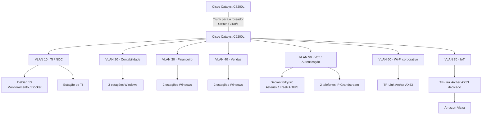

# Topologia Lógica Consolidada

**Enterprise NOC — From Scratch**

[English](../../networking/consolidated-logical-topology.md) | **Português (Brasil)**

## Topologia

O diagrama apresenta as relações de rede registradas no laboratório entre **4 e 6 de novembro de 2026**. As conexões representam associações entre equipamentos, não testes de tráfego ponta a ponta nem o mapeamento individual dos cabos.

O trunk `Gi1/0/1` está registrado no lado do switch C9200L. Não foram coletados o identificador da porta correspondente no C8200L nem a configuração completa das subinterfaces do roteador.

## Equipamentos e endereçamento

| Segmento | Equipamentos / exemplos | Rede ou endereço |
|---|---|---|
| VLAN 10 · TI / NOC | Servidor Debian 13; estação de TI | `192.168.10.12`; `192.168.10.13` |
| VLAN 20 · Contabilidade | Três estações Windows | `192.168.20.11–13` |
| VLAN 30 · Financeiro | Duas estações Windows | `192.168.30.10–11` |
| VLAN 40 · Vendas | Duas estações Windows | `192.168.40.10–11` |
| VLAN 50 · Voz | Debian Asterisk / FreeRADIUS | `192.168.50.2/24` |
| VLAN 50 · Telefones | Grandstream, ramais 1001 (Vendas) e 1002 (TI) | `192.168.50.10`; `192.168.50.11` |
| VLAN 60 · Wi-Fi corporativo | TP-Link Archer AX53, switch `Gi1/0/15` | Sub-rede dos clientes não estabelecida |
| VLAN 70 · IoT | Outro Archer AX53, Alexa, switch `Gi1/0/14` | Sub-rede dos clientes não estabelecida |

As redes departamentais documentadas (VLANs 10–50) utilizam máscaras `/24`. O servidor principal do NOC é um Dell OptiPlex 3020 com Debian 13; o servidor de voz foi registrado com Debian forky/sid.

| VLAN | Gateway registrado nos equipamentos |
|---|---|
| 10 | `192.168.10.1` — estação de TI |
| 20 | `192.168.20.1` — estação de Contabilidade |
| 30 | `192.168.30.1` — estação do Financeiro |
| 40 | `192.168.40.1` — estação de Vendas |
| 50 | `192.168.50.1` — servidor Asterisk/FreeRADIUS |

Os gateways observados não identificam todas as interfaces do roteador. As estações utilizam DHCP; foram documentadas seis divergências entre endereços observados e registros de hosts no Zabbix.

## Serviços e monitoramento

O servidor Debian principal hospeda serviços em Docker. O inventário de 6 de novembro registrou **10 containers em execução**, incluindo Zabbix, Grafana, Portainer, Pi-hole e Uptime Kuma; a infraestrutura relacionada inclui MariaDB e serviços web.

Zabbix e Grafana apresentam observações históricas de equipamentos Cisco, hosts e serviços. As capturas também registram hosts indisponíveis e itens não suportados, sem comprovar disponibilidade contínua.

## Limites das evidências

- O registro do C9200L documenta VLANs, portas e trunk, mas não comprova aplicação de ACLs no roteador nem todas as rotas entre VLANs.
- A Gi1/0/11 contém `switchport access vlan 50` e `spanning-tree portfast trunk`, sem comando explícito de modo access. O modo efetivo não foi estabelecido.
- Os dois AX53 têm funções diferentes. Seus modos de operação, sub-redes dos clientes, DHCP e NAT não foram coletados; a autenticação entre FreeRADIUS e Wi-Fi não foi verificada.
- Endereços dos equipamentos, estado do Docker e dashboards são registros datados, não garantias de disponibilidade contínua.

## Referências

[Visão geral de Redes](README.md) · [VLANs](vlans.md) · [Roteador](roteador-c8200l.md) · [Mapa de portas](mapa-de-portas-switch.md) · [Registro do switch](registro-switch-vlans-2026-11-04.md) · [Wi-Fi corporativo](wifi-corporativo-vlan60.md) · [IoT](iot-vlan70.md) · [Inventário de computadores](../estacoes/inventario-de-computadores.md) · [Serviços Docker](../containers/servicos-docker.md) · [Asterisk / FreeRADIUS](../servicos/asterisk-freeradius.md) · [Infraestrutura física](../evidencias/infraestrutura-fisica.md)
