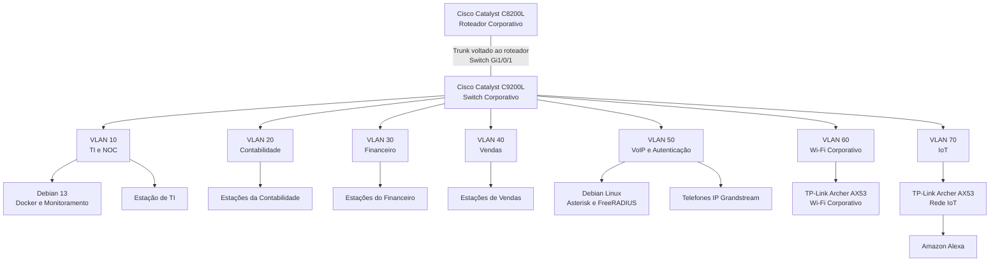
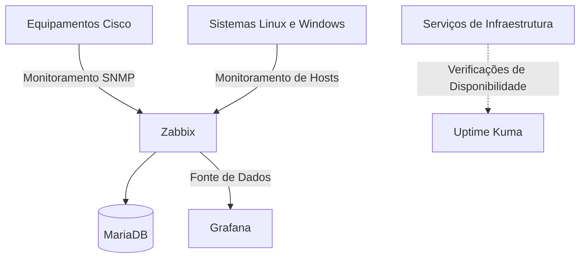

# Topologia Lógica Consolidada da Infraestrutura

**Enterprise NOC — From Scratch**

[English](../../networking/consolidated-logical-topology.md) | **Português (Brasil)**

---

## 1. Visão Geral

O projeto **Enterprise NOC — From Scratch** documenta um laboratório físico de redes corporativas desenvolvido a partir das necessidades de infraestrutura da empresa simulada Tapajós Inovações.

A rede integra equipamentos Cisco de roteamento e comutação, estações de trabalho departamentais, servidores Linux, aplicações conteinerizadas, telefonia IP, redes wireless, dispositivos IoT e monitoramento centralizado da infraestrutura.

Este documento reúne as relações lógicas entre esses componentes, estabelecendo uma referência consolidada para a arquitetura da rede e os serviços associados.

| Característica | Informação Documentada |
|---|---|
| Projeto | Enterprise NOC — From Scratch |
| Ambiente | Laboratório físico de redes corporativas |
| Roteador Corporativo | Cisco Catalyst C8200L-1N-4T |
| Switch Corporativo | Cisco Catalyst C9200L-24T-4G |
| Segmentação da Rede | Sete VLANs |
| Plataforma Principal de Infraestrutura | Debian GNU/Linux 13 |
| Plataforma de Voz e Autenticação | Debian Linux |
| Monitoramento | Zabbix, Grafana e SNMP |
| Período das Evidências | 04 a 06/11/2026 |

A topologia reúne a configuração de rede registrada em 4 de novembro com os inventários de equipamentos, registros dos serviços e evidências de monitoramento coletados nos dias seguintes.

Ela representa a arquitetura lógica documentada, não um mapa completo do cabeamento físico ou um registro de todos os caminhos de comunicação operacional.

## 2. Topologia Consolidada da Rede

O diagrama apresenta os principais componentes e segmentos da infraestrutura corporativa.



O diagrama apresenta a organização lógica da infraestrutura do laboratório.

O Cisco Catalyst C9200L possui as atribuições de VLANs documentadas e o trunk voltado ao roteador. O Cisco Catalyst C8200L desempenha o papel de roteador central na arquitetura.

**O trunk está identificado na interface `Gi1/0/1` do switch.** A interface correspondente do roteador e sua configuração completa não integram os registros coletados.

As conexões representadas correspondem às associações documentadas dos equipamentos e às relações lógicas da rede. Elas não comprovam isoladamente o estado operacional de todos os enlaces físicos.

### 2.1 Camadas da Arquitetura

A infraestrutura está organizada em quatro áreas funcionais.

| Área | Componentes | Responsabilidade |
|---|---|---|
| Roteamento | Cisco Catalyst C8200L | Infraestrutura central de roteamento |
| Comutação e Segmentação | Cisco Catalyst C9200L | Conectividade Ethernet e atribuições de VLANs |
| Equipamentos e Serviços | Servidores Linux, estações Windows, telefones IP e equipamentos wireless | Sistemas corporativos e serviços de rede |
| Monitoramento | Zabbix, Grafana, SNMP e Uptime Kuma | Observações de monitoramento e disponibilidade |

Essas áreas oferecem uma visão consolidada do laboratório, sem pressupor que todos os componentes estejam implantados em equipamentos físicos separados.

## 3. Infraestrutura de Rede Cisco

### 3.1 Cisco Catalyst C8200L

O Cisco Catalyst C8200L-1N-4T é o roteador corporativo associado à rede segmentada.

Suas responsabilidades arquiteturais documentadas incluem integração do roteamento, endereçamento de rede e projeto das políticas de acesso.

Os registros coletados identificam o equipamento físico e sua relação com o Catalyst C9200L.

Entretanto, o material disponível não contém uma exportação completa da configuração em execução do C8200L.

Consequentemente, interfaces específicas do roteador, subinterfaces `802.1Q`, comandos de roteamento, pools DHCP, regras NAT e entradas ACL não são apresentados como configurações implantadas e verificadas.

Informações adicionais estão disponíveis na [documentação do Cisco Catalyst C8200L](roteador-c8200l.md).

### 3.2 Cisco Catalyst C9200L

O Cisco Catalyst C9200L-24T-4G disponibiliza a comutação Ethernet e a segmentação por VLANs documentadas.

A captura de configuração de 4 de novembro de 2026 identifica o Cisco IOS XE versão `17.15` e a plataforma provisionada `c9200l-24t-4g`.

A configuração do switch inclui:

- Sete atribuições de VLANs.
- Trunk voltado ao roteador na interface `Gi1/0/1`.
- Interfaces de acesso departamentais.
- Interfaces associadas à telefonia IP e aos serviços de autenticação.
- Portas dedicadas ao Wi-Fi corporativo e à rede IoT.
- Configuração do Rapid PVST+.

A configuração coletada do trunk contém:

```cisco
interface GigabitEthernet1/0/1
 description TRUNK-PARA-ROTEADOR
 switchport mode trunk
```

A captura não apresenta uma lista explícita de VLANs permitidas nem uma atribuição personalizada de VLAN nativa para esse trunk.

A configuração no lado do switch não identifica a interface correspondente do roteador nem comprova o funcionamento do roteamento entre VLANs.

Os registros detalhados estão disponíveis em:

- [Registro de Configuração do Switch](registro-switch-vlans-2026-11-04.md)
- [Mapa de Portas do Switch](mapa-de-portas-switch.md)

## 4. Segmentação por VLANs e Mapeamento de Interfaces

A rede corporativa utiliza sete VLANs para separar a administração da infraestrutura, os departamentos, os serviços de voz, a conectividade wireless corporativa e os dispositivos IoT.

### 4.1 Inventário de VLANs

| VLAN | Segmento de Rede | Função | Interfaces do Switch |
|---|---|---|---|
| **10** | TI e NOC | Administração da infraestrutura e monitoramento | Gi1/0/2–3 |
| **20** | Contabilidade | Estações de trabalho departamentais | Gi1/0/4–6 |
| **30** | Financeiro | Estações de trabalho departamentais | Gi1/0/7–8 |
| **40** | Vendas | Estações de trabalho departamentais | Gi1/0/9–10 |
| **50** | VoIP e Autenticação | Asterisk, FreeRADIUS e telefonia IP | Gi1/0/11–13 |
| **60** | Wi-Fi Corporativo | Conectividade wireless corporativa | Gi1/0/15 |
| **70** | IoT | Conectividade wireless dedicada aos dispositivos IoT | Gi1/0/14 |

As atribuições das interfaces são baseadas na configuração histórica do Catalyst C9200L.

O inventário de VLANs não deve ser interpretado como uma lista explicitamente configurada de VLANs permitidas no trunk voltado ao roteador.

### 4.2 Resumo das Interfaces do Switch

| Interface | Conexão Documentada | Configuração |
|---|---|---|
| Gi1/0/1 | Cisco Catalyst C8200L | Trunk |
| Gi1/0/2–3 | TI e NOC | Access VLAN 10 |
| Gi1/0/4–6 | Contabilidade | Access VLAN 20 |
| Gi1/0/7–8 | Financeiro | Access VLAN 30 |
| Gi1/0/9–10 | Vendas | Access VLAN 40 |
| Gi1/0/11 | Servidor Asterisk/FreeRADIUS | VLAN 50 atribuída; modo operacional não estabelecido |
| Gi1/0/12–13 | Telefones IP Grandstream | Access VLAN 50 |
| Gi1/0/14 | Equipamento wireless IoT | Access VLAN 70 |
| Gi1/0/15 | Equipamento Wi-Fi corporativo | Access VLAN 60 |

As interfaces `Gi1/0/16–24` e `Gi1/1/1–4` não apresentam comandos específicos de configuração na captura coletada.

A ausência desses comandos não permite determinar isoladamente seu estado operacional ou a existência de conexões físicas.

### 4.3 Interface Gi1/0/11

O servidor Asterisk/FreeRADIUS está associado à interface `Gi1/0/11`.

A configuração histórica contém:

```cisco
interface GigabitEthernet1/0/11
 description SERVIDOR-DEBIAN-VOIP-E-RADIUS
 switchport access vlan 50
 spanning-tree portfast trunk
```

A configuração não apresenta explicitamente o comando `switchport mode access`.

O comando `spanning-tree portfast trunk` configura o comportamento do Spanning Tree e não estabelece isoladamente o modo de comutação efetivo da interface.

Portanto, a topologia preserva a atribuição registrada da VLAN 50 sem classificar a `Gi1/0/11` como uma interface access ou trunk operacionalmente confirmada.

### 4.4 Segmentação em Camadas 2 e 3

As VLANs estabelecem domínios de broadcast separados na camada 2.

A comunicação entre diferentes VLANs exige encaminhamento em camada 3.

O modelo arquitetural de controle de acesso diferencia os sistemas administrativos, departamentos, infraestrutura de voz, conectividade wireless e dispositivos IoT.

Os registros disponíveis estabelecem a segmentação no lado do switch, mas não incluem a configuração completa das ACLs do roteador nem testes independentes de todos os caminhos de comunicação entre VLANs.

Consequentemente, a separação prevista no projeto deve ser diferenciada da aplicação efetiva das políticas de acesso no roteador.

## 5. Infraestrutura Linux e Serviços de Rede

O laboratório possui dois computadores Linux de infraestrutura com responsabilidades diferentes.

### 5.1 Servidor Principal do NOC — VLAN 10

O computador principal da infraestrutura está documentado como um Dell OptiPlex 3020 executando Debian GNU/Linux 13.

| Característica | Informação Documentada |
|---|---|
| Segmento de Rede | VLAN 10 |
| Endereço IPv4 | `192.168.10.12/24` |
| Sistema Operacional | Debian GNU/Linux 13 |
| Processador | Intel Core i5-4590 |
| Memória | Aproximadamente 8 GB |
| Função Principal | Serviços de infraestrutura e monitoramento |

O ambiente de serviços documentado inclui:

- Docker e Docker Compose.
- Zabbix.
- Grafana.
- MariaDB.
- Portainer.
- Pi-hole.
- Uptime Kuma.
- Nginx e serviços de infraestrutura web.

O inventário Docker de 6 de novembro registrou **dez containers em execução** no computador principal da infraestrutura.

Essa quantidade representa o ambiente coletado no momento da observação, não uma garantia de disponibilidade contínua dos containers.

### 5.2 Servidor de Voz e Autenticação — VLAN 50

Um segundo computador Linux disponibiliza os serviços documentados de Asterisk e FreeRADIUS.

| Característica | Informação Documentada |
|---|---|
| Segmento de Rede | VLAN 50 |
| Endereço IPv4 | `192.168.50.2/24` |
| Gateway Padrão | `192.168.50.1` |
| Sistema Operacional | Debian forky/sid, conforme registro |
| Processador | Intel Core i5-4590 |
| Memória | Aproximadamente 8 GB |
| Serviço de Voz | Asterisk |
| Serviço de Autenticação | FreeRADIUS |

O ambiente Linux registrado nesse servidor é diferente da instalação Debian 13 utilizada no computador principal do NOC.

O gateway padrão consta na documentação da configuração do servidor. Sua presença não identifica isoladamente a interface correspondente do roteador.

### 5.3 Telefonia IP

Dois telefones IP Grandstream estão associados à infraestrutura Asterisk.

| Ramal | Departamento | Endereço IP Documentado |
|---|---|---|
| 1001 | Vendas | `192.168.50.10` |
| 1002 | TI | `192.168.50.11` |

Os registros disponíveis documentam os equipamentos, ramais, endereçamento e ambiente do serviço Asterisk.

Eles não comprovam de forma independente a realização de chamadas telefônicas bem-sucedidas entre os equipamentos.

### 5.4 Integração com FreeRADIUS

O FreeRADIUS disponibiliza funcionalidades de autenticação centralizada na infraestrutura documentada.

A arquitetura de autenticação relaciona o servidor localizado na VLAN 50 ao ambiente Wi-Fi corporativo da VLAN 60.

Entretanto, a presença do FreeRADIUS não comprova isoladamente que o TP-Link Archer AX53 estivesse configurado para autenticar clientes Wi-Fi por meio de RADIUS.

As configurações do equipamento wireless e os registros de transações de autenticação não integram as evidências coletadas.

Informações adicionais estão disponíveis em:

- [Infraestrutura e Serviços Docker](../containers/servicos-docker.md)
- [Asterisk e FreeRADIUS](../servicos/asterisk-freeradius.md)

## 6. Wi-Fi Corporativo e Rede IoT

A infraestrutura wireless utiliza dois equipamentos TP-Link Archer AX53 separados.

Cada equipamento está associado a um segmento de rede dedicado.

### 6.1 Wi-Fi Corporativo — VLAN 60

| Característica | Informação Documentada |
|---|---|
| Equipamento | TP-Link Archer AX53 |
| Padrão Wireless | Wi-Fi 6 |
| Classe do Produto | AX3000 |
| Segmento de Rede | Wi-Fi Corporativo |
| VLAN | 60 |
| Interface do Switch | `Gi1/0/15` |

A infraestrutura wireless corporativa está atribuída à VLAN 60 na configuração do switch Catalyst C9200L.

Os registros coletados do equipamento não incluem o modo de operação do Archer AX53, configuração DHCP, endereçamento dos clientes, parâmetros NAT ou configuração de autenticação wireless.

### 6.2 IoT — VLAN 70

O segmento IoT inclui um TP-Link Archer AX53 separado, associado a um dispositivo Amazon Alexa.

| Característica | Informação Documentada |
|---|---|
| Equipamento | TP-Link Archer AX53 dedicado |
| Segmento de Rede | IoT |
| VLAN | 70 |
| Interface do Switch | `Gi1/0/14` |
| Dispositivo Wireless Documentado | Amazon Alexa |

A topologia documentada associa a Alexa à rede wireless IoT.

```text
Amazon Alexa
     |
   Wi-Fi
     |
TP-Link Archer AX53
     |
  Ethernet
     |
Cisco Catalyst C9200L
  Gi1/0/14
  Access VLAN 70
```

A configuração do switch estabelece a atribuição da VLAN, mas não identifica o modo interno de operação do roteador wireless.

Dependendo da configuração do equipamento, os clientes podem participar diretamente da sub-rede da VLAN associada ou utilizar uma sub-rede independente atrás do roteador.

As evidências disponíveis não estabelecem qual modo de operação estava implantado.

Consequentemente, o endereço IP da Alexa, a sub-rede dos clientes wireless, o serviço DHCP, o comportamento NAT e o gateway padrão da rede IoT não são apresentados como configurações registradas.

### 6.3 Segmentação Wireless

As VLANs 60 e 70 são segmentos lógicos separados no projeto corporativo.

Os requisitos documentados de controle de acesso diferenciam a conectividade Wi-Fi corporativa dos dispositivos IoT e dos recursos empresariais sensíveis.

As atribuições de VLANs no lado do switch não comprovam isoladamente a aplicação das ACLs do roteador nem o isolamento efetivo do tráfego ponta a ponta.

Consulte:

- [Wi-Fi Corporativo — VLAN 60](wifi-corporativo-vlan60.md)
- [Rede IoT — VLAN 70](iot-vlan70.md)

## 7. Endereçamento IP Documentado

O inventário da infraestrutura de 6 de novembro identifica informações de endereçamento das estações departamentais, servidores Linux e telefones IP.

### 7.1 Inventário de Endereçamento

| VLAN | Rede Documentada | Exemplos de Endereçamento |
|---|---|---|
| 10 | `192.168.10.0/24` | NOC principal: `192.168.10.12`; TI 2: `192.168.10.13` |
| 20 | `192.168.20.0/24` | Contabilidade: `192.168.20.11–13` |
| 30 | `192.168.30.0/24` | Financeiro: `192.168.30.10–11` |
| 40 | `192.168.40.0/24` | Vendas: `192.168.40.10–11` |
| 50 | `192.168.50.0/24` | Asterisk/FreeRADIUS: `192.168.50.2`; telefones IP: `192.168.50.10–11` |
| 60 | Não estabelecida pelos registros disponíveis dos clientes | Wi-Fi corporativo |
| 70 | Não estabelecida pelos registros disponíveis dos clientes | IoT |

As redes `/24` documentadas foram determinadas a partir dos endereços dos equipamentos e das máscaras de sub-rede coletadas.

### 7.2 Gateways Padrão Observados

| VLAN | Gateway Padrão Registrado | Evidência |
|---|---|---|
| 10 | `192.168.10.1` | Configuração de estação da TI |
| 20 | `192.168.20.1` | Configuração de estação da Contabilidade |
| 30 | `192.168.30.1` | Configuração de estação do Financeiro |
| 40 | `192.168.40.1` | Configuração de estação de Vendas |
| 50 | `192.168.50.1` | Registro do servidor Asterisk/FreeRADIUS |

Esses valores representam os gateways configurados nos equipamentos correspondentes.

Os registros não comprovam isoladamente a propriedade de todos os endereços de gateway nem a configuração das interfaces do roteador.

Nenhum gateway padrão é atribuído às VLANs 60 e 70 sem evidência de endereçamento correspondente.

### 7.3 DHCP e Divergências Históricas de Endereçamento

O laboratório utiliza DHCP para o endereçamento das estações de trabalho.

O inventário de 6 de novembro identificou seis divergências entre os endereços IPv4 das estações e os endereços das interfaces dos hosts anteriormente cadastrados no Zabbix.

Essas diferenças podem contribuir para problemas de monitoramento quando os registros mantêm informações de endereçamento desatualizadas.

Entretanto, alterações por DHCP não foram estabelecidas como a causa de todos os alertas de monitoramento.

Os endereços documentados representam observações históricas, não atribuições atuais garantidas ou reservas DHCP confirmadas.

## 8. Arquitetura de Monitoramento e Observabilidade

A infraestrutura de rede inclui monitoramento centralizado e observabilidade dos serviços.

### 8.1 Componentes de Monitoramento

| Componente | Função Documentada |
|---|---|
| Zabbix | Monitoramento da infraestrutura e dos serviços |
| Grafana | Visualização das métricas coletadas |
| SNMP | Informações de monitoramento dos equipamentos Cisco compatíveis |
| MariaDB | Armazenamento dos dados do Zabbix |
| Uptime Kuma | Verificação de disponibilidade de serviços selecionados |

O ambiente de monitoramento incorpora informações dos equipamentos de rede Cisco, servidores Linux, estações Windows e serviços de infraestrutura selecionados.

### 8.2 Relações de Monitoramento



O diagrama resume as relações de monitoramento documentadas. Não representa um inventário completo dos protocolos utilizados ou das dependências dos serviços.

### 8.3 Evidências Históricas de Monitoramento

As capturas coletadas incluem:

- Métricas das interfaces do roteador e do switch.
- Observações de disponibilidade dos hosts.
- Utilização de CPU e memória.
- Indicadores de tráfego e throughput de rede.
- Informações de monitoramento dos serviços.
- Hosts indisponíveis e itens de monitoramento não suportados.

Esses resultados representam o estado do monitoramento registrado durante a coleta das evidências.

Não constituem garantia de disponibilidade contínua ou do funcionamento de todos os componentes monitorados.

A configuração original do switch, coletada em 4 de novembro, antecede a configuração posterior de monitoramento SNMP representada nas capturas.

Informações adicionais estão disponíveis em:

- [Monitoramento com Zabbix](../monitoramento/zabbix.md)
- [Monitoramento com Grafana](../monitoramento/grafana.md)
- [Diagnóstico SNMP](../monitoramento/diagnostico-snmp.md)

## 9. Infraestrutura Física

O laboratório corporativo inclui equipamentos físicos de rede e cabeamento estruturado.

O ambiente documentado contém:

- Roteador Cisco Catalyst C8200L.
- Switch Cisco Catalyst C9200L.
- Rack de rede e distribuição elétrica.
- Patch panel Categoria 6.
- Cabeamento Ethernet estruturado.
- Cabos Ethernet confeccionados manualmente utilizando a pinagem T568A.
- Estações de trabalho departamentais.
- Computadores Linux de infraestrutura.
- Telefones IP Grandstream.
- Equipamentos wireless TP-Link.

### 9.1 Evidência dos Equipamentos Físicos


A fotografia documenta os equipamentos físicos de rede e a infraestrutura do rack.

Fotografias adicionais registram a organização interna do rack e os equipamentos associados.

As evidências físicas disponíveis não constituem um levantamento completo das conexões individuais de todos os cabos.

Consulte a documentação de [Infraestrutura Física](../evidencias/infraestrutura-fisica.md).

## 10. Evidências Técnicas e Escopo

A topologia consolidada utiliza as seguintes evidências:

| Evidência | Data ou Período | Escopo Documentado |
|---|---|---|
| Captura de configuração do Cisco C9200L | 04/11/2026 | VLANs, trunk, atribuições das interfaces e Spanning Tree |
| Inventário de estações e servidores | 06/11/2026 | Equipamentos, sistemas operacionais e endereçamento IPv4 |
| Inventário Docker e Portainer | 06/11/2026 | Serviços conteinerizados e estado observado dos containers |
| Registros de Asterisk/FreeRADIUS | Novembro de 2026 | Servidor de voz e autenticação, ramais telefônicos |
| Registros dos equipamentos wireless | Novembro de 2026 | Associações dos equipamentos de Wi-Fi corporativo e IoT |
| Capturas do Zabbix e Grafana | Novembro de 2026 | Observações históricas de monitoramento |
| Fotografias físicas | Novembro de 2026 | Presença dos equipamentos e organização do rack |

A topologia reúne a arquitetura documentada, as atribuições dos equipamentos e as configurações registradas.

Ela não representa:

- Um mapa físico completo do cabeamento.
- Uma configuração integral do Cisco C8200L.
- Subinterfaces VLAN verificadas no lado do roteador.
- Confirmação independente de todos os caminhos de comunicação entre VLANs.
- Entradas ACL do roteador ou aplicação comprovada das políticas de acesso.
- Configuração completa de DHCP, NAT ou roteamento externo.
- Exportações das configurações dos dois equipamentos TP-Link Archer AX53.
- Endereçamento verificado dos clientes wireless das VLANs 60 e 70.
- Disponibilidade contínua de todos os serviços de infraestrutura.

Essas delimitações preservam a distinção entre as evidências técnicas coletadas e os detalhes de implementação não estabelecidos pelos registros disponíveis.

## 11. Documentação Relacionada

### Redes e Arquitetura

- [Redes e Arquitetura — Visão Geral](README.md)
- [Segmentação por VLANs](vlans.md)
- [Cisco Catalyst C8200L](roteador-c8200l.md)
- [Cisco Catalyst C9200L — Registro de Configuração](registro-switch-vlans-2026-11-04.md)
- [Cisco Catalyst C9200L — Mapa de Portas](mapa-de-portas-switch.md)
- [Wi-Fi Corporativo — VLAN 60](wifi-corporativo-vlan60.md)
- [Rede IoT — VLAN 70](iot-vlan70.md)

### Infraestrutura e Serviços

- [Arquitetura da Infraestrutura](../arquitetura/visao-geral-da-infraestrutura.md)
- [Infraestrutura e Serviços Docker](../containers/servicos-docker.md)
- [Inventário de Computadores e Servidores](../estacoes/inventario-de-computadores.md)
- [Asterisk e FreeRADIUS](../servicos/asterisk-freeradius.md)
- [Infraestrutura Física](../evidencias/infraestrutura-fisica.md)

### Monitoramento e Operações

- [Monitoramento com Zabbix](../monitoramento/zabbix.md)
- [Monitoramento com Grafana](../monitoramento/grafana.md)
- [Diagnóstico SNMP](../monitoramento/diagnostico-snmp.md)
- [Gerenciamento de Incidentes](../operacoes-noc/gerenciamento-de-incidentes.md)

---

**Referência das evidências:** 04 a 06/11/2026  
**Tipo de documento:** Topologia lógica consolidada da infraestrutura.
