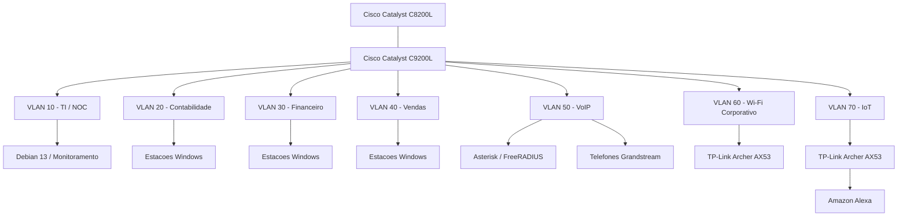

# Topologia Lógica Consolidada da Infraestrutura

[English](../../networking/consolidated-logical-topology.md) | **Português (Brasil)**

**Projeto:** Enterprise NOC — From Scratch  
**Ambiente:** Laboratório físico de infraestrutura empresarial  
**Equipamentos de rede:** Cisco Catalyst C8200L e Cisco Catalyst C9200L  
**Segmentação:** Sete VLANs  
**Período das evidências:** 04 a 06/11/2026  

---

## 1. Visão Geral

A infraestrutura do Enterprise NOC integra equipamentos físicos Cisco, estações de trabalho departamentais, servidores Linux, conectividade wireless, telefonia IP e monitoramento centralizado.

A rede está organizada em sete VLANs, separando administração, departamentos, serviços de voz, Wi-Fi corporativo e dispositivos IoT.

Este documento reúne as relações físicas e lógicas descritas nos registros técnicos do projeto.

A topologia representa a infraestrutura do laboratório e as configurações registradas durante o período de coleta das evidências.

## 2. Topologia Lógica da Rede



O diagrama representa a organização lógica da rede, não um mapeamento completo do cabeamento físico.

A conexão entre o Cisco Catalyst C8200L e o Cisco Catalyst C9200L está associada ao trunk configurado na interface `Gi1/0/1` do switch.

A configuração coletada estabelece o trunk no lado do switch. O registro não inclui a configuração completa da interface correspondente no roteador nem das subinterfaces utilizadas para o roteamento entre VLANs.

## 3. Segmentação da Rede

A infraestrutura utiliza a seguinte organização:

| VLAN | Departamento ou Serviço | Função |
|---|---|---|
| 10 | TI / NOC | Administração da infraestrutura, serviços Linux e monitoramento |
| 20 | Contabilidade | Estações Windows do departamento |
| 30 | Financeiro | Estações Windows do departamento |
| 40 | Vendas | Estações Windows do departamento |
| 50 | VoIP | Telefonia IP e serviços Asterisk/FreeRADIUS |
| 60 | Wi-Fi Corporativo | Conectividade wireless corporativa |
| 70 | IoT | Amazon Alexa e conectividade IoT |

A segmentação por VLAN estabelece domínios de broadcast de camada 2 separados para os segmentos documentados.

A comunicação entre VLANs depende de encaminhamento em camada 3. A captura histórica registra a segmentação no switch e o trunk, sem incluir as subinterfaces ou políticas aplicadas no roteador.

## 4. Cisco Catalyst C9200L — Mapeamento das Interfaces

A configuração do switch coletada em 04/11/2026 registra as seguintes atribuições:

| Interface | Segmento | Configuração Registrada |
|---|---|---|
| Gi1/0/1 | Cisco Catalyst C8200L | Trunk |
| Gi1/0/2–3 | VLAN 10 — TI / NOC | Access |
| Gi1/0/4–6 | VLAN 20 — Contabilidade | Access |
| Gi1/0/7–8 | VLAN 30 — Financeiro | Access |
| Gi1/0/9–10 | VLAN 40 — Vendas | Access |
| Gi1/0/11 | VLAN 50 — Asterisk/FreeRADIUS | VLAN 50 atribuída |
| Gi1/0/12–13 | VLAN 50 — Telefones Grandstream | Access |
| Gi1/0/14 | VLAN 70 — IoT | Access |
| Gi1/0/15 | VLAN 60 — Wi-Fi corporativo | Access |

### Interface Gi1/0/11

A configuração histórica da `Gi1/0/11` contém:

```cisco
switchport access vlan 50
spanning-tree portfast trunk
```

Diferentemente das demais interfaces departamentais, essa configuração não apresenta o comando explícito `switchport mode access`.

Por isso, a topologia preserva a associação à VLAN 50 sem atribuir um modo operacional que não esteja estabelecido pela captura.

As interfaces sem comandos específicos no registro não são classificadas como desconectadas, desabilitadas ou disponíveis.

## 5. Infraestrutura Linux e Serviços de Rede

O laboratório possui dois computadores Linux com funções distintas.

### 5.1 Computador Principal do NOC

O computador principal executa Debian GNU/Linux 13 e está associado à VLAN 10.

O inventário de 06/11 registra o endereço:

`192.168.10.12/24`

Suas responsabilidades documentadas incluem:

- Hospedagem de containers Docker.
- Monitoramento Zabbix.
- Dashboards Grafana.
- Banco de dados MariaDB.
- Uptime Kuma.
- Pi-hole.
- Portainer.
- Serviços web e proxy reverso.

O inventário Docker registrou dez containers em execução durante a coleta de 06/11.

### 5.2 Servidor Asterisk e FreeRADIUS

Um segundo computador Linux disponibiliza serviços de telefonia IP e autenticação de rede.

Os registros identificam:

| Componente | Informação Documentada |
|---|---|
| Segmento | VLAN 50 |
| Endereço do servidor | `192.168.50.2/24` |
| Telefonia IP | Asterisk |
| Autenticação | FreeRADIUS |
| Telefones IP | Dois dispositivos Grandstream |

Os ramais documentados são:

| Ramal | Departamento | Endereço IP |
|---|---|---|
| 1001 | Vendas | `192.168.50.10` |
| 1002 | TI | `192.168.50.11` |

Os valores representam as configurações e os equipamentos registrados no laboratório.

## 6. Wi-Fi Corporativo e Rede IoT

A infraestrutura wireless utiliza dois equipamentos TP-Link Archer AX53 separados.

### VLAN 60 — Wi-Fi Corporativo

O segmento Wi-Fi corporativo está associado à interface `Gi1/0/15` do switch.

Sua função é disponibilizar conectividade wireless em uma rede dedicada, separada das VLANs departamentais e da rede IoT.

### VLAN 70 — IoT

A rede IoT está associada à interface `Gi1/0/14`.

A conectividade documentada é:

```text
Amazon Alexa
     |
   Wi-Fi
     |
TP-Link Archer AX53
     |
  Ethernet
     |
Cisco Catalyst C9200L
     |
   VLAN 70
```

A configuração do switch registra as atribuições de VLAN, mas não contém os parâmetros internos de operação, NAT ou DHCP dos roteadores wireless.

Portanto, o diagrama não presume que os clientes Wi-Fi utilizem necessariamente endereços das sub-redes associadas às respectivas VLANs.

## 7. Endereçamento IP Observado

As evidências coletadas nas estações em 06/11 identificam os seguintes gateways padrão:

| VLAN | Gateway Padrão Observado |
|---|---|
| 10 | `192.168.10.1` |
| 20 | `192.168.20.1` |
| 30 | `192.168.30.1` |
| 40 | `192.168.40.1` |

Os endereços foram registrados a partir das configurações de rede das estações.

O laboratório utiliza DHCP para o endereçamento dos computadores.

Os endereços IP observados em diferentes momentos podem apresentar divergências, especialmente quando comparados aos cadastros anteriores do Zabbix.

Os gateways observados não constituem uma exportação completa da configuração do roteador nem identificam todos os mecanismos de distribuição de endereços.

## 8. Arquitetura de Monitoramento

A infraestrutura integra monitoramento de equipamentos e observabilidade de serviços.

O ambiente documentado inclui:

| Componente | Função |
|---|---|
| Zabbix | Coleta de informações de monitoramento da infraestrutura e dos serviços |
| Grafana | Visualização das métricas de monitoramento |
| SNMP | Monitoramento de equipamentos Cisco compatíveis |
| Uptime Kuma | Verificação de disponibilidade de serviços selecionados |
| MariaDB | Armazenamento dos dados de monitoramento do Zabbix |

As informações de monitoramento abrangem equipamentos de rede, servidores Linux, estações Windows e serviços selecionados.

Os dashboards disponíveis apresentam registros históricos de interfaces, disponibilidade dos hosts, consumo de recursos, tráfego e indicadores dos serviços.

As capturas de 06/11 incluem hosts indisponíveis e itens não suportados. Essas observações são preservadas como parte do registro técnico do laboratório.

## 9. Infraestrutura Física

O ambiente físico inclui:

- Roteador Cisco Catalyst C8200L.
- Switch Cisco Catalyst C9200L.
- Rack de rede.
- Patch panel.
- Cabeamento Ethernet estruturado.
- Estações de trabalho departamentais.
- Computadores Linux da infraestrutura.
- Telefones IP Grandstream.
- Equipamentos wireless TP-Link.

O laboratório utiliza a pinagem T568A na confecção manual dos cabos Ethernet.

As fotografias disponíveis documentam a organização dos equipamentos e a infraestrutura de rede.


## 10. Escopo Técnico

Este documento consolida o projeto lógico da rede, a configuração registrada do switch, o inventário físico e as evidências dos serviços de infraestrutura.

A topologia representa a organização lógica do ambiente coletado.

Não constitui:

- Um mapa físico completo de todos os cabos.
- Uma exportação integral da configuração do roteador Cisco.
- Comprovação da aplicação de todas as ACLs previstas.
- Registro de comunicação bem-sucedida entre todas as VLANs.
- Garantia de disponibilidade contínua do monitoramento.
- Uma exportação completa da configuração dos roteadores wireless.

Esses limites separam os elementos documentados do laboratório físico dos detalhes de implementação ausentes nos registros disponíveis.

## 11. Documentação Relacionada

- [Segmentação por VLANs](vlans.md)
- [Roteador Cisco Catalyst C8200L](roteador-c8200l.md)
- [Registro de Configuração do Switch](registro-switch-vlans-2026-11-04.md)
- [Mapa de Portas do Switch](mapa-de-portas-switch.md)
- [Wi-Fi Corporativo — VLAN 60](wifi-corporativo-vlan60.md)
- [Rede IoT — VLAN 70](iot-vlan70.md)
- [Infraestrutura Docker](../containers/servicos-docker.md)
- [Asterisk e FreeRADIUS](../servicos/asterisk-freeradius.md)
- [Monitoramento Zabbix](../monitoramento/zabbix.md)
- [Monitoramento Grafana](../monitoramento/grafana.md)
- [Infraestrutura Física](../evidencias/infraestrutura-fisica.md)

---

**Referência das evidências:** 04 a 06/11/2026.  
**Tipo de documento:** Topologia lógica consolidada da infraestrutura.
