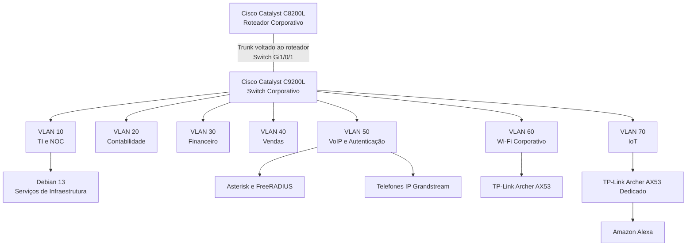

# Segmentação por VLANs — Rede Corporativa

**Enterprise NOC — From Scratch**

[English](../../networking/vlans.md) | **Português (Brasil)**

---

## 1. Visão Geral

A infraestrutura do Enterprise NOC utiliza **Virtual Local Area Networks (VLANs)** para organizar a conectividade corporativa em segmentos lógicos separados.

A arquitetura de rede contempla sete VLANs destinadas à administração de TI, departamentos empresariais, serviços de voz, conectividade wireless corporativa e dispositivos de Internet das Coisas (IoT).

As atribuições de VLANs estão documentadas na configuração do Cisco Catalyst C9200L, coletada em **4 de novembro de 2026**, complementada pelos inventários dos equipamentos e registros de rede dos dias seguintes.

| Característica | Informação Documentada |
|---|---|
| Arquitetura de Rede | Rede corporativa segmentada |
| Roteador Corporativo | Cisco Catalyst C8200L-1N-4T |
| Switch Corporativo | Cisco Catalyst C9200L-24T-4G |
| Quantidade de VLANs | Sete |
| Identificadores de VLAN | 10, 20, 30, 40, 50, 60 e 70 |
| Referência da Configuração | 04/11/2026 |
| Evidências Complementares | 06/11/2026 |

A configuração das VLANs estabelece separação lógica na camada 2.

A comunicação entre VLANs exige encaminhamento em camada 3. A configuração coletada do switch não estabelece isoladamente a configuração completa do roteador nem a aplicação efetiva das restrições de acesso entre segmentos.

## 2. Arquitetura da Rede

A infraestrutura de VLANs está associada ao switch Cisco Catalyst C9200L e ao roteador Cisco Catalyst C8200L.

O Catalyst C9200L disponibiliza a comutação Ethernet e as atribuições de VLANs documentadas.

O Catalyst C8200L desempenha o papel de componente central de roteamento na arquitetura corporativa.

### 2.1 Segmentação Lógica



O diagrama representa as associações documentadas dos equipamentos e a segmentação lógica da rede.

O trunk voltado ao roteador está configurado na interface `Gi1/0/1` do switch. A interface correspondente no roteador e a configuração completa do roteamento entre VLANs não integram os registros coletados.

O desenho não constitui um mapa físico completo do cabeamento nem uma comprovação independente da comunicação entre todas as VLANs.

## 3. Inventário de VLANs

A rede corporativa possui as seguintes atribuições de VLANs.

| VLAN | Segmento de Rede | Função | Interfaces Documentadas |
|---|---|---|---|
| **10** | TI e NOC | Administração da infraestrutura, serviços Linux e monitoramento | Gi1/0/2–3 |
| **20** | Contabilidade | Estações de trabalho da Contabilidade | Gi1/0/4–6 |
| **30** | Financeiro | Estações de trabalho do Financeiro | Gi1/0/7–8 |
| **40** | Vendas | Estações de trabalho de Vendas | Gi1/0/9–10 |
| **50** | VoIP e Autenticação | Telefonia IP, Asterisk e FreeRADIUS | Gi1/0/11–13 |
| **60** | Wi-Fi Corporativo | Conectividade wireless corporativa | Gi1/0/15 |
| **70** | IoT | Conectividade wireless dedicada a dispositivos inteligentes | Gi1/0/14 |

As atribuições utilizam como referência a configuração histórica do Cisco Catalyst C9200L.

Os segmentos possuem responsabilidades distintas, permitindo organizar os serviços de infraestrutura e os equipamentos departamentais de forma independente.

### 3.1 VLAN 10 — TI e NOC

A VLAN 10 é destinada à administração de TI e ao monitoramento da infraestrutura.

Os equipamentos documentados incluem o computador principal do NOC, executando Debian GNU/Linux 13, e uma estação adicional de TI.

O computador principal está associado ao endereço `192.168.10.12/24`.

Suas responsabilidades documentadas incluem hospedagem dos serviços Docker, Zabbix, Grafana, MariaDB, Portainer, Pi-hole, Uptime Kuma e componentes da infraestrutura web.

As interfaces `Gi1/0/2–3` do switch estão atribuídas à VLAN 10.

### 3.2 VLAN 20 — Contabilidade

A VLAN 20 é destinada ao setor de Contabilidade.

O inventário de 6 de novembro registra três estações de trabalho da Contabilidade com endereços na rede `192.168.20.0/24`.

A configuração do switch atribui as interfaces `Gi1/0/4–6` a essa VLAN.

### 3.3 VLAN 30 — Financeiro

A VLAN 30 é destinada ao setor Financeiro.

O inventário coletado identifica dois computadores do Financeiro com endereços na rede `192.168.30.0/24`.

As interfaces `Gi1/0/7–8` estão atribuídas à VLAN 30.

### 3.4 VLAN 40 — Vendas

A VLAN 40 é destinada ao setor de Vendas.

O inventário coletado identifica duas estações de trabalho com endereços na rede `192.168.40.0/24`.

As interfaces `Gi1/0/9–10` estão atribuídas à VLAN 40.

### 3.5 VLAN 50 — VoIP e Autenticação

A VLAN 50 está associada à infraestrutura de telefonia e autenticação do laboratório.

Os equipamentos documentados incluem:

- Servidor Debian Linux com Asterisk e FreeRADIUS.
- Dois telefones IP Grandstream.

O endereço registrado do servidor é `192.168.50.2/24`.

Os ramais e endereços documentados são:

| Ramal | Departamento | Endereço IP |
|---|---|---|
| 1001 | Vendas | `192.168.50.10` |
| 1002 | TI | `192.168.50.11` |

A configuração do switch associa as interfaces `Gi1/0/11–13` à VLAN 50.

A interface `Gi1/0/11` possui uma configuração particular, descrita separadamente na Seção 4.

### 3.6 VLAN 60 — Wi-Fi Corporativo

A VLAN 60 é destinada à conectividade wireless corporativa.

O equipamento identificado é um TP-Link Archer AX53, associado à interface `Gi1/0/15` do switch.

O segmento é logicamente separado das VLANs departamentais e da rede IoT.

A configuração interna do roteador wireless e o endereçamento IP dos clientes não estão estabelecidos pelos registros coletados do switch.

### 3.7 VLAN 70 — IoT

A VLAN 70 é destinada à conectividade de dispositivos de Internet das Coisas.

O ambiente documentado inclui uma Amazon Alexa associada a um TP-Link Archer AX53 dedicado.

A configuração do switch atribui a interface `Gi1/0/14` à VLAN 70.

As redes Wi-Fi corporativa e IoT utilizam dois equipamentos TP-Link Archer AX53 fisicamente separados.

O modo de operação e o endereçamento interno do roteador wireless IoT não estão estabelecidos pelos registros de configuração disponíveis.

## 4. Cisco Catalyst C9200L — Configuração de VLANs

A configuração histórica do switch documenta o trunk voltado ao roteador e as atribuições das VLANs utilizadas na infraestrutura corporativa.

### 4.1 Trunk para o Roteador

A interface `Gi1/0/1` apresenta:

```cisco
interface GigabitEthernet1/0/1
 description TRUNK-PARA-ROTEADOR
 switchport mode trunk
```

Esses comandos estabelecem que a `Gi1/0/1` estava configurada como trunk no Catalyst C9200L.

A configuração coletada não contém um comando explícito `switchport trunk allowed vlan` nem uma atribuição personalizada de VLAN nativa.

Embora o projeto possua as VLANs 10 a 70, o inventário não deve ser interpretado como uma lista explicitamente configurada de VLANs permitidas no trunk.

A interface correspondente do roteador e suas subinterfaces VLAN não estão presentes nas evidências disponíveis.

### 4.2 Interfaces de Acesso Departamentais

As interfaces departamentais utilizam configurações de portas de acesso documentadas.

Um exemplo do segmento de Contabilidade é:

```cisco
interface GigabitEthernet1/0/4
 description PCS-CONTABILIDADE
 switchport access vlan 20
 switchport mode access
 spanning-tree portfast
```

Essa configuração atribui a interface à VLAN 20 e define explicitamente o modo access.

A captura histórica contém atribuições correspondentes de VLANs para as demais interfaces departamentais e de serviços documentadas.

### 4.3 Interface Gi1/0/11

A interface `Gi1/0/11` está associada ao servidor Asterisk/FreeRADIUS.

A configuração registrada contém:

```cisco
interface GigabitEthernet1/0/11
 description SERVIDOR-DEBIAN-VOIP-E-RADIUS
 switchport access vlan 50
 spanning-tree portfast trunk
```

Diferentemente das interfaces de acesso departamentais convencionais, essa configuração não apresenta explicitamente `switchport mode access`.

O comando `spanning-tree portfast trunk` não estabelece isoladamente o modo operacional efetivo da interface.

Portanto, a VLAN 50 é documentada como VLAN de acesso configurada, enquanto o modo operacional da interface não é estabelecido pela captura coletada.

Os comandos originais foram preservados sem alterações.

## 5. Endereçamento IP Documentado

Os registros das estações e servidores coletados em 6 de novembro de 2026 contêm as seguintes informações de endereçamento.

| VLAN | Rede Documentada | Exemplos |
|---|---|---|
| 10 | `192.168.10.0/24` | NOC principal: `192.168.10.12`; TI 2: `192.168.10.13` |
| 20 | `192.168.20.0/24` | Contabilidade: `192.168.20.11–13` |
| 30 | `192.168.30.0/24` | Financeiro: `192.168.30.10–11` |
| 40 | `192.168.40.0/24` | Vendas: `192.168.40.10–11` |
| 50 | `192.168.50.0/24` | Asterisk/FreeRADIUS: `192.168.50.2`; telefones IP: `192.168.50.10–11` |
| 60 | Não estabelecida pelos registros disponíveis dos clientes | Wi-Fi corporativo |
| 70 | Não estabelecida pelos registros disponíveis dos clientes | IoT |

As redes `/24` documentadas foram determinadas a partir das informações de endereçamento dos equipamentos coletados.

Os registros disponíveis não estabelecem as sub-redes dos clientes wireless associadas às VLANs 60 e 70.

### 5.1 Gateways Padrão Observados

| VLAN | Gateway Padrão Registrado | Evidência |
|---|---|---|
| 10 | `192.168.10.1` | Configuração de estação da TI |
| 20 | `192.168.20.1` | Configuração de estação da Contabilidade |
| 30 | `192.168.30.1` | Configuração de estação do Financeiro |
| 40 | `192.168.40.1` | Configuração de estação de Vendas |
| 50 | `192.168.50.1` | Registro do servidor Asterisk/FreeRADIUS |

Esses valores representam os gateways configurados nos sistemas correspondentes.

Eles não estabelecem isoladamente qual interface do roteador é responsável por cada endereço de gateway.

Nenhum gateway é atribuído às VLANs 60 ou 70 sem evidência de endereçamento correspondente.

### 5.2 DHCP e Endereços Históricos

O laboratório utiliza DHCP para o endereçamento das estações de trabalho.

O inventário de 6 de novembro identificou divergências entre os endereços IPv4 das estações e os registros anteriores das interfaces dos hosts no Zabbix.

Essas diferenças podem afetar o monitoramento quando o endereço cadastrado de um host não corresponde ao endereço observado.

Os valores registrados representam observações históricas, não atribuições estáticas ou reservas DHCP confirmadas.

## 6. Segmentação de Rede e Políticas de Acesso

A segmentação por VLANs estabelece domínios de broadcast separados na camada 2 da rede corporativa.

A comunicação entre VLANs exige encaminhamento em camada 3, enquanto as restrições de tráfego dependem das configurações correspondentes de roteamento e controle de acesso.

O projeto lógico documenta os seguintes requisitos.

| Segmento de Rede | Requisito Arquitetural de Acesso |
|---|---|
| VLAN 10 — TI e NOC | Administração autorizada e monitoramento da infraestrutura |
| VLAN 20 — Contabilidade | Separação departamental com exceções para serviços autorizados |
| VLAN 30 — Financeiro | Separação departamental com exceções para serviços autorizados |
| VLAN 40 — Vendas | Separação departamental com exceções para serviços autorizados |
| VLAN 50 — VoIP e Autenticação | Acesso adequado às necessidades dos serviços de voz e autenticação |
| VLAN 60 — Wi-Fi Corporativo | Restrição de acessos não autorizados aos recursos internos |
| VLAN 70 — IoT | Separação da conectividade IoT dos recursos corporativos sensíveis |

Esses requisitos representam o projeto lógico de segurança.

As evidências disponíveis não incluem uma exportação completa das ACLs do C8200L nem testes registrados que comprovem a aplicação efetiva dessas restrições.

Consequentemente, a separação documentada das VLANs não deve ser apresentada como comprovação de isolamento completo em camada 3.

## 7. Integração do Wi-Fi Corporativo e IoT

### 7.1 Equipamento Wireless Corporativo

O segmento wireless corporativo utiliza um TP-Link Archer AX53 identificado nas evidências dos equipamentos de 6 de novembro.

| Característica | Informação Documentada |
|---|---|
| Fabricante | TP-Link |
| Modelo | Archer AX53 |
| Geração Wireless | Wi-Fi 6 |
| Classe do Produto | AX3000 |
| Segmento de Rede | VLAN 60 |
| Interface do Switch | `Gi1/0/15` |

A configuração histórica do switch estabelece a atribuição da VLAN 60.

As evidências disponíveis não incluem o modo de operação do Archer AX53, configurações de autenticação wireless, endereçamento dos clientes, DHCP ou NAT.

O servidor FreeRADIUS está documentado na VLAN 50. Sua presença não comprova isoladamente que o equipamento wireless corporativo utilizava autenticação RADIUS.

### 7.2 Equipamento Wireless IoT

O segmento IoT utiliza um segundo TP-Link Archer AX53.

| Característica | Informação Documentada |
|---|---|
| Fabricante | TP-Link |
| Modelo | Archer AX53 |
| Geração Wireless | Wi-Fi 6 |
| Classe do Produto | AX3000 |
| Segmento de Rede | VLAN 70 |
| Interface do Switch | `Gi1/0/14` |
| Dispositivo Associado | Amazon Alexa |

A conectividade documentada associa a Alexa à rede wireless dedicada ao ambiente IoT.

Em modo access point, os clientes wireless podem participar diretamente da rede IP da VLAN correspondente.

Em modo roteador com NAT, os clientes podem utilizar uma sub-rede independente atrás do equipamento wireless.

Os registros coletados não estabelecem qual modo de operação foi utilizado.

Consequentemente, o endereço IP da Alexa, a sub-rede dos clientes wireless, o servidor DHCP, o comportamento NAT e o gateway padrão da rede IoT não são apresentados como configurações documentadas.

### 7.3 Limites da Segmentação Wireless

As atribuições no lado do switch estabelecem VLANs separadas para o Wi-Fi corporativo e para a conectividade IoT.

Elas não comprovam isoladamente:

- Endereçamento dos clientes wireless.
- Transações de autenticação wireless.
- Aplicação efetiva das ACLs do roteador.
- Testes bem-sucedidos de isolamento entre as redes wireless e departamentais.
- Monitoramento direto dos dispositivos wireless.

Esses detalhes são diferenciados da configuração registrada do switch e do projeto lógico da rede.

## 8. Evidências Técnicas e Escopo

Este documento reúne o projeto de VLANs e os registros históricos da infraestrutura coletados em novembro de 2026.

| Fonte da Evidência | Informação Registrada |
|---|---|
| Configuração do Cisco C9200L — 04/11 | Atribuições de VLANs, trunk e portas de acesso |
| Inventário de estações — 06/11 | Endereçamento departamental e gateways observados |
| Inventário dos servidores Linux — 06/11 | Endereçamento dos servidores e funções na rede |
| Documentação de Asterisk/FreeRADIUS | Servidor da VLAN 50, gateway e telefonia IP |
| Registros dos equipamentos wireless | Associações dos dispositivos de Wi-Fi corporativo e IoT |
| Fotografias físicas | Equipamentos de rede e cabeamento estruturado |

As evidências estabelecem a organização das VLANs documentada no switch e sua associação aos equipamentos do laboratório.

Não constituem:

- Uma exportação completa da configuração do C8200L.
- Verificação independente de todos os caminhos de comunicação entre VLANs.
- Evidência da aplicação efetiva das ACLs do roteador.
- Um mapa físico completo do cabeamento.
- Endereçamento IP verificado dos clientes wireless das VLANs 60 e 70.
- Exportações das configurações dos dois equipamentos TP-Link Archer AX53.
- Confirmação de disponibilidade contínua dos serviços ou da rede.

A ausência desses detalhes delimita o escopo do registro histórico, não uma exigência pendente para concluir a documentação.

## 9. Documentação Relacionada

### Redes e Arquitetura

- [Redes e Arquitetura — Visão Geral](README.md)
- [Topologia Lógica Consolidada](topologia-logica-consolidada.md)
- [Cisco Catalyst C8200L](roteador-c8200l.md)
- [Cisco Catalyst C9200L — Registro de Configuração](registro-switch-vlans-2026-11-04.md)
- [Cisco Catalyst C9200L — Mapeamento de Portas](mapa-de-portas-switch.md)
- [Wi-Fi Corporativo — VLAN 60](wifi-corporativo-vlan60.md)
- [Rede IoT — VLAN 70](iot-vlan70.md)

### Infraestrutura e Serviços

- [Arquitetura da Infraestrutura](../arquitetura/visao-geral-da-infraestrutura.md)
- [Inventário de Computadores e Servidores](../estacoes/inventario-de-computadores.md)
- [Asterisk e FreeRADIUS](../servicos/asterisk-freeradius.md)
- [Infraestrutura Física](../evidencias/infraestrutura-fisica.md)

---

**Referência das evidências:** 04 a 06/11/2026  
**Tipo de documento:** Segmentação por VLANs e registro histórico da configuração corporativa.
