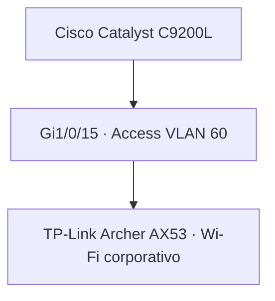

# Wi-Fi Corporativo — VLAN 60

**Enterprise NOC — From Scratch**

[English](../../networking/corporate-wifi-vlan60.md) | **Português (Brasil)**

## Equipamento e conexão com o switch

| Característica | Registro documentado |
|---|---|
| Equipamento | TP-Link Archer AX53 · Wi-Fi 6 AX3000 |
| Função | Conectividade wireless corporativa |
| VLAN | 60 |
| Switch | Cisco Catalyst C9200L-24T-4G |
| Porta | `Gi1/0/15` — access VLAN 60 |
| Evidências | Configuração do switch de 04/11/2026; fotografia do equipamento de 06/11 |

O Archer AX53 corporativo é **um equipamento físico separado** daquele usado para IoT na VLAN 70 (`Gi1/0/14`). O modelo foi identificado na fotografia coletada; a atribuição da VLAN vem da configuração Cisco.

A fotografia original contém credenciais wireless ou identificadores exclusivos e não é publicada na documentação pública.

## Conexão lógica

O trunk voltado ao roteador na `Gi1/0/1` do C9200L faz parte da arquitetura geral; sua configuração no lado do roteador não foi coletada. A conexão apresentada registra a associação do equipamento wireless ao switch, não testes de conectividade dos clientes Wi-Fi.

## Endereçamento e autenticação

A configuração do Archer AX53 não foi coletada. Portanto, **não estão estabelecidos**: modo AP ou roteador, sub-rede dos clientes, gateway padrão, DHCP, NAT, SSID e parâmetros de criptografia.

Em modo AP, os clientes podem participar da rede IP da VLAN upstream. Em modo roteador, podem utilizar uma sub-rede distinta atrás do equipamento. Nenhum dos modos é apresentado como implantado. Em particular, `192.168.60.0/24` e `192.168.60.1` não são atribuídos à rede sem evidência de endereçamento.

O FreeRADIUS está documentado no servidor Debian de voz/autenticação da VLAN 50 (`192.168.50.2`; portas RADIUS padrão UDP 1812/1813). Os registros **não** confirmam que o AX53 estivesse configurado como cliente RADIUS nem que autenticações wireless tenham sido concluídas.

## Segurança e monitoramento

A VLAN 60 é um segmento separado em camada 2. O projeto de acesso restringe tráfego não autorizado às redes internas; a atribuição no switch não comprova aplicação de ACLs no roteador nem testes de isolamento dos clientes.

Os registros de Zabbix e Grafana documentam o monitoramento de equipamentos Cisco. Não há dashboard dedicado com métricas diretas do Archer AX53 corporativo no inventário coletado.

## Referências

[Visão geral de Redes](README.md) · [VLANs](vlans.md) · [Mapa de portas](mapa-de-portas-switch.md) · [Registro do switch](registro-switch-vlans-2026-11-04.md) · [IoT · VLAN 70](iot-vlan70.md) · [Asterisk / FreeRADIUS](../servicos/asterisk-freeradius.md) · [Infraestrutura física](../evidencias/infraestrutura-fisica.md)
