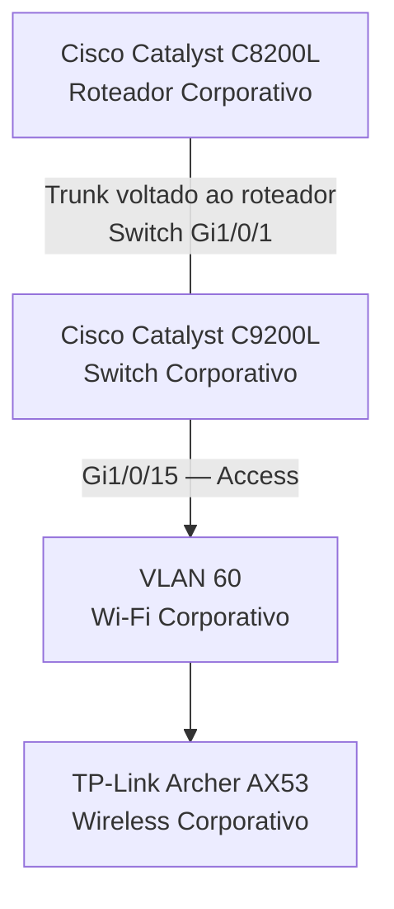

# Wi-Fi Corporativo — VLAN 60

**Enterprise NOC — From Scratch**

[English](../../networking/corporate-wifi-vlan60.md) | **Português (Brasil)**

---

## 1. Visão Geral

A infraestrutura do **Enterprise NOC — From Scratch** possui um segmento de rede dedicado à conectividade wireless corporativa.

A **VLAN 60** é destinada ao ambiente Wi-Fi corporativo, proporcionando separação lógica em relação às estações departamentais, à infraestrutura administrativa, aos serviços de voz e à conectividade IoT.

O equipamento wireless documentado é um **TP-Link Archer AX53**, associado à interface `Gi1/0/15` do switch Cisco Catalyst C9200L.

Este documento reúne a identificação do equipamento, a configuração do switch, a arquitetura de rede, o projeto das políticas de acesso, as relações com os serviços de autenticação e as evidências técnicas históricas.

| Característica | Informação Documentada |
|---|---|
| Segmento de Rede | Wi-Fi Corporativo |
| Identificador da VLAN | 60 |
| Equipamento Wireless | TP-Link Archer AX53 |
| Geração Wireless | Wi-Fi 6 |
| Classe do Produto | AX3000 |
| Switch Corporativo | Cisco Catalyst C9200L-24T-4G |
| Interface do Switch | `Gi1/0/15` |
| Configuração da Interface | Access VLAN 60 |
| Roteador Corporativo | Cisco Catalyst C8200L-1N-4T |
| Referência da Configuração | 04/11/2026 |
| Evidência do Equipamento | 06/11/2026 |

Os registros disponíveis estabelecem a identificação do equipamento e a atribuição da VLAN no lado do switch. Eles não incluem a configuração operacional completa do roteador wireless.

## 2. Equipamento Wireless

### 2.1 TP-Link Archer AX53

O equipamento wireless corporativo foi identificado a partir de evidência física coletada em **6 de novembro de 2026**.

| Característica | Identificação |
|---|---|
| Fabricante | TP-Link |
| Modelo | Archer AX53 |
| Padrão Wireless | Wi-Fi 6 |
| Classe do Produto | AX3000 |
| Função Documentada | Conectividade Wi-Fi corporativa |
| VLAN Associada | 60 |

O Archer AX53 está documentado como componente da infraestrutura wireless corporativa.

Sua identificação é sustentada pelas evidências físicas coletadas, não por uma suposição baseada na configuração do switch.

### 2.2 Separação dos Equipamentos Corporativo e IoT

O laboratório possui dois equipamentos TP-Link Archer AX53 separados.

| Equipamento | Segmento de Rede | Interface do Switch |
|---|---|---|
| Archer AX53 Corporativo | VLAN 60 — Wi-Fi Corporativo | `Gi1/0/15` |
| Archer AX53 IoT | VLAN 70 — IoT | `Gi1/0/14` |

Os dois dispositivos pertencem à mesma família de produtos, mas possuem funções distintas na arquitetura documentada.

O equipamento corporativo não é apresentado como responsável simultaneamente pela rede IoT separada.

### 2.3 Evidências Publicadas

A fotografia original do equipamento contém informações wireless sensíveis e identificadores exclusivos.

Por esse motivo, a fotografia original não foi incluída na documentação pública.

Nenhuma senha wireless, SSID, credencial administrativa, segredo de autenticação ou identificador exclusivo do dispositivo é reproduzido neste documento.

## 3. Integração com o Cisco Catalyst C9200L

A configuração do Cisco Catalyst C9200L, coletada em **4 de novembro de 2026**, atribui a interface `Gi1/0/15` ao segmento Wi-Fi corporativo.

### 3.1 Atribuição da Interface do Switch

| Componente | Informação Registrada |
|---|---|
| Switch | Cisco Catalyst C9200L |
| Interface | `Gi1/0/15` |
| VLAN Atribuída | 60 |
| Modo da Interface | Access |
| Conexão Documentada | Equipamento wireless corporativo |

O registro do switch estabelece a atribuição de VLAN configurada na interface Ethernet.

Ele não comprova isoladamente o estado físico do enlace, o modo de operação do equipamento wireless ou a conectividade bem-sucedida dos clientes Wi-Fi.

### 3.2 Relação com o Roteador Corporativo

A arquitetura de rede inclui um roteador Cisco Catalyst C8200L associado ao C9200L por meio do trunk voltado ao roteador, configurado na interface `Gi1/0/1` do switch.

A configuração coletada estabelece o trunk no lado do C9200L.

A interface correspondente do C8200L, a configuração completa das VLANs no roteador e a implementação das políticas de acesso não integram os registros disponíveis.

O inventário de VLANs da rede não representa uma lista explicitamente configurada de VLANs permitidas no trunk.

## 4. Arquitetura Lógica da Rede

O ambiente wireless corporativo está associado à VLAN 60 no Catalyst C9200L.

O diagrama apresenta a relação lógica documentada entre os equipamentos e o segmento wireless corporativo.

Ele não representa um mapa físico completo do cabeamento nem estabelece as configurações internas de roteamento, NAT, DHCP ou endereçamento dos clientes do Archer AX53.

### 4.1 Relação com as Outras VLANs

A rede corporativa possui sete VLANs com responsabilidades distintas.

| VLAN | Segmento de Rede | Relação com o Wi-Fi Corporativo |
|---|---|---|
| 10 | TI e NOC | Infraestrutura administrativa e de monitoramento |
| 20 | Contabilidade | Rede departamental |
| 30 | Financeiro | Rede departamental |
| 40 | Vendas | Rede departamental |
| 50 | VoIP e Autenticação | Serviços Asterisk e FreeRADIUS |
| 60 | Wi-Fi Corporativo | Segmento wireless corporativo dedicado |
| 70 | IoT | Rede wireless separada |

A VLAN 60 está logicamente separada das demais VLANs documentadas na camada 2.

A comunicação entre VLANs depende de encaminhamento em camada 3, enquanto as restrições dessa comunicação dependem das configurações correspondentes de roteamento e segurança.

## 5. Modo de Operação e Endereçamento IP

Os registros coletados do equipamento não incluem uma exportação da configuração do Archer AX53 corporativo.

Consequentemente, não é possível estabelecer o modo de operação implantado e a configuração interna de endereçamento a partir das evidências disponíveis.

### 5.1 Modos Access Point e Roteador

O comportamento do equipamento wireless em relação ao endereçamento dos clientes depende de seu modo de operação.

| Modo de Operação | Comportamento Geral da Rede |
|---|---|
| Access Point | Os clientes wireless podem participar diretamente da rede IP associada à VLAN upstream |
| Roteador com NAT | Os clientes wireless podem utilizar uma sub-rede interna independente atrás do equipamento |

Esses são modelos possíveis de operação, não configurações comprovadas do Archer AX53 instalado.

A atribuição de uma VLAN de acesso na interface do switch não identifica isoladamente qual modo estava sendo utilizado.

### 5.2 Endereçamento dos Clientes Wireless

Os registros disponíveis não estabelecem:

- A sub-rede utilizada pelos clientes do Wi-Fi corporativo.
- Os endereços IPv4 dos clientes wireless.
- O gateway padrão da rede wireless.
- O servidor DHCP ou seu pool de endereços.
- A configuração NAT.
- O endereçamento interno do equipamento.

Nenhuma rede `192.168.60.0/24`, gateway `192.168.60.1` ou outro endereço convencionalmente associado ao número da VLAN é atribuído à implantação sem evidência correspondente.

A informação documentada é a **atribuição da VLAN 60 à interface `Gi1/0/15` do switch**.

## 6. Segmentação e Políticas de Acesso

A arquitetura corporativa destina a conectividade wireless a um segmento lógico dedicado.

O modelo de controle de acesso diferencia o Wi-Fi corporativo das redes administrativas, departamentais, de voz e IoT.

### 6.1 Requisitos Arquiteturais

O projeto de segurança prevê:

- Restrição de acessos não autorizados dos clientes wireless à infraestrutura administrativa.
- Separação da conectividade wireless corporativa em relação à rede IoT.
- Comunicação com serviços internos somente quando necessária e autorizada.
- Controle do tráfego entre VLANs pelas políticas correspondentes de segurança em camada 3.

Esses requisitos descrevem o projeto lógico de segurança da rede.

### 6.2 Evidências de Aplicação das Políticas

A configuração histórica do C9200L estabelece a atribuição da VLAN 60 à interface do switch.

Ela não comprova isoladamente:

- Aplicação das ACLs do roteador.
- Isolamento bem-sucedido dos clientes wireless em relação às demais VLANs.
- Regras de firewall aplicadas ao ambiente Wi-Fi corporativo.
- Testes de controle de acesso entre VLANs.

Consequentemente, a arquitetura documentada deve ser diferenciada da aplicação das políticas de segurança verificada de forma independente.

## 7. Autenticação e FreeRADIUS

A infraestrutura do Enterprise NOC inclui um servidor FreeRADIUS associado à VLAN 50.

As informações documentadas do servidor são:

| Característica | Informação Registrada |
|---|---|
| Serviço | FreeRADIUS |
| Sistema Operacional do Host | Debian Linux |
| Endereço IPv4 do Servidor | `192.168.50.2/24` |
| Segmento de Rede | VLAN 50 |
| Protocolo de Autenticação | RADIUS |
| Porta Padrão de Autenticação | UDP 1812 |
| Porta Padrão de Accounting | UDP 1813 |

A arquitetura de autenticação relaciona o FreeRADIUS ao ambiente wireless corporativo.

Entretanto, as evidências disponíveis não estabelecem que o Archer AX53 estivesse configurado como cliente RADIUS operacional.

### 7.1 Escopo da Autenticação

Os registros coletados não incluem:

- Configuração do SSID do Wi-Fi corporativo.
- Configurações de criptografia wireless.
- Definições de cliente RADIUS para o Archer AX53.
- Configuração de segredo compartilhado.
- Logs de transações de autenticação wireless.
- Testes bem-sucedidos de autenticação envolvendo clientes do Wi-Fi corporativo.

A instalação do FreeRADIUS está documentada independentemente da configuração do equipamento wireless.

A presença desses componentes na mesma infraestrutura não comprova, isoladamente, uma integração operacional de autenticação.

Informações técnicas adicionais estão disponíveis em [Asterisk e FreeRADIUS](../servicos/asterisk-freeradius.md).

## 8. Monitoramento e Observabilidade

O laboratório Enterprise NOC utiliza Zabbix e Grafana para o monitoramento da infraestrutura.

As evidências coletadas incluem informações dos equipamentos de rede Cisco e dos serviços de infraestrutura.

Os registros publicados de monitoramento não apresentam um dashboard dedicado com métricas diretas do Archer AX53 corporativo.

### 8.1 Cobertura de Monitoramento

| Componente | Evidência de Monitoramento Documentada |
|---|---|
| Cisco Catalyst C8200L | Observações do roteador no Zabbix/Grafana |
| Cisco Catalyst C9200L | Métricas de monitoramento do switch |
| TP-Link Archer AX53 — Wi-Fi Corporativo | Sem dashboard dedicado de monitoramento direto nos registros coletados |

A presença de informações de monitoramento da infraestrutura Cisco não comprova o monitoramento direto do roteador wireless ou de seus clientes.

### 8.2 Referências de Monitoramento

- [Monitoramento com Zabbix](../monitoramento/zabbix.md)
- [Monitoramento com Grafana](../monitoramento/grafana.md)
- [Diagnóstico SNMP](../monitoramento/diagnostico-snmp.md)

## 9. Evidências Técnicas e Escopo

A documentação do Wi-Fi corporativo reúne os seguintes registros históricos.

| Fonte da Evidência | Data | Informação Documentada |
|---|---|---|
| Configuração do Cisco Catalyst C9200L | 04/11/2026 | Atribuição da VLAN 60 à interface `Gi1/0/15` |
| Fotografia do equipamento wireless | 06/11/2026 | Identificação do TP-Link Archer AX53 corporativo |
| Inventário consolidado de rede | Novembro de 2026 | Equipamentos wireless corporativo e IoT separados |
| Registros da arquitetura de rede | Novembro de 2026 | Organização das VLANs e projeto de segmentação |
| Capturas do Zabbix/Grafana | Novembro de 2026 | Observações de monitoramento da infraestrutura Cisco |

As evidências coletadas sustentam:

- A identificação do equipamento wireless corporativo.
- Sua função documentada na rede.
- A atribuição da VLAN 60 no C9200L.
- A separação entre os equipamentos wireless corporativo e IoT na arquitetura.

Os registros disponíveis não estabelecem de forma independente o modo wireless implantado, o endereçamento dos clientes, as transações de autenticação, a configuração NAT, a aplicação das ACLs ou o monitoramento direto do Archer AX53.

Essas delimitações definem o escopo da documentação técnica histórica e não representam atividades pendentes necessárias para concluir este registro.

## 10. Documentação Relacionada

### Redes e Arquitetura

- [Redes e Arquitetura — Visão Geral](README.md)
- [Topologia Lógica Consolidada](topologia-logica-consolidada.md)
- [Segmentação por VLANs](vlans.md)
- [Cisco Catalyst C8200L](roteador-c8200l.md)
- [Cisco Catalyst C9200L — Registro de Configuração](registro-switch-vlans-2026-11-04.md)
- [Cisco Catalyst C9200L — Mapeamento de Portas](mapa-de-portas-switch.md)
- [Rede IoT — VLAN 70](iot-vlan70.md)

### Infraestrutura e Monitoramento

- [Arquitetura da Infraestrutura](../arquitetura/visao-geral-da-infraestrutura.md)
- [Infraestrutura Física](../evidencias/infraestrutura-fisica.md)
- [Asterisk e FreeRADIUS](../servicos/asterisk-freeradius.md)
- [Monitoramento com Zabbix](../monitoramento/zabbix.md)
- [Monitoramento com Grafana](../monitoramento/grafana.md)

---

**Referência das evidências:** 04 a 06/11/2026  
**Tipo de documento:** Arquitetura da rede wireless corporativa e evidências históricas.
