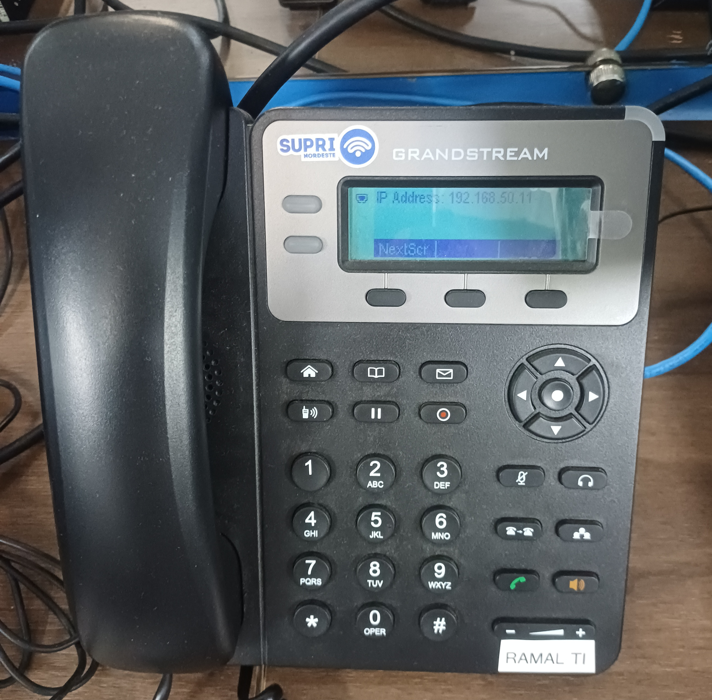
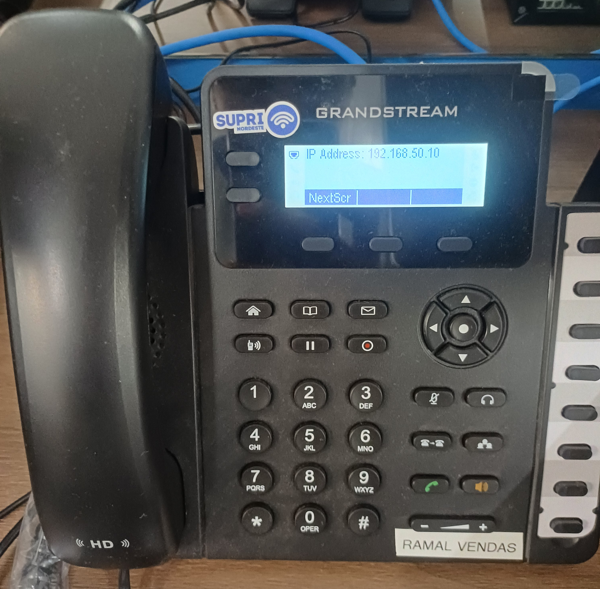
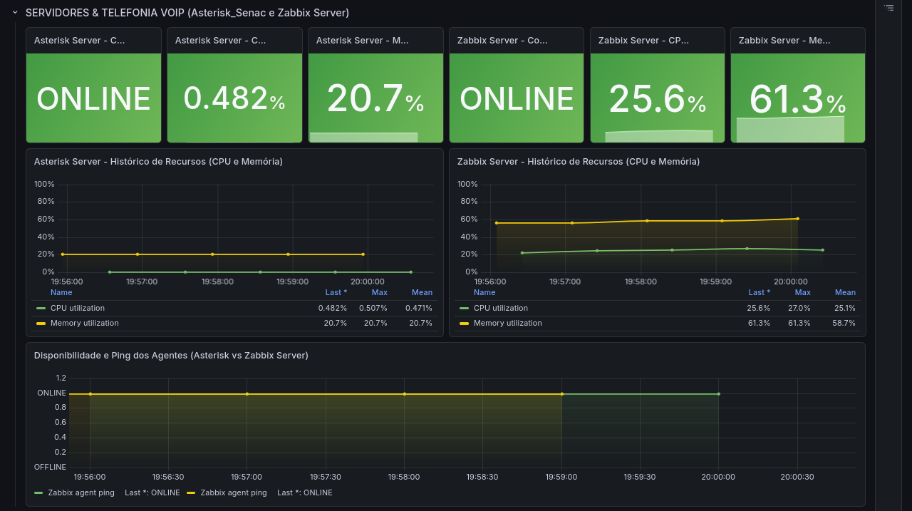

# Asterisk e FreeRADIUS — Telefonia IP e Autenticação de Rede

[English](../../services/asterisk-freeradius.md) | **Português (Brasil)**

## 1. Visão Geral

O laboratório Enterprise NOC — From Scratch possui um computador Linux dedicado aos serviços de telefonia IP e autenticação de rede.

O servidor executa duas aplicações principais:

- **Asterisk:** Gerenciamento da telefonia IP utilizando SIP/PJSIP.
- **FreeRADIUS:** Autenticação centralizada de rede por meio do protocolo RADIUS.

O mesmo computador também executa o Zabbix Agent para monitoramento e o OpenSSH para administração remota.

Esta documentação reúne informações dos relatórios técnicos produzidos em outubro e novembro de 2026, do inventário do sistema e das fotografias coletadas em 6 de novembro de 2026.

Os detalhes de configuração são apresentados conforme os registros disponíveis. Funcionalidades sem evidências diretas de teste são identificadas como tal.

## 2. Infraestrutura do Servidor

Os serviços são executados em um computador físico Dell OptiPlex 3020.

| Componente | Especificação documentada |
|---|---|
| Computador | Dell OptiPlex 3020 |
| Processador | Intel Core i5-4590 |
| Memória RAM | Aproximadamente 8 GB |
| Sistema operacional | Debian GNU/Linux forky/sid |
| Kernel | Linux 7.2.12+deb14-amd64 |
| Interface de rede | enp2s0 |
| Endereço IPv4 | 192.168.50.2/24 |
| Gateway padrão | 192.168.50.1 |
| VLAN | 50 |
| Sistema de arquivos raiz | ext4, aproximadamente 211,21 GiB |

As informações de hardware e sistema operacional foram obtidas do inventário Linux coletado em 6 de novembro de 2026.

O servidor pertence à VLAN 50, utilizada pela infraestrutura de voz e pelo serviço de autenticação hospedado localmente.

### 2.1 Inventário dos Serviços

O relatório de 6 de novembro registra os seguintes serviços como ativos:

| Serviço | Função | Estado documentado |
|---|---|---|
| Asterisk | Telefonia IP | active (running) |
| FreeRADIUS | Autenticação de rede | active (running) |
| Zabbix Agent | Monitoramento do sistema | active (running) |
| OpenSSH | Administração remota | active (running) |

Esses estados representam o momento registrado no relatório, não uma garantia de disponibilidade contínua.

## 3. Asterisk — Telefonia IP

O Asterisk disponibiliza funcionalidades de PABX IP para o laboratório.

A documentação técnica identifica a versão **Asterisk 22.10.1** e descreve a utilização do driver de canais PJSIP.

A arquitetura documentada utiliza:

- SIP/PJSIP para registro de terminais e sinalização das chamadas.
- RTP para transmissão de áudio.
- Ramais internos para comunicação entre setores.
- Plano de discagem para encaminhamento de chamadas e execução de aplicações de teste.

### 3.1 Serviços de Rede e Portas

| Protocolo | Porta | Finalidade |
|---|---|---|
| SIP/UDP | 5060 | Sinalização SIP e registro dos terminais |
| RTP/UDP | 10000–20000 | Transporte de áudio |
| AMI/TCP | 5038 | Interface de gerenciamento do Asterisk, documentada como restrita ao localhost |
| IAX2/UDP | 4569 | Funcionalidade IAX2 descrita na documentação técnica |

As portas constam do relatório técnico de configuração; o inventário não é um registro de tráfego de todos esses protocolos.

### 3.2 Ramais Documentados

Dois telefones IP Grandstream estão associados ao servidor Asterisk.

| Ramal | Setor | IP documentado | Equipamento |
|---|---|---|---|
| 1001 | Vendas | 192.168.50.10 | Telefone IP Grandstream |
| 1002 | TI | 192.168.50.11 | Telefone IP Grandstream |

O relatório técnico do Asterisk identifica os dois ramais como disponíveis no momento da observação anterior.

As fotografias coletadas em 6 de novembro confirmam a presença física dos aparelhos e os endereços IP apresentados nas telas.

As fotografias identificam os aparelhos e endereços apresentados em suas telas; não são registros de chamadas entre ramais.

### 3.3 Telefone do Setor de TI



A fotografia apresenta um telefone IP Grandstream identificado como pertencente ao setor de TI.

Na tela do aparelho, é apresentado o endereço:

`192.168.50.11`

Esse endereço corresponde à configuração documentada para o ramal 1002.

### 3.4 Telefone do Setor de Vendas



O segundo aparelho Grandstream está identificado como pertencente ao setor de Vendas.

A tela apresenta o endereço:

`192.168.50.10`

Esse endereço corresponde à configuração documentada para o ramal 1001.

Não foi possível identificar com segurança os modelos exatos dos telefones pelas fotografias disponíveis.

## 4. Configuração do Plano de Discagem

A documentação do Asterisk descreve um plano de discagem interno implementado no arquivo `/etc/asterisk/extensions.conf`.

Os seguintes ramais e aplicações estão documentados:

| Extensão | Aplicação | Finalidade |
|---|---|---|
| 1001 | Dial(PJSIP/1001,30,tT) | Chamada para o ramal de Vendas |
| 1002 | Dial(PJSIP/1002,30,tT) | Chamada para o ramal de TI |
| 8888 | Playback(hello-world) | Teste de reprodução de áudio |
| 9999 | Echo() | Teste interativo de eco |

As chamadas documentadas utilizam timeout de 30 segundos e permitem funcionalidades de transferência.

As extensões adicionais oferecem mecanismos para testar reprodução de áudio e comunicação bidirecional.

Os registros preservam a configuração do plano de discagem e dos ramais, sem apresentar um histórico de execução de todos os testes de áudio.

## 5. FreeRADIUS — Autenticação de Rede

O FreeRADIUS disponibiliza funcionalidades de autenticação centralizada para a infraestrutura de rede do laboratório.

A documentação técnica identifica a versão **FreeRADIUS 3.2.10** e descreve um ambiente de autenticação utilizando:

- RADIUS.
- IEEE 802.1X.
- EAP-PEAP.
- MSCHAPv2.
- Configurações WPA2/WPA3-Enterprise.

A arquitetura documentada relaciona o servidor FreeRADIUS, localizado na VLAN 50, à rede Wi-Fi corporativa da VLAN 60.

### 5.1 Arquitetura de Autenticação

```text
Cliente Wi-Fi
      |
Rede Wi-Fi Corporativa / Access Point
      |
Requisição de Autenticação RADIUS
      |
Roteamento de Rede
      |
Servidor FreeRADIUS
VLAN 50 — 192.168.50.2
```

Esse diagrama representa a arquitetura descrita na documentação do projeto.

Os arquivos coletados não contêm logs completos que comprovem uma autenticação bem-sucedida de ponta a ponta utilizando o equipamento Wi-Fi fotografado.

### 5.2 Portas RADIUS

| Protocolo | Porta | Finalidade |
|---|---|---|
| RADIUS/UDP | 1812 | Autenticação |
| RADIUS/UDP | 1813 | Accounting |

O diretório de configuração do FreeRADIUS está documentado como:

`/etc/freeradius/3.0/`

Os principais componentes incluem:

| Componente | Função |
|---|---|
| clients.conf | Definição dos clientes RADIUS autorizados |
| users | Registros locais de autenticação |
| Configuração EAP | Definição dos métodos de autenticação |
| freeradius.service | Gerenciamento do serviço pelo systemd |

Os documentos originais contêm segredos de autenticação e senhas de usuários. Esses valores foram intencionalmente excluídos desta documentação pública.

### 5.3 Segurança da Autenticação

A arquitetura PEAP/MSCHAPv2 registrada exige que os clientes validem o certificado de uma CA confiável e a identidade esperada do servidor. Desabilitar essa validação enfraquece a proteção contra servidores fraudulentos.

## 6. Arquitetura Operacional e Decisões Técnicas

### Asterisk: Como uma Chamada Entre Setores É Encaminhada

A topologia documentada associa dois telefones Grandstream à rede de voz e ao servidor Asterisk em `192.168.50.2`. O fluxo abaixo é uma **explicação do funcionamento previsto na configuração**, não uma afirmação de que houve captura de uma chamada:

1. O telefone IP registra sua identidade SIP pelo **PJSIP**, usando sinalização SIP em UDP `5060` na configuração documentada.
2. O usuário disca `1001` (Vendas) ou `1002` (TI); o plano de discagem em `/etc/asterisk/extensions.conf` seleciona `Dial(PJSIP/<ramal>,30,tT)`.
3. O Asterisk tenta alcançar o destino por até **30 segundos**. As flags `tT` permitem as transferências descritas nas duas pontas da chamada.
4. Após estabelecer a chamada, o **RTP** transporta o áudio; o relatório relaciona UDP `10000–20000` ao tráfego de mídia. Registro SIP, encaminhamento e qualidade de áudio são **testes distintos**.

A extensão `8888` reproduz áudio a partir do PABX; a `9999` usa `Echo()` para ajudar a verificar o caminho bidirecional. Esses testes só constituem evidência de funcionamento quando seus resultados são efetivamente registrados.

### FreeRADIUS: Funcionamento Previsto da Autenticação Corporativa

O projeto de rede documenta Wi-Fi corporativo na **VLAN 60**, servidor de autenticação na **VLAN 50** e autenticação/accounting RADIUS em **UDP 1812/1813**.

1. O cliente wireless solicita acesso por meio de um **autenticador 802.1X** (equipamento de acesso).
2. O autenticador encaminha informações EAP ao FreeRADIUS usando RADIUS.
3. No modelo **PEAP/MSCHAPv2** registrado, o cliente deve validar o certificado e a identidade do servidor autenticador confiável antes de fornecer credenciais.
4. O resultado da autenticação determina a permissão conforme a política implementada no equipamento.

Esse é o **fluxo pretendido**, não uma troca de autenticação capturada. O registro de [Wi-Fi VLAN 60](../redes/wifi-corporativo-vlan60.md) **não** comprova que o TP-Link Archer AX53 fotografado foi configurado como cliente RADIUS ou que oferece/utilizou a autenticação corporativa descrita. A VLAN configurada ou o daemon `freeradius` em execução não substituem essa evidência.

### Separação dos Serviços e Limites de Segurança

Hospedar telefonia e autenticação em outro computador Linux distingue esses serviços do host Docker de monitoramento e aplicações. Isso também introduz uma **dependência entre VLANs**: o monitoramento e a autenticação corporativa precisam alcançar o servidor apenas pelas rotas e controles de acesso permitidos. Não há teste completo de aplicação das ACLs ou de autenticação Wi-Fi nos materiais coletados.

A porta AMI `5038` foi documentada como **restrita ao localhost**; sua inclusão no inventário não implica exposição remota. Identidades PJSIP, segredos compartilhados RADIUS, senhas de usuários e chaves de certificados são omitidos do repositório público. Monitoramento da saúde do host não valida controles de acesso, registro SIP ou áudio.


## 7. Integração com o Monitoramento

O host Asterisk/FreeRADIUS (`192.168.50.2`) é monitorado por Zabbix Agent; o servidor principal Zabbix foi registrado em `192.168.10.12`. O dashboard Grafana apresenta métricas históricas de recursos e disponibilidade:



Essas métricas do host não verificam chamadas SIP ou autenticação RADIUS. Veja [Grafana](../monitoramento/grafana.md) e [Zabbix](../monitoramento/zabbix.md).

## 8. Procedimentos de Diagnóstico

Os comandos abaixo permitem consultar informações sobre os serviços documentados no computador Linux.

### Estado dos Serviços

```bash
systemctl status asterisk --no-pager
systemctl status freeradius --no-pager
systemctl status zabbix-agent --no-pager
```

### Consulta dos Ramais Asterisk

```bash
asterisk -rx "pjsip show endpoints"
asterisk -rx "core show channels"
asterisk -rx "dialplan show interno"
```

### Consulta das Portas de Rede

```bash
sudo ss -tulnp
```

Os comandos apresentados são referências para diagnóstico local; o inventário histórico reúne as saídas explicitamente registradas.

Antes de publicar resultados de diagnóstico, é necessário revisar informações de autenticação, identificadores internos e outros dados sensíveis.

## 9. Evidências, Lacunas e Próximas Validações

A matriz distingue **registros de implementação**, **observações** e **testes ainda não demonstrados**:

| Área | Evidência disponível | O que uma validação futura exige |
|---|---|---|
| Servidor Linux | Relatório de 6 de novembro: Debian, kernel, IPv4, armazenamento e quatro serviços ativos | Nova saída `systemctl` datada e logs relevantes |
| Telefonia | Relatório Asterisk de 30 de outubro, plano `1001`/`1002` e duas fotografias | Registro PJSIP datado, chamada bidirecional bem-sucedida, teste de áudio e, se autorizado, registros de chamadas sanitizados |
| Autenticação Wi-Fi corporativa | Relatório FreeRADIUS: diretórios, métodos e portas | Comprovar suporte/configuração do autenticador, CA/identidade de servidor confiáveis, respostas RADIUS e caminho permitido entre VLANs |
| Monitoramento do host | Métricas históricas do servidor no Zabbix/Grafana | Testes separados de alcance SIP, registro e autenticação RADIUS, além de CPU/RAM |

**Possíveis pontos de falha operacional:** credenciais ou registro incorretos no SIP, roteamento/firewall entre terminais e serviços, problemas no caminho RTP, definição/segredo incorreto de cliente RADIUS e validação insegura de certificado PEAP. São **hipóteses de diagnóstico**, não incidentes comprovados.

Uma futura investigação autorizada deve começar pelos comandos somente de leitura `systemctl`, `asterisk -rx` e `ss` já apresentados, registrar resultados com data/hora e evitar expor identidades ou segredos. Chamadas e autenticações só devem ser descritas como validadas após a coleta das evidências correspondentes.


## 10. Escopo das Evidências

| Evidência | O que comprova |
|---|---|
| Inventário Linux de 6 de novembro | Hardware, sistema operacional, interface de rede e armazenamento |
| Documento técnico Asterisk de 30 de outubro | Arquitetura PJSIP, ramais, plano de discagem e portas documentadas |
| Documento técnico FreeRADIUS | Arquitetura de autenticação e configuração descrita |
| Relatório de serviços de 6 de novembro | Estados registrados dos serviços e suas funções |
| Fotografia do telefone TI | Equipamento Grandstream exibindo 192.168.50.11 |
| Fotografia do telefone Vendas | Equipamento Grandstream exibindo 192.168.50.10 |
| Dashboard Grafana | Informações históricas de monitoramento do servidor Linux |

O conjunto documental inclui a configuração e as fotografias, não registros de execução para:

- Realização bem-sucedida de chamadas entre os telefones Grandstream.
- Autenticação IEEE 802.1X completa utilizando o equipamento Wi-Fi corporativo fotografado.
- Modelos exatos dos telefones Grandstream.
- Disponibilidade contínua dos serviços Asterisk e FreeRADIUS.
- Estado atual das configurações após 6 de novembro de 2026.

Os PDFs técnicos e o relatório de serviços originais não foram publicados diretamente porque contêm segredos de autenticação e detalhes internos de configuração.

## 11. Documentação Relacionada

- [Inventário de Computadores e Servidores](../estacoes/inventario-de-computadores.md)
- [Monitoramento com Zabbix](../monitoramento/zabbix.md)
- [Monitoramento com Grafana](../monitoramento/grafana.md)
- [Infraestrutura Docker e Serviços](../containers/servicos-docker.md)

