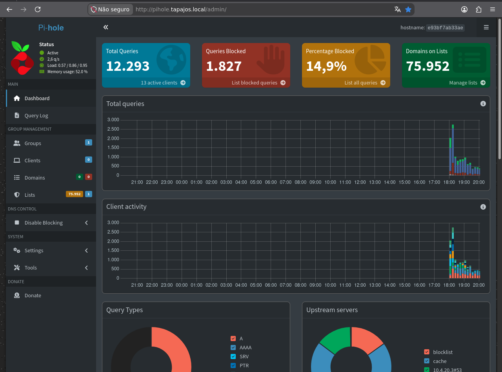
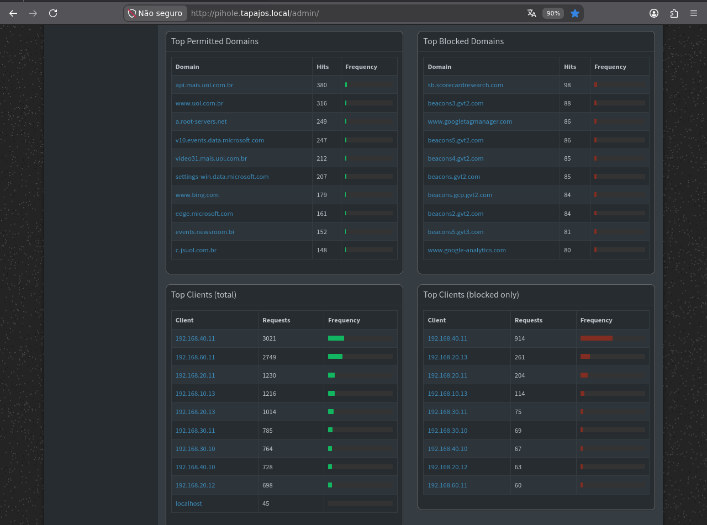
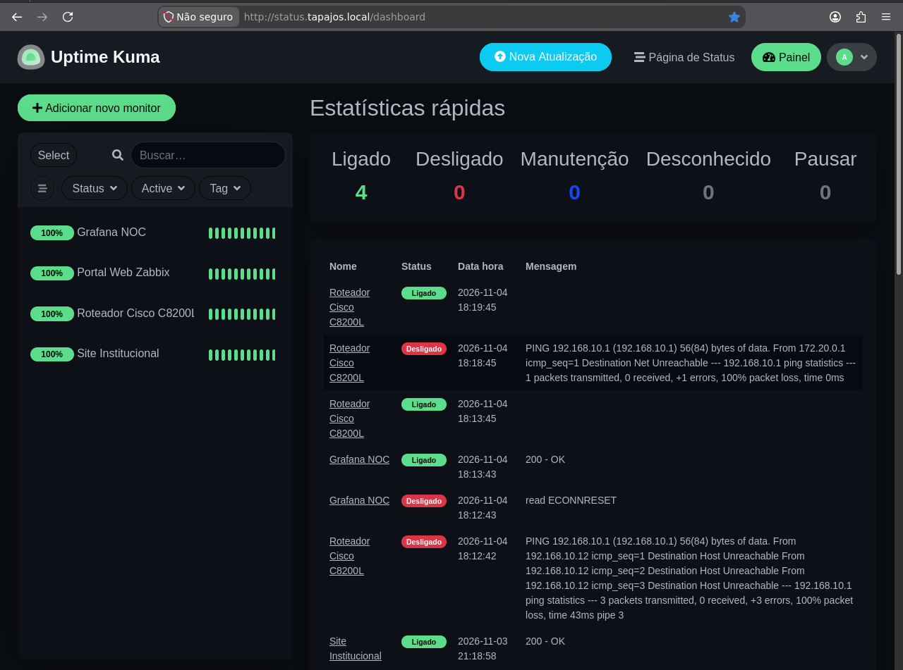

# Pi-hole e Uptime Kuma — DNS e Disponibilidade

[English](../../services/dns-and-availability.md) | **Português (Brasil)**

**Data das evidências:** 6 de novembro de 2026 · **Host:** servidor Docker Debian 13 principal, IPv4 observado `192.168.10.12/24`.

O Pi-hole filtra e registra consultas DNS; o Uptime Kuma verifica a disponibilidade de alvos selecionados. Eles complementam as métricas do Zabbix e as visualizações do Grafana.

| Serviço | Imagem do container registrada | Portas publicadas no host |
|---|---|---|
| Pi-hole (`pihole`) | `pihole/pihole:latest` | DNS TCP/UDP 53; web 8080 |
| Uptime Kuma (`uptime-kuma`) | `louislam/uptime-kuma:1` | Web 3001 |

As portas registram a configuração dos containers; não há comprovação independente de alcance a partir de todos os segmentos.

## Pi-hole — Filtragem DNS

| Indicador do dashboard | Valor registrado |
|---|---:|
| Consultas DNS | **12.293** |
| Consultas bloqueadas | **1.827** |
| Percentual bloqueado | **14,9%** |
| Domínios nas listas de bloqueio | **75.952** |
| Clientes ativos | **13** |
| Estado do serviço | **Ativo** |

A captura apresenta também evolução das consultas, tipos de requisições, DNS upstream e atividade dos clientes. Os valores pertencem ao intervalo exibido pelo dashboard, não a totais permanentes.

**Interpretação:** Uma consulta bloqueada correspondeu às regras configuradas; não prova infecção, ataque ou bloqueio de todas as conexões indesejadas. A quantidade de domínios nas listas não equivale ao número de consultas bloqueadas.

Quatro tabelas apresentam **domínios permitidos mais consultados**, **domínios bloqueados mais consultados**, **clientes por volume de consultas** e **clientes por consultas bloqueadas**. Há endereços IPv4 privados de mais de um segmento do laboratório; eles comprovam atividade DNS registrada, **não** a identidade dos equipamentos ou a aplicação de políticas DNS em todas as VLANs.

**Privacidade:** Endereços de clientes e histórico DNS são dados operacionais sensíveis; considerar a privacidade dos usuários antes de reutilizar as capturas publicamente.

## Uptime Kuma — Verificações de Serviços

| Estado do monitor | Quantidade registrada |
|---|---:|
| Up | **4** |
| Down | 0 |
| Manutenção | 0 |
| Desconhecido | 0 |
| Pausado | 0 |

| Monitor identificado | Alvo |
|---|---|
| Grafana NOC | Grafana |
| Portal Web Zabbix | Interface web Zabbix |
| Cisco C8200L Router | Roteador Cisco |
| Site Institucional | Portal corporativo |

A interface apresenta **100%** para os quatro monitores dentro do contexto configurado para o relatório. Isso **não** comprova SLA auditado ou disponibilidade ininterrupta.

A tabela histórica registra verificações HTTP `200 OK`, falhas anteriores de conectividade com o roteador Cisco, evento de conexão reiniciada do Grafana e verificações bem-sucedidas posteriores. Um monitor marcado `Up` na captura pode, portanto, possuir falhas anteriores.

Os quatro monitores selecionados não abrangem individualmente os dez containers nem todos os equipamentos.

## Referências das Configurações

- [Compose do Pi-hole](../../../docker_configs/lab-ti/pihole/docker-compose.yml): DNS `53/tcp` e `53/udp`, web `8080`, volumes `etc-pihole` e `etc-dnsmasq.d`, senha administrativa e upstream DNS fornecidos localmente.
- [Compose principal](../../../docker_configs/docker-compose.yml): Uptime Kuma `3001` e persistência em `./uptime-kuma-data:/app/data`.
- [Inventário Docker e proxy reverso](../containers/servicos-docker.md): distingue o inventário datado dos exemplos Compose e Nginx sanitizados.
- [Zabbix](../monitoramento/zabbix.md) / [Grafana](../monitoramento/grafana.md): métricas e visualizações mais amplas da infraestrutura.

Os Compose públicos omitem segredos e dados locais. Os dashboards comprovam **atividades DNS e estados dos monitores registrados**, não disponibilidade contínua, hardening, cumprimento de SLA ou cobertura DNS integral.

**Imagens originais:** `pihole_dashboard.png`, `pihole_dashboard_tops.png`, `UpTimeKuma.png` — coletadas em 6 de novembro de 2026.
