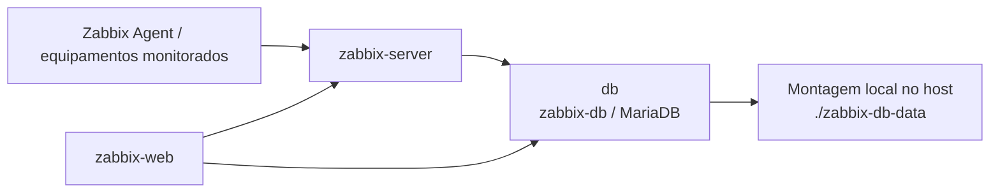

# MariaDB — Banco de Dados e Persistência do Zabbix

[English](../../../services/mariadb-zabbix/README.md) | **Português (Brasil)**  
[Documentação técnica](../../README.md) · [Infraestrutura Docker](../../containers/servicos-docker.md)

## 1. Por que o serviço é essencial

O MariaDB é a dependência de banco de dados do Zabbix Server e do Zabbix Web no laboratório. Sem um banco íntegro e acessível, o processamento do Zabbix e as funções da interface dependentes do banco podem falhar, mesmo que o container web ou outros dashboards permaneçam em execução.

O inventário de containers de 6 de novembro de 2026 inclui o `zabbix-db`. O [Compose publicado](../../../../docker_configs/docker-compose.yml) define o serviço `db`, container `zabbix-db` e imagem `mariadb:11.4`. Trata-se de um **registro de configuração**, não de um dump do banco, teste de recuperação ou comprovação de saúde atual.

## 2. Dependências e caminho dos dados



`zabbix-server` e `zabbix-web` utilizam `DB_SERVER_HOST: db`. `db` é o nome do serviço no Compose, presente na rede `zabbix-net`; `zabbix-db` é o nome do container apresentado pelo Docker. O Grafana visualiza dados selecionados do Zabbix, portanto falhas no banco podem afetar indiretamente as visualizações; o diagrama não afirma uma conexão direta Grafana–MariaDB em execução.

## 3. Inventário da configuração

| Parâmetro no Compose público | Valor documentado | Função |
| --- | --- | --- |
| Imagem | `mariadb:11.4` | Serviço de banco |
| Serviço no Compose | `db` | Nome usado na rede |
| Container | `zabbix-db` | Nome no inventário Docker |
| Nome do banco | `ZABBIX_DB_NAME`, padrão `zabbix` | Base de aplicação do Zabbix |
| Usuário de aplicação | `ZABBIX_DB_USER`, padrão `zabbix` | Conta de acesso ao banco |
| Variáveis de senha | `ZABBIX_DB_PASSWORD` e `MARIADB_ROOT_PASSWORD` | Segredos privados exigidos na inicialização |
| Caracteres / collation | `utf8mb4` / `utf8mb4_bin` | Configurações declaradas |
| Buffer pool InnoDB | `512M` | Memória configurada |
| Conexões máximas | `300` | Limite declarado |
| Persistência | `./zabbix-db-data:/var/lib/mysql` | Arquivos do banco no host |
| Rede | `zabbix-net` | Rede da aplicação |
| Porta publicada no host | **Nenhuma** | O exemplo não publica `3306:3306` |

As credenciais aparecem como valores demonstrativos no [`.env.example`](../../../../docker_configs/.env.example); **senhas reais não devem ser versionadas**. A ausência de porta publicada no host não comprova isolamento absoluto de outras redes ou containers.

## 4. Inicialização e health check

O banco define o comando `healthcheck.sh` com `--connect` e `--innodb_initialized`, intervalo de 5 segundos, timeout de 5 segundos, 30 tentativas e período inicial de 15 segundos. No Compose:

- `zabbix-server` aguarda `db` com `condition: service_healthy`.
- `zabbix-web` aguarda `db` saudável e `zabbix-server` **iniciado**.
- Zabbix Server e Zabbix Web recebem as credenciais do banco por interpolação das variáveis de ambiente.

Um health check positivo **não** comprova que o esquema Zabbix está correto, que todas as consultas funcionam, que todos os itens são coletados ou que os dashboards estão íntegros. A dependência configura a ordem de inicialização, não prontidão completa da aplicação.

## 5. Persistência, recuperação e segurança

O diretório `zabbix-db-data/` é montado do host e ignorado pelo Git. Ele pode preservar os arquivos em substituições normais do container **quando a montagem é mantida corretamente**, mas **persistência não equivale a backup**. O repositório não comprova uma política de backup, restauração testada, replicação, cluster de alta disponibilidade ou tempo de recuperação medido.

Uma estratégia futura de recuperação precisaria de backup consistente, retenção, armazenamento protegido, testes de restauração, monitoramento de espaço e procedimento compatível com as versões do MariaDB/Zabbix. Esses requisitos **não são descritos como implementações já realizadas**. Não apagar volumes nem recriar o banco como procedimento rotineiro de diagnóstico.

O acesso ao banco e aos segredos deve permanecer restrito a administradores autorizados e aplicações dependentes. Comandos de diagnóstico e logs também podem expor dados operacionais; nunca publicar dumps SQL, senhas ou informações pessoais da monitoração.

## 6. Diagnóstico não disruptivo

| Sintoma | Primeiras verificações | Evitar conclusão sem |
| --- | --- | --- |
| `db` unhealthy ou parado | Ciclo do container, logs, espaço e permissões | Erro real do health check e causa comprovada |
| Zabbix Web indisponível | Dependências `zabbix-web`, `zabbix-server` e `db` | Resposta funcional e conectividade ao banco |
| Ausência de métricas novas | Itens, logs, filas e estado do banco | Falha confirmada no MariaDB; agentes/SNMP são outra hipótese |
| Grafana `No data` | Fonte de dados, API/itens do Zabbix e intervalo | Evidência independente de falha do banco |
| Dados ausentes após recriação | Diretório de montagem, backup e registros de restauração | Confirmação de que os dados existiam e foram recuperados |

**Comandos somente de leitura para referência**, não executados nesta revisão:

```bash
docker ps --filter name=zabbix-db --format 'table {{.Names}}\t{{.Status}}\t{{.Ports}}'
docker inspect --format '{{.State.Status}} {{if .State.Health}}{{.State.Health.Status}}{{else}}no-healthcheck{{end}}' zabbix-db
docker logs --tail 80 zabbix-db
```

Executar somente no host autorizado. Revisar logs antes de compartilhá-los, pois podem conter informações sensíveis. A validação funcional exige testes de banco aprovados, com credenciais fora do repositório, e registro dos resultados reais.

## 7. Limites das evidências e referências

**Documentado:** inventário datado, imagem e parâmetros MariaDB, montagem persistente, variáveis privadas, health check e dependências do Zabbix no Compose.  
**Não comprovado:** consulta recente bem-sucedida, backup/restauração validado, durabilidade diante de falha física, HA, disponibilidade contínua ou causa específica das lacunas de monitoração.

Relacionados: [Zabbix](../../monitoramento/zabbix.md) · [Runbook Docker](../../operacoes-noc/runbooks/falhas-servicos-docker.md) · [Grafana](../../monitoramento/grafana.md).
