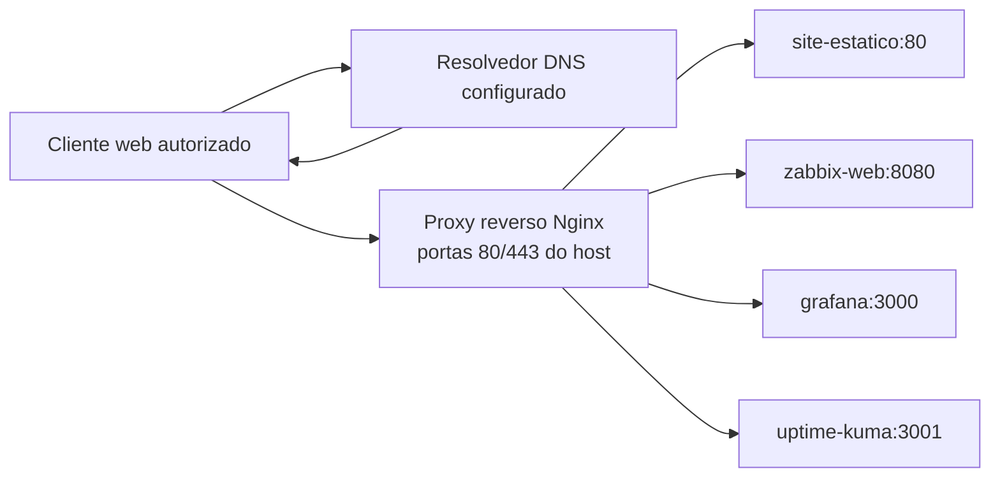

# Proxy Reverso Nginx — Arquitetura e Operação do Serviço

[English](../../../services/nginx-reverse-proxy/README.md) | **Português (Brasil)**  
[Documentação técnica](../../README.md) · [Infraestrutura Docker](../../containers/servicos-docker.md)

## 1. Papel na infraestrutura

O Nginx realiza o encaminhamento HTTP/HTTPS do laboratório Enterprise NOC. Recebe a requisição destinada a um host virtual configurado e a encaminha ao container correspondente na rede do Compose. A configuração publicada é uma **referência sanitizada**, não uma comprovação de que cada rota, nome DNS ou conexão TLS foi testado a partir de todas as VLANs.

O inventário Docker de 6 de novembro de 2026 registra o container `reverse-proxy`. O [Compose publicado](../../../../docker_configs/docker-compose.yml) declara a imagem `nginx:alpine`, as portas `80:80` e `443:443` e a rede bridge `zabbix-net`.

## 2. Caminho de uma requisição



O DNS fornece o endereço de destino antes da conexão HTTP; o Nginx utiliza o hostname requisitado para selecionar o host virtual. **Registro DNS não é regra de proxy**, e uma rota configurada não demonstra disponibilidade do backend nem acesso por todas as VLANs.

## 3. Hosts virtuais publicados

| Nome demonstrativo | Destino interno | Função |
| --- | --- | --- |
| `portal.noc.example.test` | `http://site-estatico:80` | Portal estático local |
| `zabbix.noc.example.test` | `http://zabbix-web:8080` | Interface web Zabbix |
| `grafana.noc.example.test` | `http://grafana:3000` | Dashboards Grafana |
| `status.noc.example.test` | `http://uptime-kuma:3001` | Uptime Kuma |

Os nomes `example.test` são **exemplos**, não registros DNS públicos. O arquivo não inclui hosts virtuais do Pi-hole ou Portainer, embora esses serviços apareçam no inventário do laboratório. O portal local em `site-estatico` é distinto do site público hospedado pelo GitHub Pages em `docs/`.

## 4. Arquivos de configuração e dependências

A configuração está dividida entre:

- [`nginx.conf`](../../../../docker_configs/reverse-proxy/nginx.conf): parâmetros HTTP e de execução, referências TLS, versões de protocolo permitidas, tratamento de upgrade e inclusão dos hosts virtuais.
- [`conf.d/lab.conf`](../../../../docker_configs/reverse-proxy/conf.d/lab.conf): portas, `server_name`, destinos `proxy_pass`, cabeçalhos encaminhados e ajustes específicos das aplicações.
- [`docker-compose.yml`](../../../../docker_configs/docker-compose.yml): imagem, portas expostas, montagens, rede e dependências de inicialização.

O Compose monta `nginx.conf`, `conf.d/` e `certs/` em modo somente leitura dentro do container. Os certificados locais em `docker_configs/reverse-proxy/certs/` não são versionados. Sem esses arquivos e certificados no host, um clone do exemplo público não constitui uma implantação completa. `depends_on` apenas ordena a inicialização; **não** comprova prontidão HTTP ou handshake TLS.

## 5. TLS, exposição e limites de segurança

- O `nginx.conf` referencia `/etc/nginx/certs/lab.crt` e `lab.key` e permite TLS 1.2/1.3. Emissor, cadeia de confiança, validade, correspondência de nome e sucesso de conexões TLS **não estão comprovados** pelos arquivos públicos.
- As portas HTTP 80 e HTTPS 443 estão configuradas. Os hosts virtuais publicados **não** incluem redirecionamento obrigatório HTTP → HTTPS; não é correto afirmar que há HTTPS forçado ou HSTS implementado.
- São encaminhados `Host`, `X-Real-IP`, `X-Forwarded-For` e `X-Forwarded-Proto`. Isso não comprova autenticação, filtragem, controle de acesso ou tratamento seguro desses cabeçalhos pelas aplicações.
- O Compose também publica diretamente as portas das aplicações no host (`8081`, `8082`, `3000` e `3001`). **Não está comprovado que o Nginx seja o único caminho de acesso.** Restrições adicionais dependeriam de evidências de firewall ou política de rede.
- As regras de encaminhamento não demonstram, por si, DNS interno operacional, alcance entre VLANs, certificados instalados ou saúde das aplicações.

## 6. Diagnóstico não disruptivo

| Sintoma | Dependência a distinguir | Evidência necessária |
| --- | --- | --- |
| Nome não resolve | DNS do cliente / resolvedor | Resposta DNS autorizada e destino esperado |
| Conexão ao host falha | Rota, firewall, listener | Rede de origem e resultado TCP |
| Erro TLS | Certificado, nome e confiança | Inspeção e teste real de handshake |
| Resposta `502` ou `504` | Nome, porta, container e rede do backend | Erro Nginx datado e estado do serviço |
| Página abre com falhas | Aplicação/banco/dependências | Teste funcional da aplicação |
| HTTP funciona e HTTPS falha | Caminho TLS | Verificações separadas por protocolo |

Comandos de **referência para o host autorizado**, não testes executados nesta revisão:

```bash
docker ps --filter name=reverse-proxy --format 'table {{.Names}}\t{{.Status}}\t{{.Ports}}'
docker exec reverse-proxy nginx -t
docker logs --tail 80 reverse-proxy
```

O `nginx -t` verifica sintaxe e condições de carregamento da configuração no container em execução, não o funcionamento de DNS ou da aplicação até o cliente final. Logs podem conter identificadores e dados de requisições: remover conteúdo sensível antes de publicar. Alterações, reinícios e substituição de certificados exigem autorização e plano de reversão.

## 7. Limites das evidências e referências

**Documentado:** inventário do container em 6 de novembro, Compose público, exemplo Nginx e destinos declarados.  
**Não comprovado:** acesso funcional de cada VLAN, validade TLS de produção, bloqueio das portas diretas, redirecionamento obrigatório para HTTPS ou disponibilidade contínua.

Relacionados: [DNS e disponibilidade](../../servicos/dns-e-disponibilidade.md) · [Runbook Docker](../../operacoes-noc/runbooks/falhas-servicos-docker.md) · [Documentação do site](../../site/README.md).
