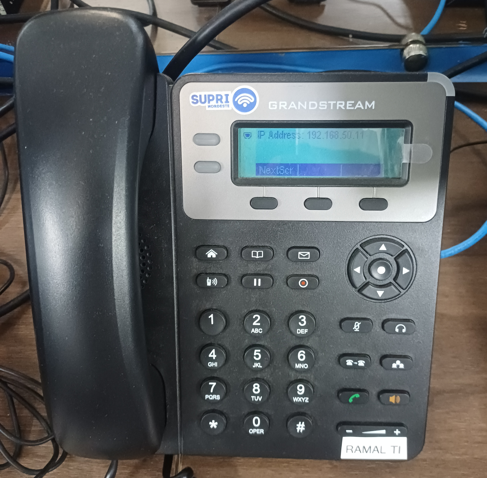
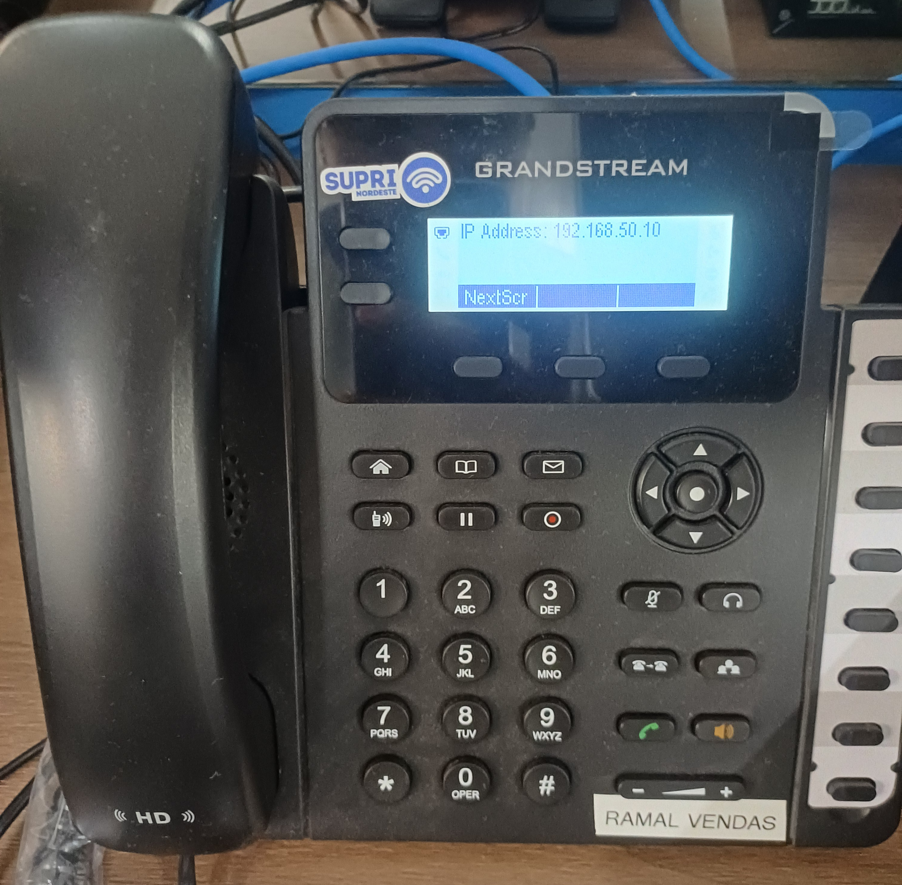
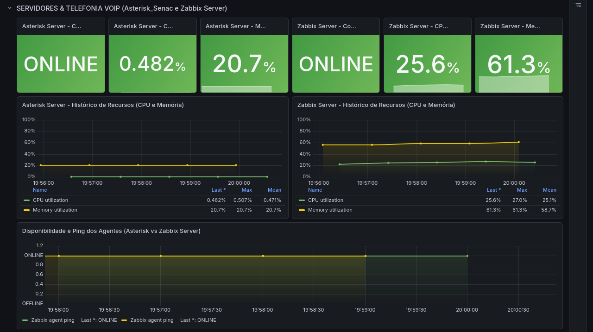

# Asterisk and FreeRADIUS — Voice and Authentication

**English** | [Português (Brasil)](../pt-BR/servicos/asterisk-freeradius.md)

**Sources:** Asterisk report (October 30, 2026), FreeRADIUS technical records, Linux/service inventory and telephone photographs (November 6, 2026).

A dedicated physical Linux computer in **VLAN 50** hosts Asterisk, FreeRADIUS, Zabbix Agent and OpenSSH. The recorded service statuses and device settings below are historical; neither VoIP calls nor wireless 802.1X transactions were independently validated end-to-end.

## Physical Server

| Item | Recorded configuration |
|---|---|
| Computer | Dell OptiPlex 3020 |
| Processor / memory | Intel Core i5-4590 / approximately 8 GB RAM |
| Operating system | Debian GNU/Linux forky/sid |
| Kernel | `7.2.12+deb14-amd64` |
| Network interface | `enp2s0` |
| IPv4 / gateway / VLAN | `192.168.50.2/24` / `192.168.50.1` / 50 |
| Root filesystem | ext4, approximately 211.21 GiB |

| systemd service | Function | November 6 recorded state |
|---|---|---|
| `asterisk` | IP telephony | `active (running)` |
| `freeradius` | Network authentication | `active (running)` |
| `zabbix-agent` | System monitoring | `active (running)` |
| OpenSSH | Remote administration | `active (running)` |

## Asterisk — SIP/PJSIP

**Documented version:** `22.10.1`. Asterisk uses PJSIP for SIP endpoint registration and call signaling; RTP carries audio. The configuration report also describes IAX2 and AMI services, without establishing their actual use.

| Protocol | Port(s) | Documented purpose |
|---|---|---|
| SIP / UDP | 5060 | Signaling and registration |
| RTP / UDP | 10000–20000 | Voice media |
| AMI / TCP | 5038 | Administration; documented as localhost-only |
| IAX2 / UDP | 4569 | IAX2 capability |

### Grandstream Endpoints

| Extension | Department | Phone IPv4 |
|---|---|---|
| **1001** | Sales | `192.168.50.10` |
| **1002** | IT | `192.168.50.11` |



The IT telephone photograph displays `192.168.50.11`, matching extension 1002 in the technical report.



The Sales photograph displays `192.168.50.10`, matching extension 1001. Exact Grandstream models are not established by the photographs; an earlier report described the two extensions as available, but successful calls between them were not separately evidenced.

### Internal Dialplan

**Configuration path:** `/etc/asterisk/extensions.conf`

| Extension | Documented application | Function |
|---|---|---|
| `1001` | `Dial(PJSIP/1001,30,tT)` | Sales, 30-second timeout, transfer flags |
| `1002` | `Dial(PJSIP/1002,30,tT)` | IT, 30-second timeout, transfer flags |
| `8888` | `Playback(hello-world)` | Audio playback test |
| `9999` | `Echo()` | Bidirectional audio/echo test |

The dialplan entries are documented configurations, not independently recorded successful test calls.

## FreeRADIUS — Network Authentication

**Documented version:** `3.2.10`. The reported configuration describes RADIUS, IEEE 802.1X, EAP-PEAP/MSCHAPv2 and WPA2/WPA3-Enterprise integration. The intended path is corporate wireless clients on **VLAN 60**, via the wireless access equipment and network routing, to FreeRADIUS at **`192.168.50.2`** on VLAN 50.

```text
Corporate Wi-Fi client (VLAN 60)
            |
    Wireless access device
            |
    RADIUS authentication
            |
 Network routing to VLAN 50
            |
    FreeRADIUS 192.168.50.2
```

The equipment-side RADIUS configuration and successful end-to-end authentication logs were not collected.

| Protocol | Port | Function |
|---|---|---|
| RADIUS / UDP | 1812 | Authentication |
| RADIUS / UDP | 1813 | Accounting |

**Configuration directory:** `/etc/freeradius/3.0/`.

| Component | Recorded role |
|---|---|
| `clients.conf` | Authorized RADIUS clients |
| `users` | Local user records |
| EAP configuration | Authentication methods |
| `freeradius.service` | systemd service control |

The original reports contain credentials and internal configuration values; these are not included here. **Client-side CA and server-identity validation are required for secure PEAP/MSCHAPv2 use**; disabling certificate checks would weaken authentication.

## Monitoring and Diagnostics

The service host is monitored via Zabbix Agent from the infrastructure server recorded at `192.168.10.12`. Grafana shows historical host CPU/RAM and availability, not successful calls or RADIUS transactions.



Read-only diagnostic commands for **future local checks** (no output is claimed):

```bash
systemctl status asterisk --no-pager
systemctl status freeradius --no-pager
systemctl status zabbix-agent --no-pager
```

```bash
asterisk -rx "pjsip show endpoints"
asterisk -rx "core show channels"
asterisk -rx "dialplan show interno"
```

```bash
sudo ss -tulnp
```

Review outputs for credentials and internal identities before publication. The recorded service states, photographs and monitoring evidence do not establish continuous availability, successful phone-to-phone calls or Wi-Fi authentication.

**Related:** [Server Inventory](../endpoints/workstation-inventory.md) · [Zabbix](../monitoring/zabbix-monitoring.md) · [Grafana](../monitoring/grafana-monitoring.md) · [Docker Services](../containers/docker-services.md).
