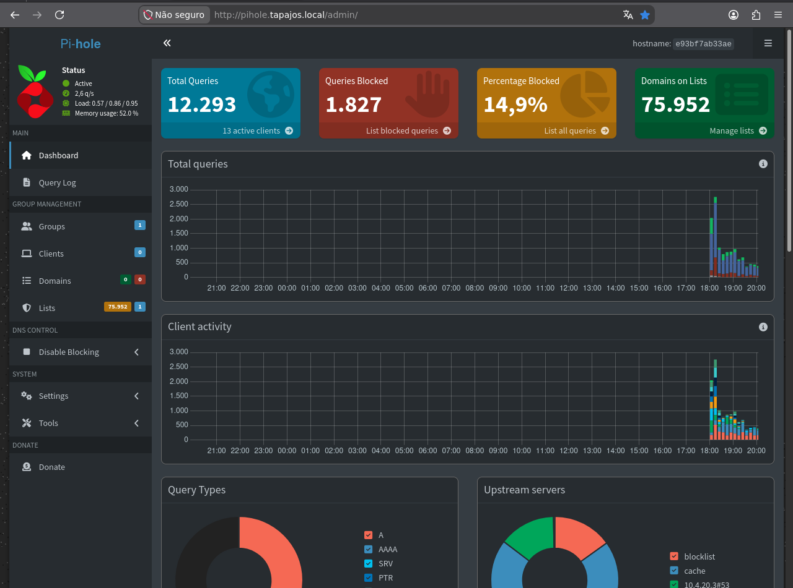
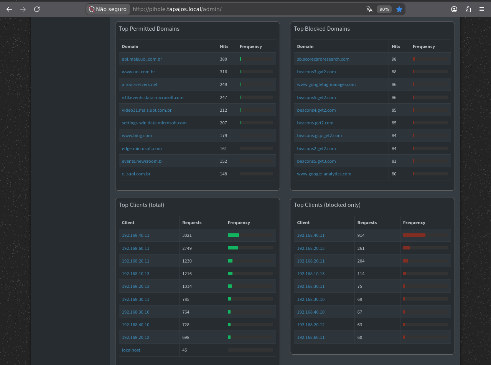
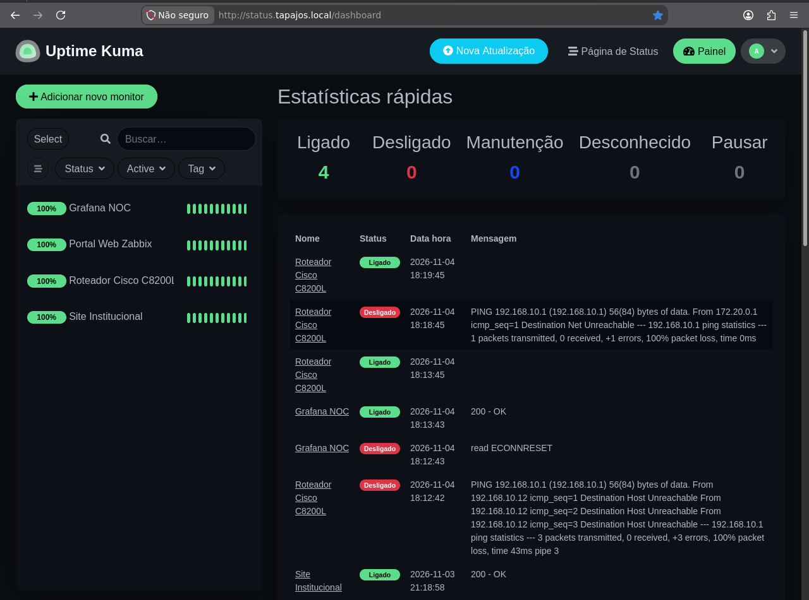

# DNS Filtering and Service Availability

[English](dns-and-availability.md) | [Português (Brasil)](../pt-BR/servicos/dns-e-disponibilidade.md)

## 1. Overview

The Enterprise NOC — From Scratch laboratory uses Pi-hole and Uptime Kuma to provide DNS filtering, network activity visibility, and service availability monitoring.

Both applications are deployed as Docker containers on the main infrastructure computer running Debian GNU/Linux 13.

The documented services have different responsibilities:

| Service | Main function |
|---|---|
| Pi-hole | DNS filtering, query statistics, and domain blocking |
| Uptime Kuma | Availability monitoring and event history |

This document uses screenshots collected on **November 6, 2026**.

All displayed statistics represent historical observations rather than live monitoring data.

## 2. Infrastructure Architecture

The main infrastructure server was identified with IPv4 address `192.168.10.12/24` during evidence collection.

The Docker environment includes:

| Container | Image | Documented access |
|---|---|---|
| `pihole` | `pihole/pihole:latest` | DNS on TCP/UDP 53; web interface on host port 8080 |
| `uptime-kuma` | `louislam/uptime-kuma:1` | Web interface on host port 3001 |

These applications complement the laboratory's Zabbix and Grafana monitoring environment.

The documented reverse proxy also provides internal web access to services.

Published ports and container presence do not independently establish successful access from every network segment.

For the complete Docker inventory, see [Docker Infrastructure and Services](../containers/docker-services.md).

## 3. Pi-hole — DNS Filtering

Pi-hole provides DNS-based domain filtering and visibility into DNS requests generated by clients using the service.

The laboratory uses Pi-hole as part of its network services infrastructure.

### 3.1 Dashboard Evidence

The collected dashboard displays the following statistics:

| Metric | Observed value |
|---|---:|
| Total DNS queries | 12,293 |
| Blocked DNS queries | 1,827 |
| Blocked percentage | 14.9% |
| Domains on blocklists | 75,952 |
| Active clients | 13 |
| Service status | Active |

The dashboard also presents:

- DNS query activity over time.
- Client activity.
- Query type distribution.
- Upstream DNS server information.
- DNS filtering statistics.

The displayed counters describe the period represented by the Pi-hole interface.

They should not be interpreted as permanent totals or long-term network performance measurements.

### 3.2 DNS Blocking Behavior

Pi-hole evaluates DNS queries against configured filtering rules and domain lists.

A blocked DNS query indicates that a request matched a blocking rule or another configured filtering condition.

Blocking statistics do not independently establish that a client was infected, that an attack occurred, or that all unwanted traffic was prevented.

Likewise, the number of domains on blocklists does not represent the number of domains actually blocked during the observation period.

### 3.3 Client and Domain Activity

The second screenshot presents four tables:

- Top permitted domains.
- Top blocked domains.
- Clients with the highest query counts.
- Clients with the highest blocked-query counts.

The information demonstrates that Pi-hole collected DNS activity from multiple clients during the observed period.

Several clients are identified using private IPv4 addresses from different departmental and wireless network segments.

These records provide supporting evidence for DNS activity across the laboratory.

However, an IPv4 address in the client list does not independently confirm the identity or hardware specifications of the device using that address.

**Privacy note:** This screenshot includes DNS query history and client addresses. Public sharing requires consideration of the privacy of network users.

## 4. Uptime Kuma — Service Availability

Uptime Kuma provides availability checks and event history for selected infrastructure components.

The collected screenshot shows monitoring of four services or network devices.

### 4.1 Monitoring Dashboard

The dashboard displays the following summary:

| Status | Monitor count |
|---|---:|
| Up | 4 |
| Down | 0 |
| Maintenance | 0 |
| Unknown | 0 |
| Paused | 0 |

The monitored targets shown in the screenshot are:

| Monitor | Component |
|---|---|
| Grafana NOC | Grafana monitoring application |
| Portal Web Zabbix | Zabbix web interface |
| Cisco C8200L Router | Network router |
| Institutional Website | Corporate web portal |

The sidebar displays `100%` indicators for the four monitors.

These values must be interpreted within the application's configured monitoring and reporting period.

They do not establish an audited service-level agreement or uninterrupted availability.

### 4.2 Historical Events

The screenshot also includes an event table with status changes recorded before the evidence collection date.

Examples include:

- Successful HTTP checks returning `200 OK`.
- Unsuccessful connectivity checks to the Cisco router.
- A recorded connection-reset event affecting Grafana.
- Subsequent monitoring records showing successful checks.

The historical entries demonstrate that Uptime Kuma records both successful and unsuccessful checks.

Consequently, the current `Up` status of a monitor must not be interpreted as proof that the service never experienced an interruption.

### 4.3 Monitoring Scope

The screenshot confirms that four monitors were configured and displayed.

It does not establish that all ten Docker containers or every laboratory network device were individually monitored by Uptime Kuma.

The application complements Zabbix rather than replacing the broader infrastructure monitoring documented elsewhere.

## 5. Relationship with Zabbix and Grafana

The laboratory uses several complementary monitoring and infrastructure applications:

| Application | Responsibility |
|---|---|
| Pi-hole | DNS filtering and DNS query activity |
| Uptime Kuma | Service and endpoint availability checks |
| Zabbix | Infrastructure metrics, monitoring items, and triggers |
| Grafana | Visualization of monitoring data |

The tools provide different perspectives on the same infrastructure.

A successful Uptime Kuma check does not independently guarantee that all corresponding Zabbix items are supported or that every Grafana panel contains valid data.

Related documentation:

- [Zabbix Monitoring](../monitoring/zabbix-monitoring.md)
- [Grafana Monitoring](../monitoring/grafana-monitoring.md)

## 6. Deployment Configuration

The sanitized Pi-hole Docker Compose configuration is available in the repository:

[Pi-hole Docker Compose](../../docker_configs/lab-ti/pihole/docker-compose.yml)

The Uptime Kuma container is described in the main Docker Compose configuration:

[Infrastructure Docker Compose](../../docker_configs/docker-compose.yml)

The public configurations exclude authentication secrets and institution-specific DNS settings.

These files document the deployment structure; the collected screenshots provide evidence of the applications running in the laboratory.

## 7. Historical Evidence Scope

| Evidence | What it demonstrates |
|---|---|
| `pihole_dashboard.png` | DNS query counts, blocking statistics, client activity, and active service status |
| `pihole_dashboard_tops.png` | Domain activity and client statistics |
| `UpTimeKuma.png` | Four configured monitors, current statuses, and historical events |
| Docker container inventory | Presence of Pi-hole and Uptime Kuma containers in the infrastructure |

The evidence does not independently establish:

- Continuous availability of either application.
- Complete DNS filtering coverage across every VLAN.
- Complete visibility into all client DNS traffic.
- A verified service-level agreement.
- Successful operation of every Docker application.
- An absence of historical incidents.

The screenshots represent the laboratory environment documented on November 6, 2026.

## 8. Related Documentation

- [Docker Infrastructure and Services](../containers/docker-services.md)
- [Zabbix Monitoring](../monitoring/zabbix-monitoring.md)
- [Grafana Monitoring](../monitoring/grafana-monitoring.md)
- [Workstation and Server Inventory](../endpoints/workstation-inventory.md)

**Evidence collection date:** November 6, 2026.

**Documentation scope:** DNS filtering, service monitoring, and historical laboratory evidence.
